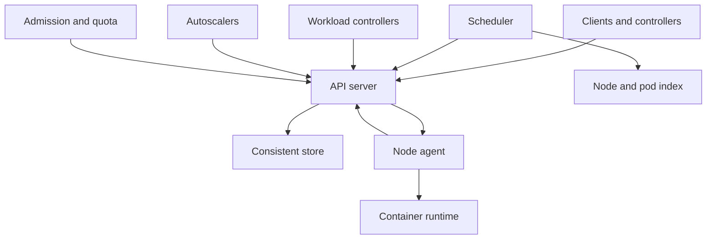

## Concept

A cluster scheduler places work onto machines under constraints, then keeps that placement honest when machines die. Borg is the production system Kubernetes took ideas from: a cell, jobs made of tasks, allocations, priorities, and a central store of desired and actual state. Kubernetes is the control-plane shape I would build for a new platform. An API server is the writer of desired state. Controllers reconcile. A scheduler writes a binding. A node agent is the only component that changes the machine’s local runtime. I would not start an internal platform by reimplementing Borg. I would take the cell as the failure domain, a strongly consistent store, a scheduler that is a controller, and a node agent that reports status back.

The unit of scheduling is a pod, or a Borg task: CPU, memory, local disk, devices, and constraints such as affinity, taints, and topology. The scheduler filters feasible nodes, scores the remainder, and binds one node by a conditional write. The node agent applies the bind. Scaling a workload and adding machines are other controllers. They are not hidden inside the match. Production and batch can share a cell if priority and preemption are real and rate-limited. If they are labels nobody enforces, the cell is shared only in the diagram, and the wrong work will be killed under load.

### Requirements

Users submit a workload, ask for replicas, roll it forward, and define probes. Requests and limits exist, and admission can refuse a pod that omits them. Priorities and preemption exist. Some agents must run on every node. Stateful identity is optional and explicit, with a stable name and a volume, not an accident of which machine was free. Draining a node is an API that respects disruption budgets. The scoring policy can pack or spread, and the choice is per workload. Administrators bootstrap a cell, join a node, set a quota, and attach admission checks. Batch queues when the cell is full. It does not retry in a tight loop against the API.

The control plane’s availability is the cell’s availability for new placement and for changes. Work that is already running keeps running through an API outage: the node agent continues, and it cannot place new work or reschedule. CPU and memory sold as guaranteed are not oversubscribed. Scheduling throughput of tens to a few hundred placements per second per cell is a realistic target for this API shape. Published placement rates from Borg describe a different implementation. I would not adopt them as our service level. One tenant does not consume the cell. Runtime isolation — control groups, and a stronger sandbox when the tenant is untrusted — is a node problem. The scheduler only places. It does not make a shared kernel safe.

Out of scope: a new container runtime, a cell that spans continents, and a two-level offer protocol. Also out of scope is putting the scheduler on the data path of application requests. A request uses the endpoints that placement already produced. It does not ask the scheduler where to go.

### Capacity sketch

Assumptions for one cell. About two thousand nodes, on the order of sixty thousand pods, a few hundred namespaces or tenants, and a peak where a meaningful fraction of pods churn in an hour because of deploys and batch. That is tens of bindings per second on average and spikes that can reach the low hundreds if a rollout or a failure empties a queue. If each object is a few kilobytes, the store is large enough that watch traffic and compaction will hurt before the raw bytes do. A scheduler that lists every node for every pod will not hold this size. It needs an indexed view of free resources and topology, updated from the watch, and it must tolerate the view being slightly stale by retrying a conflicting bind.

On the node, reserve a slice for the agent, the runtime, and the daemons that must win. The remainder is allocatable. Oversubscribe only the priority class you have named as best-effort, and say so. If the estate needs on the order of tens of thousands of nodes, add cells. Do not grow one store until the watch stream is the outage. A cell is a blast radius you chose. A higher-level placer sends work to cells. It does not replace the per-cell scheduler with a global lock, and it does not need a live view of every pod.

### API or control-plane shape

The API is Kubernetes-shaped. Clients create pods, usually by creating a workload object that a controller expands into pods. They read nodes and they read events as a debug aid, not as the state machine. The scheduler is the writer of a binding that names a node, and it uses the object’s resource version so two schedulers cannot both win. Eviction is an API object. Controllers for workloads, jobs, autoscaling, and node lifecycle watch and write desired state. They do not open a shell on the machine.

The node agent syncs the pods bound to it, reports allocatable resources and conditions, renews a lease, and talks to the runtime through a stable interface. Admission enforces quota, a baseline policy, and defaults. Filter, score, and bind are the scheduler’s steps. A conflict on bind retries with backoff. A pod that is unschedulable is marked with the reason and skipped for a while. It does not crash the scheduler. A Borg-like job of many tasks maps onto job and deployment objects. I would not add a second submission protocol unless a batch system truly cannot speak this API, and even then the second protocol would still write the same objects.

### Core data model

A cell has a region, a store quorum, and a version skew policy. A node has capacity, allocatable CPU, memory, disk, and devices, a system reservation, labels, taints, conditions, and a lease with a holder identity. A pod has a namespace, requests, limits, a priority, an optional node name, a phase, a resource version, and an owner. A binding records pod, node, which scheduler, and when. Quota is per namespace: CPU, memory, and object count, enforced on requests at admission. A priority class has a value and a preemption policy. A disruption budget has a minimum available count the eviction path must honor.

The machine’s real control groups and sandbox identifiers live on the node. The store holds desired state and the agent’s reported status. It is not a mirror of every process. Events such as “insufficient memory” exist for debugging and expire. Indexes the scheduler needs include pods that are not yet scheduled, pods by node, and nodes by zone and by free resources. Listing the world on every placement is how a cell of this size stops scheduling while the API still answers a single get. The scheduler’s cache is a performance structure. The resource version on the pod is the correctness structure.

## Trade-offs

| Approach | When it wins | Cost / risk |
| -------- | ------------ | ----------- |
| A cell, a central API, and reconcile loops | You can operate it and extend it with controllers | The API and its store are a hotspot |
| A Borg-style cell built for one homogeneous fleet | Very high placement rate inside that fleet | You will not reproduce that production system |
| Optimistic concurrency on the binding | More than one scheduler replica can try | Conflicts and retries when many pods want the same nodes |
| A pessimistic lock on cluster state | Easy to explain | A hard ceiling on placement rate |
| Two-level offers to frameworks | Frameworks that schedule their own tasks | Worse packing, and a protocol most teams no longer need |
| Production and batch in one cell with preemption | Utilization of idle guaranteed capacity | Batch dies; a bad priority evicts the wrong tier |
| A separate batch cluster | Strong isolation of latency-sensitive work | Production cores sit idle at night |
| One very large cell | Fewer control planes to run | Blast radius and store pain |
| Many smaller cells | Isolation, upgrades, and a recoverable store | Fragmented capacity and more operations |

I would mix production and batch only with enforced requests, disruption budgets, and rate-limited preemption. Cell size follows what the store can watch. At a few dozen nodes the stock scheduler is enough.

## Diagram

## Failure modes

### The store and the API saturate

Scope watches, keep large blobs out of pod objects, and cap cell size. The signal is API latency and store sync latency. A controller that lists the full collection on a timer will saturate the store.

### Pods that can never be placed

Surface the reason on the object and slow the retry. Quota accounts for requests. Skip a pod no new node would fix. The scheduler does not exit on one poison pod.

### Preemption that thrashes

A high-priority rollout evicts batch, batch is rescheduled onto the same nodes, and the cell spends its placement budget on churn. Disruption budgets protect the minimum production replicas. Preemption is rate-limited. Batch that cannot lose a machine mid-task checkpoints, or it does not run on preemptible capacity. Preemption buys utilization of idle guaranteed machines. It does not create guaranteed capacity you never bought. A priority number that every team sets to the maximum is the same as having no priority. Admission can cap how much of the top class a namespace may request.

### Two agents, one node name

The agent cannot reach the API and keeps running pods. A recreated machine, or a second process, registers the same name and starts a second copy of the workloads. Node leases and a stable instance identity fence this. Two heartbeats for one object is a split brain at the machine. A cloud instance recreated with the same name and a new disk is not the same node. The lease holder identity has to change when the instance changes, and the old holder must stop. Unique hostnames are not that fence.

### Requests that are missing

Production pods omit requests. The scheduler packs them as free. The node later runs out of memory and the agent kills something, often the wrong something. Admission requires requests in production namespaces. Limit ranges supply defaults where a default is safe, and reject a missing request where it is not. The scheduler cannot defend a lie about resources. Overcommit is a priority class you name. It is not what happens when a field is left empty. Best-effort pods are the ones you are willing to lose, and the monitoring of the node should show reclaimable usage separately from requests.

### An upgrade that mixes incompatible versions

Write down the supported skew between API, scheduler, and agent. Canary one cell, and enable a new plugin on a subset before it is the default. Practice rollback, including the store schema, before you need it.

## Real-world example

Borg is the original: cells, a node agent, jobs and tasks, allocations, priority, and a mix of production and batch on the same machines. The Omega work is why optimistic concurrency on shared cluster state shows up in this design. Kubernetes is the public control plane I would actually operate: a declarative API, reconcile loops, a consistent store, a scheduler that binds through that API, and a node agent. Nomad is another public scheduler with a different API. Mesos’s offer model is the two-level alternative I would not start with.

Copy from Borg the cell as a blast radius, real priority, honest requests, a node agent that owns the machine, and preemption you can explain. Copy from Kubernetes the API as the write path, controllers, a binding conditioned on resource version, and node leases. Leave a reimplementation of Borg, an unbounded cluster, and empty CPU requests behind. At small size, run the stock scheduler and enforce requests. Draw a cell boundary when the watch stream, not the core count, is what you are running out of.

## What to remember

- A cell bounds the blast radius. Watch load on the API store bounds how large that cell can be.
- The scheduler writes bindings, the node agent runs them, and controllers reconcile desired state with reported status.
- Honest requests, quotas, and priority are what make production and batch share a machine.
- A control-plane outage stops change. It must not kill work that is already running, which means the agent keeps going and the cell stays small enough to recover.
