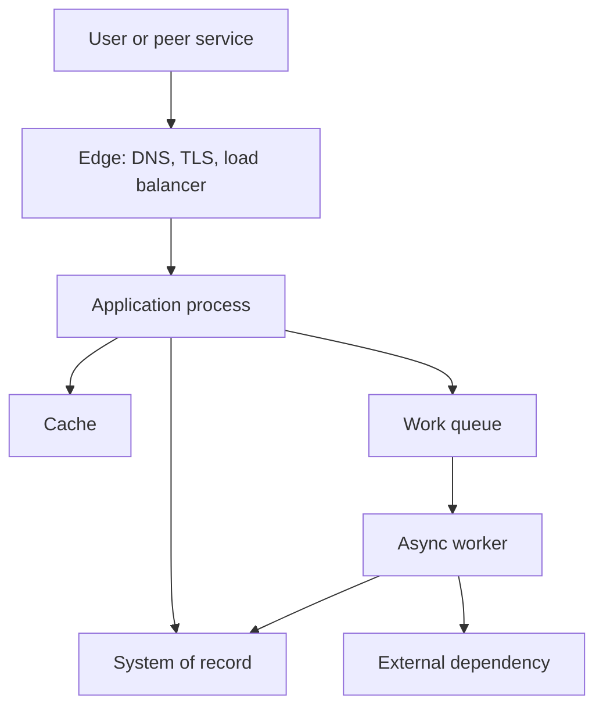

You already know how to make a function correct. System design is the work of making a product correct while many clients call it, data lives in more than one place, and parts of the stack are broken. It is the set of decisions that remain after the code compiles: who talks to whom, what is stored, what is allowed to fail, and what you will measure when it does.

A design is not a box diagram. A design is a set of constraints you chose on purpose. You pick an API because two teams must ship independently. You pick a queue because a payment provider is slower than a web request. You pick a single Postgres primary because the consistency model of your ledger does not survive a clever cache. Those choices have costs. System design is naming the costs before production names them for you.

Engineers who skip this work still design a system. They design it in incident reviews. The roadmap below is how you do the work on purpose: start from the job the product must do, write the numbers that would make the job fail, sketch the smallest topology that can hold those numbers, and only then split a process.

The skill is not memorizing every pattern. The skill is knowing which question to ask next, and when to stop asking and ship.

## Concept

### The object of design is behavior under load and failure

Functional behavior is the easy part to list: create an order, fetch a profile, stream a file. The design starts when you ask what happens if two of those run at once, if a replica is twelve seconds behind, if the client retries, if a region is dark. You are designing invariants (an order is paid at most once), interfaces (HTTP JSON, a consumer group, an object in S3), and budgets (p99 of 200 ms, 99.9 percent of minutes succeed, a dollar cost per million requests).

If you cannot say the invariant, the interface, and the budget, you do not yet have a design. You have a feature list. "A payment intent is charged at most once" is an invariant: it demands an idempotency key, a ledger, and a retry policy. "The payments service is scalable" is not; it tells you nothing you can test.

### Work the loop, not the catalog

A useful sequence, used in architecture reviews and in interviews, looks like this.

Write the functional requirements as verbs a user or another service performs. Then write non-functional requirements as numbers or as refusals: latency, availability, consistency, durability, cost, and the data residency rule legal gave you. Then list the constraints you did not choose: team size, an existing Postgres cluster, a cloud bill, a compliance boundary.

Sketch the request path for the hottest read and the hottest write. Name every hop that can add latency or lose a message. Estimate traffic, storage, and IOPS with round numbers you can defend. Where an estimate blows a budget, change the sketch: add a cache, split a write path, move a job off the request. Repeat until the sketch and the numbers agree, or until you have a list of bets you will measure in production.

Patterns enter as answers to a failed budget, not as decoration. A cache is the answer to a read that cannot hit the primary at the QPS you estimated. A queue is the answer to a dependency whose p99 is longer than your request budget. A replica is the answer to reads that may be stale. A shard is the answer to a working set that no longer fits. If you cannot point at the budget that failed, you are collecting technologies.

Keep the loop short. The retry, the timeout, and the data model decide whether users get charged twice. The logo of the queue does not.

### Building blocks you will actually place

Clients: browsers, mobile apps, other services, batch jobs. They retry. They are hostile to your assumption that a call happens once. Design the server as if every request is a duplicate until a key proves otherwise.

Edge: DNS, CDN, load balancer, API gateway. They terminate TLS, absorb some abuse, and hide instance deaths. They also concentrate failure. A bad gateway config is an outage with a single blast radius, even if every application replica is healthy.

Compute: one process or many. Stateless compute is easy to multiply. Stateful compute is a database whether you call it that or not. An in-memory session store on the application host is state. A local disk used as a queue is state. Name it, replicate it, or accept that this host cannot die.

Data: a system of record, caches, search indexes, object storage, logs. Each has a consistency story. The system of record is the one you will repair by hand at 3 a.m. Everything else is a derived view, or it is a second system of record you did not intend to create.

Async: queues and workers for work that should not sit on a user request. They also create a new class of bug: the user saw success, the worker has not run, and support cannot see the job. The design is incomplete until someone can find that job.

Control plane: deploys, config, secrets, autoscaling, certificates. If it is wrong, the data plane is wrong in every region at once. A flipped feature flag is a deploy.

You will not use all of these on day one. You will use a client, a process, a store, and a way to see errors. The rest is earned by a number that no longer fits.

### A roadmap by career, not by fashion

Early: ship a modular monolith with a clear module boundary, one relational database, structured logs, and an SLO even if the SLO is "we page if the site is down." Learn to read an explain plan and what your p99 actually is.

Next: put a cache in front of a hot read you measured. Put a queue behind a write that fans out. Add a replica for reads that can be stale. Learn the failure of each: cache stampede, poison message, replication lag that your UI treated as truth.

Later: split a service when a team, a scale, or a failure domain demands it. Learn that a distributed transaction is usually two local transactions and a story for the gap.

Throughout: write the diagram that is true in production. When the diagram and the traces disagree, the traces win.

### What good looks like in a review

A good review names the actor, the action, the data, and the failure. It has a back-of-the-envelope that would catch a 100x mistake. It says what is explicitly out of scope. It has one sequence for the write that can double-charge, not twelve boxes of every microservice you hope to staff.

A weak review is a catalog of technologies. Kafka without a consumer failure story is not a design. "We will use microservices" is a staffing plan pretending to be an architecture. Ask what the system of record is, what happens when a hop is slow or duplicated, and which number, if wrong by 10x, would force a rewrite this quarter. Those answers are the design.

## Trade-offs

| Approach | When it wins | Cost / risk |
| -------- | ------------ | ----------- |
| Single process, one database | Small team, one consistency model, unclear product | A noisy neighbor inside the process; a schema that becomes everyone |
| Modular monolith, then extract | Boundaries are still moving; you need transactions today | Discipline; a module boundary that nobody enforces is a ball of mud |
| Services from day one | Independent teams, independent scale, independent failure | Network cost, ops cost, distributed transactions you did not want |
| Design every future scale-out now | You already have the traffic and the SLO that require it | Overbuilt platform; months before a user exists |

Start as simple as the numbers allow. Complexity is a loan. Interest is paid in incidents and in hiring. The right time to distribute is when a measured constraint — team, blast radius, scale, or compliance — is already in the room. Until then, a clean module and a boring database beat a mesh you cannot staff.

## Diagram

## Failure modes

### Designing the wrong problem

**Detection.** The service meets its latency SLO and still fails the business: double charges, missing notifications, a report that disagrees with the ledger. Product asks for a feature the data model cannot represent without a rewrite. Incidents close as "working as designed." Traces look healthy while support tickets pile up around a single invariant nobody wrote down.

**Mitigation.** Start from the invariant and the user-visible failure, not from the box diagram. Write one happy-path write and one conflict — retry, double submit, stale read — before you pick a store. If the invariant needs a transaction, say so while the store is still a choice. Put the invariant in the review notes where a new engineer will find it, not in a slide that died with the kickoff.

### Non-functional requirements that never became numbers

**Detection.** Launch week is the first time anyone asks QPS. Database CPU is a cliff. A "fast enough" API is a two-second p99. Nobody can say whether 99.9 or 99.99 was the deal with the customer. Capacity reviews are adjectives: "plenty of headroom," "should be fine."

**Mitigation.** Put a number on latency, availability, and size in the same document as the features. A range is fine: ten thousand reads per second peak in year one, p99 under 300 ms. An SLO with an error budget beats an adjective. If you cannot measure it yet, write the proxy you will use until you can, and put a date on replacing it.

### Premature distribution

**Detection.** Five services and three queues serve fifty requests per minute. On-call is a graph of timeouts. A single product change needs four deploys and a distributed transaction. New engineers cannot find the write path. The platform team is the bottleneck for every feature.

**Mitigation.** Keep a modular monolith until a real constraint appears. When you split, split along a failure domain or a team boundary you already have, and make the first split the one that removes a measured pain, not the one that looks finished on a slide. Require a sequence diagram of the new remote call and an owner for the new queue before the extract ships.

### Estimates that never meet the machines

**Detection.** Disk fills on day four. Connection pools exhaust at a traffic level well below the "million users" slide. A cache with no TTL becomes the system of record. Load tests were never run against the hop that actually saturates. The first accurate capacity number arrives as an incident.

**Mitigation.** Run the envelope math: QPS, payload size, storage growth, IOPS, and the working set that must fit in RAM. Then load-test the hop you cannot afford to be wrong about. Replace the slide with the measurement as soon as you have one. Recalculate when the product changes the payload or the fan-out; yesterday's envelope is not a contract.

## Real-world example

Netflix is the public case most engineers have already heard, and the useful part is not "they use microservices." After a prolonged outage in 2008 caused by a database failure in their own data center, they moved streaming delivery onto AWS and spent years making every dependency fail without taking the product with it. The system design was explicit: stateless services, client libraries that time out and fall back, regional isolation, and later a chaos program that killed instances on purpose so the design was tested rather than hoped for.

The pieces you would put on a whiteboard are ordinary: clients, an edge, many services, caches, streaming data stores, and fallbacks when a dependency is dark. What made it a design, rather than a catalog, was the invariant they chose — a member should still watch something when a subsystem is unhealthy — and the operational practice that kept that invariant honest. Hystrix, Eureka, and Zuul were not the point. They were the mechanisms for timeouts, discovery, and edge routing after the team had already decided that failure was normal.

A company copying the service count without copying the invariant and the on-call will get the cost and miss the benefit. Name the failure you will accept, pick the smallest topology that holds it, and put the next unit of complexity behind a number you can measure.

## What to remember

- System design is the choice of interfaces, invariants, and budgets under load and failure, not a catalog of boxes.
- Work a loop: requirements, numbers, request path, estimate, then a pattern only when a budget fails.
- Start with a modular process and one system of record; distribute when a team, scale, or failure domain demands it.
- A review that cannot show a retry, a stale read, and a back-of-the-envelope is not done.
