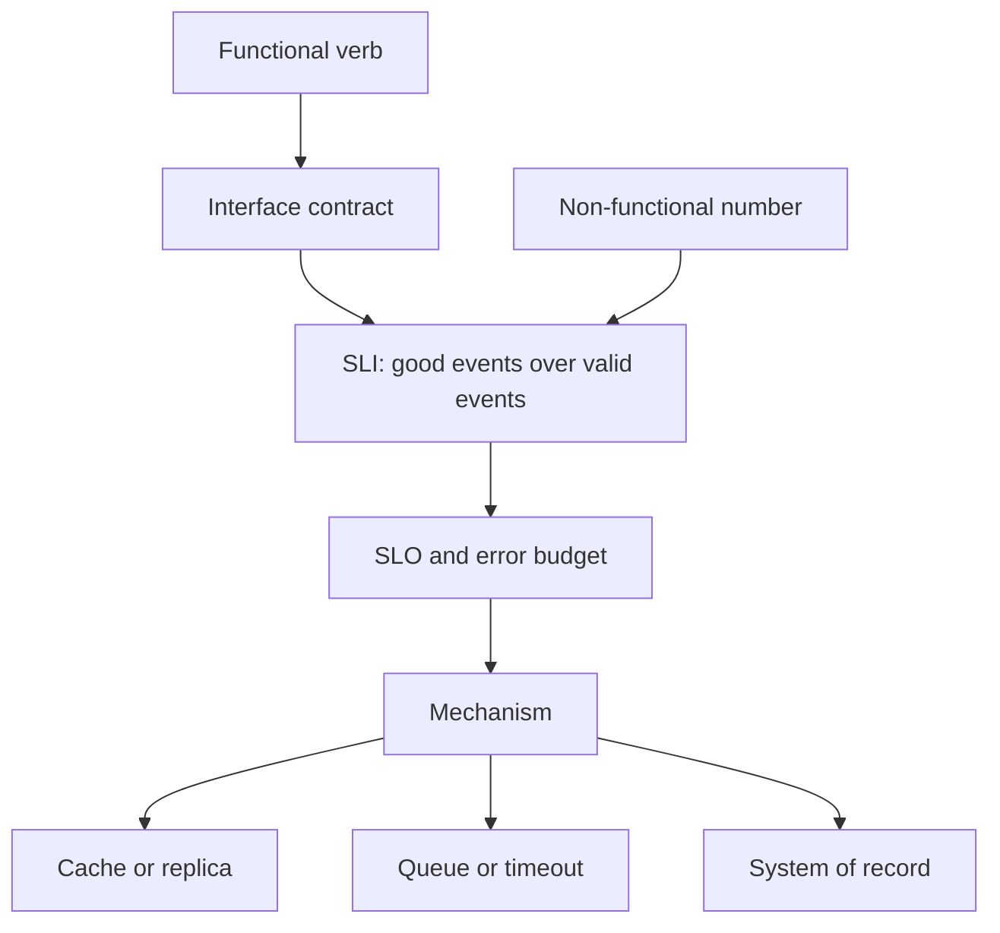

A feature list tells you what the product does. It does not tell you whether the product is allowed to be slow, empty, inconsistent, or expensive. Functional requirements are the verbs: place an order, reset a password, export a report. Non-functional requirements are the conditions under which those verbs still count as success: how fast, how often, how consistent, how private, how much they may cost.

Teams that only write the verbs ship a demo. Production then invents the rest. The database is too small. The p99 is two seconds. A retry double-charges. Legal asks where the data lives and nobody can answer. None of that is a surprise. It is an unwritten requirement showing up as an incident.

The split is a working tool, not a philosophy. You use it to force a number onto qualities people would rather leave as adjectives. "Secure" is not a requirement. "TLS 1.2 or newer at the edge, secrets in a manager, audit logs retained for one year" is a set of requirements you can test. "Fast" is not a requirement. "p99 under 200 ms at 5,000 reads per second" is.

Write both lists before you pick a store, a topology, or a cloud SKU. The lists will conflict. That conflict is the design. Resolving it in a review is cheaper than resolving it in a launch.

## Concept

### Functional requirements are observable behaviors

A functional requirement is something a user or a peer service can do, or something the system must refuse to do. Create a booking. Idempotently capture a payment. Reject an expired token. Emit an event when a shipment ships. You can demo it. You can write an acceptance test. You can point at a log line and say that requirement ran.

Scope them as contracts, not as UI copy. "The user sees a nice dashboard" is not a contract. "The dashboard shows the last 24 hours of bookings grouped by status, sourced from the bookings table, refreshed at least every minute" is a contract with a data source and a freshness bound. The freshness bound is already leaking into non-functional territory, which is correct: the two lists meet at the interface.

Refuse to treat implementation as a functional requirement. "Use Kafka" is not what the product does. "Downstream inventory is updated within 30 seconds of a paid order" is. Kafka might be how you meet the 30 seconds. A table poll might also meet it at your current scale. Keep the requirement on the behavior so the mechanism can change.

Conflicts among functional requirements are product decisions. Can a cancelled order still be shipped? Can two admins edit the same record? Those answers belong in the domain model. Architecture exists to preserve them, not to invent them.

### Non-functional requirements are constraints on those behaviors

Non-functional requirements (NFRs) constrain how the functional ones may be delivered. The common clusters:

Latency and throughput: how long a call may take, how many calls you must absorb. Write them as distributions, not averages. Users feel p99. Averages hide the tail that pages you.

Availability and durability: the fraction of time the behavior works, and whether acknowledged data survives a disk or a zone. These are different. A store can be up and still have lost the last five minutes of writes.

Consistency: which readers may see a write, and how stale a replica may be. This is the NFR most often left implicit, then rediscovered when a user reads their own profile and it is empty.

Security and privacy: authentication, authorization, encryption in transit and at rest, retention, residency. These constrain every other list. A latency SLO that requires a cache of personal data is also a privacy design.

Operability and cost: how you deploy, how you debug, how much you pay per million calls. Cost is an NFR. Ignoring it produces a correct system nobody will keep.

Changeability: how often you must ship, whether two teams can release independently, how painful a schema change is. Teams forget this until the monolith or the shared database becomes the product.

Write NFRs as testable statements with a condition. "The checkout POST has p99 under 300 ms at 200 writes per second, excluding the payment provider's time, measured at the load balancer." That sentence names the operation, the quantile, the load, the exclusion, and the measurement point. Without those, two teams will argue about a dashboard that was never the contract.

### They collide, and the collision is the work

Fast and consistent fight. Fresh reads from the primary cost primary capacity. Stale reads from a replica or a cache are cheaper and can lie. Available and consistent fight when a network partition appears: you choose which users see a failure and which users see a split. Cheap and durable fight: three replicas cost three disks; erasure coding saves space and spends rebuild bandwidth.

Functional scope fights every NFR. Every new verb is more code, more state, more ways to be slow. The honest review says which NFR you will relax for a new verb, or which verb you will refuse because the NFR cannot move.

Do not hide the collision behind "we will optimize later." Later is a traffic spike. Record the chosen loser. If checkout must be consistent and the catalog may be stale, write that down so a cache does not get copied onto the payment path by a well-meaning copy-paste.

### Turn NFRs into SLIs, SLOs, and error budgets

An SLI is the measurement: the ratio of good events to valid events. An SLO is the target for that ratio over a window. An error budget is the remainder. Google's SRE practice made this vocabulary ordinary; you do not need Google's scale to use it.

Map each critical NFR to an SLI. Availability of checkout is the fraction of POST /checkout calls that return a non-5xx within the latency budget, as seen from the edge. Durability is not that SLI. Durability is a restore test and a replication lag alert. Mixing them produces a green availability graph over a silent data-loss bug.

Product owns the SLO. Engineering owns the measurement and the mechanisms. If product wants 99.99 percent and the team is four people on a single primary, the review's job is to say the SLO is a second region and a paging roster you do not have. Either the SLO moves or the staffing and topology move. An unfunded SLO is a lie you will tell a customer.

## Trade-offs

| Approach | When it wins | Cost / risk |
| -------- | ------------ | ----------- |
| Functional list first, NFRs later | Early product discovery, weekly pivots | Launch discovers latency, scale, and residency as incidents |
| Quantitative NFRs in the same doc | You will operate this; customers or regulators will ask | Up-front measurement work; some numbers will be wrong |
| Qualitative adjectives only | A pitch deck | Two teams, two meanings of "fast" and "secure" |
| Gold-plated SLOs | A paid contract already names the nines | Cost and toil; a team that pages on noise and ignores real pages |

Write both lists at the resolution you can defend. A startup can say "p99 under 500 ms, single region, daily backups, we accept an hour of recovery." An enterprise contract can say "99.9 percent monthly, RPO of five minutes, RTO of one hour, data in eu-west-1." Both are honest. "Bank-grade" is not.

Revisit NFRs when the product or the traffic changes. A number that was conservative at one thousand users is reckless at one million, and a number copied from a hyperscaler's public SLO is a fantasy for a three-person on-call.

## Diagram

## Failure modes

### Unstated NFRs

**Detection.** The first load test is production. Disk fills. The primary CPU sits at a cliff during a campaign. A customer asks for a data-processing addendum and legal discovers you have no residency story. A mobile client times out while the server still thinks the request is in flight, then retries, and you double-fulfill.

**Mitigation.** Add an NFR section to every design review, even if the answers are modest. Latency quantile, availability target, consistency for the write, backup and restore, data class, and cost ceiling. If a field is unknown, write the unknown and a date to replace it. Unknown is a first-class state. Omitted is a land mine.

### Conflicting NFRs with no owner

**Detection.** Search is required to be both immediately consistent with writes and cheap enough to run on a replica with a 30-second lag. Security wants session tokens in a database; latency wants them in an unsigned cookie. Two dashboards disagree, and both are "the SLO." Teams optimize locally and the user gets the worst of both.

**Mitigation.** Name a single owner for each conflict. Product owns user-visible latency versus freshness. Security owns what may be cached. Write the winning NFR next to the losing one so a later reader does not "fix" the loser back into the path. When two SLOs cannot be true together, delete one.

### Measuring the wrong event

**Detection.** Availability looks excellent because health checks are cheap and frequent, while checkout is failing. Latency looks excellent because you measure inside the process after the queue wait. Durability looks excellent because backups run, and restore has never been attempted. A customer-facing SLO is green while revenue is not.

**Mitigation.** Measure the user-visible event at the place the user is. For an API, that is usually the edge, on the operations that matter, excluding probes. For durability, the SLI is a successful restore or a checksum, not a backup-job exit code. For freshness, measure replica lag against a write timestamp the product actually cares about. Graph the SLI next to the mechanism so a clever optimization cannot hide.

### Treating NFRs as a hardening phase

**Detection.** A project plan has a "scale and security" milestone after feature complete. Indexes, timeouts, authz, and load tests all land in the last week. The feature is then late, the NFR work is cut, and production inherits the demo's settings: unbounded queries, default timeouts, a single zone.

**Mitigation.** Put the hardest NFR on the critical path of the first increment. If checkout must be idempotent, the first vertical slice includes the idempotency key, not a slide that says "add later." If p99 must beat a dependency, the first slice includes a timeout and a fallback, not a hope that the dependency is fast. Hardening as a phase is how NFRs become optional.

## Real-world example

Amazon S3 publishes the split in the way a storage product must. The functional contract is small: PUT, GET, DELETE, list, and a handful of object and bucket operations. The non-functional contract is why anyone trusts it for a system of record. AWS documents eleven nines of durability for S3 Standard objects, and a monthly uptime SLA of 99.9 percent for that class; the published availability design target for Standard is four nines, which is a different number from the SLA credits. Those numbers are not slogans. They drive versioning, cross-AZ replication, checksums, and the bill you pay for copies you never see.

The same product shows the collision. Stronger availability and durability cost replicas and request overhead. Consistency was not an afterthought: after years of eventual consistency on overwrites and deletes, S3 moved to strong read-after-write consistency for those operations in 2020, a change AWS announced explicitly because applications had been designed around the old NFR. Teams that had treated "eventual" as a footnote had to re-read their own caches. Teams that had treated "durable" as "the disk on one box" learned why a local filesystem is not S3.

When you write requirements for an internal object store or a "just put it on NFS" design, copy the split, not the nines. Name the verbs. Name durability, availability, consistency, latency, and cost as separate lines. If you cannot fund S3's nines, write the nines you can fund and the failure you will accept. The failure mode of most internal stores is not a missing PUT API. It is an implied S3 contract on a single disk.

## What to remember

- Functional requirements are verbs you can demo; non-functional requirements are testable constraints on those verbs.
- Write NFRs as numbers with a measurement point, then map the critical ones to SLIs and SLOs.
- Conflicts among speed, consistency, availability, security, and cost are the design; record which one loses.
- Unstated or postponed NFRs return as incidents; put the hardest constraint on the first slice.
