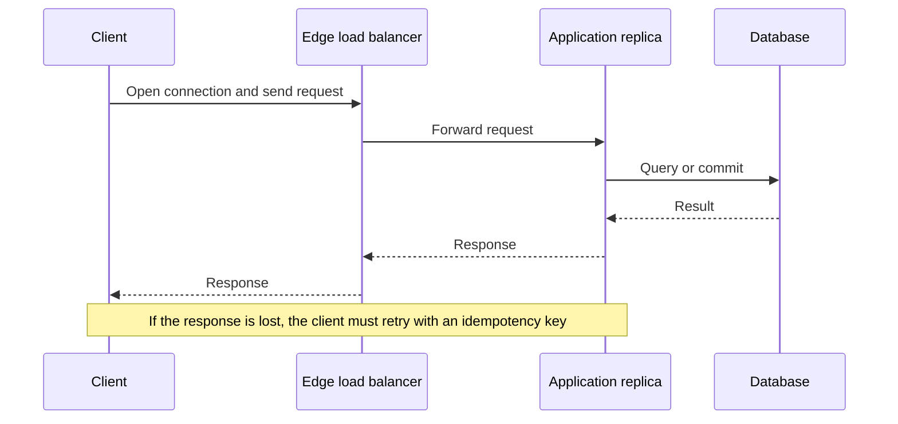

Almost every system you will operate is a client talking to a server. A browser is a client of nginx. nginx is a client of your application. Your application is a client of Postgres and of Redis and of a payment API. The pattern is recursive. If you only remember "the frontend and the backend," you will miss the place where the timeout actually lives.

Client-server is a role split, not a hardware split. The client initiates a request and waits for a response, or it opens a stream and consumes it. The server listens, accepts, does work, and replies. Either side can be a laptop, a phone, a container, or a mainframe. Either side can be written in the same language. The architecture is the contract: who may start a conversation, who holds the authoritative state, and what happens when the conversation dies halfway.

That contract is why this model beat peer-to-peer for most business software. One place owns the ledger. Many clients come and go. You can patch the server without patching every phone. You can enforce authz in one process instead of hoping every peer is honest. You also create a hotspot: the server is now a shared fate for every client.

Design the roles explicitly. A mobile app that caches writes and syncs later is still a client, but it has taken on a piece of server work. A database replica that clients read directly is a server, even if your diagram calls it "just a read pool." Names lie. The request path does not.

## Concept

### Roles, not boxes

The client has goals the server does not share: draw a UI, batch a user's taps, survive a flaky radio, retry. The server has goals the client must not be trusted with: authorize, serialize writes, enforce uniqueness, meter abuse. Mixing those goals is how you get a client that decides prices, or a server that waits on a human to tap OK.

Keep state ownership obvious. Session tokens, carts, and drafts may live on the client for latency. Money, inventory, and identity live on the server. If the client can spend the last unit of inventory by being optimistic, you did not have a server; you had a collection of peers with a shared UI.

The server is allowed to be many processes. Load balancers, application replicas, and databases are all servers to someone. Draw the roles per hop. At each hop ask: who initiates, who is authoritative, what is the timeout, what is retried, what is idempotent.

### The request is a conversation with failure in the middle

A typical synchronous call: the client opens a connection (or reuses one), sends a request, the server executes, the server writes a response, the client reads it. Failure can occur before the request is sent, after it is received but before work commits, after commit but before the response is written, or after the response is written but before the client reads it. Those four moments are not the same bug.

If the client never got a response, it does not know whether the server committed. The only safe client behavior is to retry with an idempotency key, or to query the server for the outcome. The only safe server behavior is to treat a duplicate key as the original request. Without that pair, a timeout becomes a double charge.

Timeouts belong on the client, and they must be shorter than the caller's remaining budget. A gateway with a 60-second timeout in front of an application with a 60-second timeout in front of a database with a 60-second lock wait is how you pile up work that nobody will see. Set the innermost timeout first, then leave slack for each hop to fail fast.

### Stateless servers, sticky exceptions

The textbook client-server web app keeps application servers stateless: any replica can handle any request, and state lives in a database or an external session store. That is how you add and remove replicas without draining user affinity. It is also why a crashed replica is not a data-loss event.

Sticky sessions exist when you put state in the application process: WebSocket fan-out, an in-memory cart, a leftover Java HttpSession. The load balancer then pins a client to a replica. You have reintroduced a server that cannot die. Use stickiness as a bridge, not as an architecture. If you need connection affinity for a protocol (a database connection, a gRPC stream), make that the exception and keep the rest of the fleet fungible.

Connection-oriented servers — Postgres, Redis, a game tick host — are still client-server. They are not stateless. Their clients are connection pools in your application. Pool size, idle timeout, and server `max_connections` are now part of the architecture. A burst of application replicas can knock over a database that was fine at yesterday's replica count. That is a client-server failure: too many clients.

### Protocols are the public surface

HTTP/1.1, HTTP/2, HTTP/3, gRPC, Postgres's wire protocol, Redis's RESP: the protocol is the API, including framing, auth, and how errors look. Do not treat it as plumbing. Head-of-line blocking on HTTP/1.1, concurrent streams on HTTP/2, and datagrams on QUIC change tail latency. A server that is "fine" on one protocol can collapse on another because you multiplied parallelism without multiplying backend concurrency.

Version the contract. Clients you do not control will live for years. Mobile apps in particular. Additive change (new fields, new endpoints) is the default. Breaking change needs a window, a flag, or a new hostname. The server is the long-lived process; it owes the clients a story for old code.

Push and streaming reverse the waiting, not the roles. A server that pushes market data is still the authority. The client still initiates the subscription. When the stream dies, the client reconnects and must resynchronize. Design the resume: a cursor, a sequence number, a snapshot plus catch-up. A firehose with no resume is a client that lies after every blip.

## Trade-offs

| Approach | When it wins | Cost / risk |
| -------- | ------------ | ----------- |
| Thin client, fat server | Shared invariants, many client types, central authz | Server becomes the bottleneck; offline UX is poor |
| Fat client, thin API | Rich interaction, some work can run without a round trip | Invariant leaks onto devices you cannot patch quickly |
| Synchronous request/response | The user must wait for the answer; simple failure story | Tail latency of every dependency sits on the request |
| Client-server plus async jobs | Work that must not block the click | The UI can claim success before the job exists |

Peer-to-peer still wins for some collaboration and for grids where there is no natural owner. For a business system of record, client-server is the default because authority has to live somewhere you can audit. The decision inside client-server is how thin the client is, and which hops are allowed to be synchronous.

If you are unsure, keep the client thin on money and identity, and let it be fat on presentation. That split survives a rewrite of the UI and a rewrite of the store, which is most of the rewrites you will actually do.

## Diagram

## Failure modes

### Lost response after commit

**Detection.** Users report duplicate charges, duplicate orders, or "it failed but it exists." Logs show a 200 or a commit on the server and a timeout or network error on the client. Idempotency keys are missing, or they are present but not unique per user intent. Support can find the row; the app cannot.

**Mitigation.** Make mutating endpoints idempotent. Require a client-generated key for payments, orders, and anything you cannot safely repeat. Store the key with the result and return the original result on a replay. Time out the client below the caller's budget, and teach the client to retry the same key rather than create a new intent. For reads, retries are cheap; for writes, retries without keys are data corruption.

### Server overload from well-behaved clients

**Detection.** Latency rises, then errors, then a cliff. Thread pools or connection pools are exhausted. CPU on the application is high, or more often the database is the cliff and the application is waiting. Client retries add a second wave. Autoscaling adds more clients of the database. The health check still passes because it does not touch the saturated resource.

**Mitigation.** Bound concurrency on the server: listen backlog, worker count, a load-shedder that returns 503 before queues grow without bound. Put timeouts and backoff on clients, with jitter, and stop retrying non-idempotent calls without keys. Protect the database from replica count: per-replica pool caps, a proxy that multiplexes, or a hard max. Health checks must exercise the dependency you actually fail on, or they must be paired with a saturation signal (queue depth, pool wait) that takes the replica out of rotation.

### Sticky state and unbalanced replicas

**Detection.** One replica runs hot while others are idle. A deploy that kills a replica drops a slice of users. Memory grows with session count. After a load-balancer change, a cohort of clients 404s on in-memory resources. WebSocket counts are uneven.

**Mitigation.** Move session and affinity state out of the process: a Redis session store, a sticky-free JWT, a broker for sockets. If a protocol requires affinity, drain that replica on deploy and size it for the worst shard of users, not the average. Watch per-replica in-flight and memory, not only fleet averages. Fleet averages hide the stuck node.

### Protocol and version skew

**Detection.** An old mobile build fails after a server change. A new client sends a header or a stream setting the old edge does not understand. HTTP/2 is enabled and a proxy in the middle only speaks HTTP/1.1 well, resetting connections. Postgres protocol options (prepared statements, pipelining) misbehave through a connection pooler that does not support them.

**Mitigation.** Contract-test the wire you actually traverse, including the edge. Add fields; do not reuse meanings. Pin a compatibility window for mobile. Feature-flag protocol upgrades at the edge and canary them. Treat poolers and gateways as part of the protocol, not as transparent pipes. If a pooler cannot handle your session features, you do not have those features in production.

## Real-world example

PostgreSQL is a pure client-server system, and it is the one hiding under most application diagrams. A client — `psql`, JDBC, `pgx`, Prisma — opens a TCP connection, authenticates, and speaks a documented message protocol. On the server, a process or a thread is assigned to that connection. The client sends queries. The server parses, plans, executes, and returns rows. The authoritative state is on the server's disks and in its shared buffers. The client may cache a result; that cache is not the database.

Production failures map to the roles. `max_connections` is a server-side cap on clients. An application fleet that scales from 10 to 100 replicas, each opening 20 connections, is 2,000 clients. The server will refuse or it will spend its memory on backends and not on cache. PgBouncer and similar poolers exist because the client-server contract at the database is expensive per connection; they multiplex many application clients onto fewer server connections. That pooler is a second server with its own timeouts and its own idea of a session.

SSL, authentication, and cancellation are part of the same contract. A client that abandons a query without cancelling it leaves work running on the server. A client that retries a `COMMIT` it did not see is the lost-response bug at the SQL layer. Application engineers who treat "the database" as a library miss this: every ORM is a client, and the server will enforce the limits you did not design. Size the clients you create. Set statement timeouts on the server so a missing client timeout cannot hold a lock forever. That is client-server architecture, not a Postgres trivia fact.

The same shape repeats at HTTP. nginx is the server to the browser and the client to your app. Your app is the server to nginx and the client to Postgres. Timeouts, pools, and idempotency have to be correct at each hop. Fixing only the outermost client leaves the inner conversation unbounded.

## What to remember

- Client and server are roles on each hop: who initiates, who is authoritative, what is retried.
- A lost response after commit is a duplicate unless the write is idempotent; design the key, not the hope.
- Stateless application replicas scale; state in the process creates sticky, fragile servers.
- Every dependency you call makes you a client: pools, timeouts, and protocol versions are part of the architecture.
