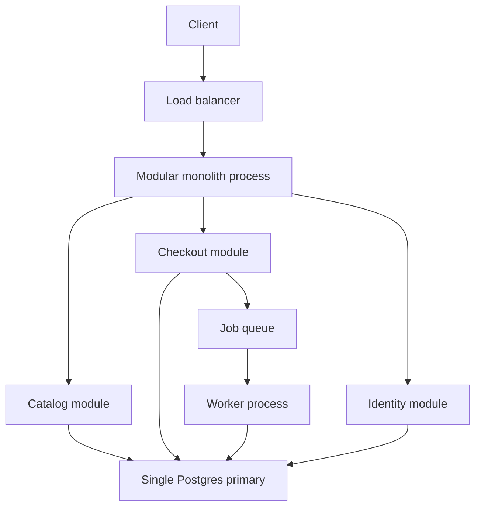

A monolith is one deployable unit that owns many features. One binary or one web process, one release train, one process space where a checkout call is a function call. That is not a failure of imagination. It is the default shape that fits a team that still shares a backlog, a data model that still needs transactions, and a traffic level that one datastore can hold.

The industry spent a decade treating this shape as a beginner mistake. Some companies needed services; they had independent teams, independent scale, and failure domains that had already bitten them. Many more copied the service count and inherited a distributed monolith: many repos, many deploys, one lockstep release, and a network where a function used to be. That is strictly worse than a single process with modules.

You choose a monolith when the cost of a remote call is higher than the cost of sharing a process. You leave it when a measured constraint — team, blast radius, scale, or compliance — is cheaper to solve with a network boundary than with discipline inside the codebase. Until that constraint is real, a well-factored monolith is the architecture that lets you ship.

## Concept

### One process, many modules

The useful monolith is modular. Checkout, catalog, identity, and billing are packages with APIs. They do not import each other's tables. They talk through function calls that you could later turn into HTTP without rewriting the domain. The database may still be one Postgres with schemas or naming conventions that mark ownership. The deploy is still one artifact.

This is not a Big Ball of Mud. The Ball of Mud is a monolith without module boundaries: any code reads any table, circular imports, a migration that scares every team. Services do not fix that. They export the tangle onto the network and add timeouts. If you cannot draw modules on a whiteboard and name an owner, you are not ready to extract a service. You are ready to draw the modules.

Language and framework support this shape well. A Rails app, a Django app, a Spring Boot app, a Next.js app with server routes, a Go binary with internal packages: all of these are ordinary monoliths. The runtime gives you transactions, in-process tracing, and a debugger that can step across features. Those are features. Treat them as such while you still have them.

### What you buy

Operational simplicity. One pipeline, one artifact, one set of dashboards, one on-call. A deploy is a deploy. You do not coordinate four repositories to change a field name. You do not debug a 200 ms gap that is actually four 50 ms hops and a serialization tax.

Transactional integrity. A checkout that writes an order, decrements inventory, and records a payment intent can be one ACID transaction on one primary. In a service split, that becomes a saga, an outbox, and a week of "what if inventory succeeds and payment fails." If your domain is a ledger, this property is worth more than independent deploys.

Local reasoning. A new engineer can clone one repo, run one compose file, and hit the real product. Tests can cover a user journey without standing up a mesh. Refactors that need a compiler — rename a type, change a function signature — still work across the product.

Cost at small and medium scale. You pay for one cluster of application replicas and one database. You do not pay for a platform team to keep twenty CI pipelines, service discovery, and a mesh green. For many products, that is the correct bill until well after product-market fit.

### What you pay

Coupling by default. A slow endpoint shares a process with a fast one. A memory leak in reporting takes down checkout. A dependency bump is everyone's problem. CPU and connection pools are a commons. Without isolation — worker pools, separate connection limits, aggressive timeouts on the bad path — a monolith has a single noisy-neighbor domain: itself.

Scaling as a unit. You scale the whole process even if only one feature is hot. That is wasteful when a tiny CPU-heavy job lives next to a large idle surface. It is also simple. Vertical scale and more replicas of the same binary go a long way. Horizontal split of the *process* is not required until a module has a different scaling curve and a team that can own the extract.

Release coupling. Everyone ships on the same train. A bad change in an obscure admin tool blocks a checkout fix, unless you have feature flags, modular deploys of the same binary, or the discipline to revert quickly. Flags and a fast revert are cheaper than a mesh for a long time.

Team contention. At some headcount, merge queues and ownership arguments dominate. That is a signal. The next architecture might still be a modular monolith with stricter package rules, or it might be an extract of the one module that is the fight. Extracting everything because stand-ups are loud is how you get twenty fights.

### Extraction is an operation on a working monolith

When you do split, you split a seam you already have. Identify the module, give it a data boundary (its tables, or an API over tables it still owns), put a network interface in front of the in-process API, and move the process. Keep the transaction on one side. If you cannot, you are not extracting a service; you are inventing a distributed transaction.

Do this when a module has a different SLO, a different scale, a different compliance boundary, or a team that ships on a different cadence. Do not do it because a conference talk used a different logo.

## Trade-offs

| Approach | When it wins | Cost / risk |
| -------- | ------------ | ----------- |
| Modular monolith | One team or a few teams, shared transactions, changing product | Process-level noisy neighbor; whole-binary scale |
| Distributed monolith | Never | Network cost with lockstep releases and shared database |
| Extracted services | Independent scale, team, or failure domain already proven | Ops, latency, and consistency you must now design |
| Modular monolith plus workers | Heavy or slow work that can leave the request path | Job semantics and a second way to fail |

The comparison that matters is not monolith versus "microservices" as a brand. It is in-process calls versus remote calls, one deploy versus many, one database versus many. You can have multiple processes that are still a monolith in spirit if they share a release and a schema. Be honest about which of the three you still share.

A modular monolith plus a job queue is often the entire architecture a product needs for years. The queue removes slow work from the request without pretending billing is now an independent company.

## Diagram

## Failure modes

### Ball of mud, blamed on "the monolith"

**Detection.** Any package reads any table. Circular dependencies. A migration requires a hallway meeting of every team. Tests are slow because they boot the universe. New features land wherever the files were open. Service extraction is proposed as the fix, and the first extracted service still joins across the old tables.

**Mitigation.** Draw module boundaries and enforce them. Package rules, code owners, separate schemas, lint that forbids imports across the wrong direction. Give each module an API and hide its tables. Do this while you still have a compiler. If you cannot keep a boundary in one repo, you will not keep a contract across a network.

### Noisy neighbor inside the process

**Detection.** A reporting query or a CSV export saturates CPU, memory, or the database pool. Checkout latency tracks that job. One replica OOMs. Thread pools fill with work that is not user-facing. Autoscaling adds replicas that all run the same export.

**Mitigation.** Isolate inside the binary before you isolate across the network. Separate worker processes for heavy jobs, dedicated database roles and pool caps per module, timeouts, and concurrency limits on the dangerous endpoints. Move the worst offender to a worker first. If a module still needs a different hardware profile after that, you have a real extract.

### Impossible deploys

**Detection.** Release trains slip because unrelated changes collide. Rollbacks are rare because the artifact mixes a fix and a half-done feature. Feature flags do not exist. The database migration is coupled to the binary in a way that cannot roll back. Teams start shadow-writing "temporary" services to escape the train.

**Mitigation.** Expand-contract migrations, feature flags, and a revert that is a first-class motion. Keep the train short. If one module blocks everyone weekly, assign ownership and flags, not a new repo. A new repo without a data boundary will still block on the migration.

### Extracting too early, or extracting the database last

**Detection.** Five services, one shared Postgres, cross-service joins, and distributed transactions implemented as "just call the other service in a request." Latency is worse. On-call is worse. The monolith was replaced by a networked ball of mud. Deploys are still lockstep because of the schema.

**Mitigation.** Extract data ownership with the process, or do not extract. Until then, keep the modular monolith and invest in the boundary. If you must split compute first, make the new process a worker against the same database with a table prefix it alone writes, and put a deadline on the schema split. A shared database is a monolith. Naming the processes does not change that.

## Real-world example

Shopify has been explicit, in engineering talks and posts over many years, that a large Rails monolith can be the right core. The storefront, admin, and checkout lived for a long time as one application — often discussed as a "majestic monolith" — because merchants need consistent commerce operations, and the team needed to ship in one product. They invested in modularity (components, stricter boundaries, tooling to stop circular dependencies) rather than in a fashion split.

They did not freeze the shape. Jobs moved to background workers. Some domains became services where scale or isolation demanded it. Storefront rendering and other high-traffic edges were split when the numbers said the one process was the wrong unit to scale. The point is the order of operations: a working monolith, then seams, then extracts that had an owner and a reason. The public story is not "never services." It is "do not start from services, and do not be ashamed of the binary that still makes money."

Stack Overflow's public architecture talks, especially from Nick Craver and the operations team, tell a smaller version of the same lesson. A high-traffic Q&A site ran for years on a compact Windows/.NET and SQL Server stack, scaled up with careful application and database work, caches, and a handful of servers, rather than a fleet of microservices. The constraints were a small team and a product that fit one mental model. When they added pieces, they added them as needed (Redis, Elasticsearch, a CDN), not as a service per feature.

If your team is closer to a commerce app or a Q&A app than to Netflix's streaming fleet, copy the honesty about the monolith, not someone else's service catalog. Measure the constraint that would make a network boundary cheaper than a module boundary. Until you can name it, keep the one process and make the modules real.

## What to remember

- A monolith is one deployable with many features; it wins while teams, transactions, and scale still fit one process.
- Modularity is mandatory; a ball of mud is not "the monolith," it is missing boundaries.
- Isolate noisy work with workers, pools, and flags before you pay for a mesh.
- Extract along a real seam — team, scale, failure domain, data ownership — not along a slide.
