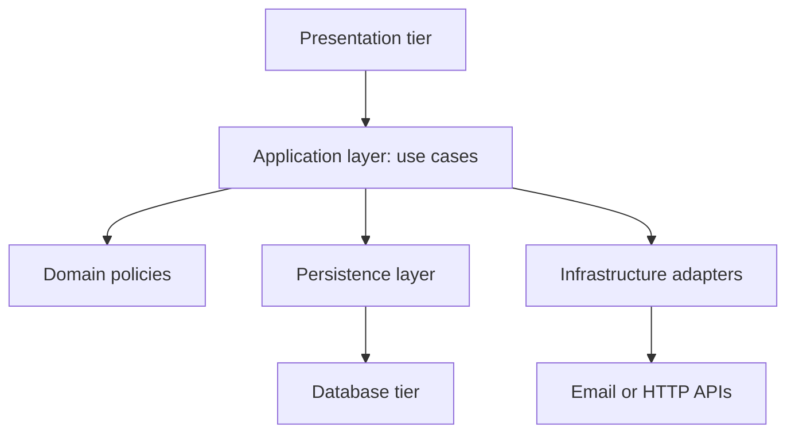

Layered architecture is the habit of slicing a system by technical role: presentation talks to an application layer, the application layer talks to a domain or business layer, that layer talks to persistence, and only persistence talks to the database. N-tier is the same idea with process or machine boundaries: a browser, a web farm, an application farm, a database. You have seen it in every tutorial that puts controllers above services above repositories.

The pattern exists to keep change local. A new screen should not rewrite SQL. A new index should not rewrite a form. A business rule should not live in a template and in a stored procedure in two slightly different forms. Dependencies point inward and downward. Upper layers may call lower ones. Lower layers do not call up, and they do not skip the layer that owns a rule.

Used with discipline, this is still the right default for a business application that is mostly request/response and CRUD with rules. Used as theater, it becomes a folder named `services` that is a pass-through to a folder named `repositories` that is a pass-through to an ORM. That is not a layer. That is an indent.

The questions that matter are where the transaction opens, where authorization is enforced, and whether a new adapter — a job, a mobile API, a CLI — can reuse the same rules without copying SQL.

## Concept

### Layers are dependency rules, tiers are process boundaries

A layer is a set of code that may depend only on the layers below it, or, in hexagonal variants, only on the inside of a port. A tier is a process or host that you can deploy, scale, and fail independently. You can have four layers in one process. You can have two layers split across four machines. Mixing the words is how a team "goes three-tier" by adding a REST call between two classes that still share a database and a release.

Classic three-tier:

Presentation: UI, HTTP adapters, input validation of shape (types, required fields). It does not decide whether this customer may have credit. It may call the application API and render the result.

Application or service layer: use cases. "Place order" is a method that loads what it needs, calls domain rules, and commits. It owns the transaction boundary for that use case.

Domain: entities, policies, calculations that would still be true if you swapped HTTP for a CLI. Credit limits, tax rules, state machines.

Persistence: mapping, queries, transactions as a mechanism. It does not know that a discount exists except as columns and tables.

Infrastructure, often mixed with persistence: email, files, clocks, other HTTP APIs. Domain code should not construct an HTTP client.

You can collapse domain and application in a small codebase. You cannot collapse presentation into persistence without teaching every screen about joins.

Physical n-tier maps those layers onto machines: browser, reverse proxy, application servers, database. Each hop is a client-server pair and needs a timeout. A "middle tier" that is only a REST wrapper around the same tables you query from the web tier is a hop you pay for without a boundary you can use.

### Why the arrows only go down

If persistence calls the application layer, you cannot replace the database without dragging rules with it. If presentation imports a table class, every UI change risks a schema change and every schema change risks a UI compile. If two layers own the same rule, they will diverge, and the incident will be a customer who got two prices.

The test is: can you swap the presentation (HTTP for gRPC, or a new web framework) without rewriting rules? Can you swap the store (Postgres for a different Postgres schema, or a queue plus a projection) without rewriting the policy? If not, the layers are labels.

Skipping is a related failure. A controller that runs a 200-line SQL query has skipped the application and domain layers. A stored procedure that implements pricing has pulled the domain into the database. Sometimes that is a deliberate performance move. Name it. The review question is: if we add a second client, will it reimplement this query and this rule.

### Where transactions, authn, and I/O belong

The application layer is the natural transaction boundary for a use case. Open the unit of work, run the policy, commit. Persistence implements the unit of work. Domain objects should not open connections. Presentation should not commit. A controller that calls three repositories and commits twice has no use case; it has a script, and the second client will not run that script.

Authentication happens at the edge of presentation: session, JWT, mTLS. Authorization is a domain or application concern: this actor may perform this use case on this resource. If you only check authz in the UI, a second adapter (a job, an API client) will skip it. If you only check it in a row-level database policy, your application still needs a story for errors and for caches. Duplicate the check at the lowest trustworthy layer you control, and do not pretend the UI is that layer.

I/O belongs at the edges. Domain code that calls SMTP will not be testable and will not survive a move to a queue. Inject a port: `Notifier`, `Clock`, `PaymentGateway`. The infrastructure layer implements it. You need a test that places an order without sending mail.

### Variants you will actually meet

Two-tier: a rich client talks to a database. Fast to start. Authz and rules leak into the client or into stored procedures. You will outgrow it when a second client appears.

Three-tier: the default web app. Browser, app, database. Split the app tier only when CPU, security zone, or a reporting workload gives you a reason.

Four-tier and n-tier: add a dedicated API, reporting, or integration process. Each extra tier is a hop. Add it when you have a DMZ, a read-only reporting workload, or a different access policy, not when you run out of folder names.

Layered, hexagonal, and clean architecture agree that policy sits in the middle and I/O sits outside. The operational test is the same. Dependencies point at policy. Policy does not point at frameworks. CQRS still has layers: a write use case and a read projector. An event handler that duplicates pricing is a second domain layer you did not draw.

## Trade-offs

| Approach | When it wins | Cost / risk |
| -------- | ------------ | ----------- |
| Layered monolith, one process | Business apps, one transaction model, small team | Layers rot into pass-throughs; process-level coupling remains |
| Physical 3-tier or n-tier | Security zones, independent scale of web versus app versus data | Extra hops, extra timeouts, extra failure modes |
| Two-tier client plus database | Internal tools, tiny scope, one client | Rules in the client; a second client forks the product |
| Hexagonal ports inside the app tier | You must swap adapters (UI, jobs, test fakes) | Ceremony; a port per trivial getter |

Add a tier when you have a reason that survives a latency budget: a DMZ, a different scaling curve, a different access policy. Add a layer when you have a reason that survives a code review: a rule that must not live in SQL and in a template. If you cannot name the reason, you are paying the cost of a diagram.

Pass-through layers are negative value. A `UserService` whose only method calls `userRepository.find` is an indent. Delete it or give it a rule. The metric is "would I test this without the database?" If no, it is not a domain layer.

## Diagram

## Failure modes

### Pass-through layers and skipped layers at the same time

**Detection.** Every controller has a matching service with one method that calls a repository. Real rules live in SQL, in the template, and in a spreadsheet the finance team emails. A "simple" field change requires edits in four folders. New engineers add a fifth service because the diagram said so. Tests mock the repository and never catch a pricing bug.

**Mitigation.** Collapse empty layers. Put the rule in one place, usually the domain or the application use case, and make the repository boring. Ban SQL in controllers except for an explicitly named reporting escape hatch. If a stored procedure owns a rule, document it as the domain, and do not reimplement it in Java. Count the places a discount can be computed; the number must be one.

### Transactions opened in the wrong layer

**Detection.** Lazy-loading blows up after the HTTP request has committed, or a controller calls three services and each commits, leaving a half-order when the third call fails. Jobs that reuse "the service" find no session. Connection pools show many short transactions for one user click. Support sees orders without payments and payments without orders.

**Mitigation.** One use case, one transaction, owned by the application layer. Load what you need inside that boundary. Do not return live ORM entities through presentation. For jobs, call the same use case, not the repositories. If a use case must call an external payment API, split "record intent" and "capture" so the local transaction does not stay open across the network.

### Authorization only in the UI

**Detection.** A hidden button is the only check. An API client, a report, or a GraphQL field bypasses it. Logs show successful writes from service accounts that should have been read-only. A second presentation tier (mobile) ships without the same guards. Pen tests find IDOR on the "internal" JSON API that the SPA uses.

**Mitigation.** Authorize in the application use case, with the actor and the resource as arguments. Presentation may hide buttons for UX. It may not be the only gate. Add tests that call the use case without HTTP. If the database has row-level security, treat it as defense in depth, not as the place the product rule lives, unless you are prepared to make SQL the domain.

### Extra tiers as latency and failure

**Detection.** A "service layer" process sits between the web tier and the database, adds 20 ms, and fails independently during deploys. Timeouts are copied at 30 seconds on every hop. Tracing shows the same use case serialized three times. The extra tier was justified as "scale" and is scaled 1:1 with the web tier, sharing the same database bottleneck.

**Mitigation.** Delete the hop or give it a job the web tier must not do: a different security zone, a different scaling curve, a protocol translation you cannot put in-process. Set timeouts that shrink toward the core. If the extra process shares the database and the release, it is not a tier. It is an RPC you can replace with a function call.

## Real-world example

A Spring Boot application at a bank or a retailer is the production shape most engineers will operate: HTTP controllers in a DMZ-facing web tier, a service and domain package, Spring Data repositories, and a relational primary, often Oracle or PostgreSQL, sometimes with a separate reporting replica. Microsoft's n-tier guidance for .NET looks the same: presentation, business, data, with an optional physical split for a DMZ. SAP GUI and application servers in front of a database are the idea at ERP scale: you do not let every client hold a database session with the rules inside the desktop.

The failure that shows up in postmortems is not "we used layers." It is a pricing rule in a stored procedure, a slightly different rule in a Java service, and a third copy in a nightly invoice job. Each folder was "clean." The product was not. An API gateway hop does not create that boundary. The boundary is the use case that computes the price, with a test, called from the web adapter and from the job.

A DMZ web farm that cannot reach the database except through an inner application network is a real security tier. A reporting warehouse that must not lock OLTP rows is a real data tier. Copy those reasons. Do not copy a four-project solution that maps folders onto four deployables that still share a schema and a Friday release. Keep layers in one process until a zone, a scale curve, or a team boundary is already in the building.

## What to remember

- Layers are dependency rules; tiers are process boundaries. Do not pay for a hop unless you need a zone, a scale curve, or a protocol split.
- Rules live in one place, usually the application or domain layer; empty service folders and SQL in controllers are the same failure with opposite labels.
- Open one transaction per use case in the application layer; do not commit in the controller or hold a session across an HTTP call to a vendor.
- Authorize in the use case, not only in the UI, so a second adapter cannot skip the gate.
