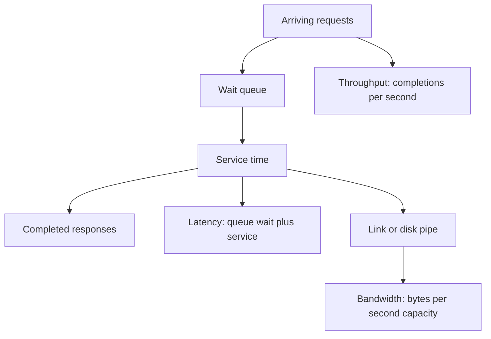

Latency is how long one unit of work takes. Throughput is how many units you finish per unit time. Bandwidth is how much raw capacity a link or a pipe has, usually in bits per second. Engineers mix them because they all feel like "speed." They are not interchangeable, and optimizing the wrong one makes the product feel slow while the graphs look busy.

A user waiting on checkout feels latency. A log pipeline that must keep up with 200,000 events per second feels throughput. A video segment download feels bandwidth until the first byte is late, at which point it is latency again. You can have a fat pipe and a terrible handshake. You can have a tiny payload and a terrible queueing delay. You can saturate throughput while each request is still fast, or you can have idle CPUs and a 3-second p99.

Little's Law ties the first two together in a stable system: average in-flight work equals arrival rate times average latency. If you raise throughput without changing latency, you are holding more work in the system. If you cannot hold it, latency rises and throughput falls. Bandwidth is the ceiling on one kind of work: moving bytes. It is not a ceiling on lock waits, disk fsyncs, or thread-pool queues.

Design with the unit the user or the SLO named. Then check that the other two will not surprise you.

## Concept

### Latency is a stopwatch on one request

Start the clock when the client sends (or when the user taps). Stop it when the client has the response it needs (or when the first byte arrives, if that is the SLO). The path is a sum of waits: DNS, TCP handshake, TLS, queueing, compute, disk, lock, downstream calls, serialization, the return path. The slowest mandatory step dominates. Parallelism helps only the steps you actually overlap.

Report distributions. Mean latency is a vanity metric. p50 tells you the typical user. p95 and p99 tell you the tail that becomes support tickets and the SLO. A system at 10 ms p50 and 2 s p99 is a system that is "fast" in a screenshot and unusable for a cohort. Tail latency comes from garbage collection, noisy neighbors, cold caches, retries, and coordinated omission in load tests that stop offering load when the system is slow.

Latency has a physical floor. Light in fiber is not instantaneous. A round trip between distant regions is tens of milliseconds before your code runs. A disk fsync, a consensus round, a TLS handshake on a new connection — these are real. You cannot cache your way out of a first-byte floor you already spent on the handshake. Keep connections warm, put the data closer, or accept the floor.

Synchronous chains add. Five sequential downstream calls at 20 ms each are 100 ms plus your own time, and the tail is worse than the sum of tails. Concurrent calls help when the work is independent. They do not help when each call needs the previous result. Draw the critical path. That path is the latency design.

### Throughput is a rate of completed work

Requests per second, records per second, bytes per second of useful payload. It is a fleet property. One replica's throughput times replica count, minus the coordination tax, is the system's throughput, until a shared bottleneck (a primary database, a lock, a NAT gateway) says otherwise.

Throughput rises with concurrency until a resource saturates: CPU, disk IOPS, a lock, a connection pool, a single-threaded event loop. After that, queues grow, latency rises, and throughput plateaus or drops. The plateau is the number you must know. Headroom is the gap between today's offered load and that plateau. Autoscaling without knowing the bottleneck scales the wrong tier.

Batching raises throughput and usually raises latency of the first item in the batch. A Kafka consumer that waits 10 ms to fill a batch, a disk that flushes 64 KB, a GPU that wants a full window: those are throughput optimizations. They are correct for pipelines. They are wrong for a user-facing call unless the batch wait is bounded inside the SLO.

Little's Law is the sanity check. N = λ × W. If you want 10,000 requests per second at 100 ms average latency, you are holding about 1,000 in-flight requests, including waits on downstreams. Thread pools, connection pools, and memory must absorb that. If they cannot, you never reach 10,000 RPS; you reach a smaller λ at a larger W.

### Bandwidth is capacity of a path, not a promise of either

A 10 Gb/s NIC, a 100 MB/s disk sequential number, an ISP plan: these are bandwidth. They tell you how fast bytes can move when the pipe is the limit. They do not tell you the RTT. They do not tell you how many IOPS a random read pattern will get. Sequential throughput on a disk can look like bandwidth. Random 4 KB reads are IOPS, which is a different budget.

On a network, useful throughput is less than link bandwidth. Headers, TLS records, retransmits, and flow control eat the rest. A chatty protocol with small messages on a high-bandwidth, high-latency link (a classic long fat network) will not fill the pipe without windowing and concurrency. TCP slow start on short connections never reaches the bandwidth you paid for. That is why a CDN and connection reuse change user-visible speed more than a bigger NIC on the origin, for small objects.

Do not size a service on "we have 10 Gb/s" if the work is JSON decoded on a single core. Compute and serialization become the limit long before the link. Do not size a video origin on CPU if the work is sending large sequential bytes; the link and disk sequential throughput dominate. Match the resource to the unit of work.

### How they fight, and how they help

Lowering latency of a single-threaded critical section can raise throughput, because each unit occupies the bottleneck for less time. Adding parallelism can raise throughput and raise tail latency if it causes queueing or cache fights. Raising bandwidth does nothing for a 40 ms RTT to another region.

Caches trade bandwidth and origin throughput for a latency win on hits, and a tail-latency loss on misses and stampedes. Replicas raise read throughput and can raise read latency if you wait for a quorum, or lower it if you read locally. Compression spends CPU (latency on small payloads, throughput on large ones) to save bandwidth.

Write the SLO in one unit, then budget the others. A p99 latency SLO implies a cap on queueing, which implies a cap on offered load, which is a throughput budget. A throughput SLO implies a concurrency budget via Little's Law, which is a memory and pool design. A bandwidth budget (egress cost, NIC, disk) implies payload size and compression policy.

## Trade-offs

| Approach | When it wins | Cost / risk |
| -------- | ------------ | ----------- |
| Optimize latency of the critical path | User-facing request/response, SLO on p99 | Lower concurrency; more hardware per request |
| Optimize throughput with batching | Pipelines, logs, analytics, bulk I/O | Higher wait for the first item; bursty downstreams |
| Buy more bandwidth | Large sequential transfers, video, backups | Does not fix RTT, locks, or single-thread limits |
| Raise concurrency | Idle resources, independent work | Queueing, tail latency, amplified retries |

Pick the objective the SLO named, then use the others as constraints. A checkout path that batches for throughput will miss a latency SLO. A log shipper that flushes every event for latency will miss a throughput SLO and a disk SLO. A "faster network" project that does not measure RTT versus payload size will buy the wrong circuit.

When both latency and throughput matter, split the paths. Interactive reads go through a cache and a tight timeout. Bulk export goes through a job with a large buffer.

## Diagram

## Failure modes

### Optimizing bandwidth while the user waits on RTT

**Detection.** Dashboards show idle NICs and "plenty of bandwidth." Users in a distant region have a multi-hundred-millisecond p99. New connections dominate. Small JSON payloads. Packet captures show handshakes and wait, not a full window. A project to upgrade the NIC or the instance network credit does not move the SLO.

**Mitigation.** Measure time-to-first-byte and the critical path, not only bytes per second. Reuse connections, terminate TLS close to the user (CDN, regional edge), collapse sequential chatty calls, and move the data closer. If the floor is cross-region RTT, either replicate the read path or tell product the number. A fatter pipe will not shrink the ocean.

### Throughput plateau blamed on "the app"

**Detection.** RPS stops rising in a load test while CPU on application replicas looks mid-range. Latency climbs. A database CPU, a single-threaded lock, a global rate limiter, or a connection pool is at 100 percent. Autoscaling adds app replicas and the plateau does not move. Sometimes it drops as more clients stampede the bottleneck.

**Mitigation.** Find the resource whose utilization tracks the plateau. Instrument pool wait, lock wait, disk IOPS, and downstream saturation, not only application CPU. Fix or scale that hop. Put a load shedder in front so latency degrades to 503 instead of to infinity. Recalculate Little's Law for the new bottleneck; your in-flight budget changes.

### Load tests that hide tail latency

**Detection.** A test reports a beautiful average at target RPS. Production p99 is several times worse. The test used a closed loop (wait for response before sending the next), so it naturally slowed the offer rate when the system was slow — coordinated omission. Or it ran from one region against a warm cache with no TLS handshake mix.

**Mitigation.** Use an open-loop offer rate, record latency from intended send time, and include a realistic mix of cache coldness, connection reuse, and payload sizes. Watch p99 and saturation, not only mean RPS. A load test that cannot reproduce the tail cannot sign off a latency SLO.

### Batching that breaks the interactive SLO

**Detection.** A shared library or a database driver batches writes. p50 is fine. p99 spikes at the batch interval. A "throughput improvement" ships and checkout latency follows the flush timer. Downstream systems see bursts that trip their own limits.

**Mitigation.** Separate interactive and bulk. Bound batch wait well inside the interactive SLO, or disable batching on that path. Size downstreams for the burst, or smooth it with a queue that has its own SLO. Never share a batch window between a user request and a pipeline without measuring the wait on the user path.

## Real-world example

Google's published "Numbers Every Programmer Should Know" — Jeff Dean's talk, later circulated and updated by others in the company — exists because latency and bandwidth are easy to get wrong by orders of magnitude. An L1 cache reference is about a nanosecond. A round trip inside a datacenter is orders of magnitude more. A round trip across an ocean is orders of magnitude more than that. Sequential disk and network bandwidth can look generous while a random read or a lock is the real budget. The point of the list is not the exact 2026 numbers, which move with hardware. The point is to budget a design against the right unit before you write the service.

You see the same split in how large products are built. YouTube and similar video CDNs provision bandwidth and cache hit ratio so that large sequential transfers fill pipes close to the viewer; the interactive SLO is time-to-first-frame, which is latency, not average megabits. Google Search, in public descriptions of its serving system, is obsessed with tail latency: a query fans out to many index shards and must wait for the slow ones unless it can cancel or hedge. Throughput of queries per second is a fleet-planning number. The user feels the tail of the fan-out.

When you design an API, steal that split. Write the p99 on the critical path in milliseconds, the capacity in requests per second, and the payload budget in bytes per second, as three lines. If a change improves one line by hurting another, say so. A compression flag that saves egress and adds 15 ms of CPU on a small JSON response is a bandwidth win and a latency loss. Ship it on the bulk path. Leave it off the checkout path until you measure.

## What to remember

- Latency is time for one unit; throughput is units per time; bandwidth is pipe capacity in bytes per second.
- Little's Law (in-flight = rate × latency) sizes pools and memory; ignore it and you stall before your RPS target.
- Optimize the unit in the SLO; batching, fatter NICs, and extra concurrency each help one number and can hurt the others.
- Measure p99 and the true bottleneck under an open-loop load; averages and idle NICs hide the failure.
