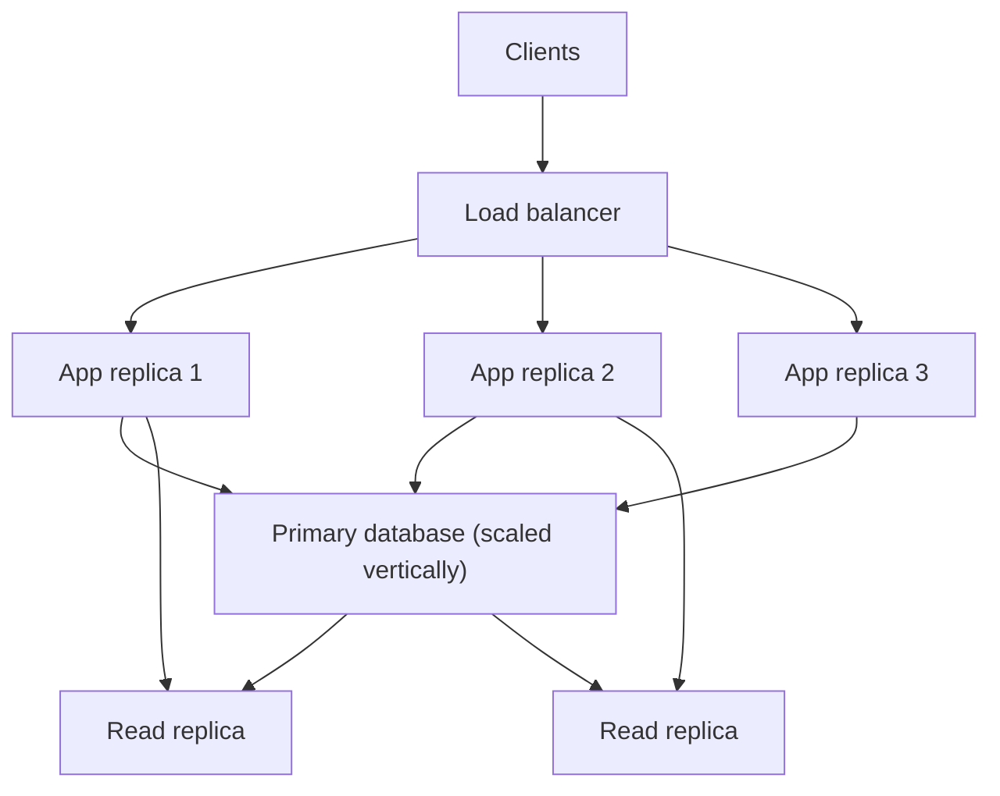

Vertical scaling means a bigger machine: more CPU, more RAM, faster disks, a larger SKU. Horizontal scaling means more machines: more replicas of the same role, and eventually more shards of the data. Both raise capacity. They fail in different ways, they cost in different curves, and they demand different application shapes.

A stateless web process scales horizontally with almost no plot. Put it behind a load balancer, add replicas, watch CPU. A database primary scales vertically until it does not: one writer, one lock manager, one buffer pool. Then you add replicas for reads, then you shard, then you live with the operational tax you deferred.

The wrong order is a religion. "We only scale out" produces a Kafka cluster for a workload that would fit in one Postgres with a larger box, plus a team to run the cluster. "We only scale up" produces a midnight emergency when the largest SKU is already on fire and the schema has no partition key. The right order is: make the thing healthy on one node, buy a bigger node while that is cheaper than splitting, and split when the next unit of vertical capacity is more expensive than the split — in money, in risk, or in time to recover a single node.

## Concept

### Vertical scaling is raising the ceiling of one unit

You change instance class, add RAM so the working set fits, move from network disks to faster ones, enable more CPU for a parallel query. The API of the system does not change. Clients still talk to one hostname. Transactions still work. Operationally you still have one primary to back up, one box to fail.

The curve is real and it bends. Cloud SKUs get expensive at the top end. Some limits are not for sale: a single-threaded bottleneck, a licensing model, a maximum volume size, a failover that takes as long as the host is large because memory has to warm. Recovery time grows with the box. A 10 TB working set that dies takes longer to restore or to replay than a 500 GB shard, even if the 10 TB box was "simpler" yesterday.

Vertical scaling is the correct first move when the bottleneck is resource starvation on a well-designed single node: CPU at 80 percent, RAM evicting the working set, disk latency from a cheap volume. It is the wrong first move when the bottleneck is a full table scan you can index, or a lock you can split in the application. Buy the index before you buy the SKU. Then buy the SKU.

Stateful systems like a relational primary, Redis as a single node, or a monolith with a large heap, love vertical scale. You are buying time and simplicity. Use the time to add observability and to decide whether the next year needs a replica or a shard. Do not use the time to ignore the growth graph.

### Horizontal scaling is adding units, then splitting state

Stateless compute: more application replicas. The load balancer spreads connections. Session state must not live in the process, or you need sticky sessions and you have not actually scaled. This is the easy direction. Almost every web tier should be able to do this on day one, even if you run one replica.

Read replicas: more copies of data for reads. Writes still meet at the primary. You buy read throughput and a reporting offload. You pay replication lag and a topology to fail over. This is horizontal scale of reads only.

Sharding: you split the keyspace so each node owns a subset of writes. You buy write throughput and smaller failure domains. You pay cross-shard joins, resharding, and a routing layer. This is the expensive kind of horizontal scale. Do it when a single primary, however large, cannot take the write rate or cannot fail in an acceptable window.

Pools of workers, partitions of a Kafka topic, cells of a service: all of these are horizontal patterns. They require an application that does not assume a single lock, a single clock, or a single transaction across the whole dataset. If your code does `SELECT ... FOR UPDATE` on a global row, you do not have a horizontally scalable write path. You have a primary with extra steps.

### What must be true before you scale out writes

Identity and uniqueness have to work without a global lock. Idempotency keys, per-tenant sequences, or Snowflake-style IDs replace `SERIAL` across the estate. Transactions have to fit in a shard, or you need a different protocol. Secondary indexes that are not prefixed by the shard key become scatter-gather. Operational jobs (schema change, backup, vacuum) have to run N times.

None of that is free. It is cheaper than an outage on the last SKU, when you need it. It is more expensive than the last SKU, when you do not.

Autoscaling is horizontal scale with a control loop. It only works if adding a replica actually adds capacity. Scaling application pods that all pound one primary will raise primary load and can reduce capacity. The control loop must watch the bottleneck, not only CPU of the tier it can cheaply clone.

### Hybrid is the normal production shape

Almost every serious system is mixed. The edge and the application tier are horizontal. The system of record is vertical as long as possible, then replicated, then sharded along a key you already know (tenant, user, date). Caches are horizontal and lossy. Object storage is horizontal and owned by someone else.

Your job is to know which tier you are talking about when someone says "scale it." Scaling "the app" is not scaling "the product" if the product is waiting on a writer.

## Trade-offs

| Approach | When it wins | Cost / risk |
| -------- | ------------ | ----------- |
| Vertical scale of one primary | Working set fits; transactions and joins stay simple | Hard ceiling; long restore; price at the top SKUs |
| Horizontal stateless replicas | CPU- or I/O-bound app tier; no in-process state | Multiplies pressure on shared stores if pools are unbounded |
| Read replicas | Read-heavy mix; lag is acceptable | Stale reads; failover complexity; write still one node |
| Sharded writes | Write rate or restore time has beaten the largest primary | Routing, resharding, cross-shard transactions |

Start vertical for state, horizontal for stateless compute. Add read replicas when the primary's CPU is read-dominated and the product can name an acceptable lag. Shard when writes or recovery time demand it, along a key that matches how you query. Mixing these without naming the bottleneck produces a cluster that is both expensive and small.

A useful numerical habit: compare the cost of the next larger SKU to the cost of the people and the software to shard. Include the on-call. Include the first reshard. If the SKU is cheaper and recovery is still acceptable, buy the SKU. Revisit every time the working set doubles.

## Diagram

## Failure modes

### Scaling the wrong tier

**Detection.** Application CPU is low. You add app replicas anyway, because that is what the autoscaler sees. Database connections and CPU climb. Latency gets worse. In the vertical case, you enlarge the app SKU while the wait is 90 percent database. Dashboards that only graph the compute tier stay green until they are not.

**Mitigation.** Graph saturation per resource: CPU, memory, disk latency, pool wait, lock wait, replication lag. Point the scaler at the bottleneck or turn it off until the bottleneck is cloneable. Cap pool sizes so replica count cannot linearly destroy the primary. When the wait is in the database, the next move is an index, a cache, a replica, or a larger primary, not another dozen stateless pods.

### Vertical scale that hides a query or a leak

**Detection.** Each incident is solved with a larger box. The explain plan is still a sequential scan. Memory grows with uptime. The new SKU is fine for six weeks, then you are back. There is no working-set budget, only a credit-card budget.

**Mitigation.** Treat a SKU change as buying time. In the same change window, capture the top queries, the allocation profile, and a restore-time test. Set an alert on the ratio of working set to RAM, and on sequential scans of large tables. If the next SKU is the last SKU, start the shard or archive design while you are still comfortable, not on the last day.

### Horizontal scale without draining state

**Detection.** Sticky sessions pin load to a few replicas. A new replica takes no traffic. A crashed replica loses in-memory carts or WebSocket users. Deploys are scary because state lives in the process. "We scaled out" on a wiki, and one node still does 70 percent of the work.

**Mitigation.** Externalize session and affinity. Confirm the load balancer's algorithm with per-replica QPS. Drain on deploy. If a protocol needs affinity, treat those nodes as a stateful set with their own ceiling, not as evidence that the fleet is horizontally scaled.

### Premature sharding

**Detection.** Ten shards, little data, cross-shard queries for every feature. Uniqueness is eventually consistent by accident. Resharding has never been rehearsed and the key was chosen badly (a hot tenant on one shard). The team spends its time on the platform and not on the product. A single larger primary would have held years of growth.

**Mitigation.** Exhaust vertical scale and read replicas for the write-light case. Pick a shard key from a real access pattern, prove a unique-id story, and rehearse a reshard on a copy before production needs it. If you cannot name the QPS or the restore-time that a single primary will miss, you are sharding a preference, not a constraint.

## Real-world example

Stack Overflow published detailed hardware and architecture notes for years, largely through Nick Craver's blog and conference talks. The public picture was a high-traffic Q&A site running on a small number of large, well-tuned Windows servers, SQL Server with a lot of RAM, Redis, and a CDN — vertical scale and careful application work, not a microservice farm. They scaled the web tier with more than one application server, which is ordinary horizontal scale of stateless compute, and they scaled the database by making the working set fit in memory and by buying the hardware that made that possible. The lesson is not "never shard." It is that a product with a compact data model and a small team can ride vertical scale and a few replicas much farther than Twitter-era folklore suggested.

At the other end, once a write path no longer fits one primary, companies shard. Shopify has discussed sharding MySQL by shop (merchant) so that one noisy merchant cannot consume a global primary, and so that the blast radius of a database failure is a slice of shops rather than the whole fleet. That is horizontal scale of state along a key the product already had. They did not start there. They started with a Rails monolith and a database they could reason about, then split when the constraint was real.

Your decision process should look like theirs, not like a copy of their current topology. Measure the bottleneck. Fit the working set. Scale the stateless tier out. Scale the primary up. Replica the reads. Shard the writes when the next vertical step is the worse risk. Write that sequence in the runbook so a busy week does not skip to the fashionable step.

## What to remember

- Vertical scale raises one unit's ceiling; horizontal scale adds units and, for writes, splits state.
- Scale stateless compute out early; keep a single primary until writes or restore time force a split.
- Autoscaling a tier that is not the bottleneck increases load on the real bottleneck.
- Shard along a key you already query, after vertical scale and replicas have earned their keep.
