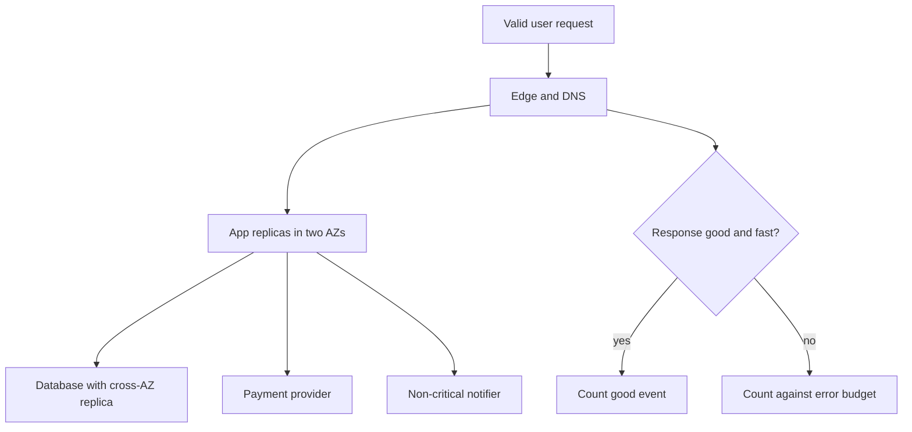

Availability is the fraction of time a service does useful work for a valid request. The "nines" are a shorthand for that fraction: 99.9 percent is three nines, 99.99 percent is four. People quote them in meetings as if they were a personality trait of the architecture. They are a budget of allowed failure, usually over a month or a year, and they only mean something if you define the event you are counting.

Three nines is about 8.8 hours of unavailability per year, or about 43 minutes per month. Four nines is about 52 minutes per year, or about 4.3 minutes per month. Five nines is about 5 minutes per year. Those numbers assume you count every minute. If you exclude planned maintenance, your "three nines" is a different product from a competitor who includes it. If you count a degraded checkout as up because a health check passed, you are lying in a precise way.

The nines are not free. Each extra nine is usually an order-of-magnitude jump in engineering and in spend: another zone, another replica, a tighter deploy, a paging roster that never drops a weekend. You buy them against a customer contract, a revenue number, or a safety requirement. You do not buy them because a slide had five digits.

## Concept

### Define the event before you count

An SLI for availability is good events over valid events. A valid event is a request that should have worked: a client called an operation you offer, from a region you serve, not a probe you exclude, not a client that failed TLS because their clock is wrong. A good event is a success within the latency budget. A 200 that took 30 seconds is not available if the SLO said 300 ms. A 404 for a path that does not exist is not unavailability. A 503 during a deploy is.

Pick the operations that are the product. For an API, that might be checkout POST and session GET, not every internal metric scrape. For a website, that might be "can a user load the home page and complete login." Measuring all HTTP status codes on a load balancer mixes health checks, bots, and the real user. The SRE workbook from Google is explicit about this: the SLI is a careful ratio, not a CPU graph.

Time-based availability (minutes up over minutes in the window) and request-based availability (good requests over valid requests) disagree. A five-minute total outage at noon on Monday can be a small fraction of monthly requests if night-time traffic is huge, or a large fraction of revenue if noon is the peak. Request-based SLIs track user pain better for request/response systems. Time-based SLIs still matter for systems with sparse traffic (an internal admin tool, a batch window). Say which one you use.

### Translate nines into minutes, then into design

Write the downtime budget in minutes per month next to the nines. Then ask where those minutes will go. A single-zone VM reboot can consume the entire four-nines monthly budget. A deploy with a bad canary can consume it. A DNS TTL of five minutes can consume it. A human-only failover that takes twenty minutes cannot live in a four-nines SLO unless failovers are extremely rare and you have budget left.

High availability is redundancy plus failover that is faster than the budget. Two instances in one rack share power and a switch. Two instances in two availability zones in one region survive a zone. Two regions survive a region, and cost you a data model for that failure. Each jump is a different architecture. Copying "multi-AZ" onto a database that cannot fail over without a 15-minute recovery does not buy four nines. It buys a diagram.

Dependencies multiply. If checkout needs your app, a database, a payment provider, and DNS, the availability of checkout is not better than the combination of those, unless you have a fallback that still counts as good. Independent 99.9 percent dependencies in series are not 99.9 percent. They are worse. Either reduce the number of hard dependencies on the critical path or make some of them soft: a cached catalog, a queue for a non-blocking email, a degraded mode that still charges.

### SLOs, SLAs, and error budgets

An SLO is the internal target you steer with. An SLA is a legal promise, usually weaker, with credits. Do not set them equal. The SLO should be tighter so you spend the error budget on engineering before you spend the SLA on refunds.

An error budget is 100 percent minus the SLO. At three nines, you have 0.1 percent of events (or minutes) to spend on deploys, experiments, and real failures. When the budget is gone, you freeze risky change and fix reliability. When the budget is full, you can ship faster. That is the operational point of nines. Without a budget, nines become a slogan that loses to every feature request.

Planned maintenance belongs in the policy. Some products count it against the SLO (users were down). Some exclude a advertised window. Enterprise contracts often name windows. Consumer products rarely get to take the site down on Sunday night without counting it. Be consistent with what the user felt.

### What extra nines actually cost

Two nines (99 percent) is more than three days down per year. A hobby project can live there. Three nines is serious single-region engineering: health checks that mean something, rolling deploys, a pager, backups you have restored, multi-instance compute. Four nines is multi-AZ for every hard dependency, automated failover you have tested, ruthless dependency reduction, and a culture that treats deploys as a source of unavailability. Five nines is the domain of specialist systems, huge fleets, or small, simple, frozen surfaces. It is not a web app with a weekly schema change and a third-party auth provider on the login path.

Cost is not only cloud bill. It is engineering time, slower features, and toil. A four-nines checkout with a one-person on-call will burn the person before it hits the number. Staff the roster or lower the SLO.

## Trade-offs

| Approach | When it wins | Cost / risk |
| -------- | ------------ | ----------- |
| Single instance, two nines | Internal tools, prototypes, cost-first | One VM is the outage |
| Multi-AZ, three nines | Standard SaaS; users notice hours, not minutes | Real failover tests; data replication |
| Multi-AZ plus strict error budgets, four nines | Paid contracts, revenue-critical paths | Change freeze pressure; dependency control |
| Multi-region active-active, five nines talk | Global products that already have the data model | Conflict resolution, cost, complexity that can lower availability |

Match the nines to the path, not to the company logo. Login and checkout might be four nines. An export job might be two. Publishing one number for the whole estate forces you to overbuild the export job or underbuild checkout. Product names the user-visible events. Engineering names the topology that can hit the budget.

A dependency you do not control (a payment network, a mobile push vendor) caps the nines you can honestly sell unless you have a fallback that still satisfies the contract. Write the cap in the SLO discussion so sales cannot invent a fifth nine.

## Diagram

## Failure modes

### Counting the wrong thing

**Detection.** The availability graph is green during an outage people are tweeting about. Health checks hit a local `/health` that does not touch the database. You exclude too much: maintenance, "partial" degradation, a region you still serve DNS for. Or you include too much: bot 404s, clients with old TLS, load tests. Executives believe the graph. Customers do not.

**Mitigation.** Define valid and good in writing. Measure at the edge on the operations that are the product, including latency. Exclude probes explicitly. Include degraded modes only if the user still completed the job. Show the SLI next to revenue or ticket volume until they agree. If they do not, the SLI is wrong.

### Nines without a failover that fits the budget

**Detection.** Architecture review says four nines and multi-AZ. The database failover is manual and takes 20 minutes. DNS TTL is 15 minutes. Deploys stop the world for 10 minutes. The last incident consumed the monthly budget twice. Redundancy exists on a diagram. Recovery does not exist in a drill.

**Mitigation.** Budget the minutes. Time the real failover, the real deploy, the real DNS change, in an exercise. If the sum of plausible events exceeds the budget, lower the SLO or automate and drain until the recovery fits. Multi-AZ compute in front of a single-AZ database is one nine, not four.

### Dependency math ignored

**Detection.** Your app is well replicated. A single Redis, a single vendor, or a control-plane region sits on every request. When that dependency blips, availability matches the dependency, not your nines. Postmortems keep naming different vendors. The SLO never mentioned them.

**Mitigation.** List hard dependencies on the critical path and assign each a fallback or an SLO contribution. Cache reads through a dependency failure. Queue non-critical writes. Time out and degrade. If a payment provider is unavoidable, split the SLO: "we accept the provider's availability on capture, and we are three nines on everything we own." Honest beats a combined number you cannot hit.

### Error budget never used as a control

**Detection.** The SLO exists in a wiki. Feature launches continue after a bad month. Toil is ignored until someone quits. Alternatively, every tiny blip freezes the company because the SLO was set at five nines with no budget left for deploys. Either way the nines are not steering change.

**Mitigation.** Review the error budget on a fixed cadence with product. When it is burned, prioritize reliability work and slow the release rate. When it is healthy, do not invent freeze theater. Set the SLO at a number you can measure and can staff. A slightly looser SLO that changes behavior beats a heroic one that everyone ignores.

## Real-world example

AWS publishes service level agreements that show how a vendor uses nines as a credit policy, not as a mystical property of a data center. Amazon EC2's public SLA has offered a 99.99 percent Monthly Uptime Percentage for instances deployed across multiple Availability Zones, with service credits when the month falls below that, and weaker terms when you run in a single zone. Amazon S3's public SLA for the Standard storage class has used a 99.9 percent Monthly Uptime Percentage for availability, while the durability design target of eleven nines is a different number on a different axis. Those documents change; read the current SLA before you quote them in a contract. The architectural lesson does not change: the nines are attached to a topology (multi-AZ versus single-AZ) and to a defined uptime calculation, and they are backed by credits, not by a promise of zero failure.

Google's SRE books used the same arithmetic to explain why Google Search could talk about high nines while a small product should not copy the number. They separate SLO from SLA, insist on an SLI that matches user experience, and treat the error budget as the bridge between shipping and reliability. That practice is available to a ten-person team. You do not need Google's fleet. You need a ratio, a window, a budget, and the will to freeze a launch when the budget is gone.

When you set nines for your own API, copy the structure of those documents. Name the Monthly Uptime Percentage or the request success ratio. Name the topology you will actually run. Name the credits or the internal consequences. If you cannot run two AZs and a tested failover, do not put four nines on a sales slide. Put three, staff the pager, and spend the next year earning the fourth.

## What to remember

- Nines are an allowed-failure budget for a defined good event, not a badge; convert them to minutes per month.
- Measure request-based SLIs at the edge on product operations, including latency; health checks are not availability.
- Each extra nine demands a faster, tested failover and fewer hard dependencies on the path.
- Steer with an error budget: spend it on change when you have it, spend it on reliability when you do not.
