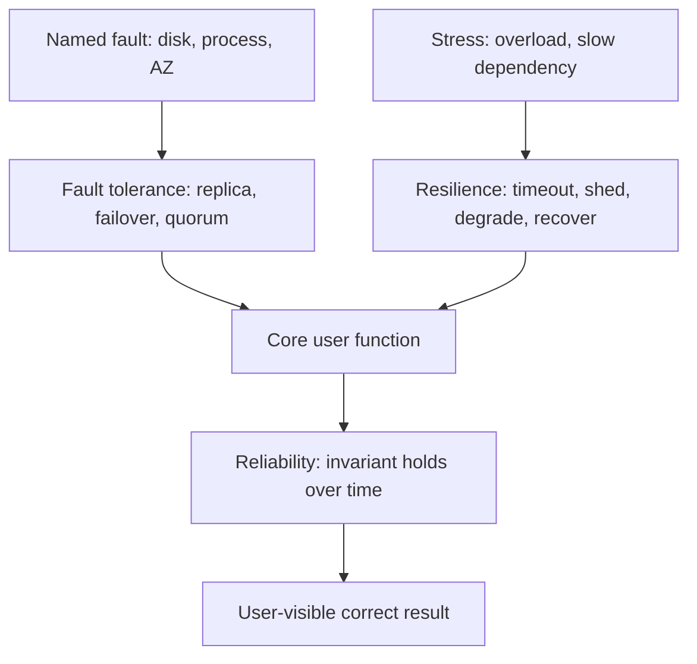

Reliability, resilience, and fault tolerance get used as synonyms for "the site stays up." They are not the same property. Reliability is whether the system does the right thing for a period of time. Fault tolerance is whether it continues while a part is broken. Resilience is whether it absorbs stress, degrades, and recovers without a human rewriting the story every time.

A RAID disk array is fault tolerant for a disk failure. It is not automatically reliable if firmware corrupts both sides. A team that pages, patches, and apologizes can be reliable in the long run without the software being fault tolerant. A service that returns cached data when a dependency is dark is resilient; if the cache is stale in a way that charges the wrong price, it is not reliable.

You need the distinction in reviews because the mechanisms differ. Redundant hardware, retries, and consensus buy fault tolerance for a class of faults you named. Bulkheads, timeouts, load shedding, and chaos exercises buy resilience under load and under dependency failure. Testing, type systems, invariants, and operational hygiene buy reliability of the result. Buying only one and claiming the other two is how you get a highly available wrong answer.

## Concept

### Reliability is correctness over time

A reliable system performs its function without failure for a stated interval, under stated conditions. In hardware this is MTBF thinking. In software the useful version is: the invariants hold, the SLOs hold, and the data you acknowledged is still there. Availability is a slice of this (can I talk to you). Durability is a slice (do bytes survive). Logical correctness is a slice (did I charge once). All three can fail independently.

Measure reliability where the user meets the function. A payment API that is up and double-charges is available and not reliable. A store that is down for a minute but never loses an acknowledged write can still be a reliable ledger with a poor availability SLO. Do not collapse these into a single "reliability nines" slide unless you have defined the failure.

The mechanisms are boring and effective: tests on the invariants, idempotency, checksums, backups you restore, schemas that refuse impossible states, code review on the money path, a type that makes "amount" not an untyped float. Redundancy does not replace these. Two replicas of a bug is not reliability.

### Fault tolerance is continuation despite a named fault

A fault is a component failing in a way you can describe: a disk dies, a process crashes, a zone loses power, a packet is dropped, a replica is slow. Fault tolerance means the system as a whole keeps meeting its spec, perhaps with reduced capacity, without waiting for that component to be repaired. The spec must name the faults. "We are fault tolerant" without "to the loss of one AZ" is advertising.

The usual tools: replication with failover, erasure coding, process supervisors, multi-AZ load balancing, quorum writes, retry of idempotent calls. Each tool matches a fault class. Retry does not tolerate a wrong response. A replica does not tolerate a corrupt schema migration applied to all replicas. A quorum does not tolerate a bug that a majority is happy to run.

Coverage has gaps. Byzantine faults, correlated faults (all VMs on a bad host class), and operator faults (a command run in production that was meant for staging) are different classes. Aircraft fly-by-wire systems triple-modular-redundant computers because they assume hardware faults are independent and they still have to worry about software common mode. Your web app is not an aircraft, but common-mode software is still how "redundant" Kubernetes nodes die together on a bad ConfigMap.

Write the fault set in the design: one instance, one AZ, one region, one disk, one network partition. Then write what is not tolerated: split-brain writes, silent data loss, a bad deploy to 100 percent. Fault tolerance is a matrix, not a feeling.

### Resilience is recovery and degradation under stress

Resilience is the system's ability to take a punch — overload, dependency latency, a bad deploy, a traffic spike — and still protect the core function, then return to normal. It includes fault tolerance, and it includes what happens when the fault was not in the matrix: a slow dependency instead of a dead one, a retry storm, a cache flush, a certificate expiry.

The tools are control tools: timeouts, retries with jitter and budgets, circuit breakers, bulkheads, load shedding, backpressure, graceful degradation, feature flags, and practiced incident response. Chaos engineering is how you find out whether those tools work. A circuit breaker you never tripped in production is an untested hypothesis.

Degradation is explicit. If search is down, the product page still loads without recommendations. If the recommendation service is required in the render path with no timeout, you are not resilient; you made a soft dependency hard. Resilience is mostly the art of keeping dependencies soft unless they are the product.

Recovery is part of the definition. A system that sheds load but never sheds the queue, or that fails over but never fails back, is brittle in the second act. Measure time to detect, time to mitigate, and time to restore capacity. Those are resilience metrics. MTTR sits here more than it sits in reliability of a disk.

### How they sit together

Aim for reliability of the invariant, fault tolerance of the infrastructure faults you can name, and resilience of the user path under overload and partial failure. A design review that only adds replicas addresses fault tolerance of instance death. It does not address a thundering herd (resilience) or a double charge (reliability).

Order the work. First make the answer right (reliability of the write). Then make a single instance failure boring (fault tolerance). Then make overload and dependency latency boring (resilience). Reversing the order produces a highly available system that corrupts, or a tough system that nobody can reason about.

## Trade-offs

| Approach | When it wins | Cost / risk |
| -------- | ------------ | ----------- |
| Reliability focus: invariants, tests, backups | Ledgers, identity, anything you cannot replay from a cache | Does not keep the site up through a dead zone |
| Fault tolerance: replication and failover | Named infrastructure faults, capacity to run N+1 | Common-mode bugs; cost of copies; failover bugs |
| Resilience: timeouts, shedding, degradation | Dependencies and overload you cannot eliminate | Degraded modes can violate reliability if they guess |
| All three on every path | Safety-critical or huge revenue paths | Complexity; slower features; toil |

Apply the expensive combination to the path that needs it. A marketing page can be resilient and only modestly fault tolerant. A ledger must be reliable first; a degraded mode that invents a balance is worse than an error. A video stream can drop quality (resilience) without corrupting a customer record.

Retries are the example that sits in all three columns and often hurts. A retry can raise reliability of a flaky network (the request eventually succeeds), can be part of fault tolerance of a crashed replica, and can destroy resilience under overload. Cap retries. Make them idempotent. That is how you keep the three properties from fighting.

## Diagram

## Failure modes

### Highly available and wrong

**Detection.** Dashboards show uptime. Users report duplicate charges, missing rows, or a cache that became the system of record. Failover worked. The bug ran on both sides. Backups exist and restore to the corrupted state. Incidents close as "blip" because availability recovered.

**Mitigation.** Put invariants on the write path: idempotency keys, constraints, checksums, an audit log you can replay. Test failover with a write in flight. Restore backups onto a sidecar and compare counts, do not only check that the restore job exited zero. Reliability gates a release on the money path even if the replica count is already two.

### Redundancy with common mode

**Detection.** All replicas die on the same config, the same bad dependency, the same cloud control-plane event, or the same OOM from one query pattern. You had N+1 instances and N+1 copies of the fault. Multi-AZ did not help because the deploy or the IAM policy was global.

**Mitigation.** Name common-mode faults in the review. Canary deploys. Progressive delivery. Separate config per AZ where it is cheap. Bound memory per request. Do not run a fleet-wide mutable "feature" that can take every replica into the same crash loop. For data, do not apply an untested migration to every shard at once.

### Retries and no bulkheads

**Detection.** A slow dependency raises latency. Clients retry. The dependency is now at 3× load. Thread pools fill. Unrelated endpoints fail. The circuit breaker is disabled or the timeout equals the caller's timeout. Resilience theater: a library is on the classpath, production settings are defaults.

**Mitigation.** Time out well inside the caller's budget. Retry only idempotent calls, with jitter and a budget of one or two. Shed load at the edge when queues grow. Isolate pools so search cannot take checkout's threads. Drill the slow-dependency case, not only the killed-instance case. If you have never seen the circuit open in a test, assume it will not save you.

### Degraded modes that break the spec

**Detection.** Fallback to a cache serves prices or permissions that are too old. A default-allow on authz failure. A queue that acknowledges to the user before persist. Resilience metrics look good (low user-facing 5xx) while reliability is gone. Product did not sign off on the degradation.

**Mitigation.** Write the degraded spec. Stale catalog: allowed for N minutes. Stale credit limit: not allowed. Authz failure: fail closed. Persist before acknowledge on money. Make the fallback visible in the UI or in a header so you can measure how often you run it. A silent fallback is a second, worse product.

## Real-world example

Netflix's public reliability work is the standard illustration of the split. After moving streaming to AWS, they treated instance and zone death as ordinary (fault tolerance through redundancy and stateless services). They then built client libraries — Hystrix is the famous one — that timed out, limited concurrency, and returned fallbacks when a dependency was slow or down. That is resilience: protect the core "play something" function from a recommendation or a rating service. Chaos Monkey and later chaos tooling killed instances in production so the fault-tolerance story was tested, not assumed. None of that, by itself, made billing correct. Billing and license rights still needed ordinary reliability work: correct writes, careful failover of stateful stores, and humans who treated data bugs as worse than a blip.

Google's SRE materials draw a similar line with different words: error budgets and SLOs for the user-visible function, defense in depth for dependencies, and an insistence that a system at the reliability target should still be able to change. They warn against chasing nines that a dependency cannot support, which is resilience and honesty about fault sets.

When you write a design, copy the split even if you copy none of the tools. For each path, say: what must never be wrong; which faults we survive without a human; what we do when we are overloaded or a vendor is slow. If the answer to all three is "more replicas," you have only addressed one column. Add the timeout, the idempotency key, and the restore test before you add the third replica.

## What to remember

- Reliability is correct function over time; availability alone can still be a wrong answer.
- Fault tolerance is continuation through a named fault; write the fault set and the common modes you do not cover.
- Resilience is timeouts, isolation, degradation, and recovery under stress, including faults you did not name.
- Retries and fallbacks can help all three or can destroy them; cap them and keep money paths fail-closed.
