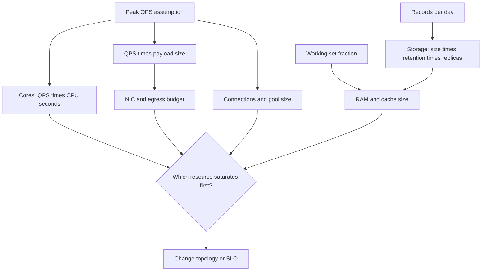

Back-of-the-envelope estimation is arithmetic you can do in a review, with round numbers, to catch a design that cannot work. It is not a forecast you will be graded on to three digits. It is a filter: if the working set is 40 TB and the box has 256 GB of RAM, the cache is not "the database." If a single primary must take 50,000 writes per second of 2 KB each, you are in a conversation about sharding or about a different store, not about a framework.

Engineers skip this step because it feels imprecise. Production is less precise if you skip it. Disk fills. Connection pools exhaust. A "cheap" log line is a second storage system. The envelope would have shown the order of magnitude. Orders of magnitude are what architecture is made of. Factor-of-two errors you can buy. Factor-of-one-hundred errors you rewrite.

Keep a short table of constants in your head: a day has about 10^5 seconds, a million is 10^6, a byte-to-GB jump is about 10^9, a 1 Gb/s link moves about 100 MB/s after overhead, a disk seek and a round trip across a region are different worlds. Jeff Dean's "Numbers Every Programmer Should Know" exists so you do not treat RAM like disk or disk like a cross-Atlantic RTT. Update the constants when hardware moves; keep the habit.

## Concept

### What you are estimating, in order

Start with the user-visible rate. How many of the hot operation per second, at peak, not on average? Average hides the peak that sizes the system. If you have DAU, convert with a peak factor: a rough default is that peak QPS is a small multiple of daily operations divided by 86,400, then doubled or tripled for a spiky product. If you do not know, pick a round peak and write it down as an assumption.

Then payload size. A 200-byte JSON body and a 2 MB image are different systems. Multiply rate by size for ingress and egress bytes per second. That number is NICs, TLS cost, CDN bill, and whether you can log every payload.

Then storage. Records per day times size times retention, plus indexes, plus replicas. A 500-byte row at 20 million new rows per day is 10 GB/day of raw rows, more with indexes, times three if you replicate. At a year of retention you are in terabytes before anyone "does analytics." Object storage and a database are different bills; do not mix them in one line.

Then the working set. How much must be hot? If 10 percent of data gets 90 percent of reads, RAM and cache sizing follow the 10 percent, not the archive. If the product is a random read across last year's data, the working set is the year.

Then the bottleneck resource: CPU per request, disk IOPS, a single-threaded lock, a chatty N+1 query. Convert QPS into that unit. 5,000 QPS of a 20 ms CPU-heavy handler is 100 CPU-seconds per second, i.e. on the order of 100 cores before inefficiency, not "a few pods."

Write the assumptions in the margin. When product changes the payload or the retention, the envelope is what you rerun. An envelope without assumptions is a guess you cannot update.

### Powers of ten, not spreadsheets

Use 10^n. 86,400 seconds in a day is 10^5 for mental math. 2^10 is about 10^3, so you can mix binary and decimal at this precision. 1 KB is 10^3 bytes, 1 MB is 10^6, 1 GB is 10^9. If two terms in a product are each uncertain to 2×, the product is uncertain to 4×, which is still a useful band: 2 TB versus 8 TB is the same architecture; 2 TB versus 200 TB is not.

Round aggressively. 7,342 QPS is 10^4. A 413-byte record is 500 bytes. A 14-day retention is 10^6 seconds. The point is to finish the multiplication before the meeting ends, and to see whether you are in hundreds, millions, or billions.

When a number would change the design if it moved by 10×, mark it as a load-test target. The envelope's job is to find those numbers. Everything else can stay rough.

### Latency numbers as a budget, not trivia

A design that needs a 50 ms p99 cannot afford a cross-region round trip on the critical path, because the floor is already tens of milliseconds. It cannot afford a disk fsync per request if that fsync is milliseconds and you stacked several. It can afford a RAM lookup and a same-AZ RPC if you keep the fan-out small.

Budget the critical path as a sum of floors plus queueing. If the floors already exceed the SLO, stop adding hops. If the floors are 10 ms and the SLO is 200 ms, you have 190 ms for queueing, compute, and retries — which is also a throughput conversation via Little's Law.

Do not memorize a stale table as law. Memorize the order: registers and L1, RAM, SSD random, SSD sequential, same-rack network, cross-AZ, cross-region, spinning disk, human. Place each hop in a bucket. The bucket is the estimate.

### Capacity is QPS, IOPS, connections, and RAM together

A system that "only" needs 1,000 QPS can still die at 1,000 connections times 50 MB of session state, or at 1,000 QPS of random 4 KB reads on a volume whose IOPS were never the headline. Size:

- Compute: cores ≈ QPS × seconds of CPU per request.
- Memory: working set + heaps + caches + connection overhead.
- Disk: sequential MB/s versus random IOPS; logs and WAL are sequential until they are not.
- Network: bytes/s in and out, plus fan-out multiplier.
- Connections: clients × pool size, versus server max.

Fan-out is the silent multiplier. One user request that becomes 20 downstream calls is 20× on that tier. The envelope that ignores fan-out is how a modest QPS knocks over a dependency.

## Trade-offs

| Approach | When it wins | Cost / risk |
| -------- | ------------ | ----------- |
| Fermi envelope in the review | Early designs, interviews, catching 100× mistakes | Wrong if a hidden fan-out or a peak factor is omitted |
| Spreadsheet model with measured constants | You have production ratios and a capacity process | False precision; stale coefficients |
| Load test only, no envelope | You already built the candidate topology | You may test the wrong bottleneck after weeks of build |
| Vendor calculator as gospel | A first SKU guess | Hidden limits (IOPS, connections) not in the pretty output |

Do the envelope first, then pick a topology, then load-test the hop the envelope said was tight. A calculator from a cloud vendor is an input, not a design. If the envelope and the calculator disagree by 10×, find the assumption (often payload size, peak ratio, or replica count of the database).

When time is short, estimate the storage growth and the peak QPS on the hottest write. Those two lines kill more designs than a detailed CPU model. Add the CPU model when the write is CPU-bound or the payload is tiny and the rate is huge.

## Diagram

## Failure modes

### Average rate, peak reality

**Detection.** You sized from daily actives divided evenly across the day. A launch, a game reset, or a region waking up delivers several times that QPS. CPU is fine at noon in the model and on fire at 18:00. Autoscaling lags the spike. The envelope said "easy."

**Mitigation.** Estimate peak explicitly. Use a peak-to-average ratio from a similar product, or from your own graphs if you have them. Size the bottleneck for the peak, and size autoscaling cooldown so a brief spike does not flap. If the peak is unknown, take 3× the flat average as a starting band and mark it as an assumption to replace with a measurement.

### Forgotten multipliers: replicas, indexes, fan-out, logs

**Detection.** Storage is 3× the "raw rows" because of replicas you did not count, or 2× because of indexes. A request fans out to twenty microservices. Debug logging at the request rate is a second write path the same size as the database. Egress is 10× ingress because every byte is read many times.

**Mitigation.** Add a line for each multiplier: replication factor, index overhead (often another 0.5× to 2× for relational stores, more for some search indexes), read-to-write ratio, fan-out, log retention. If you cannot estimate index overhead, double the raw size and revisit. If fan-out is unknown, count the downstream calls on the sequence diagram; that count is the multiplier.

### Precision theater

**Detection.** A spreadsheet with eight significant figures, a SKU picked to the dollar, and an assumption that users do 3.7 actions per session because a blog said so. The design is brittle to the first wrong coefficient. Review time is spent on the dollar, not on whether the working set fits in RAM.

**Mitigation.** Round to one significant figure for architecture. Show bands: 5k–20k QPS, 2–8 TB/year. Make a decision only when both ends of the band agree (same topology) or when they disagree (you must measure). Replace blog coefficients with your instrumentation as soon as it exists.

### Skipping the load test on the tight hop

**Detection.** The envelope was right about order of magnitude, then production hits a limit not in the model: a language runtime pause, a cloud IOPS burst credit, a connection tracker on a NAT, a mutex. The team believed the envelope as a guarantee.

**Mitigation.** Treat the envelope as a hypothesis. Load-test the resource it named, with production-like payloads and concurrency. Watch the limit you did not model (file descriptors, IOPS credits, GC). After launch, put the real QPS and payload size back into the envelope and file it next to the design so the next review starts from measurement.

## Real-world example

Google popularized this habit in engineering culture through Jeff Dean's latency-numbers talk and through the SRE book's capacity-planning chapters. The published lists — nanoseconds for L1, microseconds to milliseconds for disk and datacenter RTT, milliseconds to tens of milliseconds for a wide-area round trip — are there so an engineer can reject a design that places a user-facing 50 ms SLO on a chain of cross-region calls. The SRE materials then insist on converting user demand into machines, disks, and a growth curve, with explicit uncertainty, rather than into a single "it should scale" sentence. You can use that practice without Google's traffic.

A concrete production shape is a URL shortener, which almost every large company has built as an internal service and which Bitly and TinyURL run as a product. The envelope is why the design is small. Peak QPS is dominated by redirects, not by creates. The record is tiny: a short code, a long URL, a created-at, maybe a owner. Storage is modest even at billions of rows if you stay narrow. The hot path is a cacheable GET. The envelope tells you that RAM for the working set of hot codes, a simple key-value or a single primary, and a CDN in front will go farther than a streaming platform. It also tells you where you will break: uniqueness of the short code under concurrent writes, and analytics if you store every click as a fat row at redirect QPS. Bitly's public engineering writing over the years has emphasized click volume as the hard rate, not the length of the URL table. That is an envelope result: count the high-rate event, then decide whether it belongs in the system of record or in a log pipeline.

Run the same arithmetic on your own design before you name Kafka. If the envelope says 200 QPS and 30 GB/year, a modular process and Postgres is the architecture. If it says 200,000 writes per second and 20 TB/month of logs, you are in partitioned streams and object storage, and the envelope just saved you a year of pretending otherwise.

## What to remember

- Estimate peak QPS, payload bytes, storage with retention and replicas, working set, and the bottleneck resource, with written assumptions.
- Round to powers of ten; architecture cares about 100× errors, not three significant figures.
- Multipliers — fan-out, indexes, logs, read ratio — are where envelopes go wrong; put them on the diagram.
- The envelope is a hypothesis: load-test the tight hop and replace coefficients with production measurements.
