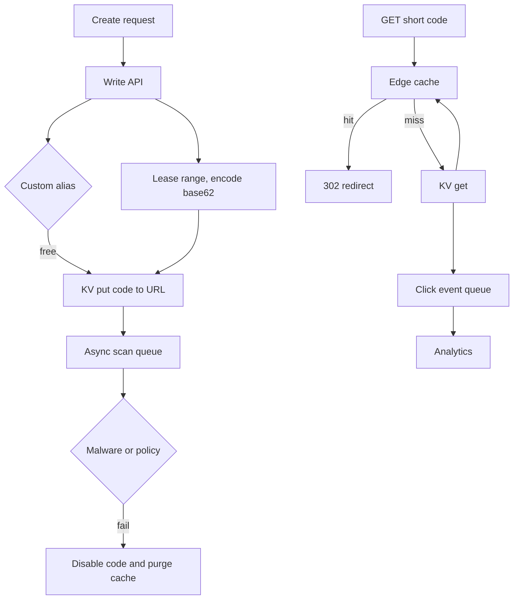

A URL shortener is a tiny write and a huge number of reads. The write stores a mapping from a short code to a destination URL. The read looks up the code and returns an HTTP redirect. The interesting parts hang on those two sentences: how the code is generated, whether the redirect is cacheable, how you count clicks without a counter on the hot path, how you stop becoming a malware CDN, and what falls over at a billion rows.

The design below is a production shape I would run: range-allocated base62 codes, a key-value map, a cache in front of reads, 302 by default, analytics off the redirect path, and explicit abuse controls. Creating a link is a human or an API client. Following a link is the internet: chat apps, crawlers, email scanners, a post that lands. Design the read path like a CDN-adjacent cache. Design the write path like a careful allocator. Do not design both like a CRUD app with a SQL autoincrement and a hope.

At a billion links the problem is no longer "can we hash." It is working set, hot keys, allocator throughput, scan-hostile storage, and the fact that most links are never clicked while a few are clicked like a homepage.

## Concept

### Write path: accept or allocate, then store

The client sends a destination URL, optional expiry, optional custom alias, and credentials. The service validates the URL (scheme, length, not a recursive shortener loop to yourself), rate-limits the caller, and then either accepts the alias or allocates a code.

Allocation should not be "hash the URL and take six characters." Hashing the destination makes the same URL collapse to one code, which you may not want (campaigns, different owners, different expiry). It also collides, and collision handling on a hash prefix is a messy secondary map. Prefer a monotonic allocator: each write takes the next integer from a range, encodes it in base62 (`0-9A-Za-z`), and stores `code -> {url, owner, created, expiry}`. Base62 of a 64-bit space is enough that a billion rows are not a key-space problem. Seven characters already covers trillions of values; you choose length for aesthetics and for the size of the typed URL, not because you are about to run out.

The allocator is a hotspot if it is a single SQL `AUTO_INCREMENT`. Give each write node a leased range (a million integers at a time) from a small allocator service, encode locally, and return unused range on shutdown if you are tidy. Collisions then only happen on custom aliases, which you check with a compare-and-set on the key. If the alias exists, reject. If the generated code exists, you have an allocator bug; fail the write, do not scan for a free slot.

Store the mapping in a key-value system that can get-by-key cheaply. You do not need a relational model for the hot path. Owner, expiry, and created-at are values. Secondary indexes (all links for a user) belong in a different table or document, updated on write, not queried on redirect.

### Read path: 301 versus 302, then cache

A GET to `/{code}` loads the mapping and returns a redirect. Status code is a cache-policy decision, not a taste.

301 Moved Permanently tells clients and CDNs they may cache the mapping and skip you next time. That is wonderful for origin load and terrible if you need per-click counts, if you might change the destination, or if you might disable a bad link. Once a browser has 301'd, your analytics and your takedown are suggestions.

302 Found (and 307, which keeps the method) tells clients to ask again. You see the traffic. You can change the destination. You can 410 a bad code. You pay origin or cache that you control. For a shortener that sells click data or must revoke malware, 302 is the default. Cache 302s yourself, at the edge, with a short TTL and a purge on takedown. Do not ask the browser to be your CDN.

Cache the mapping, not the click. A Redis (or CDN) layer keyed by code, TTL minutes to hours, negative-cache short-lived for unknown codes so scanners cannot miss-storm the store. The working set is not a billion keys. It is the Zipf head: a small fraction of codes take almost all hits. Size the cache for that head. A cold code pays one KV get and fills the cache.

Never put "increment click counter" on the redirect mutex. Return 302, enqueue `{code, time, user-agent, ip-hash}` on a queue, and let a consumer batch-write. If the queue is down, still redirect. Analytics is a best-effort product. Redirect is the product.

### Abuse, scanning, and loops

Open shorteners get spam, phishing, and malware. Rate-limit writes per account and per IP. Require an account after a modest anonymous quota, or require an account always. Scan destinations asynchronously: on write, enqueue the URL for a fetcher that checks blocklists and content; mark the code `pending` if you must not redirect until the scan returns, or redirect immediately and disable when the scan fails — a product choice between growth and safety. I will not 302 to an unscanned URL for a public instance. Paid APIs with a contract can be more trusting and still scan in the background.

Block recursive shortens to your own domain. Cap destination length. Do not follow redirects at scan time into a black hole. Log enough to respond to abuse reports; do not log raw destination query strings that are secrets (password-reset links pasted into a shortener are a class of accident).

### What breaks at a billion links

Key space is fine. The KV working set is not, if you keep all rows in memory. Cache the Zipf head; keep cold codes on disk-backed KV partitioned by key. Do not scan the hot table. The allocator must already be ranged. "My links" indexes partition by owner. Click streams belong in a warehouse: batch, compact, expire raw events. A celebrity code is a hot-key problem: replicate that mapping at the edge; a single Redis key at huge QPS is a finding. Deleting a mapping means KV write plus purge of every cache. Searching by destination URL is a separate index, not a feature of the redirect store.

## Trade-offs

| Approach | When it wins | Cost / risk |
| -------- | ------------ | ----------- |
| Hash of destination, truncated | Deduping identical URLs, no allocator | Collisions, ugly collision map, cannot have two codes for one URL |
| Range-allocated base62 integer | Unique codes, no hash collisions, scales with leased ranges | Allocator service to run; codes are guessable if sequential |
| 301 redirect | Origin relief, truly permanent mappings, no click accounting | Cached forever in browsers; takedown and retarget fail |
| 302 plus edge cache you purge | Click visibility, revocation, destination edits | You pay for the GET; mis-set Cache-Control still leaks 301 behavior |
| Counter on the redirect path | Exact counts, tiny scale | Redirect latency and lock contention; outage of counter is outage of links |

Sequential codes are guessable. If unlisted links must be unguessable, use a longer random code (or encrypt the integer) and accept a slightly worse allocator. I will not use six sequential characters for "secret" documents. I will use them for marketing links whose destination is public anyway.

Putting Postgres on the read path with `SELECT url FROM links WHERE code=` works until it does not: connection pools, a working set bigger than RAM, a celebrity key. Move the mapping to a KV early; keep Postgres for billing and owner indexes if you already have it.

## Diagram

## Failure modes

### 301 cached a destination you must change

You shipped 301 for "speed." A phishing link is now cached in browsers and corporate proxies. Your KV delete does nothing for those clients. Click counts were already a lie.

**Detection.** Takedown tickets where traffic continues after disable. `Cache-Control` and status in access logs showing 301. CDN hit ratio that stays high after a purge of your own cache but not of browsers. If you ever returned 301, assume some clients will never come back.

**Mitigation.** Default 302. Set `Cache-Control: no-store` on the redirect response so you do not accidentally become a 301. If you truly need 301 (archival, no analytics, no revocation), say so in the product and do not offer disable. For mixed needs, 302 at origin and a purgeable edge TTL of seconds to minutes.

### Allocator collision or hotspot

Two writers share a range after a lease bug, or a single SQL sequence is the write bottleneck. Writes fail or, worse, overwrite a mapping. A celebrity campaign cannot create links at noon.

**Detection.** Duplicate-key errors, two destinations for one code in logs, write latency tied to one database node, ranges that overlap in the allocator's table. An audit of leased ranges that do not partition the integer space.

**Mitigation.** Compare-and-set on put; never overwrite. Leased ranges with fencing tokens. Monitor remaining range per node. For custom aliases, explicit conflict errors to the client. Do not "find the next free code" with a loop; that loop is a scan.

### Analytics on the hot path, or loss of redirect when analytics fails

A Redis `INCR` or a SQL update sits in the GET handler. The counter store hiccups. Redirects 500. Or the queue fills and the handler waits. Users cannot leave the short URL.

**Detection.** Redirect error rate tracking analytics store latency. Timeouts in the GET handler stacked on a metrics increment. A deploy that "added counting." If disabling the counter in a test environment fixes availability, the coupling is proven.

**Mitigation.** Enqueue and return. Bounded queue, drop clicks when full, never block the 302. Batch consumers. Reconstruct approximate counts from access logs if the queue dies. Product should call click counts approximate unless you have a stronger pipeline.

### Open redirector for malware, or a billion-row working set in RAM

Anonymous writes, no scanning, and you are now a phishing CDN. Or you tried to hold a billion mappings in one Redis and eviction killed the hot set, or startup warming took an hour.

**Detection.** Abuse reports, blocklist hits on your domain, write QPS from few IPs. Memory of the KV or cache tracking total rows rather than hit rate. p99 of cold gets climbing as the table outgrows disk cache. A backup that cannot complete.

**Mitigation.** Accounts, quotas, async scan before first redirect for public users, disable-and-purge. Size cache for the Zipf head, not for N. Partition the KV. Ban table scans. Treat the domain's reputation as a first-class SLO: if mail providers block you, the product is done whether or not redirects still work.

## Real-world example

Twitter wraps outbound links in `t.co`. The public behavior is a redirect wrapper: the tweet stores a `t.co` URL, clients follow it, Twitter can scan and block destinations, and they can count clicks. That is the shortener as a safety and telemetry hop, not as a vanity product. Bitly is the commercial cousin: custom domains, branded codes, analytics as the paid good. Google's `goo.gl` was a public shortener that Google later shut down to new users and then discontinued — a reminder that a mapping table is a long-lived liability. Links outlive the product team's interest.

The public shape is consistent: the read path is a redirect with policy, the write path is restricted, and analytics is separate from whether the hop works. When `goo.gl` stopped creating new links, existing mappings still had to resolve for a long time. A billion rows is a promise to keep answering GET for years after the campaign ended.

When I build this, v1 is accounts, range-allocated codes, KV mapping, 302 plus a small edge cache, scan-before-redirect, click events on a queue, no 301, no counter in the GET. The billion-row work is partitioning and a cache sized for the head, not a cleverer hash.

## What to remember

- Write path: validate, allocate a base62 code from a leased range or accept an alias with compare-and-set, store the mapping; do not hash-and-chop as your primary key.
- Read path: 302 by default so you can count, change, and revoke; 301 is cacheable in browsers you cannot purge.
- Clicks and scans are asynchronous; a dead analytics pipeline must not take down redirects.
- At a billion links the pain is hot keys, working set, allocator ranges, and abuse reputation, not running out of base62.
