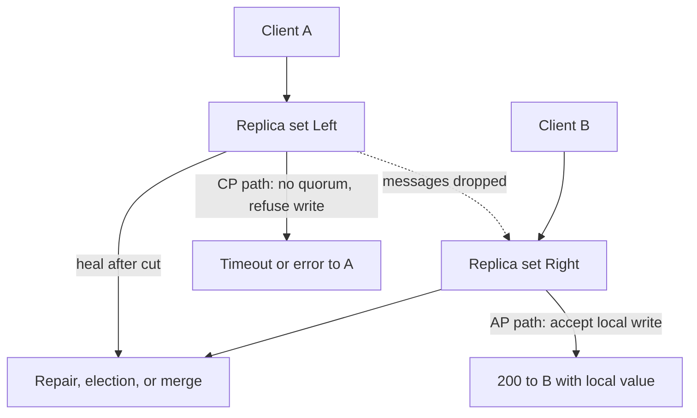

CAP is a statement about what a replicated system is allowed to do when the network splits, not a menu you pick from on a healthy afternoon. Gilbert and Lynch proved a specific claim: in an asynchronous network, you cannot implement a read/write register that is always available and always linearizable once a partition can prevent messages from arriving. That is the theorem. Everything else you have heard at whiteboards is commentary.

When the cluster is whole, you can linearize reads, you can answer every request, and you can keep replicas in agreement. The interesting design work starts at the moment a replica cannot reach its peers. Then you choose: refuse or delay the request until you know you are consistent with the other side, or answer from local state and accept that two clients may see different values until the partition heals.

Engineers who learned CAP as "pick two of three" treat C, A, and P as knobs you turn at design time and then forget. Partition tolerance is not optional on a real network. Packets drop. Availability zones lose connectivity. You are always building a partition-tolerant system. The live choice is consistency versus availability during the partition, and how you heal after it.

I want you to leave this page able to read a vendor's "we are AP" claim and ask the only useful question: when this node cannot talk to a quorum, does it serve a possibly stale answer, or does it stop?

## Concept

### The three properties, stated as operators

**Consistency**, in the Gilbert and Lynch proof, is linearizability. A read returns the result of the most recent write, as if every operation ran on a single copy, in some total order that respects real time. If client A writes `x=1` and later client B reads `x`, B must see `1` or a later value. Causal consistency, session consistency, and "eventual agreement after gossip" are weaker models. They are useful. They are not the C in CAP.

**Availability** means every request sent to a non-failed node receives a response. The node may not wait forever for a peer. Timeout-and-error is a refusal. Timeout-and-guess is an available answer that may violate linearizability. "The cluster is up from the load balancer's point of view" is not the definition. A single isolated replica that still answers PUT and GET is available in the CAP sense.

**Partition tolerance** means the system continues to obey its chosen C or A rule even when the network loses an arbitrary set of messages. You do not get to assume a reliable network. If your design requires every replica to hear every other replica before answering, you have already chosen CP: under partition, some nodes stop answering.

### What happens on a healthy cluster

A three-node Raft group, a Cassandra ring with `QUORUM` reads and writes, and a primary-replica PostgreSQL pair all provide useful consistency while the network is intact. CAP does not forbid that. The theorem is silent about the no-partition case. PACELC, Abadi's later framing, fills that gap: if there is a partition, choose A or C; else, choose latency or consistency. Most of your latency budget is spent in the "else" branch. Most of your incident reviews are spent in the "if" branch.

Treat the healthy path as an ordinary replication protocol. Quorums, term numbers, and leader leases exist so that, when a partition does arrive, each node can decide locally whether it is still allowed to serve.

### The partition is the test

Draw two replica sets that cannot exchange messages. A client can still reach one side, the other side, or both, depending on where the cut fell.

A CP system on the minority side stops taking writes, and often stops taking linearizable reads. The majority side continues. Clients pointed at the minority see errors or timeouts. The invariant: no two sides accept conflicting linearizable writes.

An AP system on either side accepts the write it can see. Both sides may accept different values for the same key. After the cut heals, the system must merge, last-write-win, or present siblings. Clients did not see errors. They may have seen a world that never existed on the other side.

There is no third option that preserves linearizability and answers every request on both sides. That is the proof. If a slide shows a triangle with a circled pair, ask what the node does when RPC to its peers times out. If the speaker cannot answer, the slide is decoration.

### Quorums make the choice operational

Give each key `N` replicas. A write waits for `W` acknowledgements. A read waits for `R` answers. If `R + W > N`, a read quorum and a write quorum must overlap, so a read that completes saw the latest completed write — while there is no partition that splits those quorums. During a partition, a side that cannot collect `W` nodes cannot complete a quorum write. That side has become CP for that key.

Lower `W` to 1 and you can write on a single isolated replica. You have become AP for that key. Reads with `R = 1` may miss that write until repair. Cassandra's consistency levels (`ONE`, `QUORUM`, `ALL`) are this knob with names. They are not a different theorem.

Leader-based protocols hide the same arithmetic. Raft's leader is a write quorum of one plus a majority that elected it. If the leader is partitioned from the majority, it steps down or its lease expires, and clients must find the new leader. The minority does not keep writing. That is CP.

### Healing is part of the model

CAP's proof ends at the partition. Production does not. An AP store needs a defined merge: last-write-win with synchronized clocks, vector clocks and sibling values, or CRDTs that commute. A CP store needs a defined catch-up: the minority discards uncommitted log, fetches from the new leader, and only then serves. If you cannot describe heal, you have not finished the design. Stale primaries that accept writes after a split are the classic CP bug; unrepaired replicas that serve forever-divergent values are the classic AP bug.

## Trade-offs

| Approach | When it wins | Cost / risk |
| -------- | ------------ | ----------- |
| CP, majority quorum (Raft, Paxos, etcd, ZooKeeper) | Metadata, locks, configuration, anything that must not fork | Minority of the cluster becomes unavailable; leader election adds failover delay |
| AP, local write plus anti-entropy (Dynamo-style, Cassandra at `ONE`) | User-facing writes you would rather accept than reject during an AZ cut | Conflicting values; repair lag; clients must tolerate stale reads |
| Tunable quorum per request | Mixed workloads on one store; some keys need overlap, some need accept-anyway | Callers pick the wrong level; operators think they bought both C and A |
| PACELC: CP in partition, strongly consistent when healthy | Payments, inventory, identity | Cross-replica latency on every write; throughput ceiling of the consensus group |
| PACELC: AP in partition, eventual when healthy | Activity feeds, caches, session blobs | Product must be correct under stale and under concurrent forks |

The useful sentence in a design review is not "we picked AP." It is "on this API, an isolated replica will still 200 this PUT, and conflict resolution is last-write-win on `updated_at`." That sentence can be tested. "We are consistent and available" cannot.

## Diagram

## Failure modes

### Split-brain primary

Two nodes both believe they are the writable primary. It happens when a leader lease is too long, when fencing tokens are missing, or when STONITH never fires. Each side accepts writes. After the network returns, you have two histories for the same key.

**Detection.** Watch for two primaries advertising leadership in the same term, or for write streams to two distinct node ids on one shard. Replication lag dashboards will not catch this; both sides look healthy to themselves. Compare committed log indexes and currentTerm (or equivalent) across the group, and alert on duplicate primary claims.

**Mitigation.** Require a majority for every committed write. Bound leader leases so an isolated primary stops serving before another election can complete. Fence storage with a shared epoch: a disk or volume that will not accept writes from a stale generation. On heal, pick one history, restore the other from snapshot, and never "merge" two linearizable logs by last-write-win.

### Minority that still serves linearizable reads

A CP replica that cannot see a quorum but still answers GET from local state is lying about C. Linearizable reads need confirmation that no write committed elsewhere. Stale reads dressed up as strong reads are how inventory double-sells.

**Detection.** Inject a partition in chaos tests and issue a write on the majority, then a read on the minority. If the minority returns the old value with a "strong" consistency flag, the API is wrong. In production, trace reads that did not contact a quorum and still claimed linearizability.

**Mitigation.** Linearizable reads go through the leader or a quorum. Follower reads are eventual or bounded-stale, and the API says so. If you need read-only availability on the minority, change the advertised contract rather than the implementation.

### AP merge that discards acknowledged writes

An AP system accepted a write during the cut, returned 200, then last-write-win dropped that value because the other side had a later timestamp. The client was told the write stuck. It did not.

**Detection.** Compare acknowledged write ids to post-repair values for the same key. Sibling counts, dropped-conflict metrics, and customer reports of "I saved this and it vanished" are the same bug at different layers.

**Mitigation.** Do not last-write-win on data the product treats as committed money or inventory. Use siblings and force an application merge, or switch that key to a CP path. If you keep LWW, put the clock source and the tie-break in the client-visible contract, and make lost-write metrics first-class.

### Operators who "turn on consistency" during an incident

Raising Cassandra from `ONE` to `ALL`, or flipping a database to synchronous replicas, in the middle of a partition, converts an AP system into a CP system while clients still retry. The cluster starts refusing the traffic it was absorbing. The incident gets worse.

**Detection.** Config-change audit plus a jump in write error rate with no matching hardware failure. Consistency-level histograms that shift during a pager.

**Mitigation.** Treat consistency level as part of the API contract, not a runtime panic button. If you need to shed load, shed with 503 and retry-after, not with a hidden quorum change. Rehearse the partition behavior of the chosen level before the first outage.

## Real-world example

Kubernetes stores cluster state in etcd, a Raft group. etcd is a CP system: a write to `/registry/...` commits only on a majority. If you lose the majority of etcd members, kube-apiserver cannot persist new objects. Pods that are already running keep running; the control plane stops taking "the world has changed" writes. That is the correct failure for a system whose job is a single consistent cluster spec. Two etcd majorities that both accepted writes would give you two cluster truths, which is worse than a control-plane outage.

The same company often puts user session data and recommendation events in Cassandra or a Dynamo-style store, configured so a single-replica write can succeed. During an AZ network cut, those writes keep landing. Repair and hinted handoff catch the other AZ up later. Product engineers accept that a session blob may be briefly stale. They do not accept that two schedulers both bound the same port on the same node because etcd forked.

I use that pairing in reviews: control plane CP, high-volume user data AP with an explicit heal. If a team wants etcd-like guarantees on a multi-region user store, they are buying cross-region consensus latency, not a free upgrade. If they want Cassandra-like availability on the Kubernetes API, they are volunteering for split-brain scheduling. Name the partition behavior for each store. Do not name a letter and sit down.

## What to remember

- CAP constrains behavior **during a partition**; a healthy cluster can be consistent and available at once.
- The C in the theorem is **linearizability**, not "replicas will catch up."
- Partition tolerance is not a feature you decline; the remaining choice is **refuse on the minority** or **accept and merge**.
- A design is finished only when you can say what an isolated replica returns, and how two histories become one after the cut.
