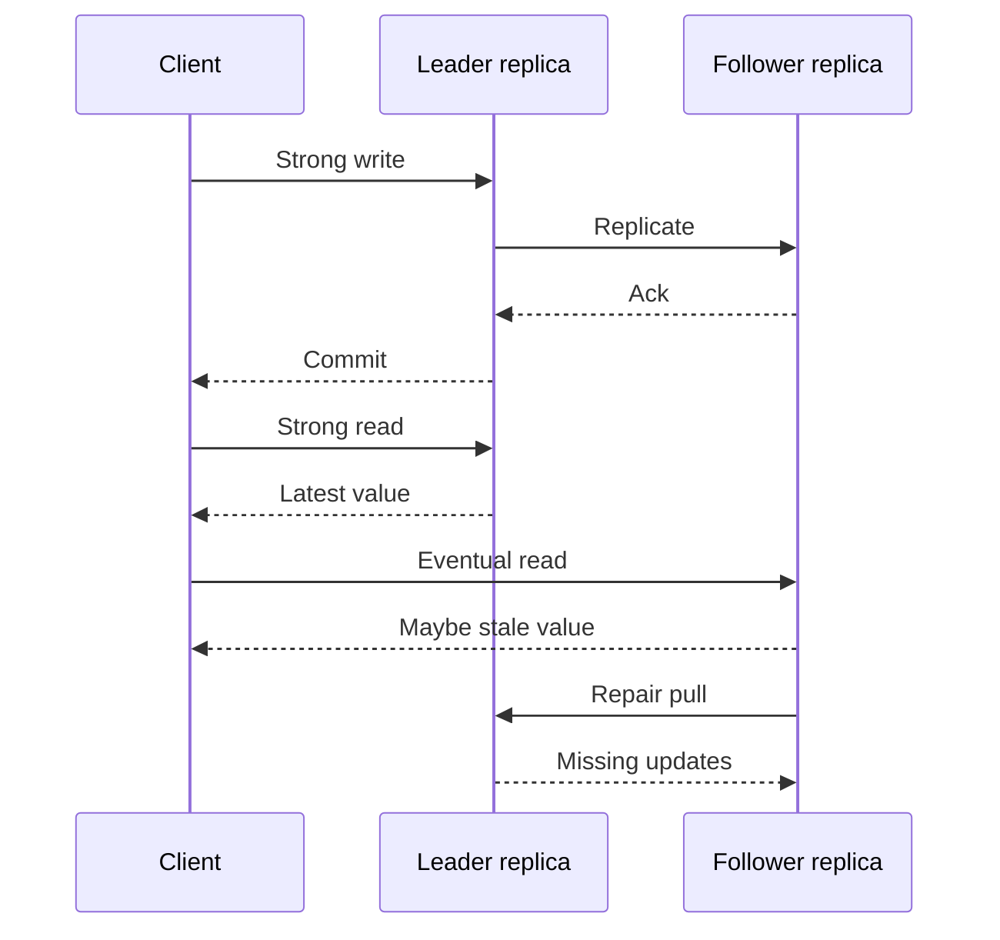

Consistency is a promise about what a read is allowed to return after a write. Strong consistency, in the sense operators usually want, means the read behaves as if there were one copy of the data: after a write completes, every subsequent read sees it, or a later write. Eventual consistency means replicas are allowed to disagree for a while, and if writes stop they converge. Both promises are real. They are not interchangeable labels for "the database is fine."

The engineer who can code a CRUD service often meets these words first as a checkbox on a managed store: "strongly consistent read" versus the default. The checkbox is not a personality trait of the product. It is a different code path with a different quorum, a different latency, and a different answer during failure.

I treat the choice as a per-API contract, not a per-company religion. A checkout total and a "people you may know" list do not need the same promise. The failure is using one word for both and discovering the difference in an incident.

If you remember one operational fact, remember this: eventual consistency is not "wrong answers forever." It is "wrong answers until repair, with a bound you may or may not be able to name." Strong consistency is not "always correct under all failures." It is "refuse or delay rather than guess" when the system cannot prove it has the latest write.

## Concept

### Strong means a single-copy illusion

Linearizability is the strict common meaning of "strong" in distributed stores. Operations appear to take effect at a single point between invocation and response, in an order that respects real time. If write W1 returns at wall-clock t, a read that starts after t must see W1 or a write that overwrote it.

Sequential consistency is slightly weaker: there is a single order of operations that all clients agree on, but it need not respect real-time precedence across clients. Practitioners still call this "strong" when they mean "no stale replica reads." I do not. If two clients can disagree about whether a completed write is visible, I call the API stale-tolerant and I write that in the runbook.

Single-leader replication with synchronous quorum, Raft-committed log, and consensus-backed registers all implement some form of this illusion. The mechanism is the same: a write is not complete until enough replicas durably hold it, and a linearizable read either goes to the leader or to a quorum that must overlap that write set.

### Eventual means convergence after writes stop

Vogels' informal definition is the one I still use with product teams: if no new updates arrive, all reads eventually return the last written value. The word "eventually" hides the repair channel. Replicas converge because something ships missing updates: a replication log, hinted handoff, read repair, anti-entropy with Merkle trees, or a client that retries until it hits a replica that has the write.

Until that channel catches up, two GETs for the same key can return different bytes. That is legal under eventual consistency. It is a bug under a linearizable contract.

Eventual systems usually offer extra session guarantees because raw eventual is too sharp for users:

- **Read-your-writes.** After you PUT, your next GET sees it. Sticky sessions, read-from-leader, or a client-side write timestamp that replicas must beat, all implement this.
- **Monotonic reads.** Once you have seen version 7, you never see version 5. Track a vector or a high-water mark per client.
- **Causal consistency.** If B read A's write, B's later write carries that dependency, and no replica applies B without A.

These are still weaker than linearizability. They are how you keep an eventually consistent store from feeling haunted.

### Quorums are how you dial the same cluster

Take `N` replicas, write quorum `W`, read quorum `R`. If `R + W > N`, overlapping quorums give you a strong read of completed writes while the network can form those quorums. If `W = 1` and `R = 1`, you have eventual visibility and fast local operations. Dynamo-style stores expose this as a per-request consistency level. The replicas did not change. The overlap did.

A "strongly consistent read" in Amazon DynamoDB is a different request type that reads from the leader replica of the partition. The eventually consistent read may go to a follower. Same table, same item, different visibility and different capacity accounting. That is the pattern I want you to see in any store: strong is extra coordination, not a magic flag.

### Time, versions, and what "latest" means

Last-write-win needs a clock. Wall clocks go backwards. Hybrid logical clocks and Lamport timestamps avoid some of that, at the cost of a partial order you must store. Vector clocks tell you when two writes are concurrent rather than ordered; then the application, not the storage engine, must merge. If you cannot describe the version type, you do not have a consistency story. You have a hope that timestamps are unique.

Strong systems still use versions, but the version is assigned by the leader or the consensus log index. Clients do not vote on time. That is why strong writes have a single commit point and eventual writes often do not.

### Where the delay lives

Strong consistency spends latency on the write path, the read path, or both: cross-AZ round trips, majority fsync, leader hop. Eventual consistency spends latency on the repair path, which the user does not wait for, and spends correctness budget on the read path, which the user does wait for. Moving a product from eventual to strong is rarely a config change. It is a latency SLO change, a capacity change, and often a regional-topology change.

## Trade-offs

| Approach | When it wins | Cost / risk |
| -------- | ------------ | ----------- |
| Linearizable reads and writes | Money, inventory, unique constraints, leader election, anything a user might screenshot as "saved" | Higher write latency; availability drops when a quorum cannot be formed |
| Eventual, repair in the background | High-volume writes, multi-region serving, caches, feeds, derived data | Stale reads; conflict resolution; harder tests |
| Session guarantees on an eventual store | Interactive apps that must read their own writes | Sticky routing; state in the client or gateway; still not global strong |
| Tunable quorum per request | One cluster, mixed APIs | Callers choose poorly; dashboards mix two contracts |
| Bounded staleness (read from replica no older than T) | Dashboards and search indexes that can name a lag SLO | T is a lie if replication is stuck; you must monitor lag against T |

Pick the contract that matches the cost of a stale read. If the cost is a double charge, pay for a quorum. If the cost is a feed item arriving a second late, pay for repair instead.

## Diagram

## Failure modes

### Stale read sold as strong

A replica serves local state, the API still says "consistent," and a client acts on a value that another client already overwrote. Classic in read-from-follower setups that skip a lease check, and in caches planted in front of a linearizable store without a version.

**Detection.** In tests, complete a write against the leader, then immediately read a follower or a cache with the strong API. In production, sample read responses against the leader's committed index for the same key. A mismatch on a "strong" path is an incident, not a metric to average away.

**Mitigation.** Linearizable reads must confirm leadership (lease) or overlap a write quorum. Caches store `(value, version)` and never answer a strong read from a value whose version is unconfirmed. If you need cheaper reads, name them `eventual` or `bounded` in the API so clients stop assuming.

### Replication stuck, "eventual" that never arrives

Anti-entropy that stops — full disks, paused consumers, a broken hinted-handoff directory — leaves replicas diverged with no countdown. Eventual consistency without a working repair channel is partition with extra steps.

**Detection.** Replica lag histograms with a growing tail, Merkle-tree comparison jobs that never finish, hint queues that only rise. Alert on lag age, not on lag count: 200 delayed writes that are three hours old is worse than 20,000 that are 200 ms old.

**Mitigation.** Cap hint lifetime, fail a replica out of the serving set when lag exceeds the product bound, and keep an operator path to rebuild from a snapshot. Publish the repair SLO next to the read SLO. If repair can take an hour, the read contract is "up to an hour stale," not "eventually, soon."

### Conflicting writes with a silent loser

Two clients write the same key on different replicas. Last-write-win drops one acknowledged write. The user who got 200 never sees their value again.

**Detection.** Conflict counters, sibling counts dropping without an application merge, support tickets that a save vanished. Trace write ids through repair and confirm they still exist.

**Mitigation.** For keys where lost updates are unacceptable, require a conditional write (`If-Match` version) so the second writer retries, or move those keys to a leader. If you keep LWW, document the clock and the tie-break, and surface lost-write metrics to the product owner who chose eventual.

### Read-your-writes broken by load balancing

A user POSTs, the next GET hits another replica or region, and the UI shows the old form. The store is "working." The session guarantee is not.

**Detection.** Client-side traces that bind a write request id to the following read's replica and version. A spike of refresh-after-save empty states after a deploy that removed session affinity.

**Mitigation.** Sticky send to the replica that accepted the write, or read from a quorum, or return the write version to the client and require reads to wait until that version is visible. Do not depend on users double-refreshing.

## Real-world example

Amazon S3 is the example I use when someone says eventual consistency is a law of object stores. For years, S3 offered read-after-write consistency for new objects in some cases and eventual consistency for overwrites and deletes. Clients that replaced an object and immediately GET-ed it could see the previous bytes. In December 2020, AWS announced that S3 provides strong read-after-write consistency for all PUT and DELETE operations in all regions, for new objects and for overwrites. The product did not change its URL. The visibility contract did.

That change is the right mental model for every store you operate. The bucket API stayed. The coordination underneath — how a GET chooses a replica, how a PUT is published — got stricter, with whatever latency and cost AWS absorbed. Your own system will face the same fork: keep serving fast, possibly stale GETs, or spend coordination so that the GET after PUT is the new object.

I also keep DynamoDB in the same conversation because it still exposes both contracts on one table. The default read is eventually consistent. A strongly consistent read goes to the leader of the partition and costs more read capacity. Teams that wrap DynamoDB and hide the distinction in a repository class tend to discover it when a load test, or a failover, shows two different answers for `GetItem`. Expose the flag at the service boundary. Let the caller who owns the business rule choose.

## What to remember

- **Strong** means a completed write is visible to later reads, as if one copy existed; the usual formal name is linearizability.
- **Eventual** means replicas may disagree until a repair channel converges them; "eventually" is a process, not a feeling.
- Quorums, leader reads, and session stickiness are how you implement the promise — the promise is what you put on the API.
- If repair can stall, eventual consistency has no bound; measure lag age and fail stale replicas out of the read set.
