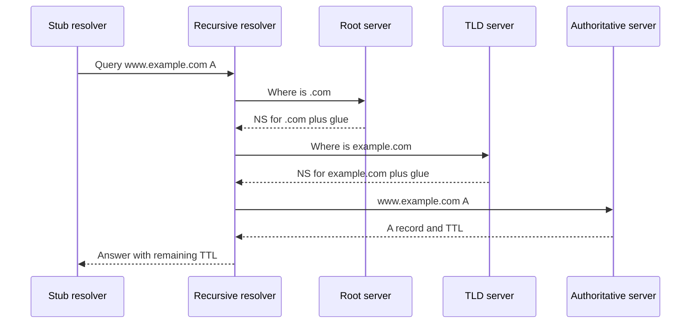

DNS is a distributed lookup that turns a name into answers: usually an IP address, sometimes a CNAME, MX, TXT, or a "this name does not exist." Every HTTP client you ship starts here. If DNS is slow, wrong, or cached too long, the rest of the request path never gets a fair chance.

The engineer who can code a service often treats DNS as a library call: `getaddrinfo`, then connect. That call hides a chain of roles. The stub resolver on the machine asks a recursive resolver. The recursive resolver walks from the root, to the TLD, to the authoritative servers for the zone, unless a cache already has a still-fresh answer. Authoritative servers are the source of truth for a zone. Recursive resolvers are the workers that cache and chase referrals.

TTL is the contract between those two. An authoritative server says "remember this for N seconds." Recursive resolvers, stub caches, browsers, and JVMs all keep their own copies. You do not control most of those copies. You control the TTL you publish and the names you choose so that a change can land.

I want operators who have not run a zone to leave with three distinctions: stub versus recursive versus authoritative; what a cache is allowed to remember; and why a "DNS change" is a propagation problem, not a button.

## Concept

### The roles

**Stub resolver.** Lives on the client: the OS, glibc, a mobile stub. It sends a query to a configured recursive resolver (DHCP, `8.8.8.8`, `1.1.1.1`, an internal Unbound). It does not walk the tree. It caches a little, often less than you think, and often more than you want in a long-lived JVM.

**Recursive resolver.** Accepts the stub's query and returns a finished answer. On a cache miss it starts at a root hint, follows NS referrals down the tree, and stores each record for its TTL. Public resolvers (Google Public DNS, Cloudflare 1.1.1.1, Quad9) and the resolver in your VPC both play this role. They are not authoritative for your company zone unless you have also loaded that zone into them.

**Authoritative server.** Answers from a zone file or a database you publish. It does not recurse (or must not, if you want a clean split). When a recursive resolver asks `api.example.com A`, the authoritative for `example.com` returns the A record and an NS set. Route 53, Cloud DNS, NS1, BIND views, and PowerDNS all sit here.

Mixing recursive and authoritative on one process is how you get loops and poisoned cache. Keep them separate.

### The lookup walk

A stub asks its recursive resolver for `www.example.com A`. Cache miss. The recursive asks a root server: "who knows `.com`?" The root returns NS records for the `.com` TLD, and usually glue A/AAAA for those NS names. The recursive asks a `.com` server: "who knows `example.com`?" The TLD returns NS for `example.com`, plus glue if the NS names sit inside the zone. The recursive asks those NS: "give me `www.example.com A`." The authoritative answers with an A, a CNAME chain, or NXDOMAIN.

Each of those answers carries a TTL. The recursive stores them. The next stub that asks gets a response with a remaining TTL, not a fresh walk. Roots and TLDs are hit far less than application graphs suggest, because their NS sets are cached for hours to days.

Queries travel over UDP on port 53 for small payloads. If the answer does not fit, the server sets the truncated bit and the client retries on TCP, or the client uses EDNS0 to allow a larger UDP payload. DNS-over-HTTPS and DNS-over-TLS wrap the same messages in a privacy layer; the tree walk does not change.

### Record types you actually operate

**A / AAAA.** Name to IPv4 / IPv6. This is what `connect()` needs.

**NS.** Delegation. The parent zone (TLD or your parent) must point at the same names your child publishes. Delegation mismatch is a class of outage that looks like "DNS is broken" and is really two sources of truth.

**CNAME.** This name is an alias of another name. A CNAME cannot sit next to other data on the same node name. Apex CNAMEs are forbidden by the protocol; vendors fake them with ALIAS/ANAME flattening at the authoritative server.

**MX, TXT, SRV.** Mail, verification, service discovery. TXT is how ACME DNS-01 and many vendor verifications work. A low TTL on a verification record is fine. A low TTL on a stable MX may just mean extra queries.

**SOA.** Serial, refresh, retry, expire, negative TTL. Secondary authoritative servers use this to decide when to AXFR/IXFR. The negative TTL (NXDOMAIN caching) is as operationally important as the positive TTL.

### TTL and caches you do not own

You publish a TTL. Recursive resolvers should not serve the record longer than that. Many honor it. Some clamp very low TTLs upward. Stub resolvers, browsers, and language runtimes add their own layers. A 60-second TTL is not a 60-second global cutover. It is a promise that well-behaved recursive caches will forget by then. It is not a promise about a laptop that resolved the name this morning and kept the socket pool.

Negative caching means NXDOMAIN and NODATA are remembered too. If you query a name before you create it, resolvers may store the absence for the SOA minimum / negative TTL. Creating the record does not instantly fix clients that already asked.

### Authority versus recursion, again, because this is where teams fail

Your application should talk to a recursive resolver. Your zone should live on authoritative servers. Your recursive resolver should not be listed in the parent's NS set. Your authoritative servers should not forward leftover names to the public internet in ways that let them be used as open resolvers. Internal split-horizon (the same name, different answers inside the VPC versus outside) is a second zone view, not a recursive trick. Get the view wrong and you leak internal IPs or blackhole public clients.

## Trade-offs

| Approach | When it wins | Cost / risk |
| -------- | ------------ | ----------- |
| Short TTL (30–60s) | Failover, blue-green cutover, CDN target changes | Query load on authoritative servers; some resolvers clamp; still not instant |
| Long TTL (hours to a day) | Stable apex, NS sets, records that never move | Long tail after a mistake; incident lasts for the old TTL |
| CNAME to a vendor | Hand the record to a CDN or SaaS without copying IPs | Extra lookup; apex restrictions; dependency on the vendor's name |
| ALIAS/ANAME flattening at the apex | Apex must look like an A but follow a vendor name | Vendor-specific; harder to debug; TTL of the flattened target may surprise you |
| Self-hosted BIND/PowerDNS | Custom logic, internal zones, no vendor API | You own AXFR, anycast, DDoS, and 3am serial mistakes |
| Managed authoritative (Route 53, Cloud DNS, NS1) | Health checks, alias records, API-driven changes | Account lock, regional API failure, product limits on record types |

TTL is the only widely deployed cache-control for DNS. Treat it as a safety and a bill. NS records should stay long; the names they point at can move with glue and dual-stack planning. Application records should be as short as your authoritative plane can honestly serve.

## Diagram

## Failure modes

### Stale cache after a cutover

You lower TTL, change the A record, and a slice of users still hit the old IP. Their recursive resolver still has the previous answer, or a stub cache never asked again, or a connection pool kept the old address.

**Detection.** Query the name from several public resolvers (`dig @8.8.8.8`, `@1.1.1.1`, `@9.9.9.9`) and from inside your VPC. Compare remaining TTL and the RDATA. Packet capture on the old origin will show new SYNs after you believed DNS had moved.

**Mitigation.** Drop TTL well before the change, wait the old TTL, then flip. Keep the old origin healthy until the old TTL has fully expired plus a margin for clamping resolvers. Flush what you own (your recursive resolvers, your application DNS cache). Do not promise the board that a 60-second TTL means a 60-second global move.

### Delegation mismatch

The TLD says `example.com` NS are `ns1.example.net` and `ns2.example.net`. Your zone file lists different names, or one of those NS is down, or glue at the parent is the wrong IP. Resolvers follow the parent. Your dashboard, which queries the child, looks fine.

**Detection.** `dig +trace example.com NS` and compare parent glue to child NS. Monitor each listed NS from outside your network. SERVFAIL on a subset of resolvers with NOERROR on others is a classic split.

**Mitigation.** Treat parent and child as two publishes. Dual-run old and new NS during a provider move. Never let the only copy of glue sit on a name inside a zone you are about to delete.

### NXDOMAIN cached before the record exists

A deploy creates `new.api.example.com` after clients and health checks have already looked it up. Negative cache holds the absence. The record is in the zone. Half the world still gets NXDOMAIN.

**Detection.** Authoritative server returns the A; recursive resolvers still return NXDOMAIN with a remaining negative TTL. SOA minimum tells you how long that lasts.

**Mitigation.** Create the name before any client should use it. Keep negative TTLs modest on zones you mutate. If you already poisoned the absence, wait it out or ask operators of recursive resolvers you control to flush that name. You cannot flush Google Public DNS for the whole internet on demand in a way you should depend on.

### Open resolver or amplification

An authoritative host that also recurses, or a recursive host without access control, becomes a DDoS amplifier. UDP, spoofed source, large TXT or ANY answers.

**Detection.** Outbound DNS bandwidth that does not match inbound query rate from your stubs. Query logs full of `ANY` and foreign sources.

**Mitigation.** Authoritative servers answer only for zones they own. Recursive servers answer only for your networks. Disable `ANY` where you can, rate-limit UDP, and prefer TCP/DoT/DoH for your own stubs. This is not optional hardening; it is how DNS operators stay on the internet.

## Real-world example

Cloudflare's 1.1.1.1 is a public recursive resolver. It is not authoritative for your zone. When a stub on a phone uses 1.1.1.1, Cloudflare's resolver either answers from cache or walks root, TLD, and your authoritative NS. The TTL you set on Route 53 or NS1 is the TTL that resolver should honor. Cloudflare also runs authoritative DNS for customers who point their NS at Cloudflare. Those are different products that share a company name. Mixing them up in a ticket is a standard outage amplifier: flushing 1.1.1.1 does not change what your NS publish, and changing a Cloudflare authoritative record does nothing for clients whose recursive resolver still holds the old RDATA.

The lookup I actually debug in production is closer to this: a laptop stub, a corporate recursive (or 8.8.8.8 on a home network), a TLD that still has last week's glue, and Route 53 as authoritative with an alias to an ELB. The ELB name has its own A set and a short TTL. The human-facing name has a longer TTL. The cutover plan has to wait for the longer of the two, not the one on the slide. `dig +trace` from a network that is not yours is the tool. Your VPC resolver will lie by being too up to date.

## What to remember

- **Stub asks recursive; recursive walks or caches; authoritative owns the zone.** Do not mix the last two on one host.
- TTL is a cache lifetime for well-behaved resolvers, not a global kill switch; negative TTL caches absence too.
- Parent NS glue and child NS sets must match, or a slice of the internet follows a different truth than your dashboard.
- UDP/53 is the common path; truncation, EDNS0, and TCP are how large answers still work.
