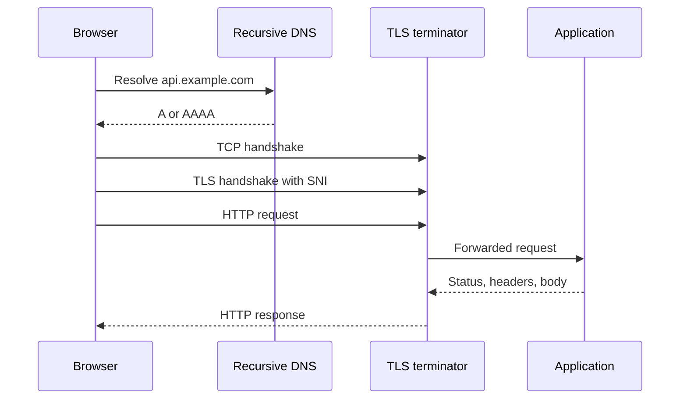

An HTTP request is not "the browser talks to the app." It is a sequence of distinct phases: resolve a name, obtain a connection, optionally complete TLS, send a request through zero or more intermediaries, let the origin apply application logic, and return a status line plus headers and a body. Each phase has its own clocks, its own failure, and its own place to add latency that you will misattribute to "the API" if you only log application time.

The engineer who can write a handler sees `GET /orders/1` and a JSON body. Production sees DNS, TCP handshake, TLS handshake, an HTTP/2 stream or an HTTP/1.1 request on a keep-alive socket, a load balancer idle timeout, a reverse proxy, and then the handler. HTTPS is HTTP on a TLS layer, not a different application protocol. The semantics of methods and status codes do not change because the socket is encrypted.

I walk this path in this order on purpose: if you start at the controller, you will never find the 200 ms that belongs to a missed DNS cache or a TLS 1.2 full handshake on a cold mobile network. If you start at DNS and never reach status codes, you will ship a service that connects beautifully and then lies with 200.

Treat intermediaries as first-class hops. CDNs, API gateways, service meshes, and corporate proxies all terminate or forward the request. The Host header, the SNI, and the TLS certificate must make sense at the hop that terminates TLS, which is often not the process that runs your code.

## Concept

### Name, then socket

The client has a URL. Scheme `https`, host `api.example.com`, path `/v1/orders`. DNS (stub, recursive, authoritative) produces A/AAAA records. Happy Eyeballs may race IPv6 and IPv4. The client picks an address and a port (443 for HTTPS, 80 for HTTP).

TCP (or QUIC, which is a different story under HTTP/3) then builds a connection. For TCP: SYN, SYN-ACK, ACK. That is one round trip before any HTTP byte, two if you still count a separate TLS phase the old way. Connection reuse exists because this cost is large. HTTP/1.1 keep-alive, HTTP/2 multiplexed streams on one TLS connection, and HTTP/3's 0-RTT on a remembered QUIC session are all answers to "do not pay handshake again."

### TLS, then HTTP

For HTTPS, the client and the terminating server run a TLS handshake. TLS 1.3 typically combines with TCP so that encrypted application data starts after one round trip from the SYN. SNI tells the terminator which certificate to present when many names share an IP. The certificate chain must validate against a trust store the client actually has. ALPN selects `h2` or `http/1.1` (or `h3` for QUIC). After keys exist, HTTP bytes move as TLS records.

The origin application often never sees this handshake. A load balancer or mesh sidecar terminated TLS and opened a new connection inland, maybe plaintext, maybe mTLS. The "request" your app logs is a descendant of the client's request, not the same socket.

### The HTTP message

A request is a method, a target, a version, headers, and optionally a body. GET and HEAD should have no body; POST, PUT, and PATCH often do. `Content-Length` or `Transfer-Encoding: chunked` frames the body. Hop-by-hop headers (`Connection`, `Transfer-Encoding`, `Keep-Alive`, `TE`, `Trailer`, `Upgrade`) belong to a single connection. Intermediaries must not blindly copy them to the next hop. End-to-end headers (`Host`, `Authorization`, `Content-Type`, caching headers) are meant to travel.

The response starts with a status line. 1xx is intermediate. 2xx succeeded at the origin's HTTP layer. 3xx asks the client to use another target. 4xx says the client sent something the origin will not accept as-is. 5xx says the origin or an upstream failed. A CDN can generate 502, 503, or 504 without your process ever running. Read the status in context of which hop wrote it.

### Intermediaries

A typical public request hits: recursive DNS, anycast CDN or edge proxy, then origin load balancer, then an application proxy or sidecar, then the process. Any hop may:

- Cache a GET (and must honor `Cache-Control`, `Vary`, and method rules or it is a bug).
- Retry a failed inbound connection. Retries of non-idempotent methods are how duplicate POSTs are born.
- Strip or add headers (`X-Forwarded-For`, `X-Request-Id`, `Via`).
- Enforce TLS, WAF rules, or authentication.

The client's URL host must match the certificate at the TLS terminator and the `Host` header the origin uses for routing. Mismatches produce the "works in curl to the pod, fails in the browser" class of incident.

### Timeouts are per hop

Client total timeout, TCP connect timeout, TLS handshake timeout, idle timeout between keep-alive requests, gateway timeout to origin, application handler deadline. They are not one number. A gateway with a 60s timeout in front of a handler with a 120s deadline will 504 while the handler still works and then writes to a closed connection. Align them on purpose: client > gateway > app, or the reverse if you want the app to notice first. Document which hop owns the user-visible error.

## Trade-offs

| Approach | When it wins | Cost / risk |
| -------- | ------------ | ----------- |
| HTTP/1.1, new connection per request | Simple debugging, tiny clients | Handshake cost; head-of-line on one connection if you pool poorly |
| HTTP/1.1 keep-alive pool | Repeat calls to one origin | Idle timeouts at middleboxes; stale sockets; limited parallelism per host |
| HTTP/2 multiplex on one TLS connection | Browsers, many small requests, header compression | TCP head-of-line under loss; more complex debugging |
| HTTP/3 / QUIC | Lossy mobile networks, faster 0-RTT resume | UDP blocked on some networks; fallback complexity |
| TLS at the edge, plaintext inland | Operational ease in a private network | Anyone on that network reads bodies; compliance may forbid it |
| TLS end-to-end plus mesh mTLS | Zero trust inside the cluster | Double handshake cost; certificate operational load |

Connection reuse and protocol version are latency tools. They do not change REST semantics. Pick them for the client population you have (browsers versus server-to-server versus mobile) and for the middleboxes you cannot remove.

## Diagram

## Failure modes

### Timeout mismatch and ghost work

The gateway returns 504. The handler continues, writes to the database, then fails to write the response. The client retries. You now have two side effects and one error in the user's face.

**Detection.** Correlate gateway 504s with application logs that still show a completed handler after the 504 timestamp. Trace ids that exist on the origin but not on a client-visible success. Database rows whose request ids have no 2xx.

**Mitigation.** Set handler deadlines shorter than the gateway timeout. Make the write path idempotent (see the companion essay on idempotency keys). When you 504, the client must not assume the origin did nothing. Document that.

### TLS terminator and origin disagree on the name

Certificate is for `www.example.com`. The app routes on `Host: api.example.com`. Or SNI says `api` and the inner `Host` says `www`. Browsers fail closed. `curl -k` to the pod succeeds.

**Detection.** Compare SNI, certificate SAN, and `Host` at each hop. Access logs at the terminator versus 404s at the origin for the same path. Certificate expiry monitors that check the name clients actually use.

**Mitigation.** One public name, SAN list that matches, `Host` preserved or rewritten on purpose. Automate certificate issuance for every name on the terminator. Do not debug TLS with application logs.

### Intermediary retries POST

A mesh or load balancer retries a POST after a connection reset. The origin processed the first attempt. The client sent one request. Two charges occur.

**Detection.** Duplicate application-level ids with one client request id. Retry counters on the proxy for methods other than GET/HEAD/PUT/DELETE. Burst of 201s with the same body hash.

**Mitigation.** Proxies retry only idempotent methods by default. POST retries require an idempotency key the origin honors. Disable retry-on-reset for unsafe methods until that exists.

### Status code from the wrong hop

A CDN 502 is treated as an application bug. An application 404 is treated as a mesh routing bug. On-call follows the wrong playbook for forty minutes.

**Detection.** Status dashboards that do not label which hop emitted the code. Missing `Via` or server identity headers. Synthetic checks that hit only the origin and miss the CDN path users take.

**Mitigation.** Tag every generated error with the hop (`cdn`, `gateway`, `app`). Synthetics from the public URL and from behind the CDN. Teach the status classes: 502/504 often mean the next hop did not speak HTTP in time; 5xx from your app mean your code or its dependencies.

## Real-world example

A Chrome request to a site fronted by Cloudflare is the lifecycle I draw on the board. The browser resolves the hostname (often to an anycast address Cloudflare publishes). It opens TCP to 443, completes TLS 1.3 with SNI for that hostname, and ALPN-negotiates HTTP/2. Cloudflare's edge is the TLS terminator. It may answer from cache for a cacheable GET, or it may open or reuse a connection to the origin (an origin certificate or a publicly trusted certificate, depending how you configured SSL mode). The origin might be an AWS ALB that terminates TLS again and forwards HTTP to an application target group. The application sees `X-Forwarded-For` and a scheme header Cloudflare injected, not the browser's socket.

Cloudflare returning 522 means it could not complete a TCP handshake to the origin. 524 means the origin accepted TCP but did not send an HTTP response in time. 5xx from your app still originate in your process. Those three are different machines. Treating them as one "HTTPS is down" bucket hides the phase that failed. The same split exists with Fastly, with AWS CloudFront plus ALB, and with nginx in your own rack: terminator, forwarder, origin, each with a timeout and a status vocabulary.

I ask teams to log three timestamps per request they own: when the terminator accepted TLS, when the origin received the forwarded request, and when the handler finished. The gaps are DNS-plus-handshake (invisible to the app), queueing, and application work. Without the gaps you will "optimize the handler" while users wait on a cold handshake.

## What to remember

- The lifecycle is **DNS, connection, TLS, HTTP, intermediaries, status** — application code is one step, not the whole path.
- HTTPS is HTTP over TLS; methods and status codes stay the same, the hop that terminates TLS often is not your process.
- Timeouts and retries are per hop; a 504 with a still-running handler is how duplicate writes start.
- Read status codes with the hop that generated them; CDN 522 and app 500 are different failures.
