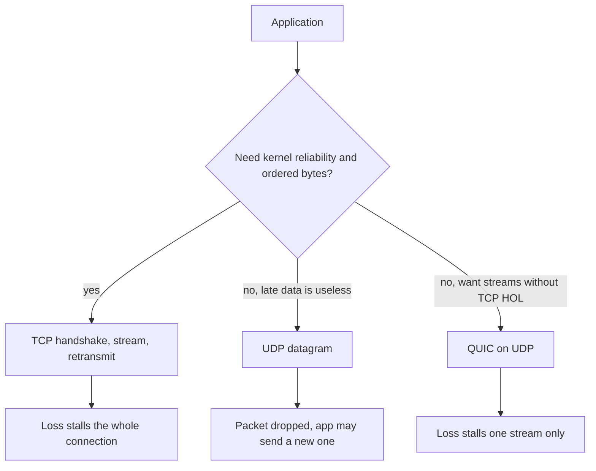

TCP and UDP are how applications get bytes onto IP. TCP gives you a byte stream: connection, ordered delivery, retransmission of lost segments, congestion control, and a handshake before data. UDP gives you datagrams: send a packet, hope, no handshake, no retransmission in the kernel, no ordering. Neither is "faster" in the abstract. TCP spends round trips and buffers to hide loss. UDP exposes loss so the application can decide.

The engineer who has written HTTP clients has been using TCP (or QUIC, which rides on UDP). The engineer who has sent a metrics packet or a DNS query has often been using UDP without naming it. The operational question is not which protocol is better. It is who owns reliability: the kernel stack, or your code.

Head-of-line blocking is the TCP property that surprises HTTP/2 operators. One lost segment stalls every stream multiplexed on that connection until the gap fills. UDP does not have that kernel behavior because it does not have a stream. QUIC rebuilds streams on UDP and loses only the stream that lost a packet. That is why HTTP/3 exists.

I want you to choose TCP when an application-level retry would be a worse reliability layer than the one the kernel already has. I want you to choose UDP when latency of a late packet exceeds the value of the packet, or when you are about to implement a better reliability machine than TCP's one-stream model.

## Concept

### What TCP actually guarantees

A TCP connection is identified by the 4-tuple (local IP, local port, remote IP, remote port). Three-way handshake (SYN, SYN-ACK, ACK) agrees on initial sequence numbers. Data is a sequence of bytes, not messages. A `recv` of 100 bytes may return 40. Application protocols on TCP need their own framing (HTTP headers plus `Content-Length`, TLS records, length prefixes).

Lost segments are retransmitted. Duplicates are dropped. The receiver's sliding window advertises how much it can accept. Congestion control (Reno, CUBIC, BBR, and friends) slows the sender when the network marks or drops packets. Connection teardown is a handshake too (FIN/ACK or RST). Firewalls learn the connection from the handshake; a stray TCP packet with no state is often dropped.

Reliability here means "the byte stream is reconstructed or the connection fails." It does not mean "the business operation ran once." A TCP send that succeeded can still sit in a kernel buffer while the process crashes. Application acknowledgements remain your job.

### What UDP actually gives you

A UDP datagram is a message. If it arrives, it arrives as sent (modulo truncation if the recv buffer was short). It may not arrive. It may arrive twice. It may arrive out of order. There is no handshake, so a first packet can carry payload. There is no connection in the kernel, so a firewall must allow stateless UDP or build its own session table from seeing traffic.

The checksum covers the UDP header and payload (and IPv4 UDP checksum can be zero, which is its own footgun). Path MTU still applies: large datagrams fragment at IP, and lost fragments lose the whole datagram. Keep application datagrams small enough to avoid fragmentation unless you control the path.

DNS queries, NTP, QUIC, HTTP/3, most game client ticks, WebRTC media (typically RTP/UDP), and syslog-over-UDP chose this because a handshake or a retransmission in the kernel would be the wrong default.

### Head-of-line blocking

TCP delivers a single ordered stream per connection. Packet 5 lost, packets 6–20 in the buffer: the application does not see 6–20 until 5 is retransmitted. HTTP/1.1 pipelining hit this per request. HTTP/2 multiplexes many requests on one TCP connection and still hits it: one loss stalls every stream. That is TCP HOL blocking.

UDP applications that number their own messages can use 6–20 without waiting for 5. Video does this: a late frame is useless, skip it. QUIC does this per stream: a loss on stream A does not stall stream B, even though both ride one UDP 5-tuple.

If your payload is a file, HOL blocking is the price of a simple stream. If your payload is 50 independent RPCs, HOL blocking is a coupled failure you did not want.

### When UDP is the right default

- **A late packet is worth less than an on-time packet.** Media, real-time game state, some telemetry.
- **You will implement reliability anyway, with different semantics than TCP.** QUIC (crypto + streams + 0-RTT), custom game protocols, DNS (retry the query, do not retransmit a segment).
- **Handshake cost dominates.** A 200-byte DNS query should not pay a TCP three-way handshake plus teardown. (DNS still falls back to TCP for large answers and zone transfers.)
- **You need to be connectionless at the kernel.** Anycast services that should not hold TCP tables for millions of clients.

When UDP is the wrong default: you were about to reimplement TCP badly — ordered reliable byte stream, timers, congestion control — in user space, without a reason like HOL or 0-RTT. That project has a name, and it ships late.

### Congestion and fairness

TCP participates in congestion control. UDP by default does not. A UDP sender that blasts at line rate will hurt the path for everyone, including itself via uncontrolled loss. Responsible UDP applications use application-level congestion control (QUIC's, LEDBAT, or a simple rate cap). If you ship a UDP protocol without a rate story, operations will firewall you, and they will be right.

## Trade-offs

| Approach | When it wins | Cost / risk |
| -------- | ------------ | ----------- |
| TCP | Request/response APIs, files, anything that wants a reliable byte stream | Handshake RTT; HOL blocking; middlebox state; not message-oriented |
| UDP, fire-and-forget | Metrics, DNS, packets where retry is "send a new one" | Loss, duplication, reordering, amplification if you answer spoofed sources |
| UDP plus application reliability (QUIC) | Multiple streams, 1-RTT/0-RTT crypto, mobile path changes | Implementation and operational complexity; UDP blocking on some networks |
| TCP plus app retries | Most CRUD HTTP | Duplicate application effects if retries are not idempotent |
| SCTP or other alternatives | Telephony niches that need native multi-stream on TCP-like reliability | Poor NAT and cloud support compared with TCP and UDP |

The kernel choice does not replace an application contract. TCP will not make POST safe to retry. UDP will not make a file transfer complete. Pick the transport for loss behavior, then write the application protocol on top.

## Diagram

## Failure modes

### TCP HOL under loss, blamed on the application

HTTP/2 p99 latency explodes on a lossy last mile. The handler time is fine. One TCP connection carries all streams. A single lost packet holds every request.

**Detection.** Compare handler duration to client-visible duration on multiplexed connections. Packet loss and retransmission counters on the connection. HTTP/1.1 parallel connections looking "faster" than HTTP/2 on the same path is a clue.

**Mitigation.** HTTP/3 where clients support it. More TCP connections if you must stay on h2 (defeats some of h2's point). Reduce RTT and loss (better PoPs, not a busier handler). Do not add application timeouts that fire while TCP is still retransmitting the same gap.

### UDP silent loss

A metrics client sends UDP and assumes the collector saw it. The collector's nic dropped, or an intermediate ACL ate the packet. Dashboards go quiet. Nobody gets an error.

**Detection.** Sequence numbers or counters in the datagrams, compared at sender and receiver. Send-versus-receive rate on both ends. A TCP or TLS control channel that reports session health while data rides UDP.

**Mitigation.** Accept loss in the product spec, or add application acks and retransmission with a budget. Cap packet size under path MTU. Do not use UDP for "must arrive" billing events without a recovery log.

### Amplification and spoofed UDP

A small spoofed query produces a large answer to a victim. DNS, NTP, memcached UDP, and poorly designed RPC all have done this.

**Detection.** Outbound bytes >> inbound bytes on UDP services. Source addresses that are not your clients. Query types that expand (DNS ANY, large TXT).

**Mitigation.** Do not answer unauthenticated UDP with a larger payload than the request. Rate-limit. Disable UDP where TCP or QUIC with cookies exists. DNS cookies, QUIC retry tokens, and "response size ≤ request size until proven a real client" are the patterns.

### Middleboxes that "know" TCP and "block" UDP

Corporate networks allow 443/TCP and drop UDP. HTTP/3 fails, HTTP/2 works. Game traffic fails on hotel Wi-Fi. QUIC deployment without a TCP fallback looks like a random regional outage.

**Detection.** Protocol-specific success rates by network. QUIC handshake timeouts followed by h2 success. UDP 443 drop in traceroutes or in client telemetry.

**Mitigation.** Always have a TCP path for user-facing HTTPS. Treat UDP as an optimization with fallback, unless you control both ends and the path (internal backbone, not the public internet).

## Real-world example

DNS is the UDP system every backend engineer already depends on. A stub sends a small query on UDP/53. Most answers fit. If they do not, the truncated bit forces a TCP retry, and zone transfers (AXFR) use TCP on purpose. The protocol chose UDP for the common small lookup so a name resolution does not pay a TCP handshake. It chose TCP when reliability and size matter. That split is the whole lesson.

HTTP/3 (QUIC) is the other named production shape I want in this essay. Chrome, Firefox, and Safari speak HTTP/3 to origins that advertise it (often via Alt-Svc or HTTPS records). QUIC runs on UDP, encrypts almost everything, and multiplexes streams so a lost packet does not stall unrelated requests. Cloudflare, Google, and Facebook have all published that they serve a large share of HTTPS over QUIC where the path allows UDP. Clients still fall back to TCP HTTP/2 when UDP is blocked. If you enable HTTP/3 on an origin, keep HTTP/2 on 443/TCP. The transport is an optimization for lossy mobile paths, not a purity test.

Games and WebRTC media sit on the same side as DNS's small query: a late reliable packet is worse than an on-time unreliable one. They still run a reliable channel (TCP or QUIC) beside UDP for chat, inventory, and signaling. Two transports, two contracts, one product.

## What to remember

- TCP is a **reliable ordered byte stream** with handshake, retransmission, and congestion control; it is not message-oriented and it HOL-blocks on loss.
- UDP is **datagrams with no kernel reliability**; loss, duplication, and reordering are normal.
- Choose UDP when **lateness is failure** or when you will implement a better stream machine (QUIC); otherwise you will reimplement TCP poorly.
- User-facing HTTPS should **keep a TCP fallback** if you adopt HTTP/3; many networks still drop UDP.
