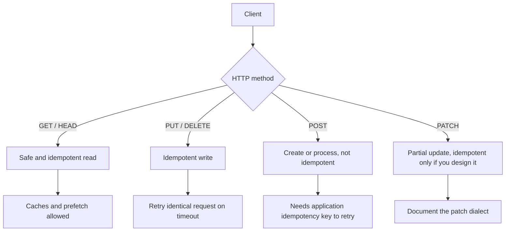

REST, as Fielding defined it, is an architectural style for networked systems: resources identified by URIs, manipulation through representations, a uniform interface, and stateless request/response. In industry usage, "REST API" almost always means HTTP resources with JSON bodies and a handful of verbs. I will talk about that practical contract, and I will keep Fielding's constraints where they still save you from a mess.

The engineer who can code a controller can expose functions as URLs: `POST /createOrder`, `GET /getOrder?id=`. That works until a gateway, a cache, a client generator, or a second implementation needs to guess what is safe to retry and what is safe to cache. HTTP already has that language. REST at the HTTP layer means using it.

Resources are nouns. Methods are the uniform verbs. Safety and idempotency are properties of those methods, defined by HTTP, not by your framework. GET is safe and idempotent. PUT and DELETE are idempotent and not safe. POST is neither. PATCH is not idempotent unless you design the patch document that way. If your "REST API" makes GET create a side effect, you have broken caches and prefetchers, not just a style guide.

I want the API to be boring: predictable URLs, boring status codes, JSON that matches the resource, error bodies that a client can parse. Cleverness belongs in the domain model, not in the verb.

## Concept

### Resources, not procedures

A resource is a thing the client might name: an order, a user, a file, a collection of invoices. The URI is the name. `/orders/abc` is an order. `/orders` is the collection. `/orders/abc/items` is a subcollection. Query strings filter, sort, and paginate a collection; they are not a second RPC convention.

Representations are the bytes you send: JSON, a JPEG, a CSV export. The same resource can offer more than one representation through `Accept` and `Content-Type`. Most product APIs pick `application/json` and stay there. That is fine. Do not pretend you are content-negotiating if you only ever emit one shape.

RPC-style endpoints (`/doRefund`) hide the resource. Sometimes the domain really is an action (a long-running job). Model that as a resource too: `POST /refunds` creates a refund object you can GET. The client can then poll a name, not a verb.

### Methods and the uniform interface

**GET.** Read a representation. Safe: it must not change server state except incidental logging and caching. Idempotent: repeating it does not change meaning. Caches and CDNs assume this. Browsers assume this. Prefetch assumes this.

**HEAD.** GET without a body. Metadata, existence checks, cache revalidation.

**POST.** Create a subordinate resource, or trigger a process whose result is not the same resource you POSTed to. Not safe, not idempotent. Two POSTs to `/orders` mean two orders unless you add an application idempotency key.

**PUT.** Replace the resource at this URI with the representation in the body. Idempotent: putting the same body twice leaves the same resource. Missing resource plus PUT is often "create at this name" if the client owns the id.

**PATCH.** Partial update. HTTP does not make PATCH idempotent. JSON Merge Patch can be idempotent; JSON Patch (ops that increment) often is not. If you need idempotent partial updates, document the patch dialect and test the double-apply.

**DELETE.** Remove the resource. Idempotent: deleting an already-gone name should return 404 or 204, not a new error each time. I prefer 204 for the first delete and 404 after, or 204 for both; pick one and keep it.

Do not invent `GET /orders/abc/delete`. Gateways will cache it. Clients will retry it. You will regret it.

### Safety versus idempotency at the HTTP layer

Safe means "no significant state change." Idempotent means "N identical requests have the same effect as 1." These are HTTP method properties. They are not your database's isolation level. A safe GET may still be expensive. An idempotent PUT may still conflict with another client's PUT (`409` or `412` with `If-Match`).

POST is the method you wrap with idempotency keys when the client retries. PUT already has a retry story if the body is the full replacement. Mixing them — POST that acts like PUT, GET that acts like POST — is how you lose the uniform interface and then rebuild it with comments.

### Status codes as a protocol, not a mood

**200** with a body, **201** with `Location` on create, **204** with no body. **304** for conditional GET. **400** for a malformed request you will never accept as-is. **401** unauthenticated, **403** authenticated but not allowed. **404** for a missing resource, including "exists but not for you" if you need to avoid oracle leaks. **409** conflict, **412** precondition failed (`If-Match`). **429** rate limit. **5xx** your problem or a dependency.

Do not return 200 with `{ "error": ... }`. Clients, load balancers, and synthetic checks all key off the status. The body explains; the status classifies.

### Collections, filtering, and pagination

`GET /orders?status=open&limit=50` is still a resource: the collection representation filtered. Pagination belongs in this family (offset versus cursor is a later essay). Sorting and filters should be stable enough that a URI can be bookmarked. Do not hide required filters in headers unless they are auth or locale.

### Hypermedia, used lightly

Fielding wanted hypermedia as the engine of application state: responses include links to legal next actions. Few JSON APIs go all the way. A practical minimum is a stable URI per resource, `Location` on 201, and pagination links (`next`, `prev`). If your only client is an iOS app you ship, full HATEOAS may not pay. If your clients are unknown integrators, names that do not change and links that do not require a second documentation site do pay.

## Trade-offs

| Approach | When it wins | Cost / risk |
| -------- | ------------ | ----------- |
| Resource URLs plus HTTP methods | Public APIs, multiple clients, caches, gateways | Awkward for "fire this workflow" unless you reify the workflow as a resource |
| RPC-style POST to verbs | Internal actions, one client, rapid prototype | No cache, no uniform retry story, colliding names |
| PUT for client-owned ids | Idempotent create/replace, retries are free at HTTP layer | Clients must mint ids; collisions need a rule |
| POST for server-owned ids | Simple "create" | Retries duplicate without an idempotency key |
| JSON-only, one versioned shape | Product APIs | `Accept` is unused; file uploads need a second path |

Use POST to create when the server assigns the id. Use PUT when the client already knows the name. Use PATCH when the representation is large and the client changes three fields. Do not use GET for anything you would not want a CDN to repeat.

## Diagram

## Failure modes

### GET with side effects

A GET sends email, starts a job, or increments a counter that the product treats as billing. A crawler, a prefetch, or an OpenAPI "try it" button fires it twice.

**Detection.** Access logs showing GET on endpoints that write. Duplicate side effects with no POST. Cache hits that still trigger downstream work.

**Mitigation.** Move the effect to POST or PUT. If you must have a "magic link," make the link land on a page that POSTs, or consume a one-time token that makes the second GET a no-op — and still know that caches may never hit the origin the first time.

### POST used for everything, including reads

`POST /search` with a body, because the query is large. Fine, sometimes. Then `POST /getUser` because the team got used to POST. GET caching, conditional requests, and CDN edges never apply. You also inherit POST's retry rules.

**Detection.** Traffic that is 90% POST. Absence of `ETag` / `If-None-Match` on read paths. Clients that cannot use a browser or a cache.

**Mitigation.** Reads as GET (or POST only when the query cannot fit the URL and you document why). Writes as PUT/PATCH/DELETE/POST according to idempotency. Measure cache hit ratio on public GETs; if it is zero, ask whether the method is wrong.

### Status 200 on failure

The HTTP layer says success. The JSON says `{ "success": false }`. A load balancer marks the instance healthy. A naive client parses only the status.

**Detection.** Search handlers for `200` plus an error envelope. Synthetic checks that only assert status. Support tickets where the client "got 200 but nothing happened."

**Mitigation.** Status carries the class. Body carries detail (`type`, `title`, `status`, `detail` in the RFC 7807 shape is enough). Tests that assert both.

### Resource identity that changes

The client stored `/orders/abc`. A rewrite moved it to `/v2/orders/abc` without a redirect, or ids were sequential and got reminted. Bookmarks and webhooks die.

**Detection.** 404 rate on previously 200 URLs after a deploy. Webhook target failures. Client SDK majors forced by path changes.

**Mitigation.** Stable resource ids. Path versioning, if you use it, keeps the rest of the path stable or 308-redirects. Treat URI as a public name, not as a filesystem path you tidy in a refactor.

## Real-world example

The GitHub REST API is the textbook of practical REST: resources as nouns (`/repos/{owner}/{repo}/issues/42`), methods with HTTP meaning, JSON bodies, documented media types, and `Link` headers for pagination. Creating an issue is POST to a collection. Updating is PATCH. Fetching is GET. GitHub also exposes a GraphQL API for a different client shape; they did not replace REST's method semantics with ad hoc verbs.

Stripe's HTTP API is the other shape I point at: resources (`/v1/charges`, `/v1/customers`), POST to create, GET to retrieve, and an explicit idempotency key header on POST because HTTP POST is not idempotent. They did not pretend POST was PUT. They added the missing application contract.

When I review an internal API, I ask three questions GitHub and Stripe both answer in docs: What is the resource name? What does a second identical request do? What status do I get when the resource is missing versus when I am not allowed to see it? If the answers live only in Slack, it is not a uniform interface yet. It is a collection of handlers.

Copy the boring parts: plural collections, integer or opaque ids in the path, JSON object per resource, error status that matches reality, and no GET that writes. Leave the clever parts — search DSL, bulk jobs, webhooks — as extra resources with the same rules.

## What to remember

- **Resources are names (URIs); methods are the uniform verbs.** Do not encode actions in the path if a method already means that action.
- **Safe and idempotent are HTTP properties.** GET must not write; POST must not be retried without an application key.
- Status codes classify; bodies explain. **200-plus-error-envelope is a lie** to every hop that only reads the status.
- PUT if the client owns the id and the body is a replacement; POST if the server mints the id; PATCH only with a documented dialect.
