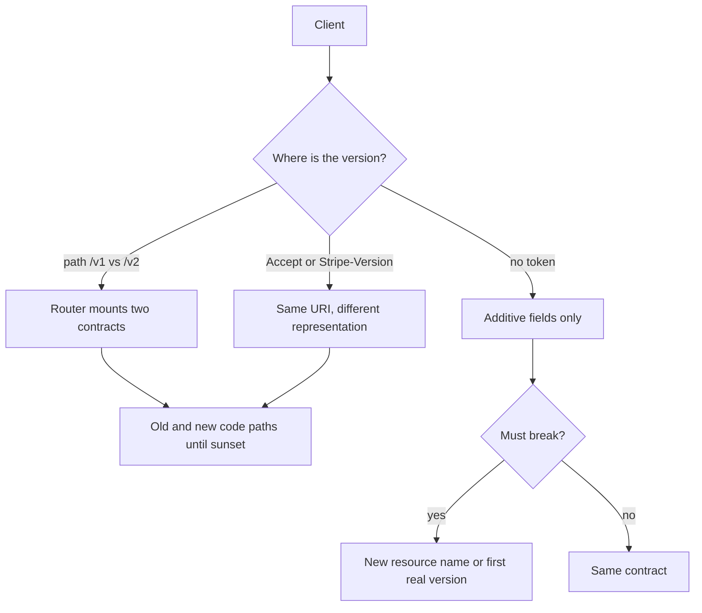

An API version is a promise about what a client that stopped updating can still send and still parse. It is not a folder name and it is not a git tag. The moment you have a second client you do not deploy, you have a compatibility problem. Versioning is how you change the contract without waking that client at 3am.

The engineer who can ship a JSON handler will "just add a field" and call it compatible, or "just put /v2/ in the path" and call it versioned. Both can be right. Both can be a trap. Compatible evolution (additive fields, optional new query params, never reuse a name for a new meaning) avoids a version bump. A new meaning for an old field, a removed property, a changed status code, or a different error shape is a breaking change. Breaking changes need a version strategy, a sunset plan, and a period when both behaviors exist.

I treat three strategies as the ones you will actually operate: URI version (`/v1/orders`), header version (`Accept` or a vendor header), and compatible evolution with no version token at all. Query-parameter versions (`?api-version=`) show up in some clouds. They are a header by another transport. Pick one primary signal. Do not make the client send three.

The goal is not to version often. The goal is to change rarely, and when you must break, to leave the old contract runnable until the last serious client has moved.

## Concept

### What counts as breaking

Breaking: removing a field, renaming a field, changing a field's type, changing default behavior, turning a 200 into a 404 for the same request, requiring a new header that old clients omit, tightening validation so previously accepted bodies fail, reordering a list that clients treated as significant.

Usually compatible: adding an optional field in a response, adding an optional query param that defaults to the old behavior, adding a new resource, adding a new optional header the server ignores if absent.

"Usually" because a strictly coded client that rejects unknown JSON fields will treat an added field as a crash. Document that clients must ignore unknown fields. If you cannot document that, additive change is still a break for that client, and you will version more than you wanted.

### URI version

`https://api.example.com/v1/orders` and `https://api.example.com/v2/orders`. The version is visible in logs, in CDNs, in browser bookmarks, in WAF rules. Routing is trivial: mount two stacks or two schemas. Clients copy the path from docs and never think about headers.

Cost: every URL is now branded with a version. Hypermedia links must carry it. You will duplicate routes. Teams start implementing features only on v2 and leave v1 to rot, or they share code and a v1 bugfix silently changes v1 behavior. Sunset means keeping a path alive, not only a header.

URI versioning is a good default for public HTTP APIs whose clients are scripts, mobile apps, and third parties who paste paths. It is a poor default if you change the version every month; the path becomes noise.

### Header version

`Accept: application/vnd.example.v2+json` or `Stripe-Version: 2024-06-20` or `GitHub` media types on `Accept`. The URI stays `/orders`. Caches must `Vary` on that header or they will mix representations. Proxies that strip unknown headers will pin everyone to default.

Date-based versions (Stripe) treat the version as a snapshot of behavior, not as a monument. The account has a default version. A request can override it. New dates appear when Stripe changes the JSON. Old dates keep working. That is header versioning with a compatibility matrix, not with two codebases named v1 and v2.

Header versioning is a good default when the resource identity should be stable and you change representation often. It is a poor default when your clients cannot set headers (some forms, some caches, some support engineers typing curl from a runbook).

### Compatible evolution without a version token

You never bump. You only add. You never change meaning. This is how many internal APIs actually live, and how Protocol Buffers field numbers were meant to work. It requires discipline: no reuse of field names, no silent change of enums, no "we'll just switch this boolean."

When you eventually must break, you have no lever except a new resource name (`/order_v2`) or a sudden flag day. Flag days need a complete client inventory. Internal APIs sometimes have that. Public APIs almost never do.

### Running two behaviors

Whatever the signal, the server must implement old and new for a while. Options: two code paths behind a version switch, two services, or a transformation layer that adapts v1 requests into the v2 model and v2 responses back into v1 JSON. The adapter is attractive and becomes a second product. Put a calendar on the old path. Publish a sunset date. Measure request share by version. Do not keep v1 because a single unused integration might still exist; keep it because the metrics say someone still calls it, then find that someone.

## Trade-offs

| Approach | When it wins | Cost / risk |
| -------- | ------------ | ----------- |
| URI path `/v1`, `/v2` | Public REST, simple curl, CDN routing, obvious logs | URL churn; duplicated routes; versions ossify into products |
| Header (`Accept` or vendor header) | Stable resource URIs; frequent representation changes; account-default versions | Caches must Vary; clients that cannot set headers; default version surprises |
| Query parameter `api-version` | Gateways and generated SDKs that already put options in the query | Easy to omit; caches and logs treat it as optional; looks like a filter |
| Compatible evolution only | Internal APIs with additive protobuf/JSON and known clients | No escape hatch; one breaking change becomes a flag day |
| Date-pinned versions per account | Large public APIs with many SDK releases (Stripe's model) | Compatibility matrix; test cost grows with every date you still honor |

I pick URI `/v1` for a first public API because it is hard to ignore in a ticket. I pick header or date versions when the URI is part of the product identity and representations will change often. I pick compatible evolution when I control every client. I never pick "we'll see."

## Diagram

## Failure modes

### Silent break on a shared `/v1`

You changed v1 behavior because the code was shared with v2. Old mobile apps fail. The path still says v1, so the incident looks like "we didn't version."

**Detection.** Contract tests that pin v1 request/response fixtures in CI. Error rate by client version and by path version. Diff of serialized JSON against a golden corpus per version.

**Mitigation.** Isolate v1 with tests that fail the build on accidental diff. If code is shared, the version switch must sit at the serialization boundary, not deep in the domain. Freeze v1 except for security fixes.

### Default version moves under existing clients

Header-versioned APIs often default to "latest" or to the account's current version. An account upgrade, or a server change of default, alters JSON for clients that never sent the header.

**Detection.** Clients that omit the version header, then fail after a deploy. Compare response schemas for header-absent requests before and after.

**Mitigation.** Pin a default per account, not globally to latest. Require the header in new SDKs. Treat a missing header as a specific frozen version documented in the changelog, not as "whatever we shipped today."

### Cache mixing representations

A CDN caches `GET /orders/1` from a v1 client and serves it to a v2 client, or the reverse. The URI was the cache key. The version was in `Accept`.

**Detection.** Clients reporting "wrong shape" with 200. Cache hit logs that do not include the version header. Missing `Vary: Accept` (or your vendor header) on responses.

**Mitigation.** `Vary` on the version header. Include the version in the cache key at the gateway. For URI versioning this class of bug mostly disappears, which is a real argument for `/v1`.

### Eternal v1

No sunset, no metrics, five versions in production, none deleted. Every bug is fixed four times or not fixed on the versions that still have traffic.

**Detection.** Version share dashboard that you do not have. Code directories named v3 still receiving production traffic two years after v5 launched.

**Mitigation.** Emit the version on every request log. Publish deprecation and sunset dates (RFC 8594 `Sunset` header is available). Contact remaining clients. Then turn v1 into 410 with a body that names the replacement. A version without an end is a second API forever.

## Real-world example

Stripe versions its HTTP API by date. The URI stays under `/v1/` as a platform prefix; the breaking-change lever is the `Stripe-Version` header and the API version pinned on the account. When Stripe changes a response shape, they publish a new date. SDKs and the dashboard can set the version. Old dates continue to be served. That is header-based, date-named compatible snapshots, not a `/v2/` rewrite of every resource.

GitHub's REST API used `Accept` media types (for example `application/vnd.github.v3+json`) to select representations, and later moved the current REST API to a versioned preview/stable policy documented in their changelog. The resource paths stayed recognizable (`/repos/...`). Microsoft Azure often puts `api-version=2021-04-01` on the query string of ARM calls, which is the same idea with a different location: every request names a snapshot.

What I copy from Stripe: pin a default per customer, let a request override, and keep old snapshots working. What I copy from URI `/v1` shops: make the version visible in the URL when your clients are curl and WAF rules. What I refuse to copy: shipping `/v2/` as a marketing increment that is not actually a new contract, or changing v1 in place because "nobody uses the old fields." Measure. Then sunset.

## What to remember

- A version is a **compatibility promise**, not a directory; breaking changes need a strategy and a sunset, not a new folder alone.
- **URI versions** are obvious and cache-safe; **header/date versions** keep resource identity stable and need `Vary` and pinned defaults.
- **Compatible evolution** (add only, never reuse names) avoids versions until it cannot; then you still need a lever.
- Run old and new until metrics say the old share is gone, then **410 with a documented replacement** — do not keep every version forever.
