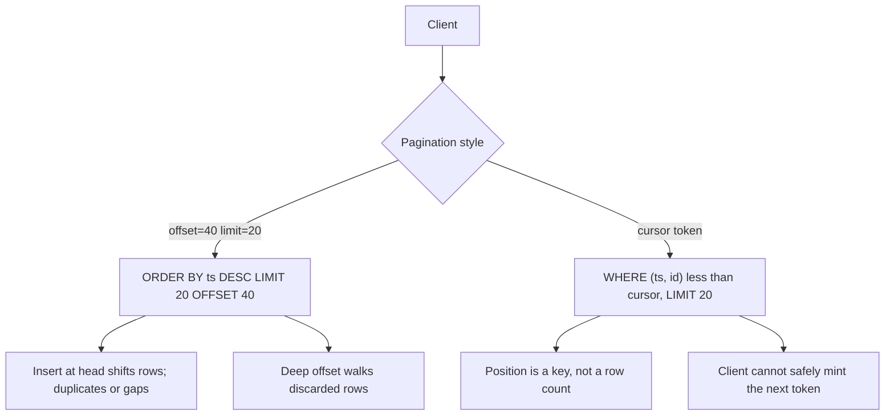

Pagination is how a collection API refuses to return the entire table. Offset pagination says "skip N, take M." Cursor pagination says "give me the next M after this opaque mark." Both slice a result set. They fail differently when the set mutates while the client walks it, and they cost differently in the database.

The engineer who can write `LIMIT 20 OFFSET 40` has offset pagination. It maps to page numbers in a UI. It also drifts: while you read page 2, a new row inserts at the top, and you skip a row or see one twice. Deep offsets make the database walk and discard N rows, even with an index, unless the planner can seek. That cost is real on large tables.

Cursors trade that for opacity. The client cannot jump to page 50 without walking, or without you offering a separate "seek" API. The cursor encodes a position in a total order, usually `(sort_key, id)`. Inserts above the cursor do not shift what "next" means. Deletes can still skip, depending on how you encode the mark. The client must treat the cursor as a token, not as JSON they edit.

I pick offset for small, stable, human-numbered lists. I pick cursors for feeds, exports, and anything a client will walk to the end under concurrent writes. I never pick " OFFSET 100000" on the primary API and hope an index makes it free.

## Concept

### Offset / limit

Request: `GET /items?limit=20&offset=40` or `page=3&per_page=20`. The server translates to `ORDER BY created_at DESC LIMIT 20 OFFSET 40`. Total count, if you return it, is a second query (`COUNT(*)`) that is often more expensive than the page.

The position is an integer in the current result set, not a row identity. If the result set is "all orders for this user, newest first," and a new order arrives, every offset after 0 now points at a different row. If an old order is deleted, offsets slide the other way. Clients that show "page 3 of 10" are asking for this model. They will see duplicates and gaps unless you snapshot the list (a search index with a frozen view, or a snapshot id).

Offset cost: for offset N the engine must find the first N+limit rows in order and throw away N. On a b-tree this can still mean walking N entries. At N in the millions, you will feel it. Keyset pagination (cursor) seeks to a place in the index instead of counting past it.

### Cursor / keyset

Request: `GET /items?limit=20&cursor=eyJ0cyI6...` or Stripe's `starting_after=ch_...`. The server decodes a position and runs `WHERE (created_at, id) < (:ts, :id) ORDER BY created_at DESC, id DESC LIMIT 20`. The next cursor is built from the last returned row. `has_more` is true if you got a full page.

The order must be unique and stable. `created_at` alone is not unique. Always add a unique tie-break (`id`). If you skip the tie-break, two rows with the same timestamp make the cursor sit on a plateau and you skip or loop.

Opacity: encode the cursor so clients cannot invent positions (signed or random-looking base64 is enough). You may need to change the sort later; opaque cursors let you add a version byte. Do not document "the cursor is the last id" unless you are willing to keep that forever. Stripe's `starting_after` is an object id, which is a cursor that happens to be readable. Twitter-style tokens are not.

A cursor is a capability. If it is just `id=123` in cleartext, a client can walk another tenant's list by guessing ids. Sign it, or bind it to the auth identity when you decode. If it is a search-engine scroll id, it may pin cluster state; treat those as short-lived and cheaper to restart than to keep warm for hours.

Forward-only feeds are easy. Bidirectional (`before` and `after`) means two directions of comparison, and a client that uses both can still miss a row that arrived in the gap between calls. Jump-to-page is not a cursor operation. If the product needs "page 50," you are back to offset or to a numbered snapshot. Do not fake page numbers by multiplying `limit` into an offset behind a cursor API; you reintroduced drift and called it a token.

### Drift versus opacity, stated as user-visible bugs

Offset drift: user sees the same item on page 1 and page 2, or never sees an item that existed during the session. Support calls this a "glitch." It is the model.

Cursor opacity: user cannot type "page 50." Analytics that assumed `offset=1000` mean something must switch to "walk cursors" or "export job." A leaked cursor format becomes an unofficial API; then you cannot change sort.

Both models still need a well-defined sort. Unordered `SELECT * LIMIT 20` is not pagination. It is a lottery.

### Snapshots and exports

If the client must see a stable universe (financial export, billing reconciliation), pagination over a live table is the wrong tool. Write a snapshot (query to a file, a table of ids, an Elasticsearch scroll, a warehouse job) and paginate that. Offset over a snapshot does not drift. Cursor over a snapshot is still cheaper at depth. The snapshot is the consistency mechanism; pagination is only the transport.

Elasticsearch scroll and search_after, Postgres keyset, and MongoDB `_id` walk are the same idea in different engines: continue from a key, do not recount from zero.

## Trade-offs

| Approach | When it wins | Cost / risk |
| -------- | ------------ | ----------- |
| Offset / page number | Small collections, admin UIs, "page 3 of 12," stable lists | Drift under writes; deep OFFSET cost; COUNT(*) cost |
| Cursor / keyset | Feeds, infinite scroll, large exports, concurrent inserts at the head | Opaque tokens; no cheap jump-to-page; must unique-sort |
| Snapshot then paginate | Financial exports, audits, "exactly these rows" | Storage and staleness of the snapshot; extra job |
| Scroll / search_after in the search engine | Existing search index is the source of truth | Engine-specific tokens; cluster state for scroll; timeout of the scan |

If the UI shows page numbers, offset is honest about that UI. If the UI is a feed, page numbers are a lie and a cursor matches the product. Do not implement a feed with offset because the first SQL was easier.

## Diagram

## Failure modes

### Offset drift on a live feed

A chat or activity API uses `offset`. New messages arrive at offset 0. The client loads "next page" and skips a message or repeats one. Testers on a quiet staging database never see it.

**Detection.** Integration tests that insert at the head between two page fetches. Production: duplicate ids across consecutive pages, or support reports of missing items during peak write hours.

**Mitigation.** Switch that API to a cursor on `(created_at, id)`. If you must keep pages, snapshot the id list for the session. Tell the product that live page numbers and live inserts cannot both be exact.

### Deep OFFSET as a denial of service

A client passes `offset=5000000`. The query is correct and takes seconds, holding a connection and CPU. Repeat.

**Detection.** Query latency by offset bucket. Slow-query log showing `OFFSET` in the millions. Connection pool exhaustion correlated with list endpoints.

**Mitigation.** Cap offset. Cap `limit`. Prefer cursors for any list that can grow without bound. Index the sort keys you actually use; an offset query without a matching order is a sequential scan with extra steps.

### Cursor that is not unique

Cursor is `created_at` only. Many rows share a timestamp (bulk import, clock resolution). The next page starts after that timestamp and skips the rest of the group, or loops if you used `<=` carelessly.

**Detection.** Tests with tied sort keys. Pages that miss ids that exist in a full table scan. Cursors that return the same first id twice.

**Mitigation.** Always append a unique column. Use a strict tuple comparison. Store both values in the token. Add a cursor version so you can change this without surprising old clients.

### COUNT(*) on every page

Admin UIs want "page 3 of 12." You run `COUNT(*)` with the same filters as the page. On a large table the count is slower than the page, and it is immediately stale under writes.

**Detection.** List endpoints whose p99 is dominated by the count query, not the `LIMIT` query. `COUNT(*)` in the slow-query log with the same `WHERE` as the list.

**Mitigation.** Drop the total, or estimate it, or cache it with an explicit "approximately N" in the JSON. If the product requires an exact total, compute it on a snapshot or a search index, not on the live OLTP table for every page turn.

### Clients that forge or persist cursors across schema changes

You changed sort from `id` to `created_at, id`. Old cursors still arrive. Or a client decoded base64 and incremented an id.

**Detection.** Decode errors, empty pages, or sudden jumps after a deploy. Logs of cursor version mismatches.

**Mitigation.** Version the token. Reject unknown versions with 400 and a message to restart from the first page. Sign the payload if forgery would leak other tenants' data. Document "opaque, short-lived, do not persist across days" if that is the contract — and then enforce TTL.

## Real-world example

Stripe lists resources with `limit`, `starting_after`, and `ending_before`. Those parameters are object ids, which are cursors in a documented order (usually created timestamp, with the id as the seek key). There is no `offset`. Clients walk with the last id they saw. Inserts of newer objects do not shift that id. This is the shape I copy for any payment-adjacent list.

GitHub's REST API historically used `page` and `per_page` with `Link` headers — offset pagination with a polite wrapper. That matches a UI that thinks in pages and a dataset where jumping to page 4 of issues is a real request. GitHub also documents that page-based pagination can miss or repeat items when data changes; their more recent guidance for large lists points clients at cursor-style methods where they offer them.

Twitter's public APIs (the classic REST v1.1 statuses and later search APIs) used `max_id` / `since_id` or opaque `next_cursor` tokens for graphs that were never "page 7 of 200." A social feed is the canonical cursor product: new rows arrive at the head constantly, and the client only means "older than this tweet."

When I design a list, I ask whether the product sentence is "page 3 of the table" or "the next twenty after this one." The first sentence is offset. The second is a cursor. Mixing them — a cursor internally, page numbers in the UI computed as `offset/limit` — reintroduces drift at the edge of the API. Pick the sentence, then the parameters.

## What to remember

- **Offset** is a row count into the current result set: easy page numbers, **drifts under writes**, slow at depth.
- **Cursor / keyset** is a position in a unique sort: stable under head inserts, **opaque**, no cheap jump to page 50.
- Sort keys must be **unique** (`ts, id`); a timestamp cursor will skip or loop on ties.
- For an exact export, **snapshot first**, then paginate the snapshot — do not pretend a live table is a frozen page.
