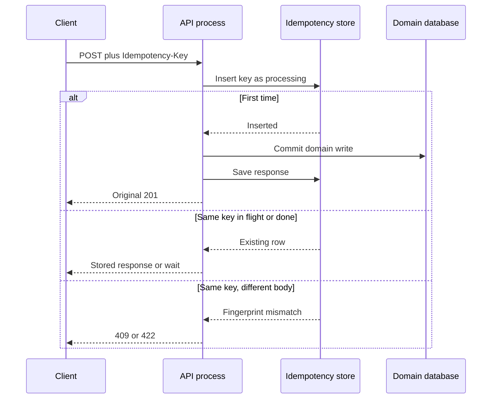

Idempotency means that performing an operation once and performing it N times with the same request leave the system in the same state. HTTP already classifies methods this way: GET, PUT, and DELETE are idempotent by specification. POST and (usually) PATCH are not. Timeouts do not care about the specification. The client sent POST, heard nothing, and must decide whether to retry. If a retry creates a second charge, the method's non-idempotence just became a money bug.

The engineer who can write a handler often hears "make it idempotent" and adds a unique constraint, or returns 200 on the second call, or stores a UUID. Those are pieces. An idempotent API for unsafe methods needs a key the client sends, a server record of what that key already did, and a defined answer when the same key arrives with a different body.

Safety is not idempotency. Safe means no significant state change (GET, HEAD). Idempotent means the same request can be repeated. PUT is not safe; it is idempotent. POST is neither. You can make a POST handler idempotent at the application layer with keys. You have not made POST safe, and caches still must not treat it as GET.

I want retries to be the default client behavior on timeout, and I want the server to make that safe for the operations that cost money or cannot be merged. The rest of this essay is the mechanism for that, not a reminder to "be careful."

## Concept

### HTTP-layer idempotency

Repeat GET `/orders/1` as many times as you want. The resource does not accumulate extra reads as business events. Repeat PUT `/orders/1` with the same body; the stored representation should match that body. Repeat DELETE `/orders/1`; gone is gone. The second DELETE may be 204 or 404; the resource state is the same.

POST `/orders` with the same JSON twice is two orders, unless you say otherwise. The otherwise is application idempotency.

### Idempotency keys

The client generates a key (UUID is fine) and sends it on the request, commonly `Idempotency-Key: <uuid>` as Stripe documents. The server stores a row keyed by `(client identity, key)`: request fingerprint, response status, response body, expiry. First request: process, store, return. Second request with the same key and the same fingerprint: return the stored response, do not process again. Same key, different body: 422 or 409, because the key now names two operations.

The key is a client-chosen nonce for "this attempt at this business action," not a hash of the body alone. Hashing the body and deduping would treat two intentional identical orders as one. Sometimes you want that (exactly-once create-if-absent). Usually you want the client to decide what "the same attempt" means: a retry of a timed-out click, not a user who clicked Purchase twice on purpose with two keys.

Store the response, not only a "seen" bit. The retried client needs the original 201 and the original resource id. A second 201 with a new id is a second resource. A second 409 without the original body is a client that cannot continue.

### Where the lock sits

Two in-flight POSTs with the same key must not both pass the "never seen" check. Insert the key row first with a "processing" state, unique constraint on the key, and let the loser wait or retry-read the winner's result. If you process first and write the key after commit, two workers will both process. The unique constraint is the lock. The stored response is the cache.

Expiry: Stripe's documentation states that keys are eligible for removal from the system after 24 hours. Whatever TTL you pick, document it. After expiry, the same key may start a new operation. Clients must not reuse keys across days.

### Retries without keys

PUT and DELETE can retry at the HTTP layer. POST can retry only if the application defines the key (or if creating twice is harmless, which it rarely is for anything you would page on). Gateways that retry POST on connection reset are applying GET logic to POST. Turn that off until keys exist.

At-least-once delivery in queues is the same problem with a different transport: the consumer must treat the message id as an idempotency key, or the handler must be naturally idempotent (set a value, not increment).

### Natural idempotence versus synthetic keys

`SET balance = 50` is naturally idempotent. `INCREMENT balance by 50` is not. `INSERT user WHERE email = ?` with a unique email is naturally idempotent for that email. `INSERT order` with a server-chosen id is not. Prefer natural idempotence when the domain has a natural key. Use synthetic keys when the domain is "this click, this payment intent."

Do not confuse "we have a unique index" with "the client can retry." The unique index may 500 the second attempt instead of returning the first order. That is uniqueness, not idempotency. Map the unique violation to the original resource if you can; otherwise require a key.

## Trade-offs

| Approach | When it wins | Cost / risk |
| -------- | ------------ | ----------- |
| HTTP method idempotency only (PUT/DELETE/GET) | Resources with client-owned names | Awkward creates; still need conflict rules (`If-Match`) |
| Client `Idempotency-Key` on POST | Payments, orders, anything retried after timeout | Storage, TTL, in-flight locking, fingerprint mismatch |
| Natural key (email, external_id) | Upserts the product already understands | Unique violation mapped poorly; two users cannot share the key's meaning |
| Dedupe on body hash | Accident-only duplicates | Two legitimate identical purchases collapse; clock-independent but intent-blind |
| Gateway retry of POST | Nothing, until keys exist | Silent duplicate side effects |

I require keys on money and on creates that a timeout would duplicate. I use PUT when the client already has the id. I do not call a unique index "idempotency" until the second request returns the first response.

## Diagram

## Failure modes

### Two in-flight requests, no lock

The client retries while the first POST is still committing. Both pass "key not found," both insert an order, and only then does one unique-key write fail — or neither does, if you store the key after the domain write.

**Detection.** Duplicate domain rows that share an idempotency key. Traces with two handler spans for one key. Tests that fire parallel POSTs with the same header.

**Mitigation.** Insert the key in `processing` state under a unique constraint before any domain write. The second worker waits or reads the stored response. If the first worker dies, expire `processing` so a later retry can take over, and make the domain write itself safe (unique natural key or transactional outbox). Never "check then insert" without the constraint.

### Same key, different body

A client reuses a UUID for a new action, or a buggy SDK sends a new JSON with an old key. If you ignore the body, you return the first resource for the second intent. If you process anyway, you have broken the key.

**Detection.** Fingerprint mismatches in logs. Support tickets: "I got last week's charge id." Contract tests that change one field and expect 409/422.

**Mitigation.** Hash the canonical request (method, path, body) and store it with the key. On mismatch, refuse. Document that a key names one request. SDKs should mint a new key per user action, and reuse only on transport retry.

### Stored response never written

The domain commit succeeded, the process crashed before saving the HTTP response. The next retry sees `processing` or missing, and either waits forever or creates a second resource.

**Detection.** Keys stuck in `processing` beyond a timeout. Retries that 500 while the first order exists. Incomplete rows in the idempotency table after deploys.

**Mitigation.** Write key, domain, and response in one transaction if they share a database. If they do not, use the domain unique key as the recovery index: on retry, look up by key, then by natural id. Expire `processing` with an operator-visible metric. Recover by returning the existing resource, not by inserting another.

### Gateway retries POST without a key

A mesh retries on connection reset. The origin processed the first attempt. The user sent one click. Two side effects.

**Detection.** Duplicate application ids with a single client request id. Proxy retry counters on POST. Burst of 201s with identical bodies and different server ids.

**Mitigation.** Disable automatic POST retries at the proxy. Require `Idempotency-Key` on the routes that money or inventory depend on, and reject those POSTs without a key (`400`) so a retry cannot sneak through as a new operation. PUT remains retryable without a key if the client owns the URI.

### TTL expiry used as a second purchase

The client stores a key for a week and retries. Your store expired at 24 hours. The retry is a new operation. Stripe documents 24-hour eligibility for removal; copy the idea: publish the TTL.

**Detection.** Same key, two domain objects, timestamps more than TTL apart. Clients that persist keys in a database rather than in retry memory.

**Mitigation.** Document TTL. SDKs keep keys only for the retry window of a single user action. If you need week-long exactly-once, persist the key in the same database as the resource with no silent delete, not in a cache.

## Real-world example

Stripe's API is the production shape I copy for this. Clients send `Idempotency-Key` on POST (and other writes). Stripe stores the key, the request's fingerprint, and the resulting response. A retry with the same key and the same body returns the original result. A retry with the same key and a different body is an error. Keys are eligible for deletion after 24 hours, which is in their docs, not folklore. They did not claim POST is idempotent at the HTTP layer. They added an application protocol on top of POST because charges cannot tolerate a timeout-plus-retry duplicate.

An IETF HTTPAPI working-group draft describes the same `Idempotency-Key` field Stripe popularized. The idea is a convention now, not a vendor quirk: unsafe method, client nonce, server-side replay cache. Payment APIs copy it because a timeout-plus-retry duplicate is a charge.

When I review an orders API that "has a unique index on email" and no key, I treat it as unfinished. Uniqueness is a last line of defense. Idempotency is a client-visible retry contract: same key, same response, including the original id and status. If the second call is a 500 unique-violation, the client still does not know whether to retry, to GET something, or to stop. Stripe's stored response is the part teams skip and then rediscover in an incident.

## What to remember

- **Idempotent is not safe.** PUT may be retried; GET must not write; POST needs an application key to be retry-safe.
- An **idempotency key** is a client nonce plus a server record of fingerprint and **stored response**, not a unique index alone.
- Insert the key **before** the domain write, with a unique constraint, or two in-flight retries will both succeed.
- Document **TTL** and fingerprint mismatch behavior; after expiry the same key is a new operation.
