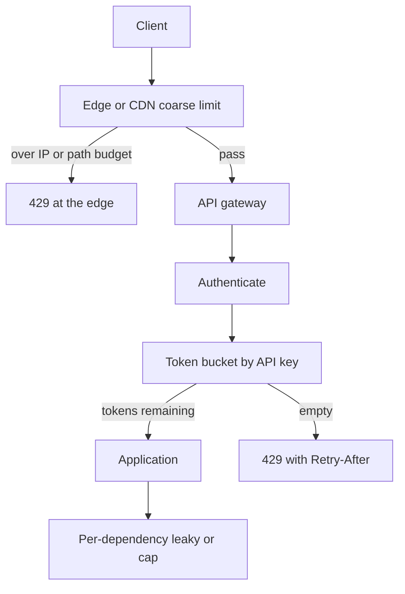

A rate limit is a budget: this subject may spend this many requests (or tokens, or bytes) per window, and the extra ones wait or fail. It is not a moral judgment about the client. It is how you keep a shared system from collapsing under one noisy neighbor, one retry storm, or one contract that promised 100 requests per second and is now seeing 10,000.

The engineer who can code a middleware will `INCR` a Redis key and return 429. That is a fixed window. It is easy and it spikes at the window edge: a client can spend the whole budget in the last second of one window and the whole budget in the first second of the next. Token bucket and leaky bucket exist because product language is usually "burst, then sustain" or "smooth this into a downstream that cannot burst."

Where you enforce the limit matters as much as the algorithm. An app-process counter is local. Two replicas double the budget. An edge or gateway limit sees all copies of the request. A per-user limit in the application sees identity the edge may not have. Most production systems need both: a coarse edge brake and a precise identity budget.

I want 429s that a client can honor (`Retry-After`, remaining, reset) and a fail mode you chose on purpose when the limiter's store is down. Accidental fail-open during an attack and accidental fail-closed during a Redis blip are both outages, just different ones.

## Concept

### The subject and the quota

Subject: API key, user id, IP, TLS fingerprint, tenant, route, or a tuple. Quota: N per second, M per day, maybe a burst. One request may attach to several quotas ("100/s per key" and "1M/day per tenant"). The limiter evaluates all of them and denies if any is exhausted.

Identity quality bounds fairness. IP limits punish NAT. API-key limits punish leaked keys, which is correct. Unauthenticated public endpoints have only IP, path, and maybe a bot score. Do not pretend an IP cap is a user cap.

### Fixed window

Count events in `[T, T+W)`. At `T+W` the count resets. Implementation: Redis `INCR` plus `EXPIRE`, or a memory map keyed by `(subject, window_id)`. Cheap. Unfair at the boundary. A 100/min limit admits 200 in two seconds that straddle the minute. For "requests per calendar day" that reset is what the contract said. For "do not melt the database" it is a hole.

### Sliding window

Approximate: weighted average of the previous window and the current one, or a log of timestamps. More accurate. The log costs memory at high QPS. The two-bucket approximation is usually enough for HTTP APIs.

### Token bucket

A bucket holds up to `capacity` tokens. Tokens refill at `rate` per second. Each request spends one (or `cost` for batch). If the bucket is empty, deny. Burst is native: an idle client accumulates tokens up to capacity, then spends them at once, then is held to the refill rate. This matches how people talk about quotas. Implementation: store `(tokens, last_refill)` and refill on the event using elapsed time. In Redis, do that in Lua so refill-and-spend is atomic.

Clock dependence is the cost. Use the store's time, not each app server's wall clock, and clamp huge time jumps so a clock step cannot mint a full bucket.

### Leaky bucket

Requests enter a queue that drains at a constant rate. Burst is absorbed as queueing delay, then overflow denies. The output is smooth. Downstream systems that cannot burst (a single-threaded worker, a partner API) like this. User-facing HTTP usually does not: a mobile client waking from sleep wants a short burst of GETs, not a line.

Leaky bucket and token bucket are duals in some textbooks. In operations they feel different: token bucket is "allow burst then 429," leaky is "delay until the leak admits you." HTTP APIs typically 429 rather than hold the socket while leaking.

### Where to enforce

**Edge / CDN / API gateway.** Sees all traffic, including junk that should never reach app CPU. Weak identity (IP, path, maybe a JWT it can parse). Fail here to protect origin.

**Application or sidecar.** Sees the user id after auth. Enforces the contract you sold. Too late to stop a cheap flood that never sends a valid token.

**Service-to-service.** Protects a dependent database or a partner. Different subject (caller service, tenant). Do not assume the public gateway's limit saved you from an internal retry loop.

A request might pass Cloudflare, then Envoy, then an application check. That is normal. Use coarser numbers at the outside and contractual numbers at identity.

Headers are part of the protocol. `Retry-After` (seconds or HTTP date), plus the `X-RateLimit-Limit` / `Remaining` / `Reset` family GitHub popularized, let a well-written client back off without polling. A 429 with an HTML body and no machine fields trains clients to retry immediately, which is how a limit becomes a herd. Return JSON, return the numbers, and jitter the reset you advertise so clients do not reconverge on the same instant.

## Trade-offs

| Approach | When it wins | Cost / risk |
| -------- | ------------ | ----------- |
| Fixed window counter | Calendar quotas, tiny services, easy mental model | Boundary burst of 2x; thundering herd at reset |
| Token bucket | Product language is burst plus sustained rate | Clock and atomic refill; clients must understand burst |
| Leaky bucket | Smoothing into a downstream with a hard ingest rate | Looks like extra latency if you queue; poor fit for interactive HTTP |
| Local in-process only | Single instance, or per-replica fairness is enough | N replicas means N times the budget; deploys reset counts |
| Shared store (Redis, gateway) | Cluster-wide contractual limits | Extra hop; limiter availability; hot keys |
| Edge IP / path limits | Abuse and scrape, protect origin CPU | NAT unfairness; does not enforce per-customer contracts |

Pick token bucket at the identity layer for APIs you sell. Pick a coarse fixed or local limit at the edge as a backstop. Do not use only local maps on a horizontally scaled fleet and then wonder why the database still melted.

## Diagram

## Failure modes

### Window-boundary stampede

Fixed windows reset on the clock. Clients wait for `reset` and retry together. The next window's first second is a thundering herd that recreates the overload.

**Detection.** QPS plots with a spike at :00. 429s that cease for one second and return. Retry-after values that all name the same unix time.

**Mitigation.** Token bucket so there is no shared wall-clock reset. If you keep windows, add jitter to `Retry-After`. Document that clients must not align on the clock. Internally, negative-cache a recent deny for a few tens of milliseconds so the same key cannot hammer the store.

### Shared-nothing limit that scales with replicas

Each pod allows 100/s. Autoscaling to 20 pods allows 2000/s. The database did not scale with the replica count.

**Detection.** Allowed QPS tracking replica count, not the documented cap. Incident during a scale-out, not a scale-in.

**Mitigation.** Shared store or a gateway that sits in front of all replicas. If you keep local limits, treat them as "protect this process" and set the number accordingly, not as the customer contract. The contract lives where all copies of the request meet.

### Fail-open versus fail-closed on store outage

Redis times out. If you fail closed, every request 429s or 503s and you have turned a cache outage into an API outage. If you fail open with no bound, the limiter is off during the exact moment you may already be unhealthy.

**Detection.** Correlation of limiter-store errors with either a site-wide 429 or a traffic spike to origin. Missing explicit policy in the runbook.

**Mitigation.** Declare the policy. I fail open for a short local budget per process, emit a high-severity signal, and keep a coarser edge limit as a backstop. The backstop protects the site. The identity limiter protects the contract. They are allowed to disagree during an incident if you said so in advance.

### Hot key on the shared store

One API key or one login IP dominates a Redis shard. Token-bucket state for that subject cannot be split without changing what the cap means. Average cluster CPU looks fine. One shard does not.

**Detection.** Per-key QPS and per-shard CPU, not cluster-average memory. A single subject in the deny log that dwarfs the rest.

**Mitigation.** Negative-cache recent denies in process for a few tens of milliseconds. Isolate celebrity keys onto a dedicated limiter pool. Cap burst even for enterprise keys. If one tenant is the business, give them hardware rather than pretending a shared shard is fair.

### Wrong subject, wrong customer blamed

A mobile carrier NAT, a campus proxy, or a cloud egress IP is one address for thousands of users. IP limits 429 everyone. Or a shard-per-tenant limiter uses a hashed user id that collides.

**Detection.** 429 rate by IP versus by authenticated user. Support tickets from many accounts sharing an ISP. Histograms that show one subject owning a surprising share of denies.

**Mitigation.** Prefer authenticated identity. If you must cap IPs, cap them coarsely and after auth use the key. Exclude health-check addresses. For tenant hashing, monitor collision and celebrity tenants; isolate heavy keys rather than tightening the global cap.

## Real-world example

GitHub's REST API publishes primary rate limits and returns `X-RateLimit-Limit`, `X-RateLimit-Remaining`, and `X-RateLimit-Reset` so a client can pace itself. Unauthenticated and authenticated callers get different budgets. Secondary limits exist for expensive routes. That is identity-aware, documented, header-driven limiting: the contract is part of the API, not a hidden middleware.

Stripe also documents request rate limits per-key and tells clients to honor `Retry-After`. The subject is the API key, which is the same identity billing uses. Cloudflare's edge rate limiting is the other pole: decision as close to the client as possible, cheap keys (IP, path, ASN), meant to shed abuse before origin CPU. You typically want GitHub/Stripe-style limits for customers you know, and Cloudflare-style limits for the public internet you do not.

nginx `limit_req` implements a leaky-bucket style delay-or-reject at the proxy. Redis `INCR` with a TTL is the fixed window people copy into app code. Envoy supports local and global rate-limit services. None of these is the whole design. The design is: subject, algorithm, enforcement point, headers, and fail mode. Copy GitHub's headers so clients can behave. Copy Cloudflare's placement so origin stays up. Do not copy a Redis INCR from a blog post and call the contract done.

## What to remember

- A rate limit is a **budget for a subject**; pick identity (key, user, IP) as carefully as you pick N.
- **Token bucket** matches burst-then-sustain; **fixed windows** are simple and double-spend at the boundary; **leaky bucket** smooths into a fragile downstream.
- Enforce **coarsely at the edge** and **precisely after auth**; local process counters multiply with replica count.
- 429 must be **machine-readable** (`Retry-After`, remaining); decide fail-open versus fail-closed before the store outage, not during it.
