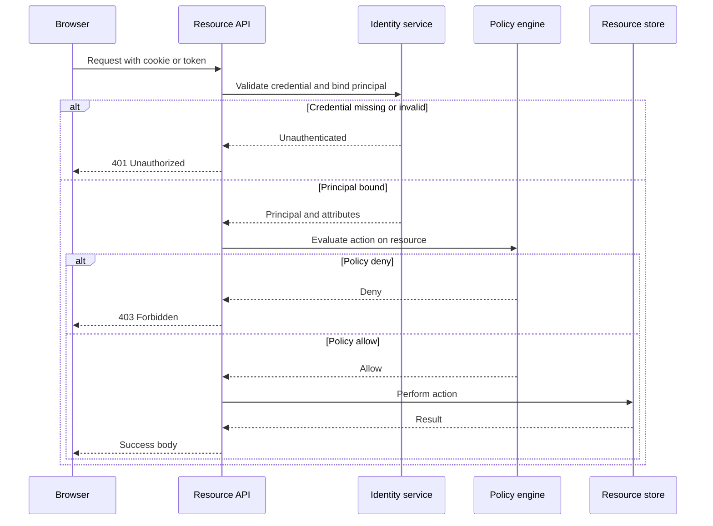

Authentication answers who is speaking. Authorization answers what that speaker may do. Collapse those questions into one flag and you get two classes of incident: a request that never proved a principal still reaching a resource, and a proven principal granted more than the policy intended.

Every request that mutates money, inventory, or personal data walks both steps. First the system binds the request to a principal. Then it evaluates a policy against that principal, the resource, and the action. A public marketing page has no principal worth naming. A cron job inside a locked VPC still needs one if you ever want an audit trail.

Login screens teach the first step and hide the second. A boolean on the user row works until the second product, the second tenant, or the first contractor account. The mechanism that keeps those questions apart is what you design, not what the framework defaults to.

## Concept

Treat the two checks as a pipeline with a typed output. Authentication produces a principal: a user id, a service account, a device, or an anonymous token you still name. Authorization consumes that principal and returns allow, deny, or a filtered view. If a handler reads `req.user` and then checks `req.user.isAdmin`, you have mixed the pipeline in application code. That mix is how a forgotten branch becomes a privilege.

### Binding a request to a principal

A principal is an identity the system is willing to write into a log. Passwords, one-time codes, passkeys, mTLS certificates, and signed bearer tokens are all ways to produce that identity. They are not authorization. A correct password says the caller controls a credential bound to Alice. It does not say Alice may refund an order.

The credential check has a failure mode of its own. Return the same message and the same timing for "no such user" and "wrong password" so an attacker cannot enumerate accounts. Rate-limit by credential and by source address. Store password hashes with a memory-hard function and a unique salt. Rotate signing keys for tokens on a schedule you can execute without a dual-write freeze.

Multi-factor authentication is still authentication. A second factor raises the cost of stealing the first. It does not change what Alice may do once she is in. Pairing MFA with a step-up on sensitive actions is a product policy: re-authenticate, then re-authorize.

Session cookies, JWTs, and API keys are carriers of an already-made authentication decision. The cookie or token is a claim that a previous check succeeded. Validate the carrier on every request. Do not treat possession of a cookie as a standing grant to every route.

### Deciding what the principal may do

Authorization is a function of principal, action, resource, and often environment. Role-based access control (RBAC) maps principals to roles and roles to permissions. It is cheap to explain and expensive to keep honest once roles multiply. Attribute-based access control (ABAC) evaluates attributes: department, resource owner, time, network, data classification. Relationship-based access control (ReBAC) evaluates a graph: Alice is a member of a folder that is a child of a drive that Alice's team owns.

Pick the model from the questions the product asks. "Is this person an admin?" is RBAC. "May this doctor see this chart because they have an active care relationship?" is ReBAC. "May this process read this object because the object's classification is at or below the process's clearance and the request is from a trusted network?" is ABAC. Mixing models without naming them produces policy that nobody can review.

Authorization must run after authentication, and it must run on the server that owns the resource. A UI that hides a button is not a control. A JWT that lists roles is a hint the resource server may use, not a substitute for checking the resource's own policy. If the token says `admin` and the object lives in another tenant, the tenant check still wins.

Distinguish 401 and 403. 401 means the principal is missing or invalid: send the caller to authenticate. 403 means the principal is known and the action is refused. Returning 404 for a resource the caller must not know exists is a deliberate information-hiding choice, not a substitute for the 403 path on resources they already located.

### Where the checks live

An API gateway can authenticate: validate a JWT signature, look up a session, require mTLS. It can enforce coarse authorization: this audience may hit this route. Fine authorization belongs next to the data. Object ownership, row filters, and field redaction need the resource's schema. Pushing those rules to the edge duplicates them and then drifts.

Service-to-service calls need both steps too. A workload identity (SPIFFE, cloud IAM role, mesh identity) authenticates the caller process. A policy on the callee authorizes the method and the tenant of the payload. "We're on the same VPC" is network hygiene, not authorization.

Human principals and machine principals share the pipeline and differ in lifecycle. Humans forget passwords, leave the company, and share screens. Machines are deployed, rotated, and scoped to a task. Issue each a distinct identity. Never reuse a human session for a batch job.

## Trade-offs

| Approach | When it wins | Cost / risk |
| -------- | ------------ | ----------- |
| Password plus session cookie | First-party browser app, simple principal, you operate the session store | Credential stuffing, session fixation, store availability on every request |
| Bearer JWT as proof of authentication | Stateless verification at many services, mobile and API clients | Revocation lag, oversize claims, treating roles in the token as source of truth |
| RBAC on a small role set | Clear job functions, few products, auditors who want a role catalog | Role explosion, toxic combinations, "admin" as a dump for leftover permissions |
| ReBAC or ABAC at the object | Sharing, tenancy, and relationships that roles cannot name | Policy complexity, caching, and a decision log you must store and replay |
| Gateway-only authorization | Coarse route allow-lists, third-party edge, first cut of a new API | Object-level leaks, UI-only hiding, policy that cannot see the resource |

A team that ships login and postpones object checks is not "starting simple." It is shipping a system that authenticates well and authorizes by accident. Put a deny-by-default check on every mutating path on day one, even if the policy is "owner or admin." You can replace the engine later. You cannot reconstruct who could have written the row.

## Diagram

## Failure modes

### Authenticated but over-privileged

**Detection.** Access logs show a support role writing production data, or a service account calling methods outside its documented surface. Audit diffs show a role that accumulated permissions across several incidents. New-hire accounts inherit a copy of someone else's groups because that was faster than a grant request.

**Mitigation.** Separate authentication success from authorization grants. Review roles against a permission catalog, not against "what the last person had." Split human and machine identities. Add a second check for money, PII export, and tenant boundaries even when the role is admin. Expire standing grants and replace them with time-boxed elevation that writes an audit row.

### Confused deputy

**Detection.** Service A, which is trusted, performs an action on behalf of user B against resource C, and the callee authorizes A instead of B. You see writes whose actor is a platform identity while the product thinks the user consented. Token-passthrough bugs show up as cross-tenant reads after an internal hop.

**Mitigation.** Propagate the user principal as a signed claim or a scoped token the callee can verify. Authorize on the user, not on the mesh identity of the proxy, except for jobs that are truly the service's own work. If A must call C, mint a downscoped token for that call. Never forward a powerful service credential as a stand-in for the user.

### 401 and 403 used as synonyms

**Detection.** Clients refresh tokens on every 403. Login screens appear for users who are already signed in. Security reviews find endpoints that return 401 when the session is valid and the policy denied, which trains attackers to retry credentials instead of stopping.

**Mitigation.** Reserve 401 for missing or invalid authentication. Reserve 403 for a known principal that is not allowed to act. Document the pair for every client team. If you hide existence with 404, do it only for resources the caller should not be able to enumerate, and keep 403 for actions on resources they can already name.

### UI as the only gate

**Detection.** A hidden route, a direct API call, or a modified client reaches a handler that never checks policy. Mobile and third-party clients bypass the web app. Tests that only click the UI stay green while the API is open.

**Mitigation.** Enforce authorization on the server that owns the data. Treat the UI as a convenience. Add tests that call the API with a low-privilege principal and expect deny. Gateway route checks are a backstop, not the object-level rule.

## Real-world example

Amazon IAM separates the two questions in a way every cloud account eventually has to learn. An IAM user, role, or federated identity is the principal: authentication is "this request is signed with credentials bound to that principal." What the principal may do is a policy document attached to the user, the group, the role, or the resource. A valid access key that can call `sts:GetCallerIdentity` is still denied on `s3:DeleteBucket` unless a policy allows it.

S3 bucket policies and IAM identity policies are both authorization. They evaluate after the request is authenticated. The `Principal` element names who, the `Action` and `Resource` elements name what. Confused-deputy protection shows up as `SourceArn` and `SourceAccount` conditions on roles that other services assume. MFA can be required as a condition key on sensitive actions: that is step-up authentication feeding an authorization condition, not a second login screen.

Teams that dump `AdministratorAccess` on a human user to "unblock a deploy" have authenticated that human and then authorized everything. The blast radius is the account. The repair is scoped roles, permission boundaries, and short-lived credentials from STS, not a stronger password.

## What to remember

- Authentication names the principal; authorization decides the action. Never store both as one boolean.
- 401 means "we do not know who you are"; 403 means "we know, and no." Hide-with-404 is a separate product choice.
- Tokens and cookies carry an authentication result. The resource server still evaluates policy on the object.
- Human identity, machine identity, and acting-on-behalf-of-a-user are three principals. Authorize each on purpose.
