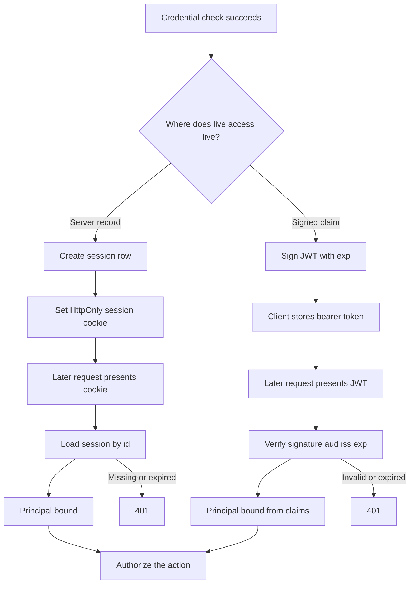

A session is server state. After login, the server stores a record keyed by a random id and sends that id to the client, usually in a cookie. Each later request presents the id. The server loads the record and decides who the caller is. Revoking access is a delete of that record.

A JWT is a signed claim. After login, the server (or an issuer) signs a payload that names the subject, the audience, and an expiry. The client sends the compact token on later requests. Any service that holds the issuer's public key can verify the signature and read the claims without a round trip to a session store. Revoking access is the hard part, because the token remains valid until it expires unless you add a denylist, a short lifetime, or a version check.

The choice is not "modern versus legacy." It is where you put the truth of "this principal is still allowed in," and how many services need to believe that truth without sharing a database.

## Concept

Both mechanisms answer authentication: they bind a request to a principal that a previous credential check established. Neither is authorization. A session record that contains `role=admin` and a JWT with a `roles` claim are caches of a policy decision. The resource still needs its own check.

### Server sessions

The session id must be unguessable. Generate it with a CSPRNG, 128 bits or more, and treat it as a capability. Store it in a cookie with `HttpOnly`, `Secure`, and `SameSite` set on purpose. `SameSite=Lax` covers most first-party navigations. `Strict` is tighter and breaks some cross-site GET flows you may want. `None` requires `Secure` and is the cross-site case, which you should not enable because it is convenient.

The record lives in memory, Redis, a SQL table, or an encrypted cookie the server can read. Memory dies with the process. Redis adds a network hop and a failure domain. SQL makes the session as available as the primary. An encrypted cookie moves the store to the client and puts a size cap and a rotation problem on the encryption key. Pick from the blast radius you accept when the store is down: no logins, or a degraded path.

Sliding expiry extends the record on activity. Absolute expiry caps the lifetime even if the user never leaves. Idle timeout plus a hard cap is the pair I want for browser apps. Logout deletes the record and clears the cookie. Password change, privilege drop, and account disable should delete or version every session for that principal.

Sticky sessions at a load balancer are a substitute for a shared store. They fail over poorly. Share the store.

### JWTs as signed claims

A JWT has three segments: header, payload, signature, encoded as base64url. The payload is JSON claims. `iss`, `sub`, `aud`, `exp`, `iat`, `nbf` are registered names with meaning. Verify the signature with the issuer's current keys, then verify `aud`, `iss`, `exp`, and `nbf`. Reject `alg=none`. Reject tokens whose `aud` is not this service.

The point of the signature is distributed verification. An API fleet, a gateway, and a worker can all trust the same issuer. That is the win. The cost is that the claims are a snapshot. If you put `admin` in the token and demote the user, every copy of that token stays admin until `exp`. If you put a shopping cart in the token, you will hit size limits and leak data into access logs.

Access tokens should be short. Minutes, not days. Refresh tokens are a second credential, stored as a server-side record or a rotating token, used to mint new access tokens. The refresh path is where you re-check "is this principal still allowed in." Treat refresh like a session: random id, hash at rest, reuse detection, family revocation on theft.

Do not put secrets in the payload. The payload is encoded, not encrypted, unless you are using JWE and have a reason. Assume any bearer token will show up in a support ticket.

### Revocation

Sessions revoke by deletion. JWTs revoke by waiting, by denylist, or by a version. Waiting is expiry. A denylist is a session store with a worse API: you now look up every request, which was the thing you left sessions to avoid. A version is a `token_version` or `session_id` claim checked against a user row. That check is a database read. It can be cached. It is no longer fully stateless.

If you need instant logout, stolen-token kill, or "disable this contractor now," you need a server-side bit. Call it a session. The JWT can still carry the principal and the expiry. The bit answers "is this issuance still live."

Key rotation is a second revocation path. Publish new verification keys at a JWKS URL. Keep the old key until every in-flight token that used it expires. Sign new tokens with the new key. A service that caches JWKS forever will accept forgeries after you retired a key, or reject good tokens after you rotated.

## Trade-offs

| Approach | When it wins | Cost / risk |
| -------- | ------------ | ----------- |
| Opaque session id in a cookie | First-party web app, instant logout, server-enforced idle timeout | Shared store on the hot path, sticky routing if the store is local, CSRF if cookies are sent cross-site |
| Signed JWT verified locally | Many services, mobile and SPA clients, gateways that must not call a session DB | Revocation lag, clock skew, oversize or stale claims, `alg` confusion |
| Short JWT plus rotating refresh token | API and mobile clients that need both scale and a kill switch | Refresh-token theft, reuse detection to implement, two-token state machines on the client |
| JWT plus server-side version or denylist | Instant disable without giving up signed claims | You reintroduced a lookup; the "stateless" argument is gone |
| Encrypted cookie session | Small session payload, no extra store, single web tier | Key rotation, size limits, logout is "wait for expiry" unless you add a denylist |

A browser app I operate myself still starts with an opaque session. An API that many services must authorize, issued by a dedicated identity service, starts with short JWTs and a refresh record. Mixing them without naming the revocation story is how a "stateless" platform takes an hour to kick a stolen laptop out.

## Diagram

## Failure modes

### JWT treated as a session with no kill switch

**Detection.** A user clicks logout and the API still accepts the access token. A stolen bearer token from a log line works until `exp`, which is measured in hours or days. Support cannot "kick all sessions" without rotating the signing key for everyone.

**Mitigation.** Shorten access-token lifetime to minutes. Store refresh tokens as server-side records and delete them on logout, password change, and disable. If you must kill access tokens, keep a version or denylist and check it. Rotating the signing key is a last resort, not a logout implementation.

### Session fixation and cookie theft

**Detection.** A login that reuses a pre-auth session id. Cookies without `Secure` or `HttpOnly` showing up in XSS reports. `SameSite=None` set "so the SPA works" on a cross-site API. Session ids in URLs, appearing in access logs and Referer headers.

**Mitigation.** Issue a new session id at login. Put the id only in a cookie with `HttpOnly` and `Secure`. Set `SameSite` to `Lax` or `Strict` for first-party apps. Use CSRF tokens or double-submit for state-changing cookie-authenticated requests. Never put the session id in a query string.

### Algorithm confusion and bad verification

**Detection.** A library that honors `alg` from the token header. Tokens accepted with `alg=none`. HMAC tokens verified with a public key parsed as a shared secret, so an attacker signs with the published JWKS key. Missing `aud` checks so a token minted for service A is accepted by service B.

**Mitigation.** Pin allowed algorithms in code. Load verification keys by `kid` from JWKS. Verify `iss`, `aud`, `exp`, and `nbf` on every request. Reject tokens that are missing required claims. Test verification with a token whose `aud` is wrong and a token whose signature is valid for another service.

### Clock skew and refresh races

**Detection.** Clients near expiry flap between 401 and success. Two devices refresh the same token and one family is revoked as a replay. Mobile apps with wrong clocks fail `nbf` or `exp` immediately after login.

**Mitigation.** Allow a small, explicit leeway on `exp` and `nbf`, measured in seconds, not minutes. Rotate refresh tokens and revoke the family on reuse. Issue the new access token before invalidating the old refresh, or accept a short overlap. Document that clients must treat 401 on the access token as "refresh, then retry once."

## Real-world example

Auth0 issues JWTs as access tokens and ID tokens, and it treats refresh tokens as a server-side credential with rotation. A typical SPA receives a short-lived access token, sends it as `Authorization: Bearer`, and uses a refresh token (or a silent renewal against the authorization server) when the access token expires. Logout at the authorization server ends the server session that would mint new tokens. It does not reach into every API and erase already-issued JWTs. Those die at `exp`.

Auth0's own guidance is to keep access tokens short, enable refresh-token rotation, and detect reuse: if a stolen refresh token is replayed, the entire family is revoked. That design admits the core trade-off. The JWT is a signed claim the API can verify locally. Instant revocation lives in the authorization server's refresh and session state, not in the JWT itself.

A first-party Auth0 session cookie for Universal Login is the other half of the same product: the browser talks to Auth0 with a session, and applications consume tokens. Mixing those two without noticing is how a team "logs out" of the app cookie and leaves a Bearer token valid in a mobile client.

## What to remember

- A session is a server record; a JWT is a signed snapshot. Revocation is cheap for the first and expensive for the second.
- Short access tokens plus a server-side refresh record give you distributed verification and a kill switch.
- Verify `iss`, `aud`, `exp`, and the signature. Possession of a token is not authorization of the action.
- Logout, disable, and privilege drop must delete server state. Waiting on `exp` is not a security control for those events.
