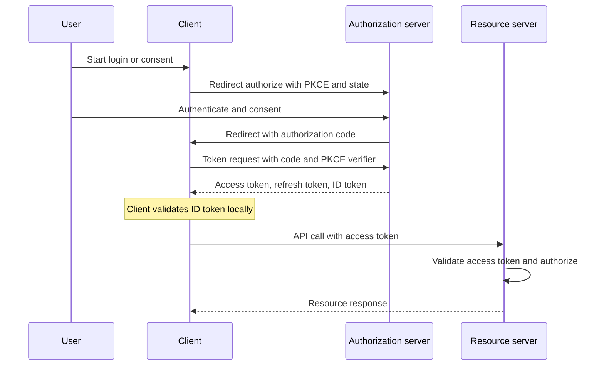

OAuth 2.0 is a protocol for delegated authorization. A resource owner lets a client obtain an access token from an authorization server, and the client uses that token at a resource server. The token proves the client is allowed to perform some scope of actions. It does not, by itself, prove who the human is.

OpenID Connect (OIDC) is an identity layer on top of OAuth 2.0. The authorization server authenticates the human and issues an ID token, a signed JWT that names the subject, the issuer, and the audience (the client). The client reads the ID token to know who logged in. Access tokens still authorize API calls. Mixing those two tokens is the most common implementation error I review.

If you need "this app may read my calendar," you need OAuth. If you need "this app knows I am Alice at example.com," you need OIDC. Most "Sign in with …" buttons are OIDC. Most "connect this integration" buttons are OAuth. The same authorization server often does both. Your code must still name which job it is doing.

## Concept

Four roles. The resource owner is the human or system that owns the data. The client is the application that wants access. The authorization server authenticates the owner and issues tokens. The resource server hosts the API and accepts access tokens. In a small product these may share a process. Keep the names anyway. They tell you which trust boundary you are crossing.

### Grants that are still fit to ship

The authorization code grant is the default for anything with a browser. The client redirects the user to the authorization server. The user authenticates and consents. The authorization server redirects back with a short-lived code. The client exchanges the code, plus a client secret or a PKCE verifier, for tokens. The code is useless without the exchange, which is why it is preferred over putting tokens in the redirect URL.

PKCE (Proof Key for Code Exchange) is mandatory for public clients (SPAs, native apps) and is now expected for confidential clients too. The client creates a random verifier, hashes it, and sends the hash on the authorize request. The token request must present the verifier. An attacker who steals the code from a redirect cannot redeem it.

The client credentials grant is for machines. The client authenticates as itself and receives an access token for its own scopes. There is no resource owner in the browser. There is no ID token. Use this for service-to-service calls where the client is the principal.

The device code grant covers devices with no browser or a terrible input: TVs, CLIs. The device shows a code, the user authorizes on another device, the device polls for tokens.

The implicit grant put tokens in the URL fragment. It is obsolete. Do not add it. The resource owner password grant puts the user's password in the client. Do not add it for third-party clients, and retire it for first-party clients in favor of authorization code plus PKCE.

### Tokens and what they mean

An access token is a credential for the resource server. It may be opaque or a JWT. The resource server validates it (introspection or signature) and enforces scopes and other policy. Scopes are coarse: `calendar.read`. They are not a complete authorization model.

A refresh token is a credential for the authorization server, used to mint new access tokens without showing the user a consent screen again. Store it like a session: server-side, hashed, rotated, revoked on reuse or logout.

An ID token is OIDC. It is a JWT. The client validates the signature against the issuer's JWKS, then checks `iss`, `aud` (the client id), `exp`, `nonce`, and `at_hash` when an access token was issued in the same response. The subject `sub` is the stable identifier at that issuer. Display claims (`name`, `email`) are attributes, not proof for an API. Do not send the ID token as `Authorization: Bearer` to your API unless you have designed that API to accept it, which you should not. APIs consume access tokens.

### OIDC as the identity layer

OIDC defines discovery (`/.well-known/openid-configuration`), userinfo, standard scopes (`openid`, `profile`, `email`), and the ID token. The `openid` scope is what turns an OAuth authorize request into an OIDC login. Without `openid`, you may receive an access token and no ID token.

User authentication happens at the authorization server. The client never sees the password when the grant is authorization code. Session at the authorization server and session at the client are different. Logout is specified (RP-initiated logout, session management) and is easy to get wrong: clearing your app cookie does not end the SSO session at the issuer.

## Trade-offs

| Approach | When it wins | Cost / risk |
| -------- | ------------ | ----------- |
| Authorization code plus PKCE | Browser, mobile, and SPA login or consent | Redirect URI hygiene, CSRF on `state`, code interception if PKCE is skipped |
| Client credentials | Service-to-service, no human, one client identity | Over-broad scopes, secret storage, no user in the audit trail unless you add one |
| OIDC ID token for login | "Sign in with" and first-party SSO | Treating the ID token as an API credential, missing `nonce` and `aud` checks |
| Opaque access token plus introspection | Central revocation, small tokens, issuer stays source of truth | Introspection latency and availability on every API call |
| JWT access token verified at the API | Fleet-wide verification without a session DB | Revocation lag, scope drift, APIs that skip `aud` |

OIDC login and OAuth consent can share a screen and still must produce different artifacts. A client that stores one token and uses it for both "who is this user" and "call this API" will eventually call the API with an ID token, or render a user from an access token that was never meant to be displayed. Split the jars.

## Diagram

## Failure modes

### Access token and ID token swapped

**Detection.** API logs show Bearer tokens whose payload has `nonce` and an `aud` equal to a client id, not an API audience. Userinfo-shaped claims appear in resource-server auth middleware. Mobile apps "work" because a gateway accepts any JWT from the issuer.

**Mitigation.** Resource servers accept access tokens only. Validate `aud` is this API. Clients validate ID tokens locally and never forward them. Issue access tokens with an audience distinct from the client id. Add a test that presents an ID token to the API and expects 401.

### Redirect URI and `state` mistakes

**Detection.** An open redirect on the client that can steal codes. `redirect_uri` registered as a prefix or wildcard. Missing or reused `state`, so an attacker can bind the victim's authorization to the attacker's session. PKCE omitted on a public client.

**Mitigation.** Register exact redirect URIs. Require PKCE. Generate `state` as an unguessable value bound to the browser session and reject mismatches. For native apps, use claimed HTTPS URLs or the platform's app-link scheme as the RFC recommends, not a custom scheme on an older stack if you can avoid it.

### Scope confusion as authorization

**Detection.** An access token with `calendar.read` reads another user's calendar because the API trusted the scope and ignored the resource owner. Admin scopes granted to every client "to make integration easy." Clients requesting `offline_access` without a refresh-token policy.

**Mitigation.** Scopes are a ceiling, not a row-level grant. The resource server must still authorize the principal against the object. Issue per-client scopes. Review consent screens. Bind refresh tokens to the client and the user and rotate them.

### Refresh-token theft and long-lived grants

**Detection.** A refresh token in a SPA's localStorage used months later from another machine. No reuse detection. Logout at the app leaves the grant alive at the authorization server. Support cannot list or revoke third-party clients a user has authorized.

**Mitigation.** Rotate refresh tokens and revoke the family on reuse. Store them in an HttpOnly cookie or a secure OS store, not localStorage, when the client is a browser. Provide a grant-management UI. Honor revocation at the authorization server and keep access-token lifetimes short.

## Real-world example

Google's identity platform is the pair in production form. "Sign in with Google" for an app is OpenID Connect: the client requests the `openid` scope, receives an ID token, and validates it as Google documents (`iss` is accounts.google.com or https://accounts.google.com, `aud` is the client id, signature via Google's JWKS). That answers who the user is at Google.

Google APIs (Calendar, Drive, Gmail) are OAuth 2.0 resource servers. The same consent screen can request `https://www.googleapis.com/auth/calendar.readonly`. The access token that follows is for those APIs, not for identifying the user in your app. Google's token info and userinfo endpoints exist because developers confuse the two; the documented path is still: ID token for login, access token for API calls, refresh token stored as a secret if you requested offline access.

A project in Google Cloud that uses an OAuth client for a server-side web app follows authorization code. A TV app uses the device grant. A backend job uses a service account (a Google-specific client-credentials analogue) rather than a user's refresh token. Each grant names a different principal. The ID token does not authorize Drive. The Drive access token is not your session.

## What to remember

- OAuth 2.0 delegates authorization; OIDC adds identity via an ID token. Do not conflate the tokens.
- Authorization code plus PKCE is the grant for browsers and native apps. Client credentials is the grant for machines.
- Resource servers consume access tokens and still authorize the object. Scopes are not row-level policy.
- Refresh tokens are sessions at the authorization server. Rotate them, bind them, and revoke them on logout and reuse.
