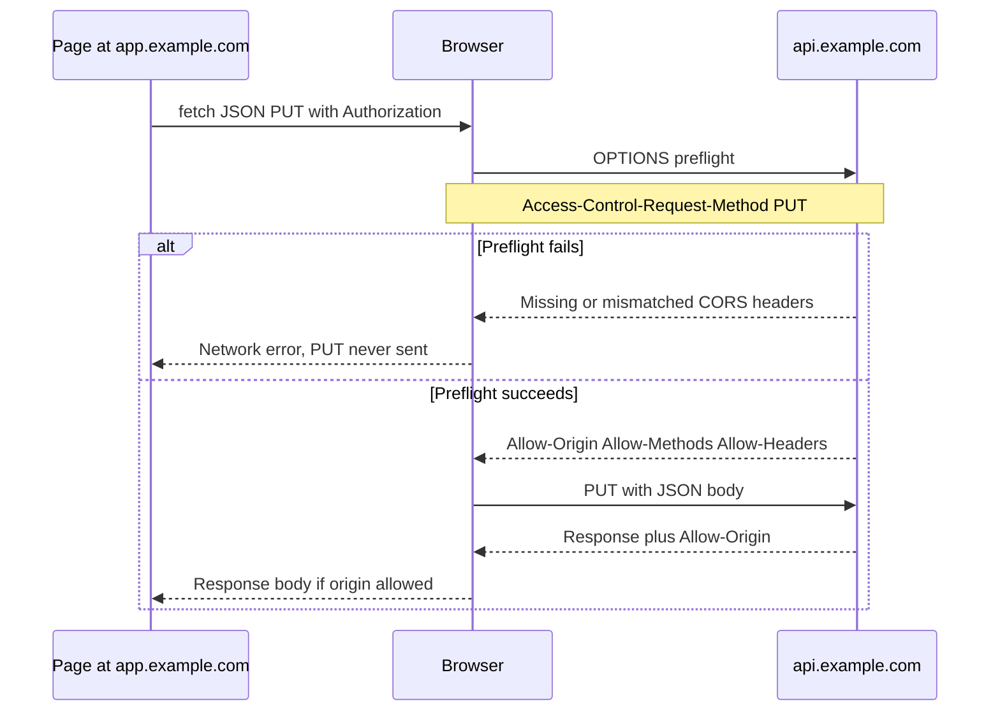

CORS is a browser rule. The same-origin policy blocks a page on `https://app.example.com` from reading a response from `https://api.example.com` unless the API opts in with CORS headers. The browser enforces that rule. A server that "implements CORS" is only emitting headers the browser will consult. `curl`, a mobile app, a server-side fetch, and an attacker with a socket do not care.

That distinction is the whole design. CORS is not an access-control list for your API. It is not a firewall. It is a way for a resource to tell cooperating browsers which origins may read the response, and whether those requests may carry cookies. If you need to stop a stranger from calling your API, you authenticate and authorize. If you need a first-party SPA on another origin to call that API, you configure CORS.

Cross-origin writes are older than CORS. A form POST from any site can still hit your URL. The browser will not let the foreign page read the response. Cookies may still be sent depending on `SameSite`. CORS did not invent that hazard. CSRF tokens and `SameSite` cookies did.

## Concept

An origin is scheme plus host plus port. `https://app.example.com` and `https://api.example.com` are different origins. `https://example.com` and `https://example.com:443` are the same. `http` and `https` are different. Subdomains are different. The browser labels every request with an `Origin` header when the request is cross-origin from script (and on some other cases). Servers must not trust `Origin` as authentication. Anyone can send that header from a non-browser client.

### Simple requests and preflights

A "simple" request is a GET, HEAD, or POST with a small set of headers and content types (`application/x-www-form-urlencoded`, `multipart/form-data`, `text/plain`). The browser sends it. The server answers. If the response lacks `Access-Control-Allow-Origin` matching the page's origin, the browser hides the response from JavaScript. The request still happened.

Anything else is preflighted. A `PUT`, `DELETE`, `PATCH`, a JSON `Content-Type`, or a custom header such as `Authorization` triggers an `OPTIONS` request first. The `OPTIONS` request carries `Access-Control-Request-Method` and `Access-Control-Request-Headers`. The server must answer with `Access-Control-Allow-Origin`, `Access-Control-Allow-Methods`, and `Access-Control-Allow-Headers` that cover the actual request. Only then does the browser send the real request.

Preflights are cached by the browser when you set `Access-Control-Max-Age`. They still cost a round trip on cache miss. They fail closed: a 404 on `OPTIONS`, a missing header, or a wildcard mismatch and the real call never leaves the browser. Your API logs will show OPTIONS, not the PUT the developer thinks they sent.

### The headers that actually matter

`Access-Control-Allow-Origin` is either a single origin or `*`. It cannot be a list. If you have several front ends, pick the incoming `Origin` against an allow-list and echo the match. Do not echo an arbitrary `Origin`. That is "allow everyone who can set a header," which is everyone.

`Access-Control-Allow-Credentials: true` lets the browser send cookies, client TLS certs, and `Authorization` in some modes, and lets JavaScript read the response of a credentialed request. You cannot combine credentials with `Access-Control-Allow-Origin: *`. The spec forbids it. The browser will refuse. Credentialed CORS is an explicit pair: a concrete origin plus `Allow-Credentials: true`.

`Access-Control-Expose-Headers` names response headers JavaScript may read beyond the simple set. Pagination headers, `RateLimit-*`, and `ETag` are common. If you omit them, the call "works" and the client cannot see the header.

`Vary: Origin` belongs on responses whose `Allow-Origin` depends on the request. Caches that ignore `Vary` will serve origin A's header to origin B.

### What CORS does not do

It does not stop the request from being issued by a non-browser. It does not replace authentication. It does not prevent CSRF on cookie-authenticated POST. It does not protect WebSockets by itself (the WebSocket handshake is a separate origin check some servers implement). It does not apply to ``, `<script>`, or `<form>` navigation the way it applies to `fetch`. Those tags have their own rules, which is why JSONP existed and why you still must not emit secrets in a JSON file that any origin can include as a script.

A reverse proxy that adds `Access-Control-Allow-Origin: *` to every response "to fix the SPA" has made the browser allow any site to read those responses. If those responses are public, that is fine. If they contain user data and the API also relies on cookies, you have a data leak to any malicious page the user visits, once credentials are in play. Even without cookies, you have taught every developer that CORS is a switch, not a policy.

## Trade-offs

| Approach | When it wins | Cost / risk |
| -------- | ------------ | ----------- |
| Same origin for app and API | No CORS policy to get wrong, cookies stay first-party | Routing and deploy coupling, harder split of SPA and API hosts |
| Allow-list of exact origins | SPA on a known front-end host, cookies if you truly need them | Missed environments, preview URLs, `Vary` bugs in CDNs |
| `Allow-Origin: *` without credentials | Public, unauthenticated reads, fonts, open APIs | Accidental use on cookie-authenticated JSON, over-sharing of user data to any origin |
| Credentialed CORS with cookies | First-party SPA on a sibling origin that must use a session cookie | CSRF returns, wildcard forbidden, every new front-end origin is a security change |
| Bearer token in `Authorization`, no cookies | SPA and mobile share the same API, CSRF is not cookie-based | Preflight on every uncached call, token storage on the client |

Put the SPA and the API on the same origin when you can: a reverse proxy that serves `/` from the static bucket and `/api` from the service. CORS then stays off the hot path. When you cannot, prefer Authorization headers over credentialed cookies. You still need CORS, because `Authorization` is not a simple header, but you drop the CSRF pairing that cookies create.

## Diagram

## Failure modes

### Reflecting `Origin` without an allow-list

**Detection.** Any site can read authenticated or sensitive responses. A test page on `https://evil.example` calls your API and receives JSON. Logs show `Origin` values you never deployed. A CDN caches one reflected origin and serves it to another.

**Mitigation.** Match `Origin` against an explicit list. Echo only a match. Reject the rest without a matching `Allow-Origin`. Set `Vary: Origin`. Disable credentials unless you have a CSRF story. Review preview-environment URLs as first-class origins, not as a reason to wildcard.

### Preflight never configured

**Detection.** GET works from the SPA, PUT and JSON POST fail in the browser with a CORS error, and the same calls succeed in curl. Access logs show `OPTIONS` returning 404 from the application router or 403 from a WAF that does not allow `OPTIONS`. Developers "fix" it by switching everything to GET.

**Mitigation.** Route `OPTIONS` to a handler that returns 204 and the CORS headers, before auth if the preflight has no cookies. Allow the methods and headers the SPA actually sends. Teach WAFs that preflight is not an attack. Cache with a modest `Max-Age` so you can change policy without waiting a day.

### Wildcard plus credentials, or cookies without CSRF

**Detection.** The browser console reports that credentialed requests cannot use `*`. Operators then echo every origin and set `Allow-Credentials: true`. Session cookies with `SameSite=None` ride along. A malicious page triggers state-changing requests as the user.

**Mitigation.** Do not pair cookies with a wildcard. Prefer bearer tokens for cross-origin SPAs. If cookies must cross a sibling origin, set a precise `Allow-Origin`, `SameSite` appropriate to the risk, and CSRF tokens on mutating methods. Treat CORS as visibility, not as CSRF defense.

### Cached CORS headers at the CDN

**Detection.** Origin A works, origin B fails, or origin B receives A's `Allow-Origin`. Intermittent SPA errors after a cache TTL. `curl -I` from a POP shows a header that does not match the request `Origin`.

**Mitigation.** Send `Vary: Origin`. Bypass cache for authenticated API responses unless you have a key that includes origin. Test from two allowed origins and one disallowed origin through the CDN, not only against origin.

## Real-world example

Stripe.js runs on merchant origins (`https://shop.example`) and talks to Stripe's own hosts. That is a cross-origin browser call by construction. Stripe documents which domains the library uses and relies on CORS on those endpoints so a merchant page may invoke them. The merchant's secret key never goes to the browser. Publishable keys and tokens do. CORS here lets the browser read Stripe's responses in JavaScript. It does not keep a thief from calling Stripe's API with a stolen secret from a server. Stripe's authentication (publishable versus secret keys, and server-side PaymentIntent confirmation) is the control that does that.

S3 is the other common production shape. A bucket used as an app origin, or as a PUT target from a browser, needs a CORS configuration: allowed origins, methods, headers, and exposed headers. A wildcard origin on a bucket that also has a policy allowing `s3:PutObject` from the world is a public write surface the browser will cooperate with. AWS documents that CORS is a browser mechanism and that bucket policy and IAM still govern whether the request is allowed. Operators who "open CORS" to unblock a frontend have not opened the bucket. They have told browsers they may look. The policy and the credentials decide whether the look succeeds.

## What to remember

- CORS is a browser rule about reading responses. It is not a server firewall and does not bind curl or a backend.
- Authenticate and authorize for access control. Use CORS to opt cooperating browsers into a cross-origin read.
- Never reflect arbitrary `Origin` values. Never pair `*` with credentials. Send `Vary: Origin` when the answer depends on origin.
- Preflight exists for non-simple methods and headers. If OPTIONS is broken, the real request never ships from the browser.
