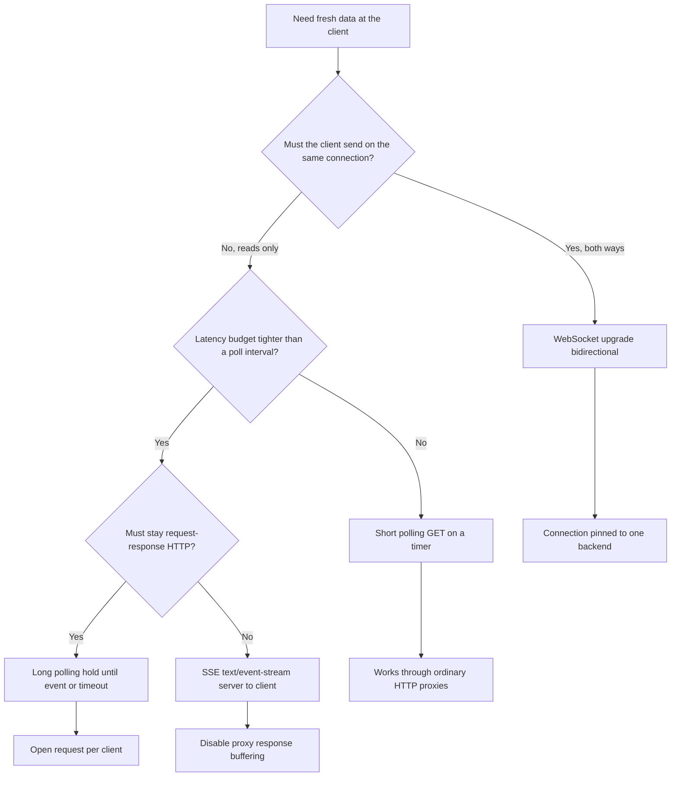

Four ways to get new data to a client, and they differ in direction, how they sit behind proxies, and how they die. Short polling is a client asking on a timer. Long polling is a client asking and the server holding the HTTP request until an event or a timeout. Server-Sent Events (SSE) is a server writing an HTTP response that never really ends, one event at a time, still client-to-server only for the request itself. A WebSocket is an upgraded connection that is bidirectional for its lifetime.

Pick from the product's direction and from the path between client and server. A status page that changes every few minutes is polling. A feed the server pushes and the client never writes on the same socket is SSE. A collaborative editor that sends keystrokes both ways is a WebSocket. Long polling is the compromise when you need push-like latency on infrastructure that only understands request/response.

None of these is a message bus. They are last-mile transports. The durable truth still lives in a store or a log. The transport is how a browser or a mobile app notices.

## Concept

### Short polling

The client issues GET (or a similar read) every N seconds. The server answers immediately with the current snapshot or a delta since a cursor. Idle clients still pay a request. The server sees a spike at the interval if many clients share a clock. Jitter the timer.

Polling dies as waste and as delay. Too slow and the UI is stale. Too fast and you amplify load by the size of the fleet. It survives proxies, CDNs, and load balancers because it is ordinary HTTP. It retries by issuing another GET. Idempotent reads are the whole protocol.

Use an `ETag` or a cursor so unchanged data returns 304 or an empty delta. Without that, you transfer the world on every tick.

### Long polling

The client issues a request. The server holds it until an event arrives or a timeout (often 15–60 seconds) fires. The client immediately issues the next request. Latency to first byte of an event can be low. The cost is an open HTTP request per client for most of the day.

Long polling dies when the hold time exceeds idle timeouts on a proxy, when workers are exhausted by parked requests, and when a burst of events fans out to every held connection at once. It also dies if the client is not careful with last-event ids: a timeout with no event must not skip a message that arrived during reconnect.

It is still HTTP, so authorization, cookies, and CORS behave as they do for other requests. Load balancers see request/response, not a special protocol. You still need enough concurrent connections and a way to wake the parked request from the event path (a queue subscription, a pub/sub, a wait on a condition).

### Server-Sent Events

SSE is `Content-Type: text/event-stream` over HTTP. The client uses `EventSource` in browsers, which reconnects automatically and sends `Last-Event-ID`. The server writes `data:` lines and optional `id:` and `event:` fields. The stream is server-to-client. The client that must send data uses ordinary HTTP beside the stream.

SSE dies when an intermediary buffers the response until it is complete, which is never. Disable proxy buffering (`X-Accel-Buffering: no` on nginx, equivalent knobs elsewhere). It dies on HTTP/1.1 connection limits in old browsers (six per origin), which is why people put the stream on a separate host. It dies if you need binary frames or client-to-server messages on the same connection. It also dies behind some corporate proxies that refuse unbounded responses.

HTTP/2 multiplexing reduces the per-origin connection pain. The buffering problem remains until every hop is configured.

### WebSockets

The client sends an HTTP request with `Upgrade: websocket`. If the server agrees, the connection becomes a framed bidirectional channel. Either side may send. Heartbeats (ping/pong) detect half-open sockets. The application must define message schemas, backpressure, and authentication on the first-frame or query-string path.

WebSockets die at stateful load balancing: the TCP connection is pinned to one backend. A deploy that kills that process kills the socket. They die at proxies that do not forward `Upgrade`. They die when a message is lost and neither side has a resume protocol: unlike SSE's `Last-Event-ID`, raw WebSockets have no standard replay. They die as a cost problem when every idle user holds a TLS connection on a box that could have served request/response traffic.

Authenticate on handshake. Do not put long-lived secrets in query strings if you can send a first message after upgrade. Authorize on subscribe, not once for the whole socket, if the socket can switch topics. Apply idle timeouts and max message size. Plan for reconnect with a resume token or a cursor into your log.

## Trade-offs

| Approach | When it wins | Cost / risk |
| -------- | ------------ | ----------- |
| Short polling | Rare updates, aggressive HTTP caching, simplest ops | Delay versus load, thundering herds on a shared interval |
| Long polling | Push-like latency on HTTP-only infrastructure | Parked workers, proxy idle timeouts, reconnect races |
| SSE | Server-to-client streams, auto-reconnect, `Last-Event-ID` | Unidirectional, proxy buffering, HTTP/1.1 connection caps |
| WebSocket | Bidirectional, low per-message overhead, custom frames | Sticky connections, Upgrade path, no standard resume, fleet of idle sockets |

Start at the left of the table and move right when the product forces you. A notification bell that can be thirty seconds late is polling. A trading tape that must not miss a tick, with resume, is SSE or a WebSocket plus a cursor. Chat that types both ways is a WebSocket, or HTTP send plus SSE receive if you want to keep the write path ordinary.

## Diagram

## Failure modes

### Proxy idle timeout and buffering

**Detection.** Long polls return 502 or empty bodies at a suspiciously round duration (30s, 60s, 120s). SSE clients reconnect in a loop and never receive events that the origin process wrote. Packet captures show the origin sending; the client receives a burst at close. WebSocket upgrades fail with 400 from a layer that does not allow `Upgrade`.

**Mitigation.** Set idle timeouts on every hop above the hold time, or stop holding. For SSE, disable buffering and send a comment tick often enough to keep the path alive. For WebSockets, terminate TLS and Upgrade at a proxy that supports them (modern nginx, Envoy, cloud L7 balancers with WebSocket enabled). Test through the production path, not only localhost.

### Connection exhaustion

**Detection.** Worker or file-descriptor limits hit while CPU is idle. Autoscaling on CPU never adds boxes. Long-poll and WebSocket counts track concurrent users, not request rate. A deploy drains connections and the reconnect storm exceeds the new capacity.

**Mitigation.** Size for concurrent connections, not RPS. Use an evented server for held connections. Drain WebSockets and SSE on deploy with a reconnect jitter. Shed with a 503 and `Retry-After` rather than accepting more sockets than you can wake. Consider moving fan-out to a dedicated gateway (fanout service, MQTT, or a managed pub/sub front door).

### Missed events on reconnect

**Detection.** Users skip messages after a network blip. Two clients diverge. Logs show a gap between last delivered id and the next. Long poll timeouts treated as "no data" while an event was in flight. WebSocket clients resume from "now" instead of a cursor.

**Mitigation.** Every event needs a monotonic id in a stream the client can resume. SSE's `Last-Event-ID` is the pattern; copy it on long poll (`since=`) and on WebSocket resume. Persist the log long enough to cover reconnect. If you cannot, tell the client to snapshot. Never assume the socket is a durable queue.

### Thundering herd on poll intervals

**Detection.** Request rate is a square wave at 10s or 30s. Databases show aligned bursts. After a push notification, every mobile app polls at once.

**Mitigation.** Jitter intervals. Back off on 429 and 5xx. Cache snapshots at the edge with short TTL. Prefer a push transport if the herd is the product (live scores, trading), not a smaller interval.

## Real-world example

Slack's public platform shows the migration. The older Real Time Messaging (RTM) API opened a WebSocket and streamed events both ways. That model is simple for a single-workspace bot and expensive for Slack: a persistent connection per client, sticky to a process, with application-level reconnect. Slack later pushed the Events API: your server exposes an HTTP endpoint, Slack POSTs events (a webhook), and you reply. Direction flipped. Slack no longer holds a socket to every integrator. The integrator no longer needs a fleet of WebSocket clients.

The Slack web and desktop apps still use persistent connections for the product UI; the public integration path moved off RTM because operator cost and failure modes of sockets do not scale with the number of third-party bots. Socket Mode exists as an outbound WebSocket for customers who cannot expose a public webhook. That is the same trade-off in reverse: Slack holds the socket because the customer's network cannot accept inbound HTTP.

When you design a similar product, the first-party client can afford a WebSocket if you operate the gateway. The third-party ecosystem often cannot. Polling a `conversations.history` style endpoint remains the fallback that always works through proxies.

## What to remember

- Direction first: poll and long poll are client pull; SSE is server-to-client; WebSockets are both ways.
- Proxies idle-timeout long polls, buffer SSE unless told not to, and break WebSocket upgrades they do not understand.
- Reconnect without a cursor drops events. Sockets are not a durable log.
- Size for concurrent connections on held transports. RPS lies while users are idle and sockets are open.
