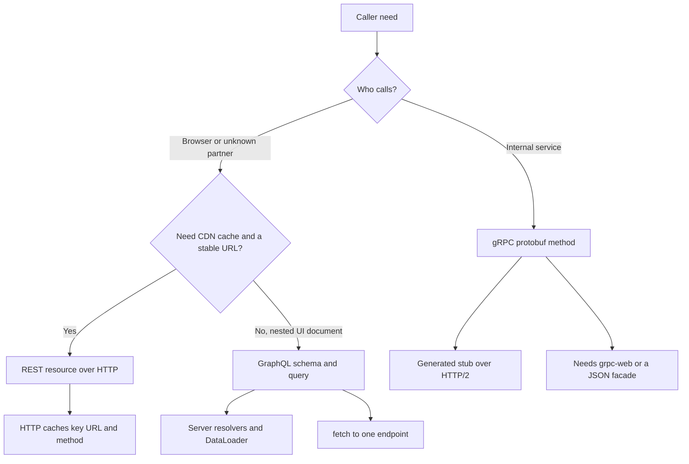

Three contracts, three caching stories, three fan-out patterns, and three browser stories. REST exposes resources over HTTP with verbs, status codes, and URLs a cache can key. GraphQL exposes a schema and lets the client name the fields it wants on a single endpoint, usually POST `/graphql`. gRPC exposes protobuf procedures over HTTP/2 (or HTTP/3) with generated stubs, streaming, and a binary payload.

Choose from the caller and from what you must cache. A public HTTP API consumed by browsers, CDNs, and unknown clients still starts as REST. A product UI that would otherwise waterfall six REST calls often earns GraphQL, with a complexity budget. Service-to-service interiors at a company that already speaks protobuf earn gRPC. Mixing them at one boundary without a translation layer produces a team that debugs three stacks to ship one feature.

None of these is a database. They are how you name operations. The data model behind them can be the same store.

## Concept

### REST as a resource contract

A REST API (in the sense teams actually ship) is a set of URLs, methods, representation formats, and status codes. `GET /orders/123` is cacheable in principle. `POST /orders` is not. `ETag`, `Cache-Control`, and `Last-Modified` work because the URL plus method plus selected headers name a representation. Intermediaries understand that.

The contract is coarse at the resource. If the mobile app needs three fields and the desktop needs thirty, you add query params, sparse fieldsets, or a second resource. Over-fetch and under-fetch are the tax. Versioning lives in the URL, a header, or a new media type. The browser can call REST with `fetch`. File uploads, redirects, and cookies behave as HTTP already taught you.

Fan-out happens in the client: page load issues N GETs. HTTP/2 multiplexing makes that cheaper than it was. It does not make six serial round trips to dependent resources free. BFF-style aggregation is how REST stays usable for a complex UI without GraphQL.

### GraphQL as a client-specified selection

The client sends a query document that selects fields, nested objects, and arguments. The server resolves field by field. One round trip can replace a waterfall. The schema is the contract: types, nullability, deprecation. Introspection and generated clients follow from that schema.

Caching is the first cost. A POST to one URL with a body that changes every screen does not hit HTTP caches. Persisted queries and GET with a hash help some CDNs. Most teams cache in the client (normalized stores) and at a gateway that understands GraphQL, not in nginx.

Fan-out moves to the server. A naive resolver per field produces the N+1 query problem: one user list, then one query per user for their last order. DataLoaders, batched resolvers, and view models exist to collapse that. Query complexity, depth limits, and timeouts exist because a client can ask for a graph that is larger than any REST resource you would have published.

Authorization is per field and per object, not per URL. A hidden REST route is a coarse gate. A GraphQL field that leaks another tenant's email is a nested resolver you forgot. Treat the schema as an attack surface and test it as one.

Mutations are named operations, not HTTP verbs. Idempotency keys and error shapes are yours to specify. Subscriptions are a separate transport (often WebSocket or SSE) that happens to use GraphQL types.

Schema evolution is additive. Deprecate a field, keep serving it, remove it only when clients are gone. Adding a required input field is a break. REST breaks when you remove a JSON key a client parsed. GraphQL can leave the field in the schema after deprecation, which is kinder if you watch field-usage metrics before deletion.

### gRPC as procedures and protobuf

gRPC methods are unary, server-streaming, client-streaming, or bidirectional. The IDL is `.proto`. Codegen produces stubs in many languages. Backwards compatibility is a protobuf discipline: add fields, do not reuse tags, do not change types. HTTP status is not your error model; `google.rpc.Status` codes are.

Browsers do not speak gRPC natively. grpc-web exists, with a proxy (Envoy) translating. That is extra machinery. Public third parties expect curl and JSON. gRPC wins inside a mesh: deadlines propagate, streams are first-class, payloads are small, and you do not parse JSON on every hop.

Caching gRPC is not what CDNs do. You cache at the application or you put a REST/JSON facade in front for the public edge. Load balancers must be HTTP/2 aware. Health is `grpc.health.v1`. Retries and hedging are configured in the client, and they are dangerous if the method is not idempotent.

Fan-out is explicit: a service calls other stubs. There is no client-specified graph. You design the procedure to return what callers need, or you add a new method. That rigidity is a feature when you want to control cost.

Deadlines are part of the contract. A missing deadline is an unbounded wait. Parent RPCs should set a deadline and children should inherit the remaining budget. Hedging — a second request if the first is slow — belongs only on idempotent reads. A load balancer that retries a non-idempotent gRPC method is the same incident as an HTTP client that retries POST.

## Trade-offs

| Approach | When it wins | Cost / risk |
| -------- | ------------ | ----------- |
| REST over HTTP/JSON | Public APIs, CDN caching, browsers, unknown clients, audit of URLs | Over/under-fetch, chatty UIs, weak standard for a single "document" of nested data |
| GraphQL | Product UIs with nested data, many clients, schema as product | N+1 resolvers, uncacheable POST, unbounded queries, field-level auth gaps |
| gRPC plus protobuf | Interior RPC, streaming, polyglot stubs, tight contracts | Poor browser story, harder ad-hoc debug, cache and CDN mismatch, breaking IDL changes |
| REST facade in front of gRPC | Public JSON plus interior protobuf | Two contracts to version, translation bugs, lowest-common-denominator errors |
| Persisted GraphQL queries | CDN or allow-list of known operations | Not ad-hoc anymore; you rebuilt a catalog of endpoints |

A company can run all three: GraphQL at the BFF for the app, REST for partners, gRPC between internal services. That is coherent if each boundary has one contract. It is sludge if every service exposes all three because a blog post said so.

## Diagram

## Failure modes

### GraphQL N+1 and unbounded queries

**Detection.** A list view issues thousands of SQL queries. p99 latency tracks nested field depth. A single anonymous query walks a relationship until the process OOMs. CPU on the GraphQL node dwarfs the databases it calls.

**Mitigation.** Batch at the resolver with DataLoader or equivalent. Cap depth and estimated cost. Time out the query. Require persisted queries in production if you cannot trust clients. Add complexity to the SLO, not only request count. Test the expensive query as a first-class fixture.

### REST chatty clients and accidental caching of private data

**Detection.** A page does twenty sequential GETs. Mobile burns battery on high-latency links. A shared `Cache-Control: public` on an authenticated resource serves user A's JSON to user B at the CDN.

**Mitigation.** Aggregate with a BFF or a purpose-built resource for the screen. Set `Cache-Control: private` (or `no-store`) on authenticated responses. Vary on authorization if you cache at all. Use ETags for unchanged reads instead of shrinking the poll interval.

### gRPC contract breaks and missing deadlines

**Detection.** A field reuse or type change in protobuf corrupts readers. Clients hang until process death because no deadline was set. A retry policy on a non-idempotent method doubles charges. Browsers cannot call the service, so a team wraps it in ad-hoc JSON that drifts.

**Mitigation.** Review IDL as an API: additive changes only. Set deadlines at the caller and propagate. Mark methods idempotent or not, and disable automatic retries on the latter. If browsers must call it, publish an explicit REST or grpc-web contract, versioned, not a one-off proxy.

### Error and status mismatch across the trio

**Detection.** GraphQL returns HTTP 200 with errors in the body, and a gateway retries. gRPC `NOT_FOUND` is mapped to HTTP 500 at a facade. REST clients treat every 4xx as unreadable.

**Mitigation.** Document the error model at each boundary. If you translate gRPC to HTTP, map codes deliberately (see the gRPC HTTP mapping). For GraphQL, decide which failures are transport 5xx versus `errors[]`, and do not retry mutations. REST keeps protocol outcome in the status code.

## Real-world example

GitHub publishes both a REST API and a GraphQL API for the same product data. REST is the older surface: `/repos/{owner}/{repo}/issues`, rate limits per resource, hypermedia links, and ETag support on many GETs. Partners, scripts, and caches understand it. GraphQL (`https://api.github.com/graphql`) exists because a dashboard that needs a repository, its last issues, and the viewer's permission would otherwise waterfall REST calls. The schema is documented, versioned by evolution and deprecation rather than `/v4` in every tutorial's memory, and GitHub imposes rate limits based on point cost so a nested query cannot be free.

GitHub did not replace REST with GraphQL. They added a second contract for a second caller shape. Internal Google RPC (Stubby, then gRPC as the open protocol) is the third shape in the industry: protobuf, deadlines, streaming, not meant as a curl-friendly public API. When Google opened gRPC, it documented that browsers need a translation. That split still holds. Use GitHub as the public dual-contract example, and gRPC as the interior one, rather than forcing one style through every door.

## What to remember

- REST gives you URLs, verbs, and HTTP caching. GraphQL gives the client a selection and moves fan-out to the server. gRPC gives protobuf procedures and streams, not a browser-native API.
- Caching, N+1, and contract evolution are the real costs. The payload format is secondary.
- Do not treat GraphQL HTTP 200 plus `errors[]` as success for retries. Do not skip deadlines on gRPC. Do not cache authenticated REST as public.
- One contract per boundary. A facade is allowed. Three dialects on every service is not a strategy.
