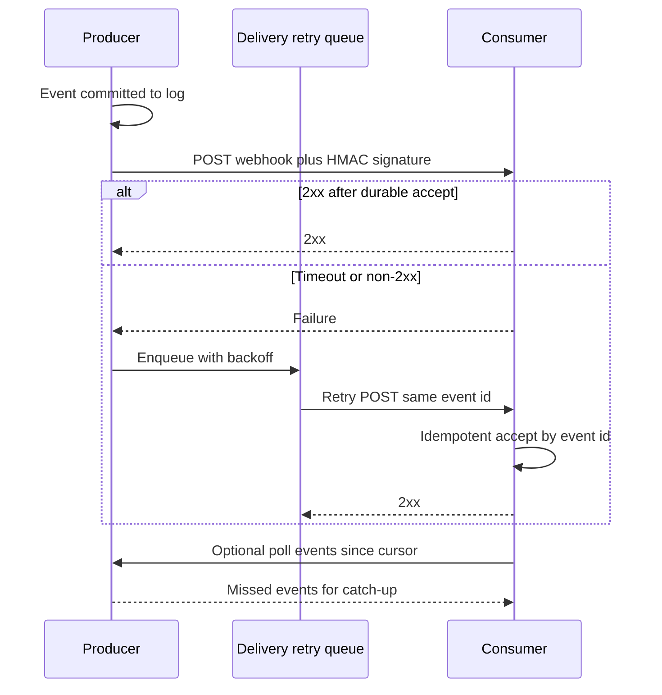

Polling is the client asking the producer whether anything changed. Webhooks are the producer POSTing to a URL the consumer registered when something did. The first is pull. The second is push. Both can deliver the same event. They fail in opposite places.

Polling wastes requests when the world is quiet and delays events by up to one interval when it is not. It is easy to authorize (the consumer already has an API key), easy to debug with curl, and friendly to firewalls that allow outbound HTTP only. Webhooks are timely and cheap at rest, and they require a public or reachable endpoint, a signature the consumer can verify, retries with backoff, and a receiver that is idempotent because at-least-once delivery is the honest contract.

If you are the producer, webhooks are an operations product: delivery, replay, signing keys, and a dashboard. If you are the consumer, polling is a cron job and a cursor. Many mature APIs offer both. Use the webhook as the fast path and poll as the catch-up path.

## Concept

### Polling as a cursor over a log

A good poll is not "GET the current object every five seconds." It is "GET events since cursor C" or "GET objects changed after timestamp T," with a stable order and a page token. The consumer stores the cursor. Empty pages are cheap. The producer can rate-limit and cache.

Bad polls hit a snapshot endpoint with no `since`. They miss changes that reverted. They cannot distinguish "no change" from "you are looking at the wrong object." They thundering-herd when every consumer shares a wall clock.

Polling dies when the interval is shorter than the producer can serve times the number of consumers, when the cursor is not monotonic (clocks, deleted rows), and when the consumer crashes without persisting the cursor and either skips or reprocesses a storm. It never dies because of inbound firewalls. The consumer speaks outbound.

Persist the cursor after a successful page, not before. Advance-then-crash skips events. Never-advance-on-poison stalls the consumer forever. A poison payload needs a dead-letter and an explicit skip, not a tight retry loop on the same page.

Backoff on 429 using `Retry-After`. Jitter the interval so a fleet does not align. `If-None-Match` on snapshot polls turns a hot object into 304s. That is still polling. It is only cheaper.

### Webhooks as an outbound POST

The producer keeps a subscription: URL, secret, event types, maybe a filter. On an event, it POSTs a payload and waits for a 2xx. Non-2xx and timeouts go to a retry queue with exponential backoff and a dead-letter after N attempts. The consumer returns 2xx only after it has durably accepted the work, not after it has finished a slow side effect, unless it can afford to lose the retry.

Signatures prove the POST came from the producer. The usual shape is an HMAC of the raw body (and often a timestamp) with a shared secret, sent in a header. The consumer recomputes the HMAC with constant-time compare, rejects skew that is too old (replay), and only then parses JSON. TLS to the consumer URL is mandatory. It is not a substitute for the HMAC. Anyone who can obtain a certificate for a host they control is not the threat. Anyone who can POST to a URL they guessed is.

Idempotency is mandatory. The producer will retry. The consumer will receive duplicates. Put an event id in the payload. Store it uniquely. A second POST with the same id is a 2xx and a no-op. Ordering is not guaranteed across types or even within a type if retries overlap. Design for arrival in any order, or ignore order and make last-write-wins explicit.

Timeouts belong on both sides. The producer should wait a few seconds, not a minute. The consumer should accept in tens of milliseconds if it only writes to an internal queue. A thirty-second handler that calls a payment network will timeout, retry, and double-pay unless that payment call is itself idempotent.

Version the payload. An `api_version` or a typed name (`invoice.paid`) lets the consumer ignore unknown types. Do not change the meaning of a field in place. Add fields. Deprecate in the producer dashboard. Secret rotation is a dual-accept window: the producer signs with the new secret, the consumer accepts either, then the producer drops the old. A single-secret cutover invalidates every in-flight retry signed with the previous key.

### The hybrid that production actually uses

On subscribe, the consumer records the current cursor. Webhooks handle the live stream. A periodic poll, or a poll triggered by a gap in event ids, fills holes. Replay APIs (Stripe's event retrieval, GitHub's delivery redelivery) exist because webhooks will fail for hours while a consumer is down.

Mutual TLS, allow-lists of producer IPs, and challenge requests (GitHub's ping, Slack's URL verification) are extra. They do not replace signatures. IP allow-lists break when the producer adds POPs. Treat them as defense in depth if you must, not as the only gate.

## Trade-offs

| Approach | When it wins | Cost / risk |
| -------- | ------------ | ----------- |
| Polling with a cursor | Consumer cannot expose a URL, low event rate, simple ops | Delay, wasted GETs, cursor bugs, rate-limit collisions |
| Webhooks with HMAC and retries | Timely events, many consumers, producer wants to push | Receiver availability, duplicate delivery, secret rotation, SSRF if the producer fetches consumer URLs carelessly |
| Webhook plus catch-up poll | At-least-once with bounded lag after an outage | Two code paths to keep correct, cursor and event id must agree |
| Shared polling of a snapshot | Tiny datasets, no event log | Missed intermediate states, hot object, no audit of what changed |
| Blocking webhook handler | Tiny, fast side effect | Timeouts, retries while work is half done, producer thread pile-up |

If the consumer is a laptop behind NAT, poll or use a long-lived outbound connection (Socket Mode, a tunnel). If the consumer is a service you operate with a public HTTPS URL, take webhooks and sign them. If you are the producer, do not ship webhooks without a delivery log the consumer can replay.

## Diagram

## Failure modes

### Unsigned or replayable webhooks

**Detection.** A forged POST creates orders, users, or payouts. Captured payloads replay hours later and succeed. Signature header is optional in code. JSON is parsed before HMAC. Timestamp is not checked. Secrets live in the repo.

**Mitigation.** Verify HMAC on the raw body first. Reject missing signatures. Reject timestamps outside a short window. Rotate secrets with dual-accept. Never use a query-string token as the only proof. Log failures without logging the secret.

### Non-idempotent receivers

**Detection.** Double charges, duplicate tickets, emails sent twice after a producer timeout. The handler returns 500 after committing, so the retry does the side effect again. Event ids are generated at the consumer instead of taken from the payload.

**Mitigation.** Persist the producer event id uniquely before side effects, or use an idempotency key on the side effect itself. Return 2xx only when the accept is durable. If the side effect is slow, enqueue internally and return 2xx. Provide a manual replay that is safe because of that uniqueness.

### Retry storms and slow handlers

**Detection.** A consumer outage ends and every delayed webhook arrives at once. The consumer falls over again. Producer retry threads pile up. Timeouts at 10s with a handler that calls a third party at 9s.

**Mitigation.** Bounded parallelism on retry. Jitter. Honor `Retry-After` if you are the consumer under load, and return 503 with it. Keep the HTTP handler short. Isolate webhook ingress from the rest of the API so a flood cannot take login with it. The producer should cap in-flight deliveries per subscription.

### SSRF at the producer

**Detection.** A subscriber sets the webhook URL to an internal metadata service, `file://`, or a neighbor's admin port. The producer POSTs secrets or probes the network. Redirects follow to a second internal host.

**Mitigation.** Allow only `https` URLs. Resolve DNS and block private, link-local, and metadata ranges. Do not follow redirects, or re-validate the target. Treat the subscriber URL as attacker-controlled input. This is a producer bug that becomes a cloud-account incident.

### Cursor and webhook event ids disagree

**Detection.** After an outage the catch-up poll reprocesses events the webhook already applied, or skips events the webhook never delivered. Event ids are UUIDs with no order. The cursor is a timestamp that jumps backward on clock skew. Two code paths use different uniqueness keys.

**Mitigation.** One identity for an event, used by both the webhook body and the list API. Store that id uniquely in the consumer. Drive the poll cursor from the same log the webhook reads, not from `updated_at` on a mutable row. If you must use time, use a server-assigned monotonic key and overlap the poll window so duplicates are possible and harmless.

## Real-world example

Stripe's webhook system is the production shape to copy. You register an endpoint, receive a signing secret, and verify `Stripe-Signature` (HMAC-SHA256 over `timestamp.payload`). Stripe retries failed deliveries with backoff for days, shows each attempt in the Dashboard, and lets you replay. Every event has an `id` (`evt_...`). Stripe's libraries and docs tell you to store that id and ignore duplicates. They also tell you to return 2xx quickly and process asynchronously.

Stripe still offers event listing via the API. That is the catch-up poll. If your endpoint was down, you fetch events you missed and process them with the same idempotent handler as the webhook. The combination is the design: push for latency, pull for reconciliation, signature for authenticity, event id for idempotency.

GitHub webhooks follow the same pattern (HMAC in `X-Hub-Signature-256`, delivery retries, ping events, reds in the UI). The lesson is industry-wide, not vendor folklore. If your webhook lacks any of signature, retry, replay, and idempotent consume, it is a demo.

## What to remember

- Polling is pull with a cursor; webhooks are push with at-least-once delivery. Use both: live path and catch-up.
- Verify signatures on the raw body, reject replays by timestamp, and key idempotency on the producer event id.
- Return 2xx only after durable accept. Slow work belongs on an internal queue so retries do not double the side effect.
- Producers must treat subscriber URLs as hostile (SSRF). Consumers must treat unsigned POSTs as hostile.
