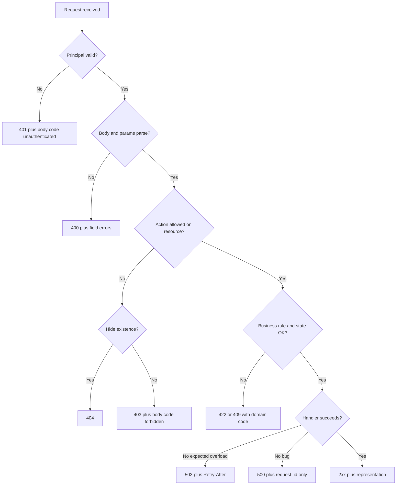

HTTP status codes describe the protocol outcome of a request. 2xx means the server understood the request and accepted the outcome as success for that method. 4xx means the client sent something the server will not honor as specified. 5xx means the server failed to carry out a request it believes was valid. Domain detail belongs in the body: which field was wrong, which business rule fired, a machine-readable code the client can switch on, a request id to paste into a ticket.

A 200 with `{ "success": false }` trains every client and every proxy to ignore the status line. A 500 for "user already exists" trains operators to page on a validation error. A 404 for an authorization failure trains attackers and also your own UI. Pick the class first, then the specific code, then a stable body.

Clients retry 408, 429, and many 5xx. They must not retry 400, 401, 403, or 422 without changing the request. Idempotency keys make retries of POST safe. Status codes cannot do that job alone, but they are the signal retries use.

## Concept

### The classes and the codes you actually need

200 OK is a successful GET, PUT, PATCH, or POST that returns a representation. 201 Created is a successful POST that minted a resource; send `Location`. 204 No Content is a successful action with an empty body, often DELETE. 202 Accepted is "I queued it"; poll or wait for a webhook. Do not use 202 if you already finished the work.

400 Bad Request is a malformed request: unparseable JSON, wrong types. 401 Unauthorized is missing or invalid authentication (the name is a historical mess; it means unauthenticated). 403 Forbidden is a known principal that may not act. 404 Not Found is no resource at this URL, or a deliberate hide. 409 Conflict is a state clash: duplicate, version mismatch, concurrent update. 412 Precondition Failed is an `If-Match` that missed. 422 Unprocessable Entity is well-formed JSON that fails validation or a business rule. 429 Too Many Requests needs `Retry-After`.

500 Internal Server Error is an unexpected failure. 502/503/504 are gateway and overload stories. Prefer 503 with `Retry-After` when you are shedding load on purpose. 501 is "this method is not implemented." You almost never want it on a resource you published.

429 is not a 500. It is a client that must wait. Send `Retry-After` as seconds or an HTTP date. SDKs that ignore it become a self-inflicted flood. 304 is not an error; it is a successful cache revalidation. Do not log it as a 4xx in the SLO. HEAD should use the same status as GET without a body. A GET that returns 200 and a HEAD that returns 404 breaks load-balancer probes.

Do not invent 2xx for errors. Do not use 418 as a product signal. Do not return 200 for a GraphQL-style error bag on a REST resource unless you have documented a transport that is not REST.

### Bodies that clients can parse

RFC 7807 problem details (`application/problem+json`) is a decent default: `type`, `title`, `status`, `detail`, `instance`, plus extensions. A `code` field your team owns (`inventory.insufficient`, `card.expired`) is what mobile apps switch on. Human `detail` is for logs and support, not for control flow. Localization belongs in the client or a separate message catalog keyed by `code`.

Put the HTTP status in the body only if you must, and keep it identical to the actual status line. Include a `request_id` you also log. Validation errors should list fields: `{ "field": "email", "code": "taken" }`. One string blob forces every client to regex your English.

Do not leak stack traces, SQL, internal hostnames, or whether a user id exists when that is an enumeration hazard. 404 versus 403 is a product choice on sensitive resources; pick it and test it.

`Content-Type` on errors must be parseable by the same clients that parse success. Returning HTML from a WAF on a JSON API is a status the SDK cannot switch on. The gateway should emit the same problem-json (or your error object) for 401, 403, and 429 it generates itself. Include `request_id` there too, or on-call will chase an empty body.

### Mapping domain outcomes onto HTTP

"Charge declined by the issuer" is 402 if you are Stripe-shaped, or 422 with `code=card_declined` if you are not in the payment-status business. "Idempotent replay of a successful POST" is 200 with the original representation, not 409. "Idempotent replay while the original is still in flight" may be 409 or 425, documented. "Partial success on a batch" is the hard one: 200 with per-item errors, or 207 Multi-Status. 207 is underused and poorly supported. Prefer a job resource and 202 if the batch is large.

Gateways must not flatten every upstream error to 500. Map with a table. A 404 from a dependency on an optional panel is not a 404 on the page resource. A 504 from a dependency is 503 or 502 at your edge, with a body that names the failed dependency only if that is safe to expose.

## Trade-offs

| Approach | When it wins | Cost / risk |
| -------- | ------------ | ----------- |
| Status for protocol, body for domain code | HTTP clients, caches, retries, and humans in DevTools | Teams must learn 401 versus 403 versus 422; needs a code catalog |
| Always 200 with an envelope | Some RPC-over-HTTP cultures, GraphQL-like transports | Breaks caches, health checks, and retry libraries; hides outages |
| RFC 7807 problem+json | New public APIs, mixed-language clients | Extra media type, must still define your `code` extension |
| 404 to hide existence | User ids, invoices, anything enumerable | Debuggability; clients cannot tell "wrong id" from "no access" |
| 207 or mixed batch results | Small bulk endpoints that must return per-item outcome | Client complexity; easy to mishandle as full success |

The envelope style is not evil inside a private RPC. It is a defect on a public REST API that you claim is HTTP. If you already ship GraphQL, HTTP 200 plus `errors[]` is that transport's rule; do not copy it onto `/v1/orders`.

## Diagram

## Failure modes

### 200 for errors, 500 for validation

**Detection.** Success-rate SLOs stay green during a bad-client deploy. Pagers fire on missing fields. Retry libraries replay POSTs that can never succeed. API gateways cannot route on status.

**Mitigation.** Map validation to 400/422, authn to 401, authz to 403, conflicts to 409, unexpected exceptions to 500. Add a contract test that asserts status class per fixture. Count 5xx as the SLO error, not 4xx, unless 429 is in your error budget by choice.

### Retrying non-idempotent failures

**Detection.** Duplicate orders after a 502 on POST. Clients retry 400. A 409 is retried until it becomes a 500. Missing `Idempotency-Key` on mutating methods.

**Mitigation.** Document retryable statuses: 408, 429, 500, 502, 503, 504, and connection failures. Require idempotency keys on POST that mint objects. Return the original result on replay. Do not retry 401/403/404/422 in client SDKs by default.

### Inconsistent codes across versions and gateways

**Detection.** Mobile v2 handles `user_not_found`; the edge now returns 404 with a different body. A WAF turns 401 into a generic 403 HTML page. GraphQL BFF swallows REST 409 into a 200 error string.

**Mitigation.** Freeze a small code catalog. Problem+json `type` URLs or a `code` enum belong in the API spec. Test through the gateway with the same assertions as origin. If a layer must rewrite, keep the machine `code` and the status class.

### Information leaks in errors

**Detection.** Stack traces in JSON. "User exists" versus "wrong password" on login. 403 on `/users/other-id` while 404 on `/users/never-existed`. SQLSTATE in `detail`.

**Mitigation.** Generic messages for credential checks. Same status for unknown user and bad password. Apply a consistent hide-or-deny policy on object URLs. Sanitize 500 bodies in production. Keep the leak in logs behind access control, not in the API response.

### 429 without a backoff contract

**Detection.** Clients retry immediately on 429 and amplify load. No `Retry-After`. Rate-limit responses are HTML or empty. Mobile apps treat 429 as a fatal error and log the user out. Success-rate SLOs count 429 as server fault and page overnight.

**Mitigation.** Return 429 with `Retry-After` and a machine code. Document which identity the limit keys on (API key, IP, user). SDKs must sleep. Put 429 in a separate metric from 5xx. If you shed load, 503 plus `Retry-After` is the signal that the server is full; 429 is the signal that this caller exceeded its quota. Do not mix them.

## Real-world example

Stripe's API uses HTTP status as the protocol outcome and a JSON error object for domain detail. A bad API key is 401. A request that cannot be processed is 400 with a `type` such as `invalid_request_error` and a `param` naming the field. Card declines are 402 with `type=card_error` and a `code` such as `card_declined`. Rate limits are 429. Server faults are 500. The object includes `charge`, `doc_url`, and `request_id` (also in `Request-Id`) so a merchant can search logs and docs without parsing English `message` for control flow.

Stripe's libraries switch on `type` and HTTP status, not on substring match. Idempotency keys on POST mean a retried 500 does not create two customers. That pairing — correct status, stable codes, request id, idempotency — is the error design. Copying only the pretty JSON and returning it under 200 would drop the part that load balancers and retry middleware already understand.

GitHub REST is a second public example: 403 for abuse detection and rate limit (with headers), 401 for bad credentials, 422 for validation with an `errors` array. When GitHub must hide a private repository from an unauthorized caller, 404 is the documented choice. Status first, body second, product policy for 404 versus 403.

## What to remember

- Status codes carry protocol outcome. Domain codes, fields, and request ids belong in the body.
- 401 is unauthenticated; 403 is authenticated and denied; 422/409 are well-formed but not applicable. Do not dump them into 500 or 200.
- Retry 429 and 5xx with backoff and idempotency keys. Do not retry 4xx that require a different request.
- Freeze a small catalog of machine codes and test it through the gateway, not only in the service unit tests.
