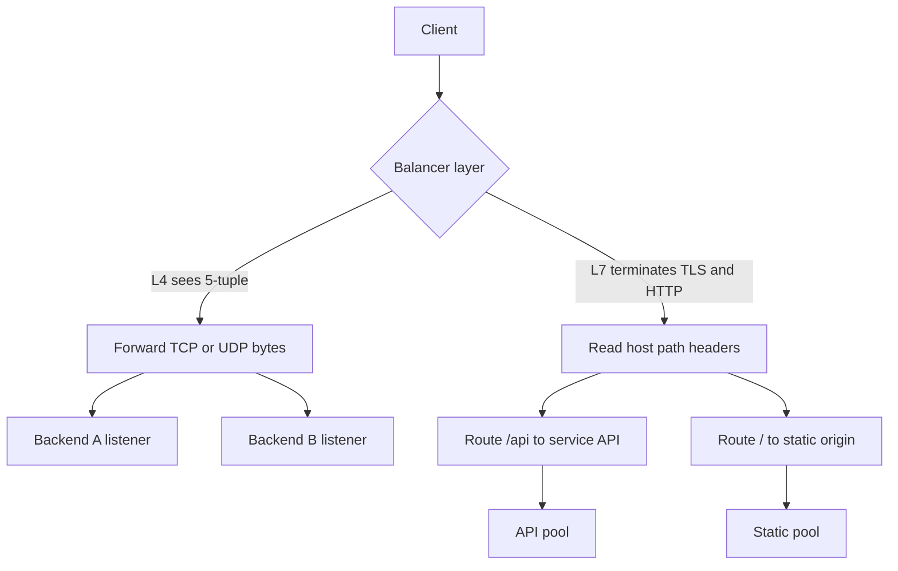

A load balancer is a traffic director in front of a pool of backends. It accepts a connection or a request, picks a healthy member, and forwards. Layer 4 (L4) sees the transport: IP addresses, ports, TCP or UDP. Layer 7 (L7) sees the application message: HTTP method, host, path, headers, sometimes the body, and for HTTP/2 the stream.

What the balancer can see decides what it can do. L4 can spread TCP connections and fail over a dead listener. It cannot send `/api` to one service and `/static` to another. L7 can route on host and path, terminate TLS, apply WAF rules, retry a GET, and inject headers. It pays in CPU, in protocol complexity, and in becoming part of the HTTP trust boundary.

You will run both. An anycast L4 VIP in front of a fleet of L7 proxies is a common production shape. Calling everything "the load balancer" without naming the layer is how a team debugs a 502 that was a TCP reset, or a sticky cookie that an NLB never read.

## Concept

### Layer 4: packets, 5-tuples, and connections

An L4 balancer maps a virtual IP and port to a set of backend sockets. For TCP it usually tracks the 5-tuple (source IP, source port, dest IP, dest port, protocol) so packets of one connection keep hitting the same backend. For UDP it may use a similar flow hash with an idle timeout, because there is no connection to close.

It does not parse HTTP. TLS is opaque unless it is also terminating, which would make it more than L4. Health checks are "did this port accept" or a simple TCP probe. Some L4 products offer HTTP health checks while still forwarding bytes blindly; the data path and the health path then differ, which is useful and easy to misread.

L4 wins on throughput and on protocols that are not HTTP: databases, game servers, SMTP, raw TLS passthrough. Connection setup is cheap. The backend sees the client IP only if you preserve it (PROXY protocol, or DSR / Direct Server Return where response packets bypass the balancer). Without that, every backend log shows the balancer's address.

Preserve source IP on purpose, not by accident. PROXY protocol v1/v2 prepends a header the backend must parse and then forget for the rest of the TCP session. DSR needs the VIP on the backend loopback and return packets that do not hairpin through the balancer. Either design is operational work. Pretending the balancer is transparent, then building rate limits on the wrong address, is how you lock out a NAT.

Failure of L4 is a flow table problem: memory for connections, hash disruption when the backend set changes (unless you use consistent hashing / Maglev-style lookup), and idle timeouts that kill long-lived TCP (WebSockets, database connections) if they are shorter than the application heartbeat.

### Layer 7: messages, routes, and TLS

An L7 HTTP balancer accepts the TCP (and usually TLS) connection itself. It reads the request line and headers, matches a route, and opens or reuses a connection to a backend. HTTP/2 from the client may become HTTP/1.1 to the backend, or stay HTTP/2. That translation is a feature and a bug farm.

Because it sees the request, it can: route `Host` and path to different services; require OIDC at the edge; rate-limit by header; retry idempotent requests on 502; canary by percentage or by cookie; compress; add `X-Request-Id`. Because it terminates TLS, it can inspect or mutate HTTP. The backend may see TLS re-encrypted (another cert) or cleartext on a private network.

Health checks can be `GET /healthz` with expected status and body. Unhealthy members leave the pool without waiting for TCP to fail. Draining stops sending new requests and waits for in-flight ones, which L4 can only approximate by removing a backend and waiting out connection idle.

L7 failure modes include header-size limits, HTTP/2 settings mismatches, timeouts that are shorter than the application, retries that duplicate POSTs, and becoming a single-process bottleneck if TLS and WAF run on the same undersized box.

### Where TLS lives

Passthrough: L4 forwards 443 to backends that terminate TLS. The balancer cannot route on SNI unless it peeks (some L4/L7 hybrids peek SNI without decrypting). End-to-end identity is backend certificates.

Terminate at L7: the balancer holds the certificate, HTTP is visible, backends may speak HTTP or TLS with a different cert. This is the usual public website.

Terminate and re-encrypt: HTTP is visible at the balancer, still encrypted on the east-west hop. Cost is two TLS handshakes per new backend connection, mitigated by pooling.

Choose from who is allowed to read HTTP and from whether you need path routing. Do not terminate TLS on a balancer whose operators are a broader set than the service owners without an access story for those keys.

## Trade-offs

| Approach | When it wins | Cost / risk |
| -------- | ------------ | ----------- |
| L4 TCP/UDP forwarding | Extreme throughput, non-HTTP, TLS passthrough, simple fail-over | No path routing, client IP preservation extra, flow-table and idle-timeout surprises |
| L7 HTTP reverse proxy | Host/path routing, TLS terminate, retries, canaries, WAF | CPU, protocol bugs, retry duplication, the balancer is now in the app session |
| L4 VIP in front of L7 proxies | Scale-out of nginx/Envoy/ALB-like nodes, DDoS absorption at L4 | Two health systems, extra hop, debugging which layer reset the connection |
| TLS passthrough at L4 | End-to-end TLS, backend-owned certs | No HTTP routing or header injection; SNI-only routing if you peek |
| Sticky L7 cookie | Backend session memory you cannot share yet | Broken by clients that drop cookies, uneven load, painful deploys |

An L7 balancer is an HTTP application. Treat its config as code, its timeouts as part of the SLO, and its retries as a multiplier on backend load. An L4 balancer is a network device. Treat its connection table and health probes as the SLO.

## Diagram

## Failure modes

### Health check and data path disagree

**Detection.** L4 TCP checks are green while the HTTP app is returning 500. Or L7 `/healthz` is green on a process that cannot reach its database, so user requests 500 while the pool stays full. A backend is marked down because a probe hits a different port than production traffic.

**Mitigation.** Probe the same protocol and path users hit, or a dedicated health that still exercises the critical dependency. Fail the probe when the process should not receive traffic. Keep L4 probes for "process alive" and L7 probes for "app ready," and require both in a two-layer setup. Log probe status next to user error rate.

### Idle timeouts kill long connections

**Detection.** WebSockets close at 60s or 350s, a round number matching the balancer. Database connections through L4 drop during idle reports. SSE streams stall. Clients reconnect in a herd.

**Mitigation.** Align idle timeouts from client through balancer to backend, above the application heartbeat. Enable WebSocket and streaming support on L7 (no response buffering). For L4, raise flow idle timeout or move long-lived connections off a balancer built for short HTTP. Test with a quiet connection, not only a load test of short GETs.

### Retry amplification at L7

**Detection.** Backend load is a multiple of client RPS during an incident. POST creates duplicates. 502s coincide with balancer retry counters. Timeouts at the balancer are shorter than the backend work, so every slow request is tried twice.

**Mitigation.** Retry only idempotent methods, or only when the backend connection failed before bytes were sent. Cap retries at one. Set the balancer timeout above p99 of the backend and below the client timeout. Use idempotency keys on mutating APIs.

### Client IP and PROXY protocol lost

**Detection.** Rate limits and access logs show a single balancer address. Geo routing is wrong. Downstream trusts `X-Forwarded-For` from the world because the L7 hop was skipped.

**Mitigation.** Enable PROXY protocol on L4, or at L7 append to `X-Forwarded-For` and `X-Forwarded-Proto` and trust only the last hop you operate. Do not trust client-supplied forwarded headers at the backend without that hop count.

## Real-world example

AWS draws the line in product names. Network Load Balancer (NLB) is L4: TCP, UDP, TLS passthrough, a stable VIP, connection-level routing, and preservation of source IP when you want it. Application Load Balancer (ALB) is L7 HTTP/HTTPS: host and path rules, TLS termination with ACM certificates, HTTP/2, WebSocket, OIDC at the listener, target groups per route. Classic ELB could operate in either mode and is the historical reason people still mix the terms.

A typical production pattern on AWS is NLB in front of a fleet of Envoy or nginx tasks, or ALB directly to target groups. TLS for a public website almost always terminates at ALB or at the L7 proxy, not at every application process, because certificate issuance and HTTP routing live there. TLS for a database stays passthrough or never crosses a public balancer. When a team puts an ALB in front of a TCP service, or an NLB in front of a need for path-based routing, the layer was chosen by habit. The AWS console will let you. The protocol will not.

Google Cloud HTTP(S) Load Balancing versus Network Load Balancing is the same split with different names. Cloudflare's reverse proxy is L7; Spectrum and similar products cover L4. Learn one cloud's pair and the others will rhyme.

## What to remember

- L4 forwards connections from IP and port. L7 routes HTTP messages after it can see host, path, and headers.
- TLS passthrough keeps HTTP invisible. TLS termination at L7 makes routing and retries possible and puts the balancer in the trust boundary.
- Health checks, idle timeouts, and retries must match the layer and the application. A green TCP probe is not a healthy HTTP app.
- Two-layer designs (L4 VIP plus L7 proxies) scale well only if you can name which layer reset the connection.
