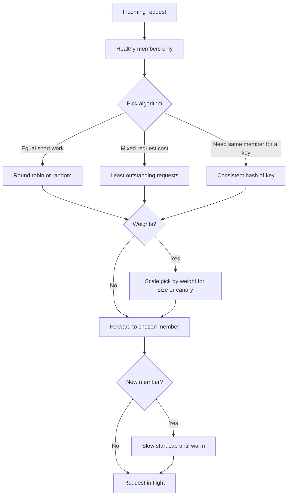

A load balancer that can see a pool still has to pick a member. The algorithm is that pick. Round robin walks the list. Least connections sends the next request to the member with the fewest in-flight connections. Consistent hashing maps a key (client IP, cookie, request path, session id) onto a ring so the same key prefers the same member as the pool changes. Weighted variants exist because servers are not equal: a new generation, a canary, a host with twice the CPU, a member you are draining.

The algorithm cannot fix a bad health check. It cannot make a non-idempotent retry safe. It can make a healthy pool uneven, sticky, or both. Choose it from the shape of the work: homogeneous short requests, mixed request cost, or a cache that must stay warm on one backend.

## Concept

### Round robin and its shuffle

Round robin assigns request 1 to member A, 2 to B, 3 to C, 4 to A. With equal members and equal request cost, it is fair over a long window. It is also the default in many L7 proxies because it needs no extra state beyond an index.

It fails when request cost is heavy-tailed. A is unlucky and draws three slow reports; B draws three cheap GETs. Connection count on A climbs; round robin still feeds A. It fails when members are added without a slow start: the new box receives an equal share while its caches are cold and its JIT is cold. It fails if the client is one connection that pipelines many requests and you balance per connection, not per request: that client pins to one member.

Random pick among healthy members is close to round robin with less synchronized lockstep. Power of two choices (pick two at random, take the less loaded) is a step toward least connections without global counts.

### Least connections and least outstanding requests

Least connections tracks how many TCP connections (L4) or HTTP requests (L7) sit on each member. The next assignment goes to the minimum. Slow members accumulate connections and receive fewer new ones. Fast members empty and receive more. That is the correct feedback for mixed request cost, if the counter is the work that actually occupies the member.

L4 least connections can lie for HTTP/2 and for connection pooling: one backend connection may carry many streams, or a keep-alive may look like load. L7 "least outstanding requests" counts in-flight HTTP requests, which matches application work better. AWS ALB documents this distinction. Envoy's `least_request` is the same idea.

The algorithm needs a slow start or a warmup so a member that just became healthy, with zero connections, does not absorb the entire site. It needs to ignore draining members. It needs a max queue; otherwise the "least" busy of a fully overloaded pool is still overloaded.

### Consistent hashing and stickiness

A hash ring maps keys to members. When a member is added or removed, only the keys that lived on that member (plus a bounded neighbor set) move. Cache locality survives churn better than modulo-N hashing, which reshuffles almost everything when N changes. Maglev and similar lookup tables are production-grade consistent hashing for L4 with small disruption and fast dispatch.

Use a key that matches the locality you want: URL path for a cache of responses, user id for server-side sessions you have not yet externalized, source IP when you have no better key and accept NAT collisions. Source-IP hash behind a carrier NAT pins thousands of users to one member.

Stickiness with a cookie is an explicit session affinity: the balancer writes a cookie naming the member. It is not consistent hashing. It is a reservation. Deploys must drain that member or the cookie breaks. Prefer a shared session store and a non-sticky algorithm when you can. Use affinity as a temporary patch.

### Why weights exist

Weights scale the pick probability or the capacity the algorithm assumes. A member with weight 2 receives twice the round-robin turns, or is treated as twice as able in least-connections (sometimes by counting each connection as half). You set weights because hardware differs, because a canary should see 5% of traffic, because you are draining (weight 0 or near 0), or because a region is degraded.

Weights are not autoscaling. If you set them once from instance size and then the application becomes memory-bound, they lie. Recalculate from observed capacity, or use an algorithm that already feeds on in-flight work (least requests) and keep weights for intentional skew only.

Drain is a weight of zero plus a wait, or a separate state that refuses new assignments while finishing in-flight work. Removing a member from a consistent-hash ring is a different act: keys move to neighbors immediately. If those keys were sessions in process memory, they break. If they were cache entries, neighbors take a miss storm. Sequence the drain with the algorithm you actually run, not with a generic "take it out of the pool" runbook copied from round robin.

## Trade-offs

| Approach | When it wins | Cost / risk |
| -------- | ------------ | ----------- |
| Round robin | Equal backends, similar request cost, simplest config | Unlucky slow piles, cold new members, per-connection imbalance |
| Least connections / least requests | Mixed latency, heterogeneous work, HTTP request-level balancing | Needs warmup; L4 connection counts lie for multiplexed HTTP |
| Consistent hash on a well-chosen key | Caches, sharded in-memory state, minimizing reshuffle on churn | Bad keys (NAT), hotspot keys, harder drain than round robin |
| Weighted any of the above | Mixed instance sizes, canaries, deliberate drain | Stale weights, operators as schedulers, canary too hot |
| Cookie or IP affinity | Legacy in-process sessions | Uneven load, painful deploys, NAT pinning |

Measure the outcome, not the intent. The right metric is per-member in-flight requests, latency, and error rate, plus how much cache hit rate drops when a member leaves. An algorithm that looks fair on connection count and unfair on CPU is the wrong layer's counter.

## Diagram

## Failure modes

### Hotspot from a bad hash key or a heavy user

**Detection.** One backend's CPU and in-flight count dwarf the others. The key is source IP behind a NAT, or a single user id that is a large tenant. Consistent hashing is working: it is faithfully pinning the hot key.

**Mitigation.** Change the key (path plus a bounded tenant shard, or a random salt for that tenant). Split the hot tenant. Fall back to least requests for that route. Cap concurrency per member. Hashing cannot invent capacity.

### New member stampedes and no slow start

**Detection.** After a deploy or scale-out, the new instance's error rate and latency spike while others are fine. Connection counts on the new member jump from 0 to a large share under least connections. Caches are empty.

**Mitigation.** Slow start: cap the new member's share and raise it over minutes. Pre-warm caches if you can. For least connections, give the new member a virtual connection count that decays. Do not add twenty members at once on a least-conn pool without warmup.

### Affinity versus drain

**Detection.** A backend will not go idle at deploy. Cookies still route users to a process you want to kill. IP hash keeps a corporate NAT on the member you removed from DNS but not from the ring. Session errors appear at the end of the drain timer.

**Mitigation.** Drain by stopping new hashes or cookies while finishing in-flight work. Shorten cookie TTL before the deploy. Move session state off the process. If you must keep affinity, extend drain past the longest session you will honor and accept uneven capacity during that window.

### Weighted canary that is not a canary

**Detection.** Weight 1 versus 100 was meant to be 1%. Integer rounding or a small pool makes it 10% or 50%. One of two members with weights 1 and 1 is not a canary. Health check failure on the production-weighted member dumps 100% to the canary.

**Mitigation.** Compute actual share from the live pool, not from the intended weights. Keep canaries in a separate target group with a traffic-shift rule at L7 when the product supports it. If the baseline pool shrinks, cap the canary's absolute RPS.

## Real-world example

HAProxy and nginx have shipped these algorithms for years: `roundrobin`, `leastconn`, `source` (hash of client IP), `uri`, and weights on each server. Envoy's `ROUND_ROBIN`, `LEAST_REQUEST`, `RING_HASH`, and `MAGLEV` are the same family with better request-level counters and lookup tables. AWS ALB's default is round robin; least outstanding requests is the option you turn on when request cost varies. NLB at L4 uses flow hashing, which is a consistent-hash-like assignment of connections, not HTTP least-requests.

Google's Maglev paper describes an L4 software load balancer that uses a consistent hash table so that backend changes do not reshuffle every flow, and so that each Maglev machine can compute the same assignment without sharing per-flow state. That is why consistent hashing shows up at the connection layer of large VIPs, not only at cache-friendly L7.

When you configure a Kubernetes Service `externalTrafficPolicy` or an ingress algorithm, you are picking from this same list. The names differ. The failure modes do not: hot keys, cold members, stale weights, and affinity that outlives the process.

## What to remember

- Round robin is fair only when members and request costs are equal. Least outstanding requests tracks mixed work at L7.
- Consistent hashing keeps a key on one member across pool churn. A bad key (NAT IP, huge tenant) becomes a hotspot.
- Weights exist for unequal capacity, canaries, and drains. They go stale. Measure actual share.
- Slow-start new members. Drain affinity before you kill a process. The algorithm is not a health check and not a session store.
