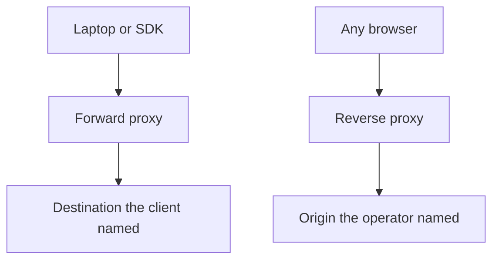

A proxy is a hop that speaks HTTP or TCP for someone else. The design question is whose someone else it is. A forward proxy acts for the client: the browser, the SDK, or the laptop is configured to send work through that hop, and the hop fetches a destination the client named. A reverse proxy acts for the origin: the service operator publishes a hostname that points at that hop, clients believe they are talking to the product, and the origin never has to be the address on the public certificate.

If you mix those jobs you will debug the wrong room. A corporate egress filter that employees set in a PAC file is a forward proxy even when the process is nginx. A TLS terminator that public DNS points at is a reverse proxy even when the process is the same nginx binary. The binary does not decide. The trust relationship does, and so does who is allowed to name the next hop.

I draw them as opposite arrows on one pipe. Forward: many clients, many destinations, one choke point the client organization owns. Reverse: many clients, one service identity, a pool of origins the service organization owns. Both boxes can cache, both can authenticate, both can log. They do not share an incident owner.

## Concept

### Who names the destination

On a forward proxy the client sends a request whose target is an arbitrary host. Classic forms are `CONNECT example.com:443` and an absolute-form `GET http://example.com/...`. The proxy resolves that name, opens a connection, and relays bytes. Policy is "may this user reach that destination." Caching, when it exists, is of other people's content as seen from this network.

On a reverse proxy the client sends a request whose `Host` is the service. The proxy already knows the origin pool. It picks a backend, optionally terminates TLS, optionally inspects the path, and forwards. Policy is "may this request hit this origin, and which origin." Caching, when it exists, is of your own content under keys you defined.

That naming difference is the whole mechanism. A forward proxy is a client with extra policy. A reverse proxy is an origin with extra policy. Treat a reverse proxy as "just a load balancer" and you will forget TLS, header sanitization, and the origin-hiding job. Treat a forward proxy as "just a firewall" and you will forget that it must resolve names, pool connections, and sometimes intercept TLS.

### The client configuration test

If the client must be told about the proxy — a PAC file, `HTTPS_PROXY`, an explicit IP, a browser setting — you are looking at a forward proxy. If the client uses the public hostname of the product and never hears the word proxy, you are looking at a reverse proxy. The test survives marketing names. API gateway, WAF, ingress, and edge are reverse proxies with extra policy. Secure web gateway, explicit proxy, and egress filter are forward proxies with extra policy.

Transparent forward proxies sit on-path without client configuration. They still act for the client: they intercept outbound flows and apply the client's organization's policy. They are harder to reason about because the client did not opt in, so certificate errors, HTTP/2, and WebSockets break in ways the application author never tested. Prefer explicit forward proxies when you can. Prefer reverse proxies that the origin team owns when the job is inbound.

### What each hop is allowed to see

A forward proxy on HTTPS often sees only `CONNECT` and SNI unless you install a corporate root and intercept TLS. Intercept is a product decision with a legal and trust cost. Users' machines must trust your CA. Mobile apps that pin certificates will fail. You gain URL-level logging and data-loss rules. You pay in breakage and in the duty to protect the intercepted bytes.

A reverse proxy almost always terminates TLS for the origin because the origin operator holds the certificate. That is why reverse proxies accumulate features: HTTP/2 to HTTP/1 translation, header rewriting, request buffering, authentication at the edge, and web-application firewall rules. The origin can speak a simpler protocol on a private network. The public identity lives on the proxy.

Neither hop should be a silent byte pipe in production. Log the identity you authenticated, the destination you chose, the status you returned, and the time you spent. A reverse proxy log is an origin access log. A forward proxy log is an employee or workload audit log. Mixing those schemas hides who did what.

### Placement on a real path

A user at a laptop may traverse both in one click. The browser uses the corporate forward proxy to leave the building. That proxy opens a connection to your public hostname. The packet lands on your reverse proxy, which selects an origin. Each hop has a different owner, a different log, and a different failure domain. Collapsing them on a whiteboard is how a four-hour incident starts in the wrong Slack channel.

Workloads inside your own mesh still meet reverse proxies: an ingress, an API gateway, a service mesh sidecar that accepts inbound connections. Outbound from those same workloads may still meet a forward proxy when you force egress through a squidding hop so that only approved destinations leave the VPC. Draw both. Name the team that pages for each.

## Trade-offs

| Approach | When it wins | Cost / risk |
| -------- | ------------ | ----------- |
| Explicit forward proxy | Corporate egress, destination allow-lists, auditing who fetched what | Clients must be configured; intercept TLS breaks pinning and some apps |
| Transparent forward proxy | Unmanaged devices you cannot configure | Surprise breakage, hard-to-debug TLS, users who bypass it on DNS |
| Reverse proxy at the public edge | One hostname, TLS, routing, origin hiding, caching your own bytes | The proxy is now the product's availability and a shared blast radius |
| Clients talking straight to origin | A private network with a handful of callers you trust | No central policy, no origin hiding, every origin does TLS and auth |

Pick the hop from the identity you need to enforce. If the identity is the employee or the workload leaving a network, you want a forward proxy with an allow-list and an audit trail. If the identity is the product the world calls, you want a reverse proxy with a certificate, a pool, and a health check. Running both on one process is possible. Owning both as one on-call is how you page the wrong person.

A reverse proxy that also opens arbitrary outbound `CONNECT` for clients has become a forward proxy with your origin credentials sitting next to a general-purpose relay. Split those roles. A forward proxy that terminates your public site has become an origin you did not mean to put on the laptop fleet. Split those roles too.

## Diagram

The two arrows below are the only distinction that matters. On the left the client names the destination. On the right the operator named the origin pool before the client arrived.

## Failure modes

### Treating a reverse proxy as a forward proxy

**Detection.** Public clients are asked to set `HTTPS_PROXY` to reach your product, or PAC files appear in a consumer app. Support tickets mention "configure the proxy" for a site that should have been a hostname. Origin IPs leak in client error messages because someone published them as the "real" destination behind the proxy.

**Mitigation.** Publish a hostname, a certificate, and a reverse proxy. Put the origin on a private address. Do not document origin IPs except to the team that operates the reverse proxy. If a partner must call you from a locked-down network, give them the public hostname and, if needed, a static set of reverse-proxy egress IPs, not a PAC file.

### Treating a forward proxy as a reverse proxy

**Detection.** An egress box starts answering as if it were your website: it holds your certificate, it routes by path to internal origins, and it is reachable from the internet. Or an internal tool is published through the corporate squidding tier and external users are told to "use the proxy." Access logs mix employee browsing with product traffic.

**Mitigation.** Inbound product traffic terminates on a reverse proxy the product team owns. Outbound employee and workload traffic leaves through a forward proxy the network team owns. Share nginx skill, not nginx processes. Separate certificates, separate logs, separate pages.

### TLS intercept on a forward proxy without an exception path

**Detection.** Mobile apps with certificate pinning fail only on the corporate network. HTTP/2 or QUIC clients fall back strangely. Certificate warnings appear for sites that are fine on cellular. The proxy team sees a rise in `CONNECT` tunnels that never complete a handshake.

**Mitigation.** Default to tunneling `CONNECT` without intercept for destinations that pin or that you do not need to inspect. Intercept only where policy requires URL-level visibility, and ship the corporate root through a device-management channel you control. Keep a bypass list with an owner. Measure handshake failures by destination, not only by proxy CPU.

### Origin IP leakage behind a reverse proxy

**Detection.** Attack traffic arrives at origin addresses that were never in public DNS. A scanner found an IP on a certificate transparency log, an email header, or an old A record. DDoS that the reverse proxy was meant to absorb lands on the application hosts.

**Mitigation.** Origins accept traffic only from the reverse-proxy fleet: security groups, mTLS, or a private network. Rotate any origin address that has been public. Disable direct origin certificates on the public internet. The reverse proxy's job includes hiding the origin, not only load-balancing it.

## Real-world example

Cloudflare's public reverse-proxy product is the shape most teams meet first. A site owner changes DNS so that the world resolves `example.com` to Cloudflare anycast addresses. Browsers open TLS to Cloudflare. Cloudflare holds the certificate, applies WAF rules, caches according to cache keys and `Cache-Control`, and only then opens a connection to an origin the owner registered. The origin can sit on a locked-down IP allow-list of Cloudflare's published ranges. Clients never configure a proxy. They type a hostname.

The same company, and most enterprises, also run the opposite hop for people and for workloads leaving the network. An explicit forward proxy — historically Squid, today often a cloud secure web gateway — is configured in the OS or the browser. The client sends `CONNECT` or an absolute-form request. The proxy decides whether that user may reach that destination, logs the event, and only then connects. The destination did not publish this proxy. The destination may not even know it exists.

I keep those two pictures on the same slide in a design review. If the box is on the path because the client organization demanded it, it is a forward proxy. If the box is on the path because the service organization published it, it is a reverse proxy. Cloudflare at the DNS record is reverse. Squid in the laptop PAC file is forward. nginx can be either. Your on-call rotation cannot.

When we put an API gateway in front of a fleet, we are choosing the reverse-proxy side and then adding auth and limits. When we force Lambda or Kubernetes egress through an HTTP proxy so that only approved hosts leave the VPC, we are choosing the forward-proxy side. Both are correct. Confusing them produces a gateway that will `CONNECT` to arbitrary hosts with the origin's identity, or an egress filter that someone tries to use as a public website. Name the client. Name the origin. Put one hop in service of each.

## What to remember

- A forward proxy acts for the client and fetches a destination the client named; a reverse proxy acts for the origin and receives a hostname the operator published.
- Use the configuration test: if the client must be told about the hop, it is forward; if the client only knows the product hostname, it is reverse.
- TLS intercept belongs to forward proxies that must see URLs; TLS termination belongs to reverse proxies that hold the site certificate.
- Keep the hops on separate processes and separate on-call rotations even when they share a binary.
