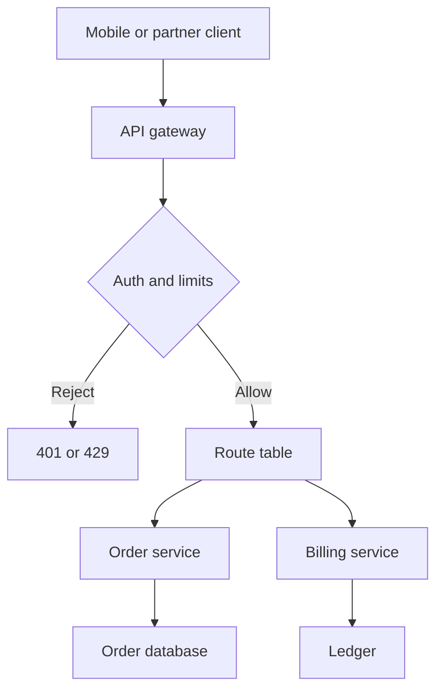

An API gateway is a reverse proxy with a job description: authenticate, authorize, route, and limit, then hand the request to a business service that does not have to know how the internet arrived. It is not the order service. It is not the billing service. It is the door those services agreed to share. If you put domain logic in the gateway, you will ship a second, worse copy of the product on a hop that every team pages when it breaks.

The door is still a reverse proxy. Clients call a hostname you published. The gateway terminates TLS, picks an upstream, and forwards. The extras are why you bought a gateway instead of a load balancer: API keys or JWT validation, per-route rate limits, request transformation, and a catalog of paths that product teams can publish without each one opening a public listener.

I want that catalog to stay boring. A gateway that grows custom code for every team becomes a deployment bottleneck and an unowned monolith at the edge. A gateway that only does policy and routing stays a platform. The business service stays the place where money moves and inventory changes.

## Concept

### Reverse proxy, plus a policy plane

Start from the reverse proxy. The client never sees origin addresses. The gateway holds the certificate, speaks HTTP/1 or HTTP/2 or gRPC at the edge, and opens a shorter, simpler call to an origin on a private network. Health checks decide which origin is in the pool. Timeouts on the gateway are shorter than the client's, and longer than the origin's own deadline.

Then attach policy that a load balancer usually will not own. Authentication: is this request from a principal we know. Authorization: may that principal call this route. Routing: which service, which version, which canary. Limits: how many requests per key, per IP, per tenant. Optional transforms: strip hop-by-hop headers, inject a correlation id, map a legacy path to a new one. Optional protocol translation: REST at the edge, gRPC inside. None of that is the billing calculation. All of that is the door.

If a feature needs the body of an order to decide a price, it does not belong on the gateway. If a feature needs a JWT, a route table, and a quota, it does.

### Where the gateway sits

Public mobile and web clients usually hit the gateway first, after a CDN if you cache GETs. Internal services should not bounce through the public gateway to call each other. That path doubles TLS, doubles auth, and couples every interior call to the edge's release. Interior traffic belongs on a mesh, a private load balancer, or a DNS name inside the cluster. The gateway's audience is untrusted or semi-trusted callers: partner APIs, mobile apps, third-party integrations, browsers.

A backend-for-frontend is a cousin, not a synonym. A BFF is a business service that aggregates for one client surface. It may sit behind the gateway. It must not be replaced by gateway orchestration graphs that fan out to six origins and compose a homepage. Fan-out with application semantics is application code. Put it in a service you can test and roll back without touching every other team's routes.

### Auth, routing, and limits as separate knobs

Authentication at the gateway means the origin can receive a verified identity header, or can refuse traffic that did not come from the gateway. Mutual TLS between gateway and origin, or a signed internal token, stops clients from bypassing the door. Authorization at the gateway is coarse: this key may call `/v1/payments` at 100 requests per second. Fine-grained checks — this user may refund this payment — stay in the service that owns the data.

Routing is a map from public path and method to origin and timeout. Versioning belongs in that map: `/v1` and `/v2` can point at different services. Canaries belong there too, as a percentage or a header. The map needs an owner per route, or you will accumulate orphan paths that still pass auth.

Limits protect the origins from a single key or a single address. They are not a substitute for origin capacity planning. A gateway that returns 429 is doing its job. A gateway that queues until the origin melts is a load balancer you forgot to bound. Set the limit from the origin's proven rate, not from a round number in a slide.

### What the business service still must do

The origin still validates the body. The origin still enforces object-level authorization. The origin still writes the audit record for the money movement. Gateway auth answers "who is at the door." Service auth answers "may this who touch this row." Skipping the second check because "the gateway already authenticated" is how a broken route table becomes a data incident.

Idempotency keys, pagination, and error bodies are service contracts. The gateway may translate a protocol, but it should not invent a new error model. Pick one public error shape, document it, and have origins emit it or a mapping you own. A gateway that rewrites every 500 into a 200 with a JSON blob will hide origin failure from every client and from every alert.

## Trade-offs

| Approach | When it wins | Cost / risk |
| -------- | ------------ | ----------- |
| Shared API gateway at the public edge | Many services, one hostname, one auth and limit policy | Shared blast radius; a bad route config pages every consumer |
| Per-service public load balancer | One team, one product, little need for a catalog | Every service repeats TLS, auth, and limits; partners see a zoo of hosts |
| Gateway with custom business plugins | A short-lived adapter for a legacy path | The gateway becomes an unowned application that is hard to test |
| Interior calls through the public gateway | A temporary break-glass path | Extra hops, extra failure domain, auth loops, and latency you cannot explain |
| Mesh or private LB for service-to-service | Trusted interior traffic with mTLS | Does not replace the public door; partners still need a gateway |

A managed cloud gateway wins when you want auth, quotas, and a WAF without running nginx. You pay in integration timeout ceilings, in vendor auth models, and in the difficulty of local reproduction. A self-hosted gateway (Kong, Envoy, nginx plus your policy) wins when you need custom protocol work and you already operate a fleet. You pay in upgrades and in the temptation to write Lua or filters that belong in a service.

Keep the route table small enough that a human can read it in a review. When it is not, split by audience: partner gateway, mobile gateway, internal preview. Splitting by team without splitting the hostname is how you get two doors for one product and clients that never know which one to call.

## Diagram

The gateway terminates the public call, applies policy, and forwards to a service that owns the business write. The service is not inside the gateway box.

## Failure modes

### Business logic living in the gateway

**Detection.** Gateway plugins compute prices, call three origins and merge JSON, or contain "temporary" code that has been there for a year. Gateway deploys require product-team review. Unit tests for checkout exist only in the gateway repo. A rollback of the edge takes the homepage composer with it.

**Mitigation.** Move composition into a BFF or into the service that owns the use case. Limit gateway code to auth, routing, limits, header policy, and protocol translation. Give each plugin an expiry and an owner. If a plugin cannot be expressed as policy, it is an application.

### Origins that trust the gateway too much

**Detection.** Services accept `X-User-Id` from any caller. A port-forward or a forgotten security group lets a client hit the origin with a spoofed identity. Audit logs show internal identity headers on requests that never passed the gateway.

**Mitigation.** Origins accept traffic only from the gateway: private subnets, mTLS, or a mesh identity. Treat identity headers as untrusted unless the connection is authenticated as the gateway. Repeat object-level authorization in the service. The gateway is the door, not the lock on the row.

### Shared limit that hides a hot route

**Detection.** One public 429 counter. A noisy partner or a runaway mobile retry burns the shared quota. Other routes fail even though their origins are idle. On-call sees "gateway throttling" and cannot tell which key or which path.

**Mitigation.** Limit by key and by route. Emit the key, the route, and the reason on every 429. Give partners isolated quotas. Keep a separate ceiling for the gateway process itself so that one route cannot exhaust worker threads for the rest.

### Gateway timeout longer than the client, shorter than nothing

**Detection.** Clients abort at 10 seconds. The gateway waits 29 seconds and still holds an origin worker. Or the gateway times out and retries a POST while the origin already committed. Traces show the origin finishing after the client has gone.

**Mitigation.** Set the gateway integration timeout below the client's deadline and above the origin's own timeout. Propagate a deadline header. Do not retry non-idempotent methods at the gateway. Cancel the origin call when the client disconnects if the protocol allows it.

## Real-world example

Amazon API Gateway is the managed form of this pattern. You define a REST or HTTP API, attach a custom domain and a certificate, and choose an authorizer: IAM, a Cognito user pool, a Lambda authorizer, or an API key. You set usage plans and stage-level throttles. You map paths to integrations: Lambda, an HTTP origin, a Step Functions state machine, a mock. The integration is the business service. The gateway is the door.

Two facts from that product shape the design even if you never use AWS. The integration timeout is bounded — for REST APIs the ceiling has long been 29 seconds — so a slow origin cannot be hidden behind an unbounded wait at the edge. You must design the business call to finish inside that budget or make it asynchronous. Usage plans attach quotas to keys, which is the limit knob separated from the Lambda that actually writes the order.

Teams get into trouble when they treat API Gateway as the application. Mapping templates that rewrite bodies into a private schema, nested Lambda authorizers that hit a database, and VTL that encodes business rules all belong in a service. The managed gateway is still the right place for the JWT check, the WAF association, the throttle, and the route to a Lambda that owns the write.

Netflix's Zuul, in its original form, was the self-hosted cousin: a JVM reverse proxy at the edge that authenticated, routed, and applied filters before traffic reached mid-tier services. Zuul 2 moved to a non-blocking model for the same job. The lesson I still take from that lineage is placement. The edge filter chain is policy. The recommendation service remains a service. When those two merge, every origin deploy waits on the edge, and every edge deploy risks every origin.

## What to remember

- An API gateway is a reverse proxy plus auth, routing, and limits; it is not the business service.
- Put object-level authorization, money movement, and composition in services; put identity, quotas, and the public route map at the door.
- Interior service-to-service calls should not tour the public gateway.
- Timeouts, retries, and 429s at the gateway need owners, or the door becomes a silent amplifier.
