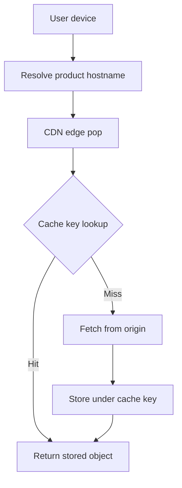

A content delivery network is a cache that sits closer to the client than your origin does. The client resolves a hostname to an edge pop. On a hit, the pop answers from local bytes and the origin never hears the request. On a miss, the pop fetches from origin, stores the object under a cache key, and answers. The design is not "put Cloudflare in front." The design is the cache key, the TTL, and the invalidation path that makes a changed object visible.

If you skip those three, you have rented a fleet of servers that will serve yesterday's JavaScript with today's HTML, or that will stampede the origin on every deploy. Distance is the easy part. Coherence is the part that pages you.

I treat a CDN as the outermost cache in a chain you already have: browser cache, edge cache, application cache, database buffer pool. Each layer has a different owner and a different idea of what "the same object" means. The CDN's idea is the cache key. Get the key wrong and you either fragment the cache into one-object-per-user or you serve one user's personalized page to another.

## Concept

### What the edge actually stores

The pop stores a response body plus selected headers, keyed by a string the CDN computes. A typical key is scheme, host, path, and a chosen subset of query parameters. Cookies and `Authorization` usually bust the key or disable caching, which is correct for personalized HTML and fatal if you accidentally put a session cookie on a static asset URL.

TTL comes from `Cache-Control` on the origin response, from a CDN override, or from both. `max-age` and `s-maxage` are different: the first speaks to browsers, the second to shared caches such as the CDN. `private` keeps the object out of the shared cache. `no-store` forbids storing. `must-revalidate` and ETags turn a miss into a cheap conditional GET. Learn those headers before you learn the vendor's "purge all" button.

The object that is safe to cache is immutable or cheap to be slightly stale. Hashed asset filenames (`app.a1b2c3.js`) are the first kind: a new deploy is a new key, so you can set a long TTL and never purge. HTML that points at those assets is the second kind: short TTL, or explicit purge on deploy. Personalized HTML is usually not a CDN object at all.

### Cache keys are the product

Two requests that must share a cached object must produce the same key. Two requests that must not share an object must produce different keys. That sentence is the whole key design.

Query parameters used for tracking (`utm_source`) should be excluded from the key, or every campaign fragments the cache and the origin sees a miss storm. Query parameters that select a real variant (`w=800` on an image) must be included, or you will serve the wrong bytes. Headers that change the body (`Accept-Language`, `Accept-Encoding`) belong in the key or in a `Vary` that the CDN honors. `Vary: Cookie` is how you disable the cache by accident.

Geographic or device variants need an explicit key component, not a hope that the origin will "do the right thing" on a miss. If the origin varies on something the key ignores, users share the first variant that was cached. That is a correctness bug, not a performance bug.

### Invalidation is a design, not a button

TTL expiry is the quiet invalidation path. It does not need an API call. It does mean the worst-case staleness is the TTL. Purge by URL is the loud path: you tell the CDN that a key is dead. Purge by tag or surrogate key is the grown-up path: one content change invalidates every object that listed that tag.

Purge is eventual. Pops do not share one memory. A purge request fans out. For a few seconds or longer, some pops still have the old object. If you need a cutover that is atomic from the user's point of view, change the key (new filename, new path) instead of purging. Immutable assets plus a small HTML TTL beat "purge the world" on every release.

A purge-all on a large site is a self-inflicted origin DDoS. Every pop misses together. Origin CPU, origin bandwidth, and origin database all see a square wave. Prefer tagged purge of the objects you actually changed. Prefer versioned URLs so you do not purge at all.

### Where the CDN sits relative to the origin

The CDN is a reverse proxy. Clients do not configure it. DNS or an anycast address points at the vendor. Origin hide, TLS, WAF, and bot rules often live on the same hop. Those features are not caching. Do not tune cache keys as if they were WAF rules.

Shielding or a regional mid-tier cache sits between pops and origin so that many pops miss into one shield, and only the shield misses into origin. That is how you survive a global TTL expiry. Without a shield, TTL expiry is a synchronized origin stampede.

The origin must still set correct headers. A CDN cannot invent a safe TTL for a JSON API that changes per user. If the origin sends `Cache-Control: no-store`, the CDN should obey. If the origin sends nothing, vendor defaults apply, and vendor defaults are how private API responses end up in a shared cache.

## Trade-offs

| Approach | When it wins | Cost / risk |
| -------- | ------------ | ----------- |
| Long TTL plus versioned URLs | Immutable assets, images, hashed JS and CSS | Requires a build that changes the filename; HTML must point at the new name |
| Short TTL, no purge | News homepages, mildly stale catalogs | Origin traffic stays proportional to 1/TTL; users see old content until expiry |
| Tagged purge on write | CMS content that is reused across many URLs | Purge fan-out lag; a wrong tag purges too much or too little |
| Cache HTML that varies on cookie | Almost never | Personalized pages leak across users, or the cache never hits |
| Bypass CDN for authenticated APIs | Per-user JSON that cannot be keyed safely | You give up edge offload; origin must absorb the RPS |

A CDN is the right first cache for bytes that many users share. It is the wrong first cache for a shopping cart. Put the cart in an application cache or a database. Put the product image on the CDN. Mixing those on one key scheme produces either leaks or a 0% hit ratio.

Hit ratio is a starting metric, not a goal. A 99% hit ratio on the wrong objects still serves stale checkout HTML. A 70% hit ratio on large video segments can still save the origin. Measure origin request rate, origin bandwidth, and user-visible staleness alongside hit ratio. Then tune the key and the TTL, not the vendor's "accelerate everything" checkbox.

## Diagram

A client hits a pop. The pop answers from its store, or it fills from origin under a key you defined, then answers.

## Failure modes

### Cache key too wide

**Detection.** Hit ratio collapses after a marketing campaign or after you add a new query parameter. Origin graphs match client graphs. Pops report millions of keys with a request count of one. `utm_` parameters or session ids appear in cached URLs.

**Mitigation.** Normalize the key: drop tracking parameters, sort query strings, ignore case where it is safe. Log the key, not only the URL. Set a vendor limit on key cardinality and alert when it climbs. Static assets should not inherit the HTML query string.

### Cache key too narrow, or Vary too broad

**Detection.** Users report seeing another user's name, cart, or language. Or every response includes `Set-Cookie` and the CDN caches nothing. `Vary: Cookie` or `Vary: *` appears on public assets. Support tickets mention "wrong site language" after a deploy.

**Mitigation.** Do not cache responses that include `Set-Cookie` unless you have a reviewed exception. Split personalized HTML off the CDN or cache a shell that fetches private data from an uncached API. Put language in the URL or in a small, explicit key header. Review `Vary` on every origin change.

### Purge-all stampede

**Detection.** A deploy or a CMS save issues a global purge. Origin CPU, bandwidth, and error rate spike in every region at once. CDN miss rate jumps from a few percent to nearly all traffic. The site is "down" while the origin generates the same objects it generated yesterday.

**Mitigation.** Ban purge-all outside a named break-glass procedure. Version assets. Purge by tag for HTML. Use a shield pop so misses collapse. Stagger TTL jitter so expiry is not synchronized. Rehearse a deploy that does not purge.

### Stale HTML pointing at dead assets

**Detection.** After a deploy, browsers request `/static/app.oldhash.js` and get 404. HTML was cached with a long TTL. The new origin no longer has the old file. Or the opposite: new HTML is live, old JS is still cached and does not match the new markup.

**Mitigation.** Keep old hashed assets on origin or on the CDN until the HTML TTL has expired. Set HTML TTL short, asset TTL long. Never reuse a hashed filename for different bytes. If you must purge HTML, purge it by tag and leave the assets alone.

## Real-world example

Netflix Open Connect is a CDN the company built because commodity CDNs were the wrong shape for their traffic. Open Connect appliances sit inside ISP networks. When a member hits play, the client is directed to a nearby Open Connect appliance that already holds the encoded video segments for that title. The segments are immutable objects: a given encode of a given chunk has a stable identity. Caching them is a key and a fill problem, not a purge problem. A new encode is a new object. The old one ages out.

That is the cleanest CDN design I know: the cache key is the content id, the object never mutates, and invalidation is "wait for TTL or stop advertising that id." The control plane decides which titles to push or pull onto which appliances, using forecasts of demand and of ISP capacity. The data plane is a cache hit on a segment. Origin — Netflix's encoding and packaging pipeline — is not in the path of a typical play.

Most product teams will not ship appliances into ISPs. They will buy Fastly, Cloudflare, CloudFront, or Akamai. The Open Connect lesson still applies. Separate immutable bytes from mutable documents. Give the immutable bytes versioned keys and long TTLs. Give the documents short TTLs or tagged purges. Do not ask the CDN to cache a personalized homepage under a single URL. Netflix does not cache "the homepage of user 17" on an ISP box. They cache the video segments every user of that title will share.

If your site is a CMS, Wikimedia's public stack is the closer cousin: Varnish and a CDN in front of MediaWiki, with cache keys and purges tied to page edits. An edit invalidates the page and some surrounding objects. It does not purge the entire encyclopedia. That is tagged invalidation in production, whether you call the tags "purge keys" or "page ids."

## What to remember

- A CDN is an edge cache in front of your origin; hit ratio only matters for objects that are safe to share.
- The cache key defines what "the same object" means; tracking parameters, cookies, and `Vary` will wreck it if you ignore them.
- Prefer versioned immutable URLs over purge-all; when you must invalidate, purge by tag and expect lag across pops.
- Staleness is a product choice expressed as TTL and key design, not a vendor default you forgot to read.
