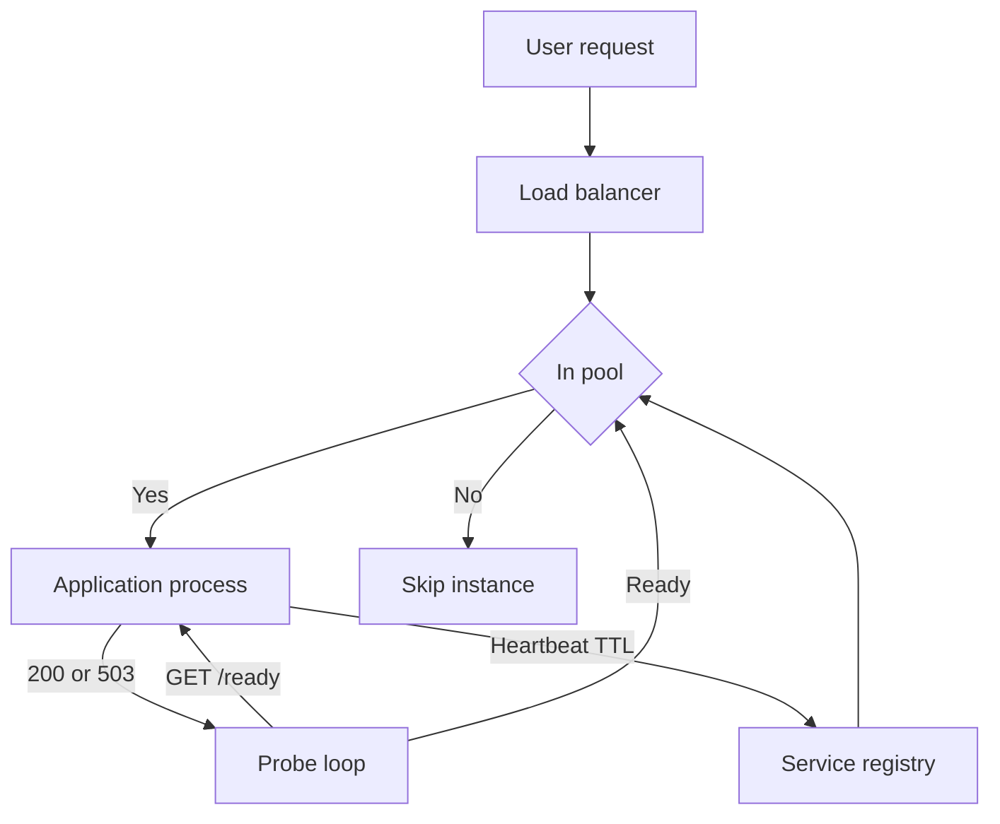

A load balancer can only send traffic to processes it believes are alive. A health check is how it forms that belief. A heartbeat is the sibling signal: the process tells a registry, at an interval, that it still wants work. Both are easy to implement as a function that returns 200. Both are easy to get wrong in a way that routes users to a process that cannot actually serve.

The check must exercise the dependency that the request path needs. A process that can open a socket but cannot reach Postgres is not healthy for a checkout API. A process that can reach Postgres but has a full thread pool is not healthy either. If you only probe `/ping` that returns a static string, you will have a green cluster and a red product.

I split the problem into two questions. Should this process stay in the pool right now. Should this process be restarted because it is wedged. Those questions have different answers, different intervals, and different failure costs. Kubernetes names them readiness and liveness. The names travel. The distinction should travel with them even if you are on VMs and an ELB.

## Concept

### Health checks as admission to a pool

A pull health check is a probe from the balancer, the kubelet, or the service mesh. At an interval, the probe hits an endpoint, a TCP port, or a command. Consecutive failures remove the instance from rotation. Consecutive successes put it back. Thresholds exist so a single packet loss does not flap the pool.

The endpoint is the design. A liveness probe should answer "this process is not deadlocked." It should not answer "Postgres is up." If liveness fails when a dependency is down, Kubernetes will kill and restart pods that were fine, while the database is still down, and you will add crash-looping to an outage. A readiness probe should answer "I can do useful work for the traffic you are about to send me." That is the place to check the database, the critical cache, or a disk that must be writable.

Depth has a cost. If every probe on a 200-pod service opens a new database connection every two seconds, the health check is a load test you forgot to schedule. Reuse the process's existing pool. Cache the dependency result for a fraction of a second. Probe a cheap `SELECT 1` or a connection checkout, not the heaviest query you have.

### Heartbeats as a push membership signal

A heartbeat is the process saying "I am here" to a registry: Eureka, Consul, a custom membership table, or a gossip ring. Missed heartbeats expire the instance. The registry then stops advertising that address to clients or to balancers.

Heartbeats fail in the opposite way from pull probes. A process that is too busy to send a heartbeat looks dead, and may be dead for practical purposes. A process that can send a heartbeat but cannot serve looks alive. If the heartbeat is a UDP packet from a sidecar, and the application thread pool is stuck, you will keep sending traffic into a stuck process. Tie the heartbeat to the same readiness condition you would put on a pull probe, or have the registry also pull.

Gossip systems (Cassandra, SWIM-based membership) use heartbeats plus indirect probes so that one lost packet does not eject a node. The mechanism is still membership, not application health. A node can be in the ring and still refuse queries. Application-level readiness remains a separate signal.

### Intervals, timeouts, and grace

The probe interval, the probe timeout, the unhealthy threshold, and the startup grace period are four numbers that must fit together. If the timeout is longer than the interval, probes pile up. If the unhealthy threshold times interval is longer than your SLO for "stop sending traffic to a dead pod," users will eat those failures. If there is no startup grace, a slow JVM will be killed forever.

During deploy, readiness should go false before the process stops accepting work, and it should stay false until the new process is actually ready. That is drain. A heartbeat that continues until SIGKILL is how you deploy into 500s. A health check that turns red and then waits for in-flight requests to finish, up to a deadline, is how you deploy quietly.

The balancer must distinguish "failed probe" from "slow probe." A probe that times out is a failure. A probe that hits a handler which waits on a lock you also need for user traffic can make the health check compete with the product. Run the ready handler on a path that cannot starve: a separate executor, a bounded wait, a fail-closed timeout inside the handler itself.

### What "healthy" is allowed to mean

Healthy means "safe to receive a share of traffic," not "every dependency in the company is green." Optional dependencies belong on a degraded flag, not on readiness. If the recommendation service is down and the homepage can omit that row, the homepage process stays ready. If the database for that process is down, the process is not ready.

Multi-tenant processes complicate this. One tenant's storage can be sick while others are fine. A binary ready bit will either eject the process for everyone or keep sending the sick tenant into errors. If that matters, the ready bit stays green and a per-tenant error budget or a shard-aware balancer takes over. Do not pretend a single `/health` can encode a hundred tenant states.

## Trade-offs

| Approach | When it wins | Cost / risk |
| -------- | ------------ | ----------- |
| Shallow liveness, deep readiness | Kubernetes and any pool where restart is not the same as eject | Two endpoints to maintain; teams copy-paste the wrong one onto both probes |
| Single deep check on the balancer | VMs behind an ELB with no orchestrator restart | A dependency outage ejects the whole fleet together |
| Heartbeat-only membership | Client-side discovery with a registry | Busy or stuck processes keep advertising; TTL lag leaves stale addresses |
| Pull probe plus heartbeat | Registries that must not trust a stuck sidecar | Double the config; mismatched intervals flap |
| Dependency check on every probe | Catching "process up, database down" | Health-check storms on the dependency; slow probes block user threads |

Fail closed on readiness when the critical dependency is unknown: if you cannot tell whether Postgres is up, do not take traffic. Fail open on optional checks. Write those two sentences next to the endpoint. A handler that returns 200 on every exception to "avoid flaps" is how you serve errors at 100% of instances.

Match the probe network to the data network. A balancer that probes a management IP while users arrive on another NIC will keep a machine that has a dead data interface. A kubelet probe that hits `localhost` is the right local answer for process health; the Service still needs the container port that users hit to be the one that is listening.

## Diagram

A balancer probes readiness, a registry records heartbeats, and only instances that pass both should receive user traffic.

## Failure modes

### Shallow checks, deep outage

**Detection.** Balancer target health is 100%. Error rate on the product is high. Instance metrics show the process is up. Dependency metrics show the database, cache, or disk is not. The ready handler is a static string or a framework default.

**Mitigation.** Put the critical dependency on the readiness path with a cheap, bounded check. Keep liveness shallow. Alert on the gap: product error rate high while pool health is green. That gap is the signature of a lying check.

### Health-check storm

**Detection.** Database connection rate or CPU tracks the probe interval times the instance count. Failovers happen at probe boundaries. `SELECT 1` from a monitoring user dominates the process list. Adding instances makes the dependency sicker.

**Mitigation.** Reuse the application pool. Cache readiness for a short window. Lengthen the interval once you have a sane threshold. Do not open a new connection per probe. Do not run the full user query as a probe. If many balancers probe the same fleet, consolidate to one probe owner.

### Liveness tied to a dependency

**Detection.** A database blip restarts every pod. CrashLoopBackOff appears during a dependency incident. Restarts continue after the database is back because the fleet is still warming. Liveness and readiness hit the same URL.

**Mitigation.** Liveness checks process health only: event loop, deadlock detector, local watchdog. Readiness checks the dependency. During a dependency outage the pods go unready, stay alive, and come back without a rolling restart.

### Heartbeat from a sidecar while the app is stuck

**Detection.** Registry shows the instance up. User traffic times out. Thread dumps show the application pool exhausted. The sidecar is still heartbeating. Deregistration lag is the TTL, which is longer than the incident.

**Mitigation.** Drive the heartbeat off the same ready condition as the pull probe. Fail the sidecar heartbeat when readiness is false. Shorten the registry TTL to something inside your SLO, and compensate with more frequent heartbeats so healthy instances do not flap.

## Real-world example

Kubernetes probes are the production shape most teams now operate, even when they came from an ELB world. The kubelet runs liveness, readiness, and startup probes against a container. Failed liveness restarts the container. Failed readiness removes the pod from Service endpoints. Failed startup delays the other two so a slow boot is not killed.

AWS load balancers have the same split in a coarser form. An Application Load Balancer health check is a pull probe that decides target-group membership. If that check is `GET /` on a framework that returns 200 as soon as the HTTP server is bound, the target stays healthy through a database outage. Teams that learned this the hard way moved the ALB check to `/ready` and made `/ready` fail when the connection pool could not check out a connection inside a small timeout. They left `/live` for the orchestrator.

A concrete incident pattern I have seen on more than one fleet: a Postgres failover. Every application process could still serve `/ping`. The balancer kept sending checkout traffic. Every checkout thread blocked on a connection that would not return. Thread pools filled. `/ping` still returned 200 because it did not use the pool. Health was green. The site was down. The fix was not "more instances." The fix was a readiness check that used the pool, a timeout inside that check, and a liveness check that did not.

Eureka heartbeats at Netflix are the push-side cousin. Instances register and renew. Missed renewals expire the instance so clients stop using that address. The same lying-health problem applies: a renewing instance is not necessarily a serving instance. Pair the heartbeat with an application-level ready bit, or you have invented a shallow check with extra DNS cache lag.

## What to remember

- Health checks decide whether traffic may arrive; heartbeats decide whether an address stays in a registry; neither is optional if something else is routing on that belief.
- Readiness must test the dependency the request path needs; liveness must not, or a dependency outage becomes a restart storm.
- Probe intervals, timeouts, and thresholds are part of the SLO; a lying 200 is worse than a flap you can see.
- Heartbeats from a sidecar must fail when the application is unready, or the registry will advertise a stuck process.
