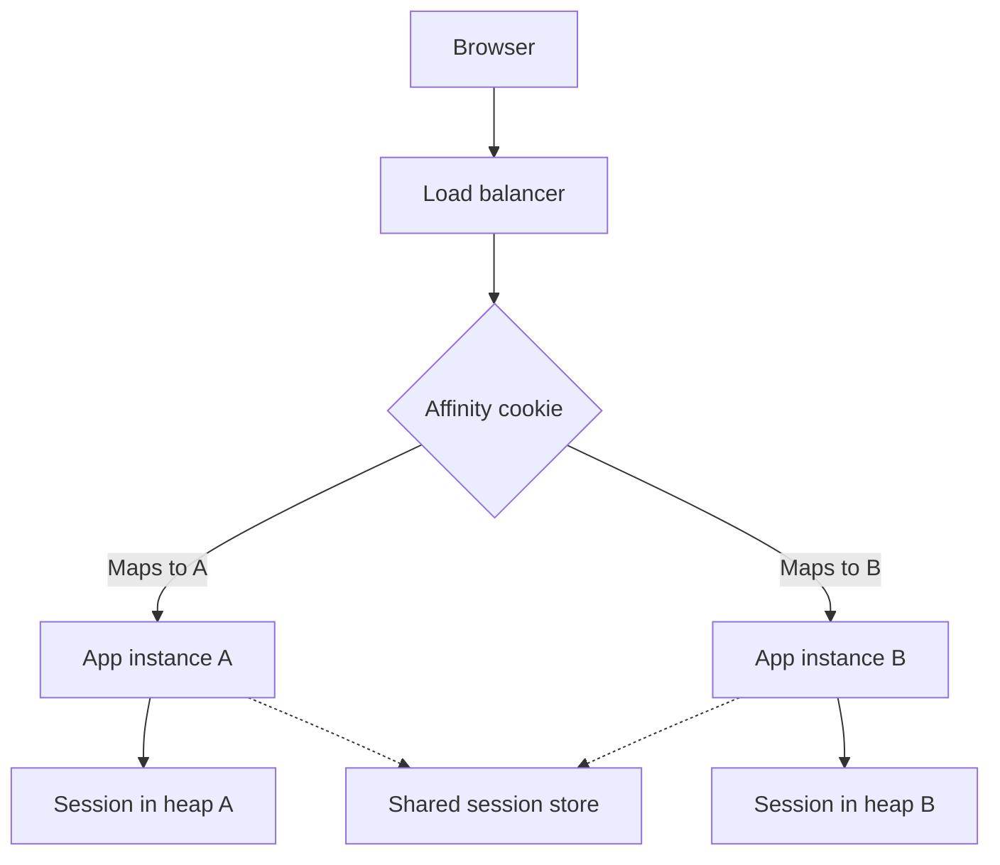

Sticky sessions are a load-balancer promise: once a client has been sent to a particular instance, later requests from that client return to the same instance. Session affinity is the same promise under a different name. The promise exists so that you can keep session state in the process memory of that instance and still have a multi-instance fleet. It works until an instance dies, until you deploy, until one user gets hot, or until you need to scale in.

I treat stickiness as a confession. The application has state that should have lived in a store every instance can read. The balancer is hiding that state behind a routing trick. The trick is acceptable as a bridge. It is a poor destination. Every month you keep it, you pay in uneven load, in painful deploys, and in a recovery story that includes "wait for the user to log in again."

If you are designing a new service, put the session in Redis, in a database, or in a token the client presents. If you have inherited stickiness, measure how much state is actually in memory, then move it. Do not add a second sticky layer (cookie plus IP hash plus application sticky) on the way.

## Concept

### What the balancer is hashing

Cookie affinity is the usual L7 form. The balancer issues a cookie, or it honours one the application issued. Later requests carry that cookie. The balancer maps the cookie to an instance. AWS Application Load Balancers call this a stickiness cookie. nginx calls it `sticky cookie`. Apache httpd and IIS have the same idea under other names.

IP affinity hashes the client address onto an instance. It needs no cookie, so it "just works" for broken clients. It also just breaks NAT. A thousand users behind one corporate egress IP land on one instance. Mobile networks change addresses. IPv6 privacy addresses change. IP affinity is a last resort for protocols that cannot store a cookie.

Application-controlled affinity is a header or a path the balancer is taught to hash: a player id, a tenant id, a WebSocket upgrade. That is a legitimate use when the state is a long-lived in-memory workspace you have not yet externalized, such as a game server or a collaborative document process. It is still stickiness. It still needs a story for the day that process dies.

### Why the application wanted it

Classic servlet and ASP.NET session objects live in the heap of one JVM or one w3wp. PHP session files live on one machine's disk. A round-robin balancer on the next request finds a different machine, which has an empty session, which looks like a logout. Stickiness papers over that.

The paper is thin. Memory sessions are lost on crash. They are lost on deploy unless you drain and wait for every sticky client to disconnect. They cannot follow the user to another region. They make the instance that received a heavy user into a hot spot the autoscaler cannot split, because splitting would break the cookie.

External session stores remove the need. The balancer goes back to least-outstanding-requests or round-robin. Any instance can serve any user. Deploys become ordinary. The cost is a network hop to Redis or the database, and the need to design session size and TTL. That cost is smaller than it looks once you have lived through a sticky failover.

### Duration, drain, and death

Stickiness has a TTL. If the cookie outlives the instance, the balancer has to pick a new instance and the in-memory session is gone. If the cookie is too short, the user flaps between instances on a single page of clicks. Set the cookie near the session TTL, and still assume the instance can vanish.

Drain is mandatory. On deploy, stop sending new sticky assignments to the instance, keep serving existing ones for a grace period, then take it down. Users who stay longer than the grace period lose their in-memory session. That is the hidden deploy SLO of a sticky fleet. Externalize the session and the deploy SLO returns to "in-flight requests," which is the number you wanted.

Death is a failover with no drain. The balancer notices the health check fail and remaps the cookie, or it does not, and the client retries into a 502 until the cookie expires. Either way the heap is gone. If logout is unacceptable on instance death, stickiness was never a complete design.

### Affinity is not load balancing

A sticky fleet's load is the load of the users who landed, not the load of the requests. One user with a large in-memory cart, a long-polling connection, or a heavy report pins an instance. Least-connections cannot help that user move. Autoscaling adds instances that receive only new users, while the hot instance stays hot until those users leave.

For WebSockets and gRPC streams, some affinity is inherent: a connection is already pinned to a process. That is connection affinity, not session affinity. Do not confuse them. A connection must live on one process. A session does not. Terminate the connection on any process, store the session in a shared store, and you can still fail over the next connection.

## Trade-offs

| Approach | When it wins | Cost / risk |
| -------- | ------------ | ----------- |
| Cookie stickiness to in-memory sessions | A legacy app you cannot change this quarter | Uneven load, painful deploys, session loss on crash |
| IP hash | Clients that cannot store cookies, simple TCP | NAT hot spots, mobile address changes, no drain story |
| External session store, no stickiness | Almost every HTTP API and website | Session size and TTL must be designed; one more dependency |
| Client token with no server session | Stateless APIs, JWTs with a short TTL | Revocation and payload size; not a place for a cart of 200 items |
| Intentional pin to a stateful worker | Game shards, live collaboration processes | Needs explicit failover and rehydration, not a hidden cookie |

Stickiness as a temporary compatibility layer is honest. Stickiness as an architecture is a bet that instances do not die and that users are equal. Both bets fail. If a vendor dashboard makes "enable stickiness" a checkbox next to the target group, treat that checkbox as technical debt with an owner and a date.

When two layers both sticky — CDN to origin, origin balancer to app — you can pin a user to a sick chain and never escape it. One layer of affinity is already a constraint. Two is a trap. If you must pin, pin once, as close to the stateful process as you can.

## Diagram

A cookie maps a user to one process. When that process leaves the pool, the in-memory session leaves with it unless a shared store exists.

## Failure modes

### Instance death looks like mass logout

**Detection.** A single instance fails a health check or a deploy. Support sees a spike of "I was signed out" from a subset of users. Session-creation metrics jump. The balancer remaps cookies. Heap session counts on surviving instances do not absorb the lost sessions.

**Mitigation.** Store sessions in Redis or a database with a TTL. Keep stickiness off. If you cannot move yet, replicate sessions between instances (sticky plus replication is still a cluster you have to operate) or accept the logout and make it loud in the runbook so nobody "fixes" it by lengthening the cookie.

### Hot instance under a fair balancer

**Detection.** One instance runs hot CPU or memory. Others are idle. Request rates per instance are uneven. The heavy users all have the same affinity cookie. Autoscaling adds cold instances that stay cold.

**Mitigation.** Remove stickiness. If a particular user is expensive, that is an application problem: pagination, streaming, a queue. If you must pin, cap sessions per instance and reject or rebalance when the cap is hit. Watch per-instance session count as a first-class metric.

### Deploy that cannot drain

**Detection.** Rolling deploys produce 5xx or logouts in waves. Graceful shutdown kills connections that still have sticky cookies. The deploy pipeline has no pre-stop hook that marks the instance unready and waits.

**Mitigation.** Fail readiness first. Wait for in-flight and sticky clients up to a budget. Then exit. Shorten session TTL so the wait is bounded. The durable fix is still an external store, after which drain only has to cover in-flight requests.

### NAT and IP affinity

**Detection.** A whole office or a mobile carrier lands on one instance. That instance saturates. Other instances idle. Client IPs in logs collapse to a handful of egress addresses. Turning off IP affinity spreads load and "breaks" sessions.

**Mitigation.** Stop hashing on IP. Use a cookie if you must stay sticky, or externalize the session. For TCP protocols with no cookie, terminate TLS at a layer that can insert a cookie or a PROXY protocol header you control, and hash on a real client identifier only if you are sure it is one.

## Real-world example

AWS Application Load Balancer stickiness is the form I still see on inherited fleets. You enable duration-based stickiness on a target group. The ALB sets an `AWSALB` cookie. For a configurable duration, requests with that cookie return to the same registered target, as long as the target stays healthy. Disable stickiness, and the same fleet can use round robin or least outstanding requests.

The usual application behind that checkbox is an older Java or .NET site with an in-process session: a shopping cart, a wizard, a file upload in progress. It worked on one server. It was cloned behind an ALB. Stickiness was the checkbox that made login stop bouncing. Months later, a deploy still logs a fraction of users out, Black Friday load sits on whichever instances happened to receive the first requests of heavy shoppers, and a single target health failure is a customer incident.

The migration that ends the story is the one Rails, Django, and modern servlet containers already documented: store the session in ElastiCache for Redis or in the database, sign a session id cookie the application owns, and turn ALB stickiness off. Any healthy target can load the session. Deploys drain in-flight HTTP only. Instance death loses in-flight requests, not the cart.

I keep one exception on the books. A realtime worker that holds a simulation, a game room, or a CRDT document in memory may need a pin, with an explicit rehydration path from a log or a snapshot when the worker dies. That pin is named, owned, and tested. It is not an ALB checkbox left on for a login form.

## What to remember

- Sticky sessions pin a client to one instance so in-memory session state appears to work; they hide state you should move out.
- Instance death, deploys, and hot users are the costs; an external session store removes the need for the pin.
- Cookie affinity beats IP hashing; two layers of affinity is a trap.
- A WebSocket is pinned by nature of the connection; a session does not have to be.
