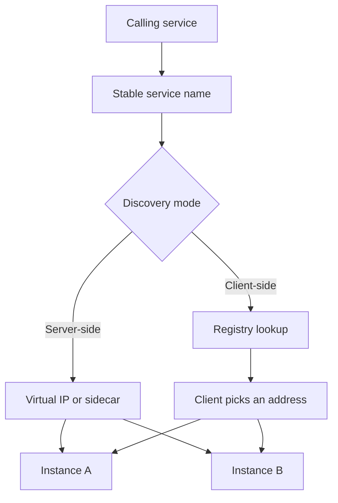

Service discovery answers a question every RPC must ask: given a name, which addresses may I call right now. In a static fleet the answer was a config file. In a fleet that scales, deploys, and dies, the answer is a moving set. Discovery is the mechanism that keeps that set close to reality. If it is stale, you call the dead. If it is too aggressive, you flap off the living.

Two axes decide the design. Who looks up the set: the client, or a proxy on the path. Where the set lives: DNS, or a dedicated registry. Client-side discovery means the caller queries a registry, picks an instance, and opens a socket. Server-side discovery means the caller opens a socket to a stable name or a load balancer, and something else picks the instance. DNS can implement either. A registry like Eureka or Consul usually serves client-side lookup, and can also feed a proxy.

I want the pick to be boring. A name, a healthy set, a load-balancing rule, a timeout if the set is empty. The drama belongs in membership: how an instance joins, how it leaves, and how quickly a corpse disappears.

## Concept

### Client-side versus server-side

Client-side discovery puts a library in every caller. At start, and then on an interval, the library reads the registry for `orders.prod` and caches the endpoints. Each request picks from that cache: round robin, weighted, least request. The caller needs network rights to every instance. The caller also needs the retry and outlier logic, because there is no proxy to hide a bad pick.

Server-side discovery puts a proxy or a virtual IP in front of the instances. The caller knows one name: `orders.prod.svc.cluster.local`, or an internal load balancer DNS name. The proxy has the set. kube-proxy and iptables or IPVS, an Envoy sidecar with EDS, an AWS NLB: all of these are server-side. The caller stays simple. The proxy is now in the availability path.

A mesh is server-side discovery with extra policy. The sidecar is the proxy. The control plane is the registry feed. The application still thinks it is dialing a name. That is usually the right default in Kubernetes. Client-side still wins for a data plane that must avoid a hop, or for a language runtime that already has a mature resolver, such as gRPC with a custom resolver.

### DNS versus a registry

DNS is the oldest registry. You publish A or AAAA records, or an SRV record, and clients resolve. TTLs control staleness. DNS is everywhere, which is its strength. DNS has no first-class health: a record remains until something deletes it. Clients and operating systems cache past your TTL. Load balancing with DNS is coarse. You can make DNS work as discovery. You will fight caches.

A dedicated registry stores instance records with a heartbeat TTL, health checks, and metadata: zone, weight, version, canary flag. Eureka, Consul, etcd, and Kubernetes Endpoints are this family. Clients or proxies watch for changes instead of waiting for a TTL. Metadata lets you route to a version or a zone without encoding that in the hostname.

Kubernetes uses both. CoreDNS serves `service.namespace.svc.cluster.local` as a stable virtual IP (ClusterIP) or as a list of pod IPs (headless). The Endpoints or EndpointSlice objects are the registry. kube-proxy programs the virtual IP. That is server-side discovery with DNS as the name layer, not DNS as the membership layer. Headless services plus client-side pick are the other mode, used by StatefulSets and by some gRPC setups.

### Join, leave, and the stale set

Join must not advertise an instance before it is ready. Register after readiness, not at process start. If you register first, callers receive 502s from a JVM that is still compiling. Leave must stop advertising before the process stops taking work. Deregister, wait for caches to drain, then exit. If you kill first, every client that still has the address is a failure.

Caches are why this is hard. A client-side cache, a DNS cache, a proxy cache, and a connection pool all hold addresses. The membership TTL can be two seconds and the connection pool can still send a request on a socket that has been open for an hour to a process that is gone. Discovery updates the set of dialable addresses. It does not close sockets you already have. Health checks on the connection, idle timeouts, and retries on connect failure complete the design.

Empty-set behaviour needs an explicit choice. Fail the request. Hold and retry the lookup. Fall back to a last-known set. Last-known is how you survive a registry outage. It is also how you keep calling a dead fleet if you never expire the cache. Cap the age of last-known data.

### Who is allowed to pick

If every client picks, you need a pick algorithm that does not synchronize. Round robin from a shuffled start is enough for many fleets. Zone-aware pick keeps traffic in-region. A central load balancer can do least-outstanding-requests more fairly than a client that cannot see other clients. Do not run both a clever client pick and a clever proxy pick on the same path without measuring. Two layers of least-requests can produce oscillation.

Service discovery is not service mesh policy. Discovery gives you addresses. Auth, retries, and timeouts are adjacent. They often ship in the same library. Configure them as separate objects so a registry blip does not silently change your retry budget.

## Trade-offs

| Approach | When it wins | Cost / risk |
| -------- | ------------ | ----------- |
| Client-side plus registry | Callers that already have a library, or that must avoid a proxy hop | Every language needs a client; cache bugs become production incidents |
| Server-side plus virtual IP | Kubernetes ClusterIP, cloud LBs, simple callers | Extra hop; proxy capacity and health become the discovery failure domain |
| DNS only, with TTL | Tiny static fleets, third-party names you do not own | Stale caches; no metadata; TTL fights with failover time |
| Registry watch plus DNS name | Kubernetes, Consul DNS, Cloud Map | Two layers to debug when a name does not move |
| Headless DNS plus client pick | StatefulSets, gRPC, clients that must address a specific member | Clients must handle empty answers and record-set changes |

A registry outage should not take down a healthy fleet. Clients and proxies should keep last-known endpoints for a bounded time and still require a connect timeout. A DNS-only design that relies on a 60-second TTL cannot meet a 5-second failover SLO. Either shorten the TTL and pay the lookup cost, or move membership off DNS.

Do not publish every pod on the public internet as a discovery shortcut. Discovery names belong on a private network. The public name belongs to a reverse proxy or an API gateway that already has a pool.

## Diagram

A caller resolves a name. Server-side discovery stops at a virtual IP. Client-side discovery returns a set the caller picks from.

## Failure modes

### Stale endpoints after a scale-in or a crash

**Detection.** Error spikes of connection refused or timeouts after a deploy or an autoscaler scale-in. The registry or DNS still lists the old IPs. Packet captures show SYN to addresses that no longer exist. Client caches or JVM DNS caches have TTLs of 30 seconds or more.

**Mitigation.** Deregister before exit. Shorten client cache TTLs to a value inside the failover SLO. Disable overly aggressive JVM DNS caching. Pair discovery with a connect timeout and a retry to a different address. Drain connections on shutdown.

### Thundering lookups

**Detection.** Registry CPU or DNS QPS tracks client fleet size times 1/TTL. A registry blip causes every client to refresh at once. Lookup latency becomes the RPC latency. New instances start slowly because registration is backed up.

**Mitigation.** Watch APIs instead of poll where you can. Jitter poll intervals. Cache at a proxy so one hop looks up, not a thousand application pods. Protect the registry with its own limits; it is a control plane, not an RPC data plane.

### Split-brain membership

**Detection.** Two sets of clients have different views. A network partition leaves a registry minority advertising a partial fleet. Some callers succeed, others see empty sets. Operators "fix" it by restarting clients, which makes the views diverge more.

**Mitigation.** Run the registry as a consistent cluster with a documented quorum. Prefer server-side discovery so the view lives in one proxy layer you can inspect. On empty set, fail calls rather than inventing addresses. Alert on registry quorum, not only on application error rate.

### Registering before ready, leaving after death

**Detection.** Every deploy produces a burst of 5xx from instances that just appeared. Shutdown produces a burst from instances that already received SIGTERM. Registration is in the main() first line. Deregistration is absent and the heartbeat TTL is long.

**Mitigation.** Register on readiness. Deregister on SIGTERM, then drain, then exit. Make the heartbeat TTL shorter than the error budget you will spend on corpses. Test deploy and kill, not only the happy lookup.

## Real-world example

Netflix Eureka is the textbook client-side registry. Services register and heartbeat. Callers run a Eureka client, cache the instance list, and pick. The registry is an AP system in CAP terms: it prefers to keep serving a possibly stale view rather than refuse lookups during a partition. That choice matches a large fleet that would rather call a slightly stale address, with a connect timeout, than stall every RPC on registry quorum. Ribbon, and later more modern clients, sat on top of that list to pick and retry.

Kubernetes flipped the default for a generation of teams. You create a Service. CoreDNS answers with a ClusterIP. kube-proxy or ipvs maps that ClusterIP to ready pod IPs from EndpointSlices. The application dials `http://orders` and never sees the set. Readiness gates membership. A pod that fails its ready probe is removed from the EndpointSlice and from the virtual IP. That is server-side discovery with a registry (EndpointSlices) and DNS as a stable name.

Both shapes are in production at scale. The mistake is mixing them without noticing. A gRPC client that does its own round robin against a ClusterIP sees one address and never spreads. A JVM that caches DNS forever turns a 5-second Kubernetes endpoint update into a 30-second outage. An Eureka client inside Kubernetes that ignores ready pods and uses its own heartbeat duplicates membership and drifts.

When I review a new service, I ask three questions. What name does the caller dial. Who turns that name into addresses. How long after a pod dies can a caller still receive that address. If nobody can answer the third number, discovery is not designed yet. It is a DNS record someone copied from a tutorial.

## What to remember

- Discovery maps a name to the addresses that may be called now; client-side lookup and server-side proxies are the two ways to do it.
- DNS is a name layer; a registry with heartbeats and readiness is a membership layer; Kubernetes uses both.
- Register after ready, deregister before exit, and bound every cache so corpses expire inside the SLO.
- An empty or stale set needs an explicit policy: fail, retry the lookup, or use last-known data with a maximum age.
