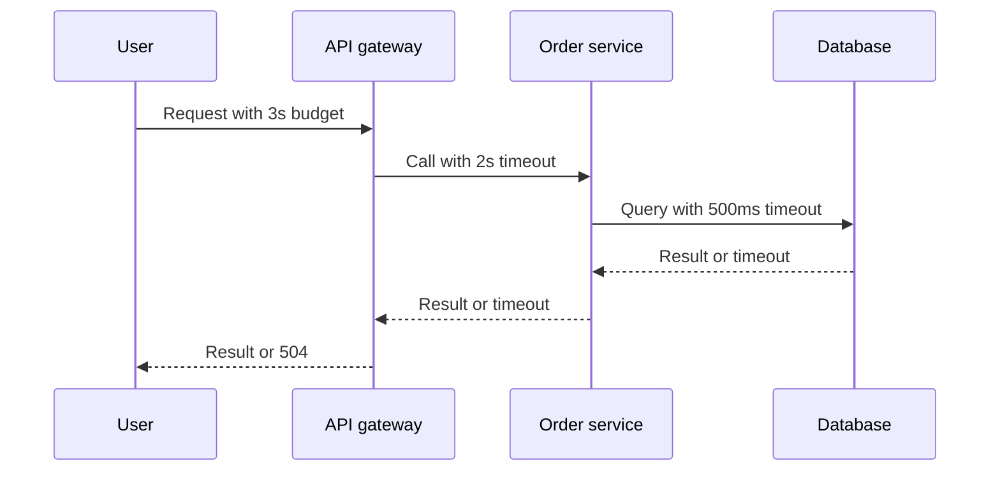

A remote call without a timeout is a request to wait forever. The other side can die, the network can drop the reply, a thread can sit in a garbage-collection pause, and your worker will still be parked on that socket. Workers that wait are workers that cannot serve healthy traffic. A timeout is the deadline that turns an unbounded wait into a failure you can see, retry, or shed.

Every hop needs its own deadline, and that deadline must be shorter than the caller's remaining budget. If the browser waits 30 seconds, the gateway cannot wait 29 for an origin that itself waits 30 for a database. The inner call will still be running after the outer caller has gone. You pay the work, you lose the user, and a retry from the client doubles the bill.

I want timeouts written next to the RPC, not inherited from a library default of "none" or "60 seconds" that nobody measured. Connect timeout and request timeout are different knobs. A connect timeout bounds the handshake. A request timeout bounds the whole attempt. A deadline that travels with the request bounds the whole fan-out. You need all three on a path that leaves the process.

## Concept

### What a timeout actually cancels

A timeout is a local decision: this attempt has used its budget, so we stop waiting. Whether the work on the other side stops is a separate question. HTTP/1 often leaves the origin running after the client hangs up. HTTP/2 and gRPC can reset the stream. Databases cancel if you send a cancellation and the server honours it. Design as if the work might continue, then use protocols that cancel when you can.

The failure the caller sees is a timeout error. That error is not a proof that the write did not happen. It is a proof that this attempt did not finish in time. The next move for a read is often a retry. The next move for a write is a status check or an idempotent replay with a key. Treating a timeout as "nothing happened" is how you double-charge a card.

### Connect, request, and idle

Connect timeout covers TCP, TLS, and any proxy handshake. Keep it short: a few hundred milliseconds on a local network, a small number of seconds across a region. If the peer is not accepting, waiting ten seconds to learn that is how thread pools die during an instance failure.

Request timeout covers the time from a completed connect until the response is finished. Set it from the latency distribution of a healthy call, not from a round number. If p99 is 80 milliseconds, a 10-second request timeout is not "safe." It is 10 seconds of worker hold during a brownout. A request timeout should sit above p99 plus a margin, and still inside the caller's remaining deadline.

Idle timeout covers a connection you intended to reuse. Load balancers, NAT, and sidecars all have one. If your pool believes a connection is alive and the NAT has already dropped it, the next request waits until the request timeout. Set idle below the infrastructure idle, and detect dead pooled connections with a probe or with TCP keepalives you understand.

### Budgets that shrink down the path

A user request that fans out is a budget. The edge starts a clock. Each hop receives the remaining time, subtracts its own overhead, and sets the outbound timeout to something smaller. gRPC deadlines and some HTTP headers (`grpc-timeout`, custom `X-Request-Deadline`) exist for this. If you cannot propagate, you still configure static nested timeouts: 3 seconds at the edge, 2 seconds to the interior, 500 milliseconds to the database.

The inequality is strict. `timeout(caller) > timeout(this hop) > timeout(dependency)`. Equality is how you lose the race: both fire, neither cancels the other, logs disagree on who failed. Leave room for serialization, queue wait, and the time to write an error. A 1-second caller with a 1-second dependency timeout will still 504.

Fan-out needs a tighter interior timeout than a single hop would. Five parallel calls with a 2-second timeout each can still finish in 2 seconds, but a retry on one of them will not fit. Either forbid retries on the fan-out path or reserve budget for them. Timeouts and retries are one design.

### Where the timeout lives

A library default of infinite is still common in HTTP clients, database drivers, and gRPC stubs you construct by hand. A proxy default of 15 seconds or 60 seconds is still common on load balancers. Neither number came from your SLO. Set the client timeout in code or config you own. Set the proxy timeout to a value that is shorter than the next inbound caller and longer than the outbound client.

Do not rely on only the proxy. If the application pool is blocked, the proxy timeout will fire, but the application will not notice until it tries to write the response. Application-level deadlines, context cancellation, and worker interrupts are what free the pool. The proxy timeout is a backstop for the hop, not a substitute for a deadline inside the process.

## Trade-offs

| Approach | When it wins | Cost / risk |
| -------- | ------------ | ----------- |
| No timeout, library default infinite | Never, except a local pipe you already bound otherwise | One dead dependency takes the caller with it |
| One generous timeout for every hop | A prototype with a single RPC | Brownouts hold workers; nested calls exceed the user wait |
| Nested timeouts, each strictly shorter | Any path with more than one hop | Needs measurement; too tight and you timeout healthy p99 |
| Propagated deadline on every RPC | Fan-out, meshes, gRPC interiors | Every hop must understand the header; a missing hop wastes the budget |
| Timeout only on the proxy | You do not own the client code yet | Application threads stay blocked; retries hide at the wrong layer |

A tight timeout increases visible errors and protects goodput. A loose timeout decreases visible timeouts and turns them into user-facing hangs. Pick from the SLO: if the user-facing budget is 300 milliseconds, the interior cannot borrow 2 seconds. If the SLO is a batch job that may run a minute, a 2-second timeout is the wrong tool; a deadline of 60 seconds with a progress check is the right one.

Retries after a timeout spend the remaining budget. If none remains, do not retry. If some remains, the retry's timeout is the remainder minus overhead, not a fresh copy of the original. That single rule prevents a 3-retry policy from turning a 1-second budget into 4 seconds of work.

## Diagram

A user budget shrinks at each hop. The database timeout is the smallest, and it still finishes before the user deadline.

## Failure modes

### Missing timeout on one hop

**Detection.** A dependency incident fills the caller's thread or connection pool. Thread dumps show waits on a socket with no deadline. Metrics show no timeout count on that client, and a rise in pool acquisition time. The library config still has `0` or a comment that says default.

**Mitigation.** Set connect and request timeouts on every client you construct. Lint for unbounded clients. Add a pool timeout so acquisition cannot wait forever either. Game-day a blocked dependency and confirm the caller sheds.

### Nested timeouts that invert

**Detection.** Clients 504 at 10 seconds. Traces show the interior still working at 15 or 29 seconds. Origin CPU stays high after the user is gone. Gateway integration timeout exceeds the browser timeout. Database statements run past the application deadline.

**Mitigation.** Walk the path and write the numbers in order. Make each outbound timeout strictly smaller than the inbound remaining budget. Enable cancellation where the protocol allows it. Align ALB idle, gateway integration, application, and driver timeouts on one sheet.

### Timeout equal to the healthy tail

**Detection.** Timeout rate tracks p99. Healthy deploys look like incidents. People lengthen the timeout until the graph is green, and the next brownout lasts as long as the new value. The timeout was set to the current p99 with no margin and no view of the SLO.

**Mitigation.** Set the timeout from the SLO budget, then confirm p99 sits comfortably below it. If p99 does not fit, fix the query or the fan-out; do not hide it in a 30-second wait. Watch timeout rate and p99 on the same dashboard.

### Timeout treated as a sure abort of a write

**Detection.** Duplicate orders, duplicate charges, or "already exists" errors after timeouts. The client retried a POST because the attempt timed out. The origin had committed. Idempotency keys are absent.

**Mitigation.** Timeouts on writes are unknown outcomes. Retry only with an idempotency key, or read status before sending a second write. Record the attempt id. Teach the product that a 504 on checkout is "check order history," not "click pay again."

## Real-world example

Amazon API Gateway's integration timeout is a public, hard ceiling: for REST APIs it has long been 29 seconds. The gateway will not wait forever for Lambda or for an HTTP origin. If your origin needs more time, the product shape has to change: an asynchronous job, a client that polls, a WebSocket, a different entry point. Teams discover this when a browser has already given up at 10 seconds and the integration still runs to 29. The nested-budget rule is sitting in the vendor limit, whether you planned for it or not.

gRPC makes the same rule explicit with deadlines. A caller sets an absolute deadline on the context. Each hop forwards the remaining time. When the deadline passes, the client stops waiting and, on a well-behaved server, the handler sees cancellation. That is the production shape I want on interior meshes even when the edge is still HTTP. Envoy route timeouts and `grpc-timeout` are how you enforce it when the application forgets.

A three-hop checkout I will sign off on looks like this. The browser's fetch aborts at 5 seconds. The API gateway integration timeout is 4 seconds. The order service sets a 3-second context deadline. The payment HTTP client has a 1.5-second request timeout and a 200-millisecond connect timeout. The database statement timeout is 500 milliseconds. None of those numbers is a library default. All of them are smaller than the hop above. A payment provider that cannot answer in 1.5 seconds is a payment provider we fail toward a retry with an idempotency key, not toward a worker that waits for the provider's own undocumented hang.

Google's public guidance on deadlines in distributed systems, and the gRPC documentation on deadline propagation, are the same design in different clothes. A call is a budget. Spend it on purpose. Stop when it is gone.

## What to remember

- Every remote call needs a timeout; an unbounded wait turns a dead dependency into a dead caller.
- Nested hops need strictly shorter timeouts than the caller, with room for cancellation and error handling.
- Connect, request, and idle timeouts are different knobs; set each from the SLO and the latency distribution.
- A timed-out write is an unknown outcome, not a sure no; retry only with idempotency or a status check.
