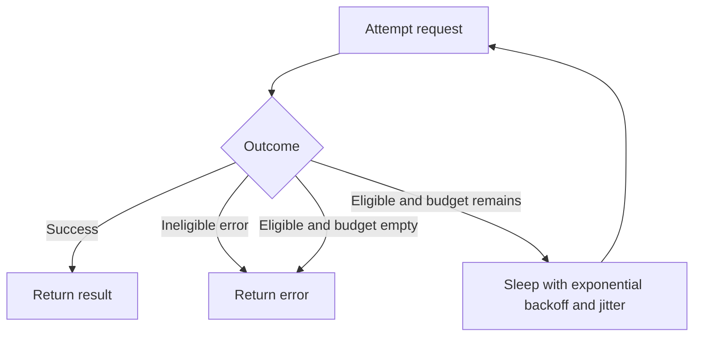

A retry is a second attempt after a failure that you believe is transient. Used on an idempotent read against a single dead instance, it turns a blip into a success. Used on a saturated fleet, or on a POST that already committed, it turns a blip into a duplicate and a storm. The mechanism is small: catch an eligible error, wait, try again. The design is the eligibility, the wait, and the budget.

Exponential backoff is how the wait grows. After attempt `n` you wait on the order of `base * 2^n`, so a persistent failure does not hammer the dependency at a constant rate. Jitter is how you stop the whole fleet from waiting the same number and retrying together. A budget is how you cap the extra load even when every error looks eligible. Miss any of the three, and the retry that saved yesterday's packet loss is tomorrow's outage.

I will not retry a call that is not idempotent unless the store will treat a second attempt as a no-op. I will not retry a 400. I will not retry while a circuit breaker is open. I will not retry after the deadline has no time left. Those refusals are the design. The loop is the easy part.

## Concept

### What is eligible

Eligible failures are those where another attempt can succeed without changing the meaning of the first. Connection refused, connection reset, a connect timeout to one instance, a 503 with a `Retry-After`, a gRPC `UNAVAILABLE` from a proxy that lost a backend: these are the usual yes. A 500 from a handler that may have written a row is not a yes until you have an idempotency key. A 400, a 401, a 403, and a 404 will fail again for the same reason.

Idempotency is a property of the operation, not of HTTP as a whole. GET of a static resource is idempotent. PUT of a full replacement can be. POST of "create a charge" is not, unless the charge store keys on an `Idempotency-Key` and the second POST returns the first result. POST of "append an event" is not. A timeout on a write is an unknown outcome: the server may have committed. The safe next call is a status read, or a replay with the same idempotency key, not a new POST with a new body id.

Retry-After is an instruction. Honour it. A 429 that you immediately replay is how you turn rate limiting into a fight. If the header is absent, back off anyway on 429 and 503.

### Backoff, jitter, and the herd

Without backoff, retries arrive as soon as the error returns. A fleet that shares a 200-millisecond timeout then delivers a square wave of attempts every 200 milliseconds. The dependency never sees a gap. Exponential backoff opens the gap: 100 milliseconds, then 200, then 400, capped at a ceiling so a long outage does not wait a minute when the user budget is two seconds.

Without jitter, exponential backoff still synchronizes. Every client computes the same 200, 400, 800. Full jitter, as described in AWS's public retry guidance, picks a random wait in `[0, cap]`. Equal jitter mixes a floor with a random extra. Either smears the herd. Decorrelated jitter is another published variant. Pick one, implement it once in a library, and do not let each service invent a sleep.

The ceiling of the backoff must fit the remaining deadline. If 800 milliseconds of wait would blow the user budget, you do not wait 800 milliseconds. You fail, or you wait the remainder minus the next attempt's timeout. Backoff is not independent of timeouts.

### A budget, not an infinite loop

A retry budget caps amplification. A common form: at most X percent of requests in a sliding window may be retries, or at most N retries per call, or both. Once the budget is spent, failures go to the user or to a fallback. The budget exists for the incident, when every call looks eligible. A per-call max of three is not enough if a thousand callers each send three extra attempts into a dying service. The windowed percentage is what protects the fleet.

One hop owns the budget. If the edge retries, the mesh should not. If the mesh retries, the application should not. Nested retries multiply. Write the multiplicity on the design review: edge × mesh × client × SDK. The product should be close to one extra attempt, not eight.

Retries stop when a circuit breaker is open. They stop when the deadline cannot fit another attempt. They stop on ineligible status codes. A library that retries all errors, including 4xx, is a bug.

### Where the retry runs

Application code sees the business idempotency key and should retry the operations it understands. An HTTP client library can retry connect failures and idempotent methods. An SDK for a cloud API often already has exponential backoff and jitter; use it, then disable the copy you were about to write. A gateway or mesh retry is a blunt default: useful for GET, dangerous for POST, and easy to leave on for every route.

Idempotency keys belong on the wire for writes you will retry: a header the server stores with the result. Stripe's `Idempotency-Key` is the public form. Your payment, your order create, and your "send email" path need the same idea even if you never touch Stripe.

## Trade-offs

| Approach | When it wins | Cost / risk |
| -------- | ------------ | ----------- |
| No retries | Non-idempotent writes without a key; dependencies already at a concurrency limit | Single-instance blips become user-visible errors |
| Immediate retry, no backoff | Almost never | Synchronized storms on the next millisecond |
| Exponential backoff without jitter | A single client, a lab | A fleet retries in lockstep |
| Backoff plus full jitter plus a budget | Idempotent reads and keyed writes under transient errors | A budget too large still storms; too small wastes cheap recovery |
| Retries at every hop | Nobody intended this; it is the default pile-up | Multiplicative load; duplicate side effects |

Retrying a read of immutable data is cheap and usually correct. Retrying a search that is allowed to be slightly racy is usually correct. Retrying a charge is correct only with a key the ledger will honour. When in doubt, fail the user-facing call and make the next click a status check. "Click pay again" is a retry policy you handed to a human, and humans do not jitter.

A 503 is not always transient. If the server is shedding because it is full, your retry is more load. Honour Retry-After, keep the budget tight, and let a breaker stop the loop. A 500 that is a bug will fail every time; a small retry count is enough to survive a single bad instance, not to wait out a bad deploy.

## Diagram

An eligible failure waits a jittered backoff, spends one unit of budget, and tries a second attempt. An ineligible failure returns immediately.

## Failure modes

### Retry storm on a saturated dependency

**Detection.** Origin QPS rises as error rate rises. Goodput falls. Client retry counters climb in lockstep with 503s and timeouts. Disabling retries in a game day recovers the origin. Backoff is missing or has no jitter, so graphs show spikes on timeout intervals.

**Mitigation.** Retry only eligible errors. Add full jitter. Cap retries per call and as a fraction of traffic. Honour Retry-After. Open a circuit breaker on a high error rate and stop retrying while it is open. Shed on the server with a fast 503 instead of a slow timeout.

### Duplicate writes after a timeout

**Detection.** Double charges, double orders, duplicate emails, unique-constraint errors on ids the client thought were new. Traces show two POSTs with different bodies or missing idempotency keys after a client timeout. Support hears "I only clicked once."

**Mitigation.** Treat timed-out writes as unknown. Send the same idempotency key on replay. Make the server store the first result. Change the client copy to "check status" rather than "submit again." Do not retry POST at the gateway.

### Nested retry layers

**Detection.** One user action produces a tree of attempts. Mesh stats, SDK stats, and application stats all count retries. A single 503 becomes eight origin hits. Multiplicity is not written down. Each team believed they were the only hop retrying.

**Mitigation.** Pick one hop. Disable the others for that route. If an SDK retries, the mesh must not. Document the owner. Test with a fault that lasts one timeout interval and count origin hits per user action.

### Retrying bugs and client errors

**Detection.** 400 and 401 rates are amplified. A bad deploy that returns 500 on every call is hit with three times the traffic. CPU on the origin is retry load, not user load. The retry policy matches "any non-200."

**Mitigation.** Allow-list the status codes and exceptions. Retry connect failures, resets, 503, 429 with backoff, and 500 only when the method is idempotent and the body cannot have committed, or when a key makes replay safe. Never retry 4xx except 429.

## Real-world example

AWS SDKs ship retries with exponential backoff and jitter as a default for many service calls. AWS engineers published the argument for full jitter: uncorrelated clients, a backoff cap, and a random wait inside that cap, so a recovered service does not meet every caller on the same millisecond. If you use an AWS SDK, you already have this policy for those APIs. The work that remains is to not stack a second policy on top, and to apply the same idea to the HTTP clients you wrote in-house.

Stripe's API makes the write side explicit. Clients send an `Idempotency-Key` header on POST. Stripe stores the result of the first request with that key and returns it on later retries, including after timeouts. That is how a payment API can invite retries without inviting double charges. Any ledger, order service, or mail sender you operate needs an equivalent, even if the header name is yours.

I put those two together in a review. Reads and AWS-style control-plane calls: jittered backoff, a small budget, one hop. Money and other once-only writes: the same retry loop, plus a key the server will honour, plus a timeout treated as unknown. Netflix's published retry and Hystrix work, and the later retry-storm literature, add the last constraint: when the error is saturation, the budget must collapse toward zero. A retry is a loan against future capacity. Size it for the afternoon when the dependency is full, not for the afternoon when one instance restarts.

## What to remember

- Retry only idempotent calls, or writes that carry an idempotency key the server will honour.
- Back off exponentially, add jitter so the fleet does not retry in lockstep, and cap the extra load with a budget.
- One hop owns retries; nested layers multiply traffic and duplicate side effects.
- A timeout on a write is an unknown outcome; a 4xx is not transient; a saturated 503 needs a budget, not enthusiasm.
