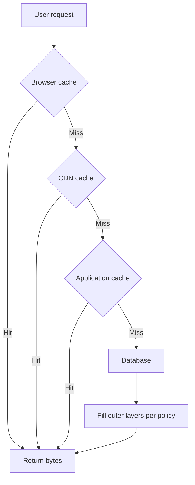

A cache stores a result you already paid for so the next lookup does not pay again. The payment might have been a disk read, a distant RPC, a rendered page, or a JSON blob from a database. Caching is how you trade freshness and memory for latency and origin load. If you cannot name the hit ratio you need, the staleness you will accept, and the layer where the bytes will live, you do not have a cache design. You have a hope that Redis will make the site fast.

Where matters as much as whether. The same object can sit in the browser, at a CDN pop, in an application process, in a remote cache cluster, and in a database buffer pool. Each layer has a different key, a different owner, and a different invalidation story. A hit in the wrong layer still looks like a hit in a dashboard and still serves the wrong user.

I start from the user-visible budget and work inward. If the browser can keep the asset, do that. If many users share the bytes, put them on a CDN. If the bytes are per-user or per-session, keep them off the CDN and consider an application cache. If the database already holds the working set in memory, another cache may be a second copy you now have to invalidate.

## Concept

### Why a cache exists

A cache exists to cut repeated work that is expensive relative to a memory lookup. Expense is latency, CPU, money, or a dependency SLO. A cache that stores a result that is cheaper to recompute than to invalidate is a net loss. A cache that stores a result nobody reads twice is a net loss. Measure reuse. If the key space is almost as large as the request count, you do not have reuse, you have a buffer.

Hit ratio is hits divided by lookups at that layer. It is not a goal by itself. A 99% hit ratio on personalized HTML that leaked across users is a correctness incident. A 40% hit ratio on a 2-megabyte image that would have left the origin is a win. Always pair hit ratio with origin QPS, origin bytes, and a staleness measure: how old was the object you served.

Staleness is a product decision. A product image that is five minutes late is usually fine. A stock price that is five minutes late is not, unless you labeled it delayed. An inventory count that is five minutes late sells items you do not have. Write the allowed age next to the key. TTL is how you encode that age when you do not have a better invalidation path.

### The layers, from the user inward

The browser cache is the closest. `Cache-Control`, `ETag`, and `Last-Modified` decide whether the next page load costs a network round trip. `private` keeps the object out of shared caches. Hashed filenames let you set a long `max-age` without serving a stale script after a deploy. This layer is cheap and easy to get wrong with a global `no-store` that felt safe in development.

The CDN cache is shared and geographic. Many users hit one object. Cache keys and invalidation dominate, as they do in any shared HTTP cache. Personalized responses do not belong here unless you have a key that is actually per-user and a reason to fill edge memory with per-user bytes.

The application cache is a process-local map or a nearby Redis. It holds objects the CDN must not: session-adjacent data, authorization decisions with a short TTL, query results that are keyed on user id. Process-local is fast and dies with the process. Redis is shared across instances and is another failure domain. Do not run both for the same key without a reason.

The database cache is the buffer pool, the query cache if you still have one, and materialized results you store as tables. It is the right layer when the working set fits and the query is already simple. Adding Redis in front of a database that is already serving from memory adds a consistency problem for a latency win you will not measure.

### What to put where

Public, immutable, widely shared: CDN and browser, long TTL, versioned URL. Public, mutable, widely shared: CDN with short TTL or tagged purge, browser with a shorter TTL or revalidation. Private, reused within a session: application cache or client memory, never a shared CDN key. Private, reused across instances: Redis or the database, with a TTL and an invalidation on write. Computed artifacts that are expensive and shared: application or CDN, depending on whether the bytes are HTTP-cacheable.

Negative caching — storing "not found" — belongs where the miss is expensive and the absence is stable. Cache 404s for a short TTL on a CDN for paths that bots guess. Do not negative-cache "user has no notifications" for ten minutes if a notification can arrive in one.

### Coherence across layers

Each layer can serve an object the inner layer has already replaced. Browser HTML can point at a CDN asset you purged. An application cache can hold a row the database updated. There is no global "clear all caches" that is both instant and safe. You get TTL, explicit invalidation, or versioned keys.

Versioned keys are the most honest. A new object is a new key. Old keys age out. Invalidation is the most precise and the most error-prone: every write path must know every cache that might hold the object. TTL is the most forgiving and the most stale. Mix them: version assets, TTL the HTML, invalidate the per-user record on write.

A thundering herd is what happens when a hot key expires in a shared cache and every instance misses together. The origin sees a spike for one object. Coalesce the fill: one waiter fetches, the others wait. Request collapsing, single-flight, and cache leases are the names. Pick one before you put a hot key on a short TTL.

## Trade-offs

| Approach | When it wins | Cost / risk |
| -------- | ------------ | ----------- |
| Browser cache | Static assets, authenticated pages that can be private-cached | Users keep stale JS if filenames are not versioned |
| CDN edge cache | Shared public bytes, images, downloadable files | Wrong keys leak or fragment; purge-all stampedes origin |
| Application Redis cache | Per-user or per-object data reused across instances | Another cluster to operate; stale reads after writes |
| Process-local memory | Tiny, hot, non-critical objects on one instance | Every instance has a different view; lost on restart |
| Database buffer pool only | Working set already in RAM, simple queries | Will not help a query that is heavy even from memory |

Caching a result does not make the first request fast. Cold caches, deploys, and new keys still hit origin. If the first-request path is the one that fails SLOs, you need prefetch, a warmer, or a faster origin, not a larger Redis. Hit ratio measured over a day can hide a morning stampede after a flush.

Do not cache because a list of interview topics said so. Cache because you measured a repeated cost and you accepted a staleness. Then pick the closest layer that is allowed to store that object.

## Diagram

A read walks inward until it hits. A well-placed object never reaches the database on the hot path.

## Failure modes

### Caching personalized bytes under a shared key

**Detection.** Users see another user's name, cart, or account. CDN or Redis keys are a URL without a user id. `Vary: Cookie` is absent and the response set a cookie. Support tickets cluster on "wrong account on the homepage."

**Mitigation.** Do not put per-user bodies on a CDN. Include the user id in application cache keys. Mark responses `private` or `no-store` when they are not public. Review every new cache key against "who is allowed to see this object."

### Stale data past the product's allowed age

**Detection.** Prices, inventory, or permissions lag writes by the TTL. Dashboards show high hit ratio and a rising complaint rate. Invalidation code exists on some write paths and not on others. A flush "fixes" it until the TTL refills.

**Mitigation.** Write the allowed age. Invalidate on the write path that changes the object, or shorten TTL to the allowed age. Version the key on publish. Test the write-then-read path in the same region and across layers.

### Stampede on expiry of a hot key

**Detection.** Periodic origin spikes at TTL boundaries. One key dominates miss traffic. Instance CPU lines up on the expiry. Adding instances makes the spike worse because more waiters miss together.

**Mitigation.** Coalesce fills. Add jitter to TTLs so expiry is not synchronized. Keep a stale object while a single filler refreshes (stale-while-revalidate). Pin hot keys to a longer TTL if the product allows it.

### Cache as a second source of truth

**Detection.** Operators edit Redis to "fix" a user. The database disagrees. Restarts change behaviour. Nobody can say which store is authoritative. A migration copies from cache because the database was "probably stale."

**Mitigation.** The database, or the object store, is the source of truth. The cache is a hint. Rebuild the cache from the truth, never the other way. Forbid production edits to cache contents except as a documented break-glass flush.

## Real-world example

Facebook's memcached deployment, described in their "Scaling Memcache at Facebook" paper, is a lookaside cache in front of MySQL at a size most teams will never match. The facts that transfer: they used memcached as a demand-filled cache, not as the system of record; they cared about thundering herds on hot keys and introduced leases so that one miss would fill while others waited; they treated stale reads as a problem to engineer against, not as an accident of TTL. The cache sat in the application tier's path, not in the browser, because the objects were social-graph data keyed on user and object ids, not public assets.

Wikimedia's public sites sit at the other end of the layering: browsers, a CDN, Varnish, then MediaWiki, then a database. Page views of a popular article should hit Varnish or the CDN. An edit purges the relevant objects rather than the whole encyclopedia. Static bits — logos, hashed resources — live with long TTLs. That is "where" in practice: shared HTML and assets at the HTTP cache layers, application data behind them.

Your system will mix those lessons. Product images and JavaScript belong on a CDN with versioned names. The signed-in homepage shell might be a short-TTL CDN object or not cached at all. The per-user feed belongs in Redis or the database, with a TTL and an invalidation when the user posts. The database buffer pool should be sized before you assume Redis is the next step. Hit ratio, staleness, and layer: write those three next to every key, or you will debug a "cache issue" that is really a key issue on the wrong hop.

## What to remember

- Cache to skip repeated expensive work; hit ratio only counts for objects that are safe to serve stale for a named age.
- Place bytes at the closest layer allowed to store them: browser, CDN, application, then database — not all four for every key.
- Shared layers need shared keys; personalized data needs a private key or a private layer.
- Invalidation, TTL, and versioned keys are the three coherence tools; a flush is an incident, not a design.
