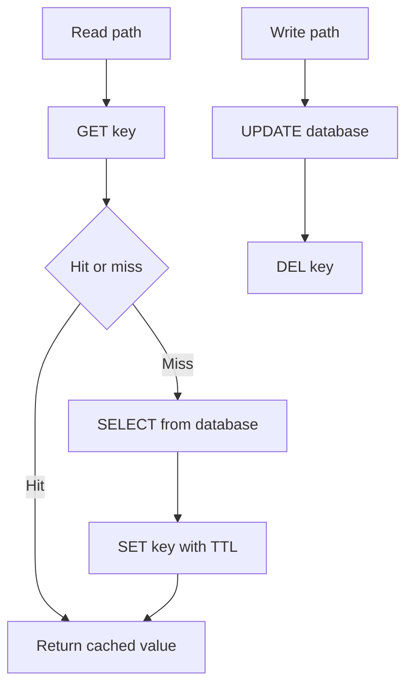

Cache-aside, also called lazy loading or lookaside, puts the application in charge of both stores. On a read, the application asks the cache. On a hit, it returns the cached value. On a miss, it reads the database, writes the value into the cache, and returns it. On a write, the application writes the database first, then invalidates the cache key. The cache is a hint. The database is the source of truth.

That order is the pattern. Invert it and you will serve ghosts. Write the cache before the database and a crash leaves a value that never committed. Update the cache in place on write and you will race with readers who refill from an old row. Delete the key after the database commit and you still have a window; that window is smaller, and it is the one this pattern accepts.

I use cache-aside when the application already knows the key, when many objects are never read, and when I want the cache to be optional: if Redis is down, I can go to the database and survive. Write-through and read-through hide the cache behind a library. They win when you want the store to look like one thing. Cache-aside wins when you want the control plane of the cache in your code, where you can see it.

## Concept

### The read path

The read path is three steps with a branch. Compute the key. `GET` the key. If the value is present and not a stored negative, return it. If the value is absent, `SELECT` from the database. If the database returns a row, `SET` the key with a TTL, then return the row. If the database returns nothing, you may store a short-lived negative, then return not found.

The application owns the serialization. What you store is a byte representation of the row, not a live object. Version that representation. A deploy that changes the struct without changing the key will deserialize garbage. Include a schema version in the payload, or bump the key prefix when the shape changes.

TTL is the backstop if invalidation never runs. It is not a substitute for invalidation on a path that must be fresh. A user profile that may be stale for 60 seconds can live with TTL-only. A permission bit that gates a write cannot.

### The write path

The write path is two steps in a strict order. Write the database. On success, delete the cache key. Do not write the new value into the cache on this path unless you have a protocol that prevents a concurrent reader from filling an older row. Invalidation is the conservative move. The next read misses, loads the new row, and fills.

Why not update the cache on write. A concurrent reader can miss before your write, read the old row, and `SET` after your `SET`, putting the old row back. Invalidation plus TTL bounds that race: the stale fill can still happen if the reader read before your commit and sets after your delete. That is the classic cache-aside race. Mitigations exist: version numbers on the row, compare-and-set on the cache, leases, or a short TTL so the ghost dies. Facebook's memcache leases were built for this family of races.

Why database first. If you delete the cache, then write the database, a reader can miss, load the old row, and refill before your write lands. You then have a long-lived stale value until TTL. Database first plus delete after commit shrinks the window to readers that overlapped the write.

### What the application must not forget

Keys must match across read and write. A read keyed on `user:17` and a write that invalidates `profile:17` is a bug that looks like a cache that "sometimes works." Put key construction in one function. Call it from both paths.

Partial objects need a policy. If you cache a user by id, and you update only the email column, you still invalidate the whole user object. If you cache a list, a write to one member invalidates the list key, not only the member. List keys are expensive to get right; often you cache items and recompute lists.

Cache down is a mode you design. Fail open to the database if the product can take the load. Fail closed if a stampede would be worse than an error. A retry storm against Redis plus a miss storm against MySQL is how an optional cache becomes a required one in the worst minute of the week.

### How this differs from the neighbours

Read-through: the cache library loads the database on miss. Write-through: the cache library writes both stores. Write-behind: the cache writes later. Cache-aside leaves those jobs in your handlers. You see the `GET`, the `SELECT`, the `SET`, and the `DEL`. You also get to forget the `DEL`, which is the operational risk.

Cache-aside pairs well with Redis and memcached. It pairs poorly with a belief that the cache is always right. Never repair the database from the cache. Flush the cache from the database.

## Trade-offs

| Approach | When it wins | Cost / risk |
| -------- | ------------ | ----------- |
| Cache-aside, DB then invalidate | Demand-filled objects, cache optional at runtime | Read/write races; every write path must delete the right keys |
| Read-through library | One load path you want to keep out of handlers | Hidden stampedes; harder to vary TTL per key |
| Write-through | You want the cache to always hold the latest on write | Cache is on the write latency path; still races without versions |
| Write-behind | High write rate where loss is acceptable | A crash loses writes; the cache has become a queue |
| TTL only, no invalidation | Data that may be stale for the full TTL | Users see old values until expiry; hot keys stampede on expiry |

Cache-aside is the default I want for user profiles, product records, and other objects with a clear primary key and a read-heavy mix. It is the wrong default for a counter you increment ten thousand times a second; that belongs in a store designed for increments, or in write-behind with a documented loss window. It is the wrong default for bytes that should live on a CDN; those are HTTP caches with HTTP keys, not Redis aside a database.

When the write rate to a key exceeds the read rate, a cache-aside fill is wasted work. Stop caching that key. When the read rate is high and the write rate is low, cache-aside is the pattern that earned Redis its seat in application diagrams.

## Diagram

A read looks at the cache, then the database, then fills. A write commits to the database, then deletes the key.

## Failure modes

### Stale fill after invalidation

**Detection.** A write is visible in the database and not in the application. A few hundred milliseconds later it appears, or it does not until TTL. Traces show a `GET` miss, a `SELECT` of the old row, a `DEL` from the writer, then a `SET` of the old row. The race is not theoretical; it shows up on hot objects.

**Mitigation.** Include a row version or updated-at in the payload. `SET` only if the cache is empty or the incoming version is newer. Use a lease so only one miss fills. Shorten TTL on hot, write-prone keys. For permissions and money, skip the cache on the read-after-write path.

### Forgotten invalidation

**Detection.** Some screens update immediately, others lag until TTL. The lagging screens have a write path that never calls delete. A new feature wrote to the table through a batch job or a migration that does not know the key.

**Mitigation.** One key function, used by every writer. Invalidation in the same module as the SQL. Batch jobs and migrations either invalidate or bump a key prefix. Alert when database updates for an entity have no corresponding cache delete rate, on paths where they should.

### Stampede on a hot miss

**Detection.** One missing key produces a spike of identical `SELECT`s. Database CPU tracks cache miss rate for that key. After a flush, the site is down until the cache refills. Every instance fills independently.

**Mitigation.** Single-flight in the process. A distributed lock or a lease for the key across instances. Serve stale while revalidating if the product allows it. Warm the hottest keys after a flush, or avoid global flushes.

### Cache outage taken as data outage

**Detection.** Redis blips. The application returns 500 instead of reading the database, or it retries Redis until the database would have been faster. Connection pools to Redis exhaust. A fallback to the database then stampedes MySQL because every key is now a miss.

**Mitigation.** Time out Redis quickly. Fail open to the database with a shed: only a fraction of misses hit the database, the rest error, if the database cannot take 100% of traffic. Keep the cache optional in the dependency diagram, and test that mode. If you cannot take a full miss storm, the cache was not optional; provision it like a primary.

## Real-world example

Facebook's memcached layer in front of MySQL is the large-scale cache-aside system the rest of the industry copied. Application servers look aside to memcached. On a miss they read MySQL and populate memcached. Writes go to MySQL, and the application deletes or updates memcache keys. The published engineering, including the 2013 SOSP paper, focuses on the races that naive lookaside produces: concurrent fills, stale sets after delete, and thundering herds. Leases were their mechanism: on a miss, memcached can return a token that allows one client to fill, and `SET` without a valid lease is rejected so a late stale writer cannot clobber a newer value.

You will not need Facebook's full protocol to use the pattern. You do need their order of operations. Read cache then database. Write database then invalidate. Treat a late `SET` as a bug you will eventually see on a hot key. Redis `GET`/`SET`/`DEL` is enough for a first version if you add a TTL, a version field, and a single-flight on miss.

A typical commerce service looks the same at a smaller size. Product page reads `product:{id}` from Redis. Miss loads Postgres. An admin save updates Postgres, then `DEL product:{id}`. The CDN may still cache the HTML; that is a different layer with a different key. Cache-aside does not replace the CDN. It replaces a hope that the application can query Postgres on every personalized view without a plan.

When a team "adds Redis" without the write-side `DEL`, they have built a TTL cache, not cache-aside. That can be valid. It is not this pattern. Name it TTL-only and set the TTL to the staleness the product accepted. Cache-aside is the pattern where the write path is part of the contract.

## What to remember

- Cache-aside means the application reads cache then database, and writes database then invalidates; the cache is a hint.
- Invalidate on write rather than overwrite, unless you have versions or leases that stop a stale fill.
- One key function for reads and writes; forgotten deletes are the usual source of "the cache is wrong."
- Design cache-down: fail open with a shed, or admit the cache is on the critical path and operate it that way.
