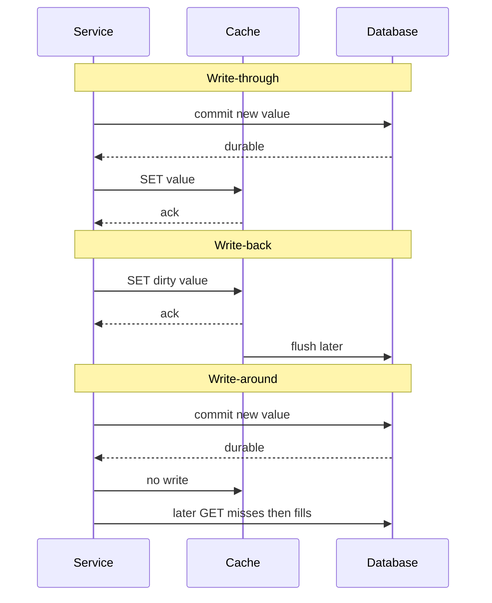

A cache that never sees a write is a read accelerator. The moment the application mutates data, you must decide whether the cache sits in the write path, after the write path, or deliberately out of it. Write-through, write-back, and write-around are those three answers. They are timing contracts between the cache, the origin store, and the caller who thinks the write succeeded.

Write-through updates the cache and the database together. The caller waits until both have accepted the new value. Write-back updates the cache, acknowledges the caller, and flushes to the database later. There is a loss window: a crash between acknowledge and flush drops the write unless another log already captured it. Write-around writes the database and leaves the cache alone. The cache fills on the next read, or stays empty if that key is never read again.

Pick the policy per key class, not per cluster. Session blobs, catalog prices, and write-heavy counters do not want the same answer. Mixing policies without naming them is how a team gets "the cache is wrong" as a standing incident. Write-through borrows the database's durability and pays write latency. Write-back owns a durability gap unless a log or replica closes it. Write-around never claims the cache is a source of truth.

## Concept

### Write-through: both stores, then ack

On a write, the service issues the mutation to the origin and to the cache before it returns success. Typical order is origin first, cache second. Origin-first means a crash after the database commit and before the cache update leaves the cache stale until TTL or an explicit delete. Cache-first means a crash after the cache update and before the origin commit leaves a value that does not exist in the database. Most application caches therefore write origin first, then set the cache, then ack.

The caller pays both round trips, or a parallel pair bounded by the slower of the two. After a successful write, a read that hits this cache should see the new value. Two stores can still disagree if the cache set fails after origin commit, if a replica cache was not updated, or if another writer races.

Write-through fits modest write rates, small values, and read-your-writes on the next request: profile updates, feature flags, configuration blobs. High-rate counters and bulk imports amplify every write into two hops. A common implementation is origin then `SET` the blob. Origin then `DEL` is write-through of the invalidation, cheaper for large values, and it reintroduces a miss plus the fill-after-delete race.

### Write-back: ack from cache, flush later

On a write, the service updates the cache (or a write buffer in front of it), returns success, and schedules a flush to origin. The cache now holds dirty data. Until the flush completes, origin is behind. If the cache node dies, those dirty keys are gone unless you wrote a log, replicated the dirty set, or accepted loss.

The loss window is the defining property. Measure it. A write-back session store with no replica loses sessions on a node restart. A write-back buffer pool with a write-ahead log does not lose committed transactions; the log closed the window. Calling both "write-back" without naming the log is how people ship a cache and think they shipped a database.

Flush policy is a second decision. Flush on eviction, flush on a timer, flush when dirty bytes cross a watermark, or flush on shutdown. Eviction-only flush means a quiet key stays dirty forever and origin never learns. Timer-only flush means a crash just before the timer still loses the batch. Production write-back always combines a log or replica with a checkpoint that bounds recovery time.

Write-back wins when origin writes are scarce and a short loss window is acceptable or is covered by a log. CPU caches and database buffer pools use it. Application Redis as the only copy of a shopping cart is a durability bug unless persistence and failover are part of the contract. If the product cannot lose the write, write-back without a log is not a cache policy. It is an unacknowledged database.

### Write-around: origin only, cache fills on read

On a write, the service updates origin and does not touch the cache. The next read misses, loads origin, and fills. If you also delete the old cache key, you have mixed write-around of the payload with explicit invalidation; that hybrid is common and should be named, because the delete is on the write path even though the new value is not.

Write-around avoids polluting the cache with write-once keys that will not be read. Bulk imports, audit rows, and cold object uploads fit. It also avoids turning a write-heavy key into a hot cache update. The cost is obvious: the first read after a write is a miss, and until that miss fills, other readers may still see the previous cached value. If you did not delete the old key, they will see it until eviction or TTL.

Write-around is the partner of cache-aside reads: the application owns fill logic, the cache is a lookaside store. Most Redis-as-cache and Memcached lookaside fleets work this way. Mutations hit origin; the cache is a hint that must be invalidated or left to die.

### Ordering, replicas, and what "together" means

"Writes cache and DB together" is a single-node slogan. Write-through to one Redis shard does not write-through to the near-cache in the other twenty pods. A policy is defined against a set of stores: origin, remote cache, process cache. Treat the process cache as another store: invalidate it, skip it, or stop using one.

## Trade-offs

| Approach | When it wins | Cost / risk |
| -------- | ------------ | ----------- |
| Write-through | Read-your-writes on the next hit; modest write rate; small values | Write latency is origin plus cache; cache-set failure after origin commit; replica caches still diverge |
| Write-back | Origin writes are scarce; a log or replica covers the loss window | Dirty data dies with the node if the log is missing; flush storms; origin lag is user-visible |
| Write-around | Write-once or rarely-read keys; cache-aside read path already exists | First read after write misses; stale hits until TTL or delete; easy to forget the delete |

Write-through is the policy you can explain to a product manager: "after save, the next page load is new." Write-back is the policy you explain to a storage engineer: "we ack from memory and we have a log." Write-around is the policy you explain to a capacity planner: "do not put this mutation in the cache working set." If you cannot finish that sentence for a key class, you do not have a policy yet. You have a `SET` in a random code path.

## Diagram

## Failure modes

### Lost dirty writes in write-back

**Detection.** After a cache node restart, failover, or process crash, recently acknowledged writes are absent from origin and from the replacement cache. Metrics that expose this are a gap between "cache write successes" and "origin flush successes," a drop in dirty-key count to zero on crash, and user reports that a save vanished. If you have no dirty-key metric, you will learn from tickets.

**Mitigation.** Do not acknowledge a write-back mutation unless a log or a replica has it. Database buffer pools pair dirty pages with a write-ahead log and a checkpoint. If the product can lose the write, say so in the SLO and keep the window short with a flush timer. If it cannot, stop using write-back for that key class. Failover must replay the log or discard the node only after flush.

### Stale hit after write-around

**Detection.** A write returns success, then a read from another pod or the same pod returns the previous value. Access logs show origin write, then cache hit, then later a miss that finally loads the new row. The cache key was not deleted, or the delete missed a replica, or a process-local cache was not in the policy.

**Mitigation.** Pair write-around of the payload with an explicit delete of the old key on every cache that can serve it, plus a TTL bound. Better: write-through the new value when the next read must be correct. For near-caches, broadcast the delete or stop caching that key in process. Tests should write then read from a second client against a warm cache; a single-process test will not catch replica stale hits.

### Split brain between origin and cache on write-through

**Detection.** Origin has the new row, cache has the old blob, or the reverse. Error logs show origin commit succeeded and cache `SET` failed, or a timeout on one of the two hops with a success returned to the client. Version columns disagree: cache payload version is behind `updated_at` on the row.

**Mitigation.** Origin first, then cache, then ack; if the cache set fails, delete the key and treat the write as success only if origin committed. Store a version on the row and refuse to fill a cache entry whose version is older than a version the client already saw. Retry the cache set, but do not retry the origin write unless it is idempotent. Monitor origin-versus-cache version skew on a sample of keys rather than trusting hit rate.

### Flush storm and origin overload

**Detection.** After a quiet period or a cache restart, origin write QPS jumps to the size of the dirty set. Disk queues on the database rise with cache eviction rate. The trigger is a watermark flush, a rolling deploy that restarts write-back nodes, or an LRU wave that evicts dirty keys together.

**Mitigation.** Pace flushes. Checkpoint so the dirty set stays small. On restart, delay traffic until replay finishes. Separate write-back keys from lookaside keys so a read-cache eviction does not flush. If origin cannot absorb the dirty set, write-back was oversized.

## Real-world example

MySQL InnoDB is a production write-back cache with a log that closes the loss window. The buffer pool holds pages in memory. A committed `UPDATE` changes the in-memory page, writes a redo log record, and returns to the client. The dirty page is not required to hit the tablespace on that commit. A later checkpoint writes dirty pages back to disk. If the process dies, crash recovery replays the redo log into the buffer pool and the committed update survives. That is write-back as a storage engine, not as a disposable lookaside cache.

The same server also shows write-around. The InnoDB buffer pool is not a query-result cache. A statement that changes a row dirties pages; it does not store the SQL result set. Query result caches, Redis keys filled by the application, and CDN objects in front of the origin sit on a different policy. Application teams that put a Redis `SET` of a JSON profile next to an `UPDATE users` are choosing write-through of a derived blob. Teams that `UPDATE` and never touch Redis are choosing write-around and will serve the old JSON until TTL, eviction, or a delete.

CPU caches make the same split. Modern x86 data caches are write-back by default: a store dirties a line, the line flushes later, and coherency traffic keeps other cores from reading a stale line. Some device mappings use write-through so a DMA engine sees memory the CPU just wrote.

The portable lesson is the loss window. InnoDB may ack from memory because the redo log is durable. Redis used as the only copy of a cart, with persistence off, may ack from memory because nobody put a log in front of it. Both are write-back. Only one is a database. If you copy the InnoDB pattern into an application cache, copy the log, the checkpoint, and the recovery path, not just the ack-from-memory part.

## What to remember

- Write-through updates cache and origin before ack; you pay both latencies and still need a rule for cache-set failure.
- Write-back acks from cache and flushes later; without a log or replica, the loss window is real.
- Write-around writes origin only and fills on read; pair it with a delete or accept stale hits until TTL.
- Name every store in the policy, including process near-caches; "together" on one Redis node is not together on twenty pods.
