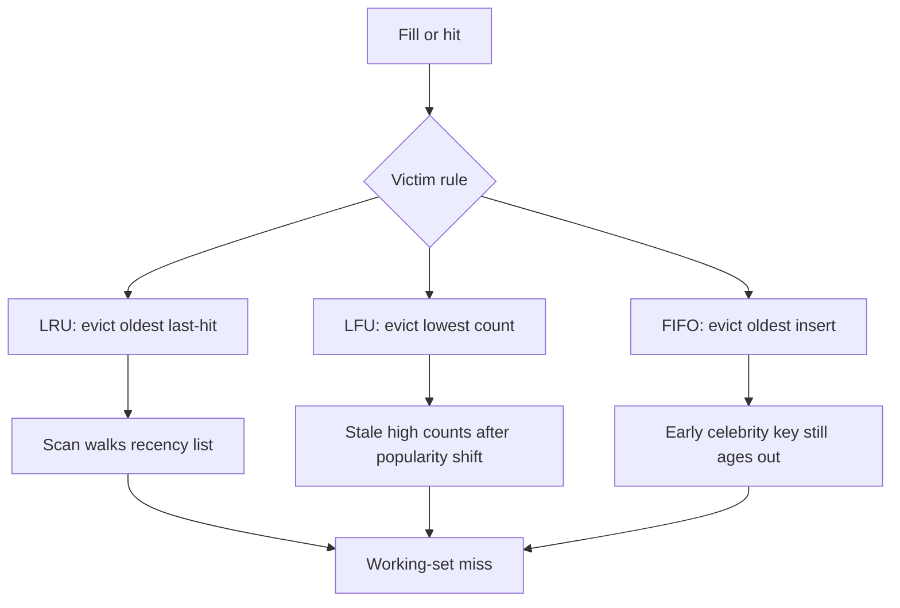

A cache with unbounded memory is a database you have not admitted to yet. Real caches fill. When they fill, something leaves. Eviction policy is the rule that picks the victim. LRU, LFU, and FIFO look interchangeable in a whiteboard box labeled "cache." They are not interchangeable once the working set, the scan, and the one-hit wonder show up.

The policy does not increase capacity. It decides which bytes you keep when capacity is already spent. A perfect policy with a cache smaller than the working set still misses. A clumsy policy with a cache larger than the working set still looks fine until a sequential scan, a job that reads every key once, or a celebrity key that is hot in a way the policy cannot see.

You will also meet approximations. Exact LRU needs a linked structure or timestamps on every hit. At millions of keys per second, most stores sample, clock, or keep a cheap frequency sketch. The name on the config flag is the intent. Tune against your miss curve, not a four-slot textbook animation.

A single policy fails on scans. LRU treats a full-table dump as hottest-recent keys and evicts the working set you needed. FIFO ignores recency and frequency. LFU protects frequent keys through a scan and then fails when popularity shifted this morning. Pick a default, measure the scan, and keep an escape hatch.

## Concept

### What eviction is answering

Every eviction policy is a bet on the next access. LRU bets that recency predicts reuse. LFU bets that frequency predicts reuse. FIFO bets that arrival order is good enough and that bookkeeping should be cheap. Random (often in the same config menu) bets that a cheap victim is better than a wrong sophisticated one. None of the bets include "this key was loaded by a backup job and will never be read again" unless you encode that in TTL, in a separate cache, or in an admission policy that refuses the fill.

Admission is the twin of eviction. TinyLFU and related schemes refuse to insert a new key until it has shown a little frequency, so a scan never enters. Many production caches skip admission control and only evict. They then blame LRU for a problem that started at insert. If you can cheaply ignore a fill, do that before you tune the victim selector.

Capacity is per slab, per shard, and per process, not per logical cache. Memcached evicts inside a slab class. Redis `maxmemory` is per instance. A process near-cache evicts inside one JVM. A policy that is fair globally can still starve a slab or a shard. When miss rate is high on one prefix and low on another, you may have a partitioning problem, not an LRU problem.

### LRU: recency as a proxy for reuse

Least Recently Used evicts the key whose last hit is oldest. A hit moves the key to the most-recent end. A miss that fills inserts at the most-recent end. The working set of a loop that revisits the same keys stays resident. A key that has not been touched in a long time leaves.

Exact LRU is a doubly linked list plus a hash table, or an equivalent recency index. Cost is pointer updates on every hit. Under high QPS that cost is real: cache CPU becomes the limiter before DRAM does. Redis therefore does not run exact LRU on the whole keyspace. It samples a few random keys (configurable `maxmemory-samples`, default five) and evicts the least recently used among the sample. Memcached maintains LRU tails per slab. Linux page cache uses a clock approximation. When someone says "we use LRU," ask which approximation and whether hits are tracked at all for every get.

LRU's failure mode is the scan. A sequential read of keys that will not repeat walks the recency list and pushes the true working set to the victim end. After the scan, the cache holds the scan. Database buffer pools learned this decades ago; scan-resistant variants (midpoint insertion, 2Q, ARC) exist because vanilla LRU is hostile to reporting queries that share the pool with OLTP. LRU also treats a one-hit key as recently used: unique URLs fill, sit at the head, and crowd out hot keys. Insert-at-tail or admission control reduces that damage.

### LFU: frequency as a proxy for reuse

Least Frequently Used evicts the key with the lowest hit count, often aged so that old counts decay. A key read a million times yesterday and never today should not occupy RAM forever. Implementations store a counter, a count-min sketch, or a small integer with periodic decay. Redis LFU (since Redis 4.0, `allkeys-lfu` and `volatile-lfu`) keeps a decaying counter in the object metadata and uses the same sampling approach as LRU: pick a few keys, evict the least frequent in the sample.

LFU survives a scan better than LRU if the scan keys are new and the working set already has high counts. The scan inserts at count 1 and is the first victim. That is the advertised win. The advertised loss is a popularity shift. Yesterday's hot product is today's empty page; its counter still looks large until decay catches up. Too-slow decay wastes RAM on the past. Too-fast decay turns LFU into a noisy LRU.

LFU needs hits to mean "will be needed again." A polling loop that reads a dead key every second builds a high frequency for a key you would like to evict. A job that retries a missing config key hammers frequency. Filter those loops, or they become immortal.

### FIFO: arrival order, no recency tax

First-In, First-Out evicts the oldest insertion, ignoring hits. A queue of keys, pop from the front when full. Bookkeeping is a gift: no pointer move on hit, no counter. CPU cost of a get stays a hash lookup.

FIFO wins when keys are roughly equal in value and the pattern is a sliding window: streaming buffers, TTL-shaped caches, tiny caches where sophistication does not pay. FIFO loses when a hot key was inserted early: it leaves while cold newcomers occupy the queue. A celebrity key in FIFO is a miss factory. If the code never updates recency on get, it is FIFO no matter what the comment says.

### Why one policy is not enough

Production traffic is a mix: a stable working set, a daily scan, unique keys, a celebrity key. LRU handles the working set and fails the scan. LFU handles the scan and lags the shift. FIFO stays cheap and ignores popularity. Segment the cache before you invent a hybrid: put the reporting scan on a different pool, one-hit objects on a CDN, OLTP on LRU or LFU. Shared RAM makes policy changes global.

## Trade-offs

| Approach | When it wins | Cost / risk |
| -------- | ------------ | ----------- |
| LRU (often sampled) | Stable working set, recency predicts reuse, default for lookaside caches | Sequential scans evict the working set; one-hit fills occupy the head; exact LRU is CPU-heavy |
| LFU (with decay) | Frequent keys must survive bursts of cold traffic; scan-resistant if newcomers start at count 1 | Popularity shifts lag; polling loops become immortal; decay needs tuning |
| FIFO | Hits are not worth tracking; sliding-window keys; tiny caches | Hot old keys evict while cold new keys stay; no scan resistance |

Use LRU as the default for a lookaside cache whose keys are reused across requests. Switch to LFU when you have measured scan pollution. Reach for FIFO when hit tracking does not change miss rate, or when the structure is already a queue. If the working set does not fit, no policy saves you; buy RAM or split the keyspace.

## Diagram

## Failure modes

### Scan eviction of the working set

**Detection.** Hit rate collapses during a backup, a migration, a `SCAN`, a table dump, or a reporting query, then stays low after the job ends. Eviction rate spikes with the job's QPS. The keys that leave are the OLTP keys; the keys that remain match the job's sequential identifiers. CPU on the cache may look healthy. Origin QPS will not.

**Mitigation.** Stop sharing the pool. Run the scan against origin, a replica, or a dedicated cache. Enable scan-resistant admission or LFU if the scan keys are new. Insert new keys at the LRU tail. Bound job concurrency. The durable fix is isolation of RAM, not a cleverer victim function on mixed traffic.

### Frequency poisoning and stale popularity

**Detection.** Under LFU, a key with a retry loop, a health check, or yesterday's campaign occupies memory while today's hot key misses. Counters on idle keys stay high. Decay interval is long relative to the product's popularity half-life. Eviction logs show low-count new keys leaving immediately.

**Mitigation.** Decay on a clock that matches the business cycle: hours for a catalog, minutes for a feed. Exclude internal polling from the cache, or use a separate key prefix with volatile-TTL. Reset or age counters on deploy if the key schema changed. If popularity is spiky, LRU or a hybrid (LFU admission, LRU eviction) tracks the shift faster than pure LFU.

### Slab or shard unfairness

**Detection.** Global hit rate is acceptable, one object size or one hash slot is a miss storm. Memcached stats show evictions concentrated in a slab class. Redis Cluster shows one shard at `maxmemory` while others are half empty. A new payload size moved objects into a crowded slab.

**Mitigation.** Rebalance slab sizes or use a cache that does not slab by size. Rehash keys or split a hot prefix across shards. Cap item size so a few large values cannot dominate a class. Watch evictions per slab and per shard, not a single hit-rate number. A policy cannot evict a key from a shard it does not live on.

### Bookkeeping cheaper than the miss it causes

**Detection.** Cache CPU is hot, p99 get latency rises, and you switched to exact LRU or a heavy frequency structure. Sampling LRU with a slightly worse theoretical miss rate has better end-to-end latency because the get path is shorter. Flame graphs show list-pointer updates or sketch updates on the request path.

**Mitigation.** Prefer sampled LRU/LFU or clock. Measure miss rate and get latency together. A small miss-rate win that adds time to every hit is a loss when hits outnumber misses by a large factor.

## Real-world example

Redis is the eviction policy menu most application teams actually turn. An instance with `maxmemory` set must pick `maxmemory-policy`. `noeviction` turns a full cache into a write error, which is correct for Redis-as-database and fatal for Redis-as-cache. `allkeys-lru` and `volatile-lru` approximate LRU by sampling. `allkeys-lfu` and `volatile-lfu` arrived in Redis 4.0 for the scan-heavy and long-tail cases LRU mishandles. `volatile-ttl` evicts keys that already have an expire, preferring those closest to death. `allkeys-random` is the honest cheap policy.

The implementation detail that matters is sampling. Redis does not keep a perfect recency list. On eviction it inspects a handful of random keys and picks the worst according to LRU or LFU metadata. Raising `maxmemory-samples` improves victim quality and costs CPU. Teams that "switch to LRU" without setting `maxmemory` grow until the host OOMs. Teams that set `maxmemory` and leave `noeviction` fail on the first write after the limit.

Memcached tells a parallel story with a different constraint. Memory is split into slab classes by object size. LRU runs inside a class. A wave of slightly larger values can cause evictions in one slab while another slab is empty. Facebook's Memcached paper and years of Memcached operations commentary treat slab awareness as part of eviction, not as an afterthought. The policy name is still LRU. The victim set is "LRU among objects that fit this bin."

Linux page cache is the third production shape: clock approximations plus scan-resistance so a backup does not evict the working set of a database sharing the machine. If your service and `mysqld` share a host, you are already in a shared-eviction system.

Name the approximation, isolate scans, and watch evictions per partition. A single global policy on mixed traffic looks correct in a microbenchmark and fails the first night the analytics job runs.

## What to remember

- LRU, LFU, and FIFO are bets on the next access; they do not add capacity when the working set does not fit.
- A single policy fails on scans: LRU drops the working set, LFU lags a popularity shift, FIFO evicts hot old keys.
- Production LRU and LFU are usually sampled or clocked; measure miss rate and get latency, not textbook exactness.
- Split RAM by workload before inventing a hybrid policy; admission control often beats a smarter victim.
