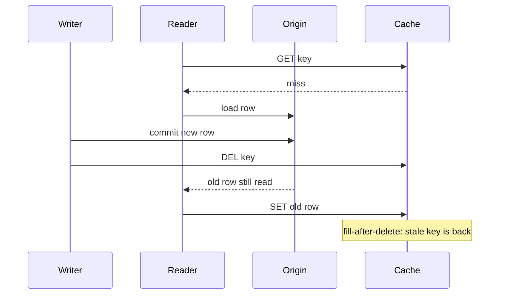

A cache is a copy. Copies go stale the moment origin changes. Time-to-live and explicit invalidation are the two ways you bound that staleness. They are not interchangeable. TTL is a fuse: if nothing else works, the key dies. Explicit invalidation is a message: origin changed, drop this copy now. Mixing them without an SLO is how a profile page is "eventually correct" while the product spec said "correct after save."

TTL is a bound, not correctness. A five-minute TTL means you accepted five minutes of lies, plus clock skew, plus the time to refill. It does not implement read-your-writes. It does not implement "the user must not see the deleted post." Those requirements need a delete, a version, or a write-through of the new value. Using TTL as a substitute for invalidation is a product decision. Write it down as an SLO, or a PM will write it down as a bug.

Explicit invalidation has races. The classic one is fill-after-delete: a reader misses, loads the old origin row because the write has not committed or has not reached this replica, and fills the cache after your delete. The new world is now the old blob. Another race is delete-the-wrong-key: tenant prefix missing, version suffix missing, near-cache not on the bus. Invalidation that does not name the same key the fill uses is a no-op.

You need both more often than you need one. TTL catches missed deletes, crashed subscribers, and keys you forgot to wire. Invalidation catches the cases where the TTL is longer than the user will tolerate. Jitter on TTL catches the case where a thousand keys loaded together expire together and origin dies.

## Concept

### TTL as a safety fuse

A TTL is an expire time stored with the key, or a wall-clock comparison on read. Redis `EXPIRE` / `SET EX`, Memcached expiry, HTTP `max-age`, DNS TTL, and CDN edge TTLs are the same idea at different layers. After the fuse blows, the next read is a miss (or a revalidation). Until then, the cache may serve a value origin would no longer return.

The SLO and the TTL must use the same unit. If the product allows 30 seconds of staleness, a 10-minute TTL is a spec violation. If the product allows 10 minutes, a 30-second TTL is extra origin load. Teams pick round numbers (60, 300, 3600) because they are round, then spend incidents explaining why a price or a permission was wrong for that round number.

TTL clusters. Keys filled in a burst expire in a burst. That is an expiry cliff: origin QPS follows the fill wave one TTL later. Add jitter, a random extra interval, or a probabilistic early refresh, so the cliff becomes a slope. Jitter is part of invalidation strategy, not a cute `random()` left in a client.

TTL on a negative (a cached miss) needs its own bound. Caching "this user does not exist" for an hour blocks signup of that name. Caching it for 50 milliseconds may not be worth the round trip. Negative TTLs are usually much shorter than positive ones, and they must be invalidated on create.

### Explicit delete, update, and versioned keys

After origin commits, the write path deletes the cache key, or overwrites it with the new value. Overwrite is write-through of the payload and avoids a miss. Delete is cheaper for large blobs and safer when serialization of the new value is expensive or error-prone. Delete without a version is racy under concurrent readers.

Versioned keys put the version in the name or in the payload: `user:42:v:N`, or a blob `{version, body}`. Invalidation becomes "increment N" and stop reading N-1. Old payloads die by TTL. Fill-after-delete cannot resurrect N-1 if readers only look up N. The pointer to N must itself be cheap and correct; a hot pointer is a new bottleneck.

A generation or epoch on a namespace is a nuclear invalidation. Bump the epoch, every key hashes differently or fails a version check, the working set misses. Operators use this for a poisoned blob, a bad deploy of cached HTML, or a schema change of the cached shape. Origin must survive the refill. Rate-limit fills after an epoch bump or you turned a cache bug into an origin outage.

### Invalidation is a graph, not a key

A user change is a profile object, a search document, a feed embedding, a CDN path, and every cached HTML fragment that inlined the old display name. Deleting `user:42` does not delete those derived copies. If the SLO says the old name must vanish, you need fanout invalidation, versioned embeds, or an architecture that does not copy the name into a million cached records.

Derived tables are caches. A materialized count, a rendered page in a `cache_*` table, a Redis hash of a GraphQL response: they need the same story. CDC from origin to a worker that deletes or rebuilds the view is an invalidation bus. A nightly rebuild is a TTL. Naming the table `users` does not make it origin if it can be reconstructed and can be wrong.

### Races: fill-after-delete and replica lag

The fill-after-delete race is concurrent, not exotic. Timeline: reader misses, reader loads origin (old), writer commits origin (new), writer deletes cache, reader fills cache (old). Detection is "we deleted, and it is still stale." Mitigation is origin versions on fill, a short lock that blocks fills during the write, or writing the new value instead of deleting.

Replica lag produces a cousin: writer committed on the primary, reader filled from a replica that is behind, cache now holds old data with a fresh TTL. Read-from-primary on fill, or put the version on the payload and refuse to overwrite a newer cached version with an older fill.

Near-caches in the application process add a bus problem. A delete on Redis does not delete the Caffeine map in twenty pods. Pub/sub without replay leaves a restart hole. A durable log with offsets, or a local TTL inside the SLO, closes that hole. Starting a pod with a warm snapshot and no replay is serving stale on purpose.

## Trade-offs

| Approach | When it wins | Cost / risk |
| -------- | ------------ | ----------- |
| TTL only, plus jitter | Staleness SLO matches TTL; users cannot tell; writes are rare | Expiry cliffs; no read-your-writes; product still files "stale" bugs |
| Explicit delete or overwrite after commit | Single remote cache, 1:1 keys, SLO tighter than a comfort TTL | Fill-after-delete race; missed deletes without a TTL backstop; wrong key names |
| Versioned keys or epoch bump | High fanout, poison recovery, many derived shapes | Pointer becomes hot; garbage of old versions; epoch refill stampedes origin |

TTL-only is acceptable for weather, public content with a published delay, and derived stats that already have a tick. It is not acceptable for the writer's own account settings. Explicit delete is the workhorse when the writers can see the cache cluster. Versioned keys win when the same entity is cached in many shapes. Combine them: versioned payload, explicit pointer update, TTL on both. Combining them without one SLO is how five mechanisms still produce a stale read.

## Diagram

## Failure modes

### Fill-after-delete resurrection

**Detection.** A write and a delete are logged, yet the next read returns the previous blob. The cache key exists with a fresh TTL. Traces show a GET miss that started before the write and a SET that completed after the DEL. Reproducing it requires concurrent read and write, not a serial test.

**Mitigation.** Store an origin version with the cached value. On fill, compare versions; never overwrite a newer entry with an older load. Prefer `SET` of the new value over `DEL` of the old one. Optionally block fills of that key with a short lock around the write. Keep a TTL so a missed compare cannot last forever.

### Expiry cliff and origin storm

**Detection.** Origin QPS shows a periodic spike at the TTL interval after a traffic burst, a deploy, or a cache flush. Cache miss rate and origin CPU share a shape. Keys loaded together die together. A flush or epoch bump produces the same spike without waiting for TTL.

**Mitigation.** Add jitter to TTLs. Refresh asynchronously before expiry (early recompute) on hot keys. Coalesce concurrent misses. After a flush, pace fills. Do not set the same TTL on every key of a mass load; spread them. Treat a planned invalidation of millions of keys as a capacity event for origin, not as a cache cleanup.

### Missed invalidation and wrong key

**Detection.** Sampled compares of origin versus cache show mismatches after the SLO window, concentrated on a key prefix, a tenant, or pods that restarted. The write path logged a delete of `user:42` while the read path fills `tenant:9:user:42`. A pub/sub subscriber dropped exceptions and stopped applying deletes.

**Mitigation.** TTL as backstop on every key. Tests that the write path emits the exact key the read path fills, including tenant and version. Durable invalidation log with offsets for near-caches; cold start empty if you cannot replay. Alert on subscriber lag and on origin-cache version skew, not only on hit rate.

### Negative cache blocking creates

**Detection.** A newly created resource 404s or returns an empty profile for the negative TTL duration. Logs show a cached miss written during signup races, or during a lookup before the row existed. The create path did not delete the negative key.

**Mitigation.** Short negative TTLs. Invalidate the negative key on create (same key-name discipline as positive keys). Do not negative-cache existence checks for names a user can immediately claim. For security-sensitive "does this account exist" responses, prefer not to cache.

## Real-world example

Facebook's TAO, described in the 2013 USENIX ATC paper "TAO: Facebook's Distributed Data Store for the Social Graph," is a production graph cache in front of MySQL. Objects and associations (the social graph's nodes and edges) are cached geographically. Reads try the cache; misses load MySQL and fill. Writes go to the database, then the cache is updated or invalidated so other servers do not keep serving the previous association.

That design treats TTL as insufficient for graph correctness. A friendship edge, a privacy change, or a deleted post has an SLO tighter than a comfort expire. TAO therefore performs explicit cache updates on the write path, with replicas in other regions learning through a combination of write forwarding and cache maintenance rather than waiting for a timer. The paper's shape is the one this essay argues for: origin is MySQL, the cache is a copy, invalidation is part of the write, and a miss refill must not resurrect a value the write already replaced.

The same fleet also shows why TTL remains. Multi-region copies, process failures, and missed messages still need a bound. A cache that only had explicit deletes and no expire would rely on every invalidation arriving at every replica forever. Facebook's public descriptions of Memcached and TAO repeatedly pair lookaside caching with expiry and with leases or versions so a concurrent fill cannot blindly win.

DNS is the other everyday system that teaches the same split. The TTL on a record is a bound on how long resolvers may reuse an answer. It is not a guarantee that every resolver dropped the old address at the instant you changed the zone. Operators who need a cutover faster than the published TTL lower the TTL ahead of time, then change the record, then raise it. Operators who forget and published a one-day TTL wait a day, or they wait out the resolvers that clamped the TTL anyway. Correctness of "this name points at the new load balancer" is not the TTL. The TTL is how wrong you agreed to be.

Application Redis sits between those two examples. For a product setting, copy TAO: write origin, delete or overwrite the key, version the blob, keep a TTL. For a public content card, copy DNS: pick a TTL that matches the SLO, add jitter, skip the bus. If you cannot say which of those two you are building, you will ship both badly.

## What to remember

- TTL bounds worst-case staleness; it does not implement read-your-writes or deletion correctness.
- Explicit invalidation races with concurrent fills; put a version on origin or write-through the new value.
- Invalidation is a graph of derived copies, not a single key name.
- Pair every delete with a TTL backstop, and jitter TTLs so expiry does not become an origin outage.
