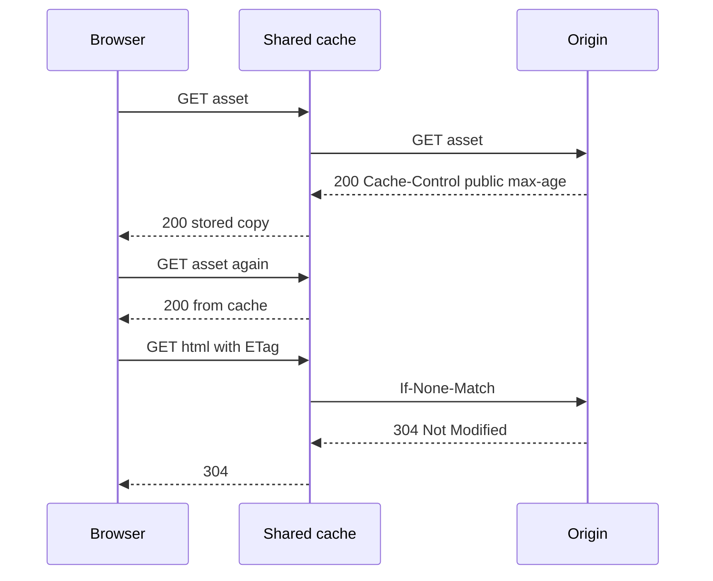

HTTP caching is a protocol, not a CDN checkbox. Browsers, corporate proxies, reverse proxies, and edge caches all read the same headers and then disagree about what they are allowed to store. If you do not send those headers on purpose, you still sent them: intermediaries will guess, browsers will heuristically cache, and a user will see yesterday's CSS or a shared proxy will store a personalized HTML page.

The headers that matter for a working mental model are `Cache-Control`, validators (`ETag`, `Last-Modified`), revalidation requests (`If-None-Match`, `If-Modified-Since`), and the distinction between private and public caches. `Expires` still exists; `Cache-Control` `max-age` overrides it when both are present. `Vary` tells caches that the response depends on request headers such as `Accept-Encoding` or `Authorization`. Ignore `Vary` and you serve gzip bytes to a client that cannot unzip, or worse, one user's page to another.

Shared caches may store a response only when the rules say they may. `Cache-Control: private` means "browser, yes; CDN and proxy, no." `public` means a shared cache may store it even if it would otherwise hesitate (for example, when a cookie was present). `no-store` means do not write this to disk or to a shared cache. `no-cache` does not mean "do not cache"; it means "revalidate with origin before reuse." That last confusion has caused more production bugs than any other line in RFC 9111.

Fingerprinted static assets and uncacheable HTML are the two ends of a correct setup. The JS file named with a content hash can be `public, max-age=31536000, immutable`. The HTML that points at that hash should be short-lived or revalidated, so a deploy that changes the hash is seen. Caching both for a year pins users to the old app.

## Concept

### Cache-Control directives that actually change behavior

`max-age=N` is the freshness lifetime in seconds from when the response was generated. A cache that still has freshness left may reuse the response without talking to origin. `s-maxage` is the same idea for shared caches only; use it when the CDN should keep HTML for 30 seconds while the browser should not. `Age` on a stored response tells you how long it has already sat; remaining freshness is roughly `max-age - Age`.

`private` versus `public` is who may store. Personalized pages, responses that vary on cookies, and anything with an `Authorization` header default to "not for shared caches" unless you explicitly mark `public` and understand the risk. Marking a logged-in dashboard `public` is how a shared cache becomes a data leak. Marking a hashed CSS file `private` is how you waste origin on bytes every browser could have taken from an edge.

`no-store` forbids storage. Use it for one-time secrets, banking payloads you do not want in a laptop's disk cache, and responses that must not reappear from the back button's store if product and legal require that. `no-cache` allows storage but requires revalidation before reuse. `must-revalidate` says a stale response must not be used without a check; combined with `max-age` it is a freshness window plus a hard stop. `immutable` (widely supported in browsers for fingerprinted assets) says do not revalidate before `max-age` ends, even on reload.

`stale-while-revalidate` and `stale-if-error` let a cache serve stale bytes while it refreshes, or when origin is down. They are explicit about staleness. Prefer them over silent heuristic caching when the product can name the extra seconds.

### Validators: ETag and Last-Modified

A validator is a cheap way to ask "do you still have this?" without transferring the body. `ETag` is an opaque token the origin chooses: a hash of the body, a version, a storage generation. `Last-Modified` is a timestamp. The client (or a shared cache) sends `If-None-Match` with the ETag, or `If-Modified-Since` with the timestamp. Origin returns `304 Not Modified` with no body, or `200` with a new body and new validators.

Strong ETags claim byte-identity. Weak ETags (`W/"..."`) claim semantic equivalence; gzipping or trivial reformatting may still match. If you compute ETags after compression and also vary on `Accept-Encoding`, do it on purpose. If two representations share an ETag they should not, 304 will strand a client on the wrong bytes.

Validators do not replace freshness. A response with `max-age=3600` and an ETag will not revalidate for an hour. After that hour, the ETag saves bandwidth. If you need "always check, but skip the body when unchanged," send `no-cache` (or `max-age=0, must-revalidate`) plus an ETag. That is the right shape for HTML that changes on deploy but is identical between deploys.

`Last-Modified` is weaker in practice. Clocks, sub-second updates, and load-balanced origins with filesystem timestamps produce false 304s. Prefer ETags when you control origin.

### Private versus public, and what shared caches may store

RFC 9111 defines a shared cache as one that stores responses to serve to more than one user: a CDN, a reverse proxy, a campus proxy. A private cache is typically the browser. The default heuristic for authenticated or cookie-tied responses is conservative: shared caches should not store them unless `public` is present (and even then, many CDNs require an explicit cacheable status and content type).

What a shared cache may store is also gated by status code and method. `GET` and `HEAD` 200s are the normal case. `POST` responses are not cached by default. `Set-Cookie` on a response is a loud signal not to share that response. A CDN that caches a `Set-Cookie` login page will pin a session to strangers. Strip cookies on cacheable public content, or mark `private`.

`Vary` is the other half of safety. `Vary: Accept-Encoding` means gzip and identity are different entries. `Vary: Cookie` often makes a shared cache useless, because every cookie value is a new variant; that is sometimes the point. `Vary: Authorization` similarly fragments the cache. Do not `Vary` on headers you do not actually use. Do not omit `Vary` on headers you do use.

### Heuristic caching and the cost of silence

If you send no `Cache-Control` and no `Expires`, some caches still store a GET 200 using a heuristic. You cannot predict which browser or proxy will guess what. For APIs and HTML, send an explicit directive. Silence is not "uncacheable." Silence is "undefined."

## Trade-offs

| Approach | When it wins | Cost / risk |
| -------- | ------------ | ----------- |
| `public, max-age` long, `immutable`, hashed URL | Static assets; content-addressed files; CDN hit ratio is the goal | HTML must not be cached the same way or deploys pin old apps; query-string variants can fragment |
| `private` or `no-store` | Personalized HTML, secrets, cookie-tied pages | Origin and browser both pay; back-button and offline behavior change |
| Short freshness plus ETag revalidation | HTML and APIs that change on deploy but are stable between deploys | Origin still sees a request on every stale check; miscomputed ETags strand clients |

Fingerprinted public assets plus short-lived HTML is the default for websites that deploy often. `no-store` is the default for responses you would not print on a shared printer. Revalidation is the middle: you keep a copy but you ask. If a CDN is in the path, test with that CDN's header parser, not only with a browser. Shared caches interpret `s-maxage`, `Vary`, and cookies more strictly, and they are the ones that leak if you get `public` wrong.

## Diagram

## Failure modes

### Shared cache stores a personalized response

**Detection.** User A sees user B's name, cart, or session. CDN logs show cache hits for a path that includes personalized HTML. The response had `Set-Cookie`, an `Authorization` request header, or a body that varies on cookie, and `Cache-Control` was `public` or missing. A single URL such as `/` was stored once and served to everyone.

**Mitigation.** Mark personalized HTML `private, no-store` or `private, no-cache`. Do not send `public` on cookie-tied pages. Configure the CDN to respect `private` and to bypass cache when `Set-Cookie` is present. Split URLs: public marketing page versus authenticated app shell. Add a canary header or a unique user marker in HTML during tests and fetch the same URL from a second identity through the CDN.

### Deploy pinned by long-lived HTML

**Detection.** After a release, a fraction of users run old JavaScript and fail against a new API, or they request hashed files that 404 because HTML still points at the previous hash. Those users have a cached `index.html` with a long `max-age`. Browsers with a warm disk cache reproduce it; incognito does not.

**Mitigation.** Cache HTML with a short `max-age` or with `no-cache` plus ETag. Put content hashes in asset URLs and give those assets long `max-age` and `immutable`. On deploy, do not reuse hashes for different bytes. For an emergency, change the HTML URL or send a purge for the HTML path; purging every hashed asset is usually unnecessary if hashes changed.

### Validator lies: 304 with the wrong body

**Detection.** Clients keep old JSON or old CSS after origin changed, and access logs show 304. ETags were a timestamp that did not change, a hash of a template before substitution, or a weak validator reused across encodings. Two origins behind a load balancer generated different bodies with the same ETag.

**Mitigation.** Compute strong ETags from the bytes you actually send, or from a storage generation that changes on every write. Include the representation (encoding, language) in the ETag or in `Vary`. Do not generate ETags from wall clock. Test: change one byte, confirm the next revalidation is 200 with a new ETag, then confirm an unchanged second request is 304.

### Heuristic or intermediary cache ignores your intent

**Detection.** An API you believed uncacheable is served stale by a browser, a corporate proxy, or a default CDN rule. Responses lack `Cache-Control`. GET 200s with `Last-Modified` were stored by heuristic. A CDN "cache everything" configuration overrode origin headers.

**Mitigation.** Send explicit `Cache-Control` on every cacheable and uncacheable class. For APIs: `private, no-store` or `no-cache` as the product requires. Review CDN dashboard rules; a page rule can ignore origin. Add `Vary` only for headers you honor. Log `Age` and `X-Cache` (or the vendor equivalent) in synthetic checks after deploys.

## Real-world example

Wikimedia's site-facing caches are a public, long-running case of HTTP caching headers used as an operations system. Wikipedia and its sister projects sit behind layers of HTTP caches (historically Squid, then Varnish, with Apache Traffic Server also in the story) in front of MediaWiki origin. Anonymous article views are the bulk of traffic. Those responses are cacheable at the edge. Logged-in views, edits, and personalized bits are not treated as public shared content.

The headers and cache keys do the work. Cache-Control and related metadata decide freshness for anonymous pages. A purge, not a hope that TTL will catch up, is how an edit becomes visible: MediaWiki issues invalidations so that an article someone just saved does not sit at the edge until `max-age` expires. That is HTTP caching plus explicit invalidation, the same pairing as application caches, implemented with PURGE-style requests and cache-key discipline rather than Redis `DEL`.

Static bits (logos, some scripts and styles, uploaded media on the commons) follow the fingerprinted or long-lived asset pattern where the URL and the headers allow shared caches to hold bytes for a long time. HTML of an article cannot use that pattern blindly: an edit must win. Wikimedia's operational writing on wikitech documents cache layers, purge, and the split between anonymous cacheable traffic and requests that must reach origin.

Any shop that puts CloudFront, Fastly, or Cloudflare in front of an app is in a smaller version of the same design. Mark the HTML and the API on purpose. Mark the hashed `/static/app.<hash>.js` `public` and long-lived. Put `private` or `no-store` on the session page. Send ETags for revalidation where bodies are large and change infrequently. Read RFC 9111 when a CDN behavior looks like a vendor bug; it is often the shared-cache rules you skipped.

## What to remember

- `Cache-Control` is the contract: `max-age` and `s-maxage` for freshness, `private` versus `public` for who may store, `no-store` versus `no-cache` for storage versus revalidation.
- Shared caches may store a response only when the rules allow; personalized HTML marked `public` is a leak.
- ETag and `Last-Modified` save bandwidth on revalidation; they do not replace freshness, and a lying ETag pins stale bodies.
- Fingerprint assets for long public caching; keep HTML short-lived or revalidated so deploys actually roll out.
