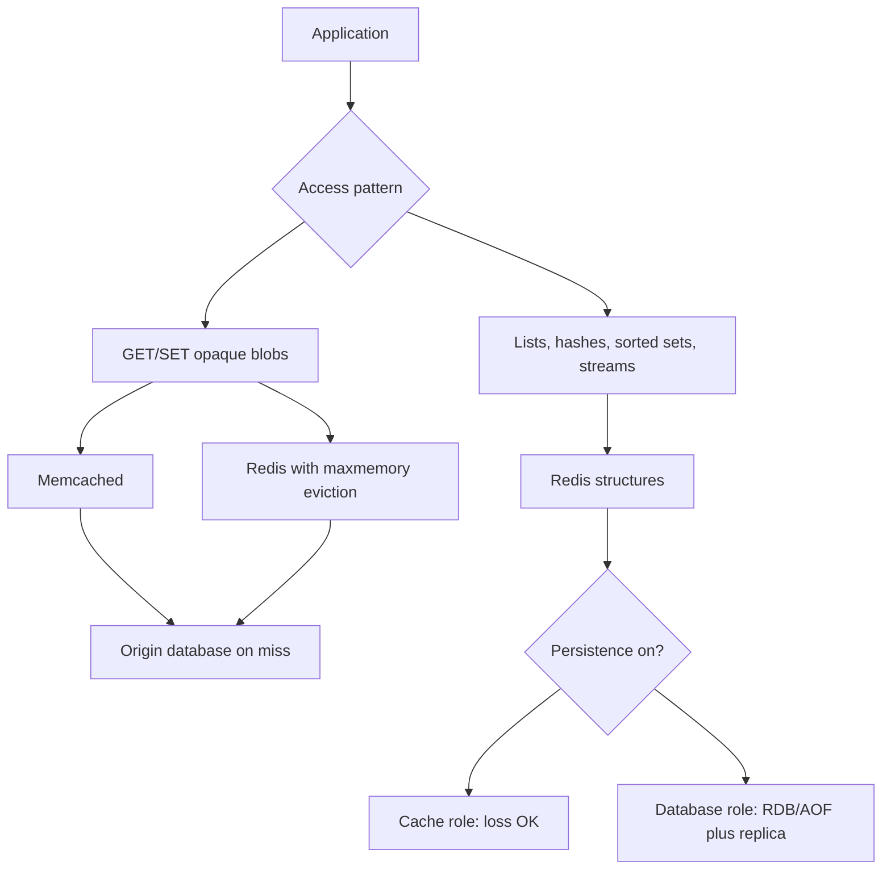

Redis and Memcached are both in-memory stores that application teams reach for when a database round trip is too slow. They are not interchangeable products with different logos. Redis is a data-structure server with optional persistence, replication, and a single-threaded command execution model. Memcached is a simple volatile cache: strings (and opaque bytes) in slabs, multithreaded, no rich types, no durable log. Pick them by the operations you need, not by which one is already on the AMI.

If the workload is "GET and SET a blob, evict when full, restart means empty," Memcached is a complete answer. If the workload is "increment a counter, push onto a list, union a set, expire a hash field, take a lock, keep a replica," Redis is the answer, and you must then decide whether Redis is a cache or a database. Those two roles disagree about persistence, failover, and what a flush means.

Single-threaded command execution in Redis is the fact that surprises people who hear "fast." One thread runs commands; I/O may use extra threads in Redis 6+, but the command itself is serialized. A slow command (`KEYS *`, a huge `SUNION`, an oversized Lua script) stalls every other client on that instance. Memcached workers run in parallel across cores; a single get does not block other gets. That difference shows up on a hot instance long before you care about persistence.

Do not run both as a default. Two caches mean two eviction policies, two failure domains, and two ways to be stale. Run both when the roles split cleanly: Memcached for lookaside blobs, Redis for structures and locks. Facebook's Memcached fleet and GitHub's Redis use for jobs and rate limits are that split at company scale, not a mandate to install both in a three-person shop.

## Concept

### Memcached: a multithreaded memory cache

Memcached speaks a simple protocol: set, get, delete, a few extras (cas, incr, slabs). Values are opaque bytes. There is no hash type, no sorted set, no secondary index. Keys have a size limit; values have a size limit. Memory is carved into slab classes by approximate object size. Eviction is LRU inside a class. When the process dies, the data dies. There is no RDB, no AOF, no replica that is part of the core design (though people have built replication sidecars).

Multithreading is the performance story. Worker threads accept connections and operate on the hash table with fine-grained locks. Throughput scales with cores for the GET/SET path. CPU-bound serialization of your JSON still happens in the client; Memcached will not transform the blob.

Use Memcached when you want a lookaside cache in front of MySQL or another origin: Facebook's published Memcached architecture is this shape. The application is cache-aside. Memcached does not persist, so a flush or a restart is a miss storm you must survive at origin. That is acceptable if origin was always the source of truth.

### Redis: data structures, persistence options, serialized commands

Redis values have types: strings, lists, sets, hashes, sorted sets, streams, bitmaps, HyperLogLog, and geospatial indexes, with more modules in some deployments. Commands are type-specific: `HGET`, `ZRANGE`, `RPOP`, `XREAD`. You can implement a rate limiter, a leaderboard, a queue, and a session blob in one process. You can also implement a footgun: a list that grows forever, a `KEYS` in production, a hot key that cannot be split because the structure is one value.

Persistence is optional and real. RDB snapshots dump the dataset to disk on a schedule or on command. AOF rewrites a log of operations (with fsync policies from "every command" to "every second" to "let the OS decide"). You can run Redis with no persistence, which is a cache. You can run RDB plus AOF, which is a memory database with a recovery story. Replication is built in: a replica tails the primary. Redis Sentinel and Redis Cluster exist because people treated Redis as infrastructure, not as a local cache.

Command execution is single-threaded. Pipelining and Lua scripts reduce round trips, but a script still runs to completion on the command thread. Redis 6 I/O threads read and write sockets in parallel; they do not run `ZUNIONSTORE` in parallel. Horizontal scale is multiple instances: Cluster shards by key slot. A single hot key still lives on one thread on one shard.

### What "cache" versus "database" changes

Memcached is always a cache in the durability sense. Redis is a cache if you set `maxmemory` and an eviction policy and you accept loss. Redis is a database if you persist, replicate, and refuse to evict (`noeviction`). Mixing the modes on one instance — persistent jobs list plus evictable session blobs — means eviction can drop the jobs list if you chose `allkeys-lru`. Split instances by role: a persistent Redis for queues and locks, a volatile Redis or Memcached for lookaside.

Failover semantics follow the role. A Memcached node disappears; clients miss and refill. A Redis primary disappears; Sentinel or your operator promotes a replica. If persistence was `appendfsync everysec`, you can lose a second of writes. If the replica was behind, you can lose more. Document that window. Application developers who heard "Redis is durable" will not.

### Client behavior, clustering, and hot keys

Both systems fail in the client as often as in the server. Connection pooling, timeouts, and retry policy determine whether a cache blip becomes an origin outage. Memcached clients hash keys to nodes (consistent hashing); a node loss remaps a fraction of keys, which is a miss wave. Redis Cluster moves slots; a wrong assumption that a multi-key command spans slots (`SUNION` of keys on different shards) fails at runtime.

Hot keys hit both. Memcached can at least serve the hot blob from many threads on one node. Redis serves it from one thread. Replication helps reads if you accept replica lag. Local near-caches in the application, request coalescing, and splitting the key are the usual escapes. A hot Redis key that is also a large sorted set is how you discover single-threaded command execution in a page-one incident.

## Trade-offs

| Approach | When it wins | Cost / risk |
| -------- | ------------ | ----------- |
| Memcached | Opaque blobs, lookaside in front of origin, many cores, empty-on-restart is acceptable | No structures, no persistence, slab eviction unfairness, miss storm on restart |
| Redis as cache | Need types, TTL per field patterns, eviction policies including LFU, optional replica reads | Single-threaded slow commands; persistence accidentally on or off; hot keys |
| Redis as database | Queues, locks, counters, streams, session store with a stated durability window | Failover loss window; `maxmemory` vs `noeviction` mistakes; treating it like a query engine |

If you need a list or a sorted set, Memcached will not grow one. If you need a volatile blob cache and you already operate Memcached well, Redis adds persistence knobs you can set wrong. Many teams standardize on Redis because one binary covers cache and structures, then learn they needed two Redis instances anyway: one with eviction, one without.

## Diagram

## Failure modes

### Slow Redis command stalls the instance

**Detection.** All clients time out together on one Redis primary. Latency metrics jump for every command, not only the heavy one. Slow log (`SLOWLOG`) shows `KEYS`, a large `LRANGE`, a big Lua script, or `HGETALL` on a huge hash. CPU is one core at 100% while others idle.

**Mitigation.** Ban `KEYS` in production; use `SCAN`. Bound list and hash sizes. Move heavy aggregations off Redis. Split a fat key. Keep Lua scripts short. Run `SLOWLOG` and latency monitor as pages, not as archaeology after the outage. Memcached is not immune to large values, but it will not serialize every other get behind your scan.

### Persistence and eviction on the same instance

**Detection.** After memory pressure, a queue, a lock, or a session that was supposed to be durable is gone. `maxmemory-policy` is `allkeys-lru` on an instance that also holds job lists. Or the opposite: a lookaside cache with `noeviction` starts returning write errors and the application treats them as origin failures.

**Mitigation.** Separate instances by role. Lookaside: `maxmemory` plus `allkeys-lru` or `allkeys-lfu`, persistence off if origin is truth. Jobs and locks: persistence on, `noeviction`, memory alerts before full. Name them in DNS (`redis-cache`, `redis-jobs`) so a new service does not grab the wrong one.

### Restart miss storm and thundering herd

**Detection.** A Memcached or non-persistent Redis restart (deploy, OOM, host failure) is followed by origin QPS equal to the previous cache hit rate. Application timeouts cascade. The cache fills again and the storm ends, until the next restart.

**Mitigation.** Rolling restarts of a pool so only a hash slice misses. Cache warming for the hottest keys if you can name them. Request coalescing and origin rate limits. For Redis, replicas that can be promoted keep the data; that is a database-shaped deploy, and it needs the failover loss window documented. Do not restart every Memcached node at once in the same deploy wave.

### Slab or slot imbalance

**Detection.** Memcached evictions in one slab class while others have free pages; object size shifted after a serialization change. Redis Cluster: one slot hot, `used_memory` skewed, one thread at the cap. Clients see evictions or `MOVED` storms after a reshard.

**Mitigation.** Watch per-slab and per-node memory, not a global hit rate. Recompress or cap value size. Split keys that hash together. Rebalance Cluster slots. For Memcached, a value that moved from 1 KB to 2 KB can change slab class and eviction behavior overnight after a deploy; include payload size in the deploy checklist.

## Real-world example

Facebook's Memcached deployment, described in the NSDI 2013 paper "Scaling Memcache at Facebook," is the canonical lookaside cache at scale. Memcached sits in front of MySQL. Applications read through the cache, fill on miss, and delete or update on write. The paper's concerns are leases to avoid stampedes, regional pools, and the operational reality of a volatile, multithreaded blob cache. Persistence is not the point. Origin is MySQL. Empty cache is a survivable event if origin and leases are in place.

Redis occupies a different niche in public engineering writing from companies that also know Memcached. GitHub has long used Redis for background jobs (Resque, then other queue workers) and for lock-like and rate-limit structures that are not a MySQL row. Those workloads need lists, atomic increments, and expiry. Memcached cannot host them without reinventing types in the client. Twitter's cache history includes both: Twemcache/Memcached-style lookaside for blobs, and Redis where structures mattered.

Instagram's early Redis use (counters, live fanout, and similar in-memory structures) is another documented pattern: Redis as a data-structure server, not as a slower Memcached. Persistence and replication then become product questions: is a lost counter acceptable? Is a lost job acceptable? The answers differ, which is why "we run Redis" is not an architecture.

The portable choice is a sentence: "opaque lookaside blobs, origin is truth" points at Memcached or at Redis with eviction and no durability claim. "structures, atomics, optional durability" points at Redis with the persistence and clustering story named. If you cannot finish that sentence, you will configure `appendonly yes` on a cache and `allkeys-lru` on a queue, and both will fail in opposite directions.

## What to remember

- Memcached is a multithreaded volatile blob cache; Redis is a data-structure server with optional persistence and single-threaded command execution.
- Redis I/O threads do not make a slow command concurrent; `KEYS` and fat values stall the instance.
- Split Redis-as-cache from Redis-as-database: eviction and persistence cannot share a policy on one dataset.
- Hot keys, slab classes, and cluster slots fail in the client and the partition, not only in the product comparison table.
