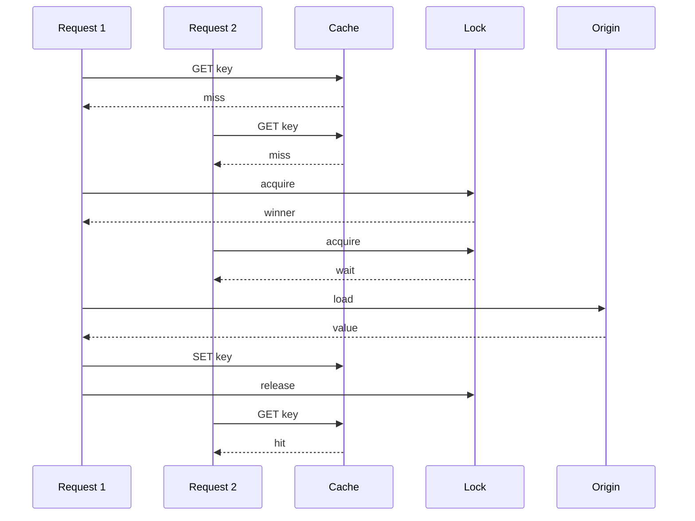

A cache stampede, also called a thundering herd or dogpile, is many concurrent misses for the same key hitting origin at once. The cache did its job until the key expired, was evicted, or never existed. Then every in-flight request discovered the miss together, every replica of the application loaded origin, and origin did the expensive work N times. The users wait. The database CPU goes to the ceiling. The cache fills N times with the same blob.

The usual trigger is an expiry cliff. A popular key is loaded at 12:00 with TTL 60 seconds. At 12:01 it dies. Traffic at that instant is thousands of reads per second. Without coordination, thousands of loads run. A deploy that flushes the cache is the same cliff with a larger key set. A hot key that never quite fits (evicted under memory pressure) is a stampede on a timer you do not control.

The fixes are coordination and earlier work. A lock or a lease lets one loader run and the others wait or serve stale. Early recompute refreshes the key before TTL zero so the cliff never forms. Request coalescing folds concurrent misses into one origin call inside a process or a proxy. Jitter spreads TTLs so many keys do not die in the same millisecond. None of these is optional decoration if the origin query is heavier than a primary-key get.

Stampedes are a property of fanout, not of Redis. A single-process memoization map stampedes if 200 threads miss together. A CDN stampedes origin if every edge POP misses a popular URL at once. Varnish, Memcached leases, and "only one cron refreshes this key" are the same pattern at different layers.

## Concept

### Anatomy of the expiry cliff

The dangerous sequence is: key present and hot, TTL reaches zero (or eviction), a window where the key is absent, many readers in that window, each reader able to issue origin work. The width of the window is your miss detection time plus origin latency. The height is QPS on that key. Origin cost is height times the query cost, until the first fill lands and later readers hit.

Identical TTLs on keys filled together produce a herd of herds: not one celebrity key, but the entire working set. A cache warm at startup, or a mass fill after a flush, sets that clock. Jitter — add a random extra TTL, or a random early refresh — turns a wall into a slope. Jitter without coalescing still leaves each individual hot key able to stampede at its own expire time.

Eviction stampedes differ from TTL stampedes only in predictability. LRU under pressure drops a hot key because a scan or a one-hit wave crowded it. The next request wave refills and the key is hot again, then dropped again. That oscillation is a stampede loop. The fix may be more RAM, a pinned key, or isolating the scan, not a lock.

### Lock, lease, and single-flighter

The lock pattern: on miss, try to acquire a per-key lock (`SET lock:key NX EX` in Redis, or Memcached `add`). The winner loads origin, fills the cache, releases the lock. Losers wait and retry the cache, or serve the previous value if you kept it. The lock must expire so a dead winner does not block the key forever. The waiters must have a timeout so a slow origin does not stall the site.

Facebook's Memcached leases, described in the NSDI 2013 paper, are this idea with protocol support: a miss can return a lease token; only the holder may fill; others are told to wait. The lease also helps with stale fills after invalidation. You do not need Memcached leases to use the pattern. You need a single winner and a defined behavior for losers.

Loser behavior is a product choice. Wait and retry means latency equals origin latency plus wait, but origin load is one. Serve stale means users see old data during refresh, which is often better than a 5-second wait or a 500. Fail the waiters means they hit origin anyway and you failed open into a stampede. Document which one you coded; the default in a hastily written `if miss: load()` is fail open.

Single-flight inside one process (Go's `singleflight`, a local mutex map) coalesces waiters on the same instance. It does not coalesce across 40 pods. Combine local single-flight with a Redis lock for cross-process, or accept that you will have about one origin load per pod. For many keys, one load per pod is acceptable. For a 200 ms join that hammers MySQL, it is not.

### Early recompute and probabilistic refresh

Do not wait for TTL zero. When remaining lifetime is below a threshold, a request may refresh in the background and still return the current value. Only some requests should refresh, or you move the stampede to the refresh. Probabilistic early expiration (the XFetch-style approach: probability rises as expiry approaches) spreads the refresh across clients without a central lock.

A dedicated rebuilder is the other shape: a worker knows the hot keys and refreshes them on a schedule shorter than TTL. The request path never sees a miss for those keys unless the worker dies. This is how expensive dashboard aggregates and "homepage fragments" stay warm. The worker is now a dependency. Monitor it. If it stops, you still want a lock on the request path as a backstop, or you have a time bomb.

Early recompute needs stale-while-revalidate semantics: the cache must still hold the old value while the new one computes. If you delete then recompute, you created a miss window on purpose. Overwrite in place, or use a versioned key and flip the pointer when ready.

### Request coalescing at the proxy

Reverse proxies can collapse concurrent identical misses. Varnish request coalescing is the textbook HTTP version: while one fetch to origin is in flight for a URL, other requests for that URL wait and share the response. CDNs implement variants. This protects origin from browser herds on a popular article without application locks.

Coalescing keys must match. Query-string noise, `Cookie` in the cache key, and `Vary` misconfiguration split the herd into many origin fetches that look unique. A cache key that includes a user id will not coalesce across users, which is correct for private content and useless for a public page accidentally keyed on cookie.

## Trade-offs

| Approach | When it wins | Cost / risk |
| -------- | ------------ | ----------- |
| Per-key lock or lease | Expensive origin load; many pods; one winner must run | Lock expiry too long blocks; too short reopens the herd; waiters need a stale fallback |
| Early recompute / probabilistic refresh | Hot keys with predictable TTL; stale serve is allowed | Moves work earlier; without probability, refresh stampedes; worker failure |
| Proxy request coalescing | Identical public URLs; Varnish/CDN in front | Wrong cache key splits the herd; private content must not coalesce across users |

Use coalescing at the edge for public HTTP. Use a lock or lease in the application for computed keys that never pass through Varnish. Use early recompute for the handful of keys whose origin cost you can name. Jitter belongs on every TTL regardless. Combining lock and early refresh is normal: refresh usually wins, lock catches the miss that still happens.

## Diagram

## Failure modes

### Expiry cliff on a celebrity key

**Detection.** Origin QPS and latency spike at a regular interval equal to the TTL, or at a cache flush. Traces show the same cache key missing from many pods in the same millisecond. Database CPU matches the spike. After the fill, traffic is quiet until the next expire.

**Mitigation.** Lock or lease on that key. Keep serving stale during refresh. Add TTL jitter even on a single key class so related keys do not align. Lower the cost of the origin query (materialize, precompute). Pin the key against eviction if it is hot and small. Early-refresh the key from a worker so request path misses go to zero.

### Lock that deadlocks or fails open

**Detection.** After adding a stampede lock, p99 latency goes to the lock TTL, or origin load does not drop. Causes: lock TTL longer than users will wait, winner crash without release, waiters ignoring the lock and loading origin, lock key name not matching the cache key, Redis lock instance different from the cache instance and partitioned.

**Mitigation.** Set lock TTL to origin p99 plus margin, not to minutes. Always set expiry on the lock. Waiters retry the cache, then serve stale, then fail; they must not all call origin. Use the same key namespace. Test with concurrent clients, not a serial unit test. If the lock store is down, decide fail-open (stampede) versus fail-closed (errors) explicitly; silent fail-open is how the protection disappears in the incident you bought it for.

### Coalescing split by cache key

**Detection.** Origin still sees N identical queries. Access logs show URLs that differ by tracking query params, session cookies, or `Accept-Language` variants you did not intend to cache separately. CDN hit ratio is low on a "popular" page. Application logs show one miss per pod despite in-process single-flight.

**Mitigation.** Normalize cache keys: strip tracking parameters, do not vary on cookie for public pages, collapse language if the body does not. Add in-process single-flight and a distributed lock for the remaining cross-pod misses. Verify coalescing with a load test of one URL from many connections; if origin count equals connection count, the key is not coalescing.

### Refresh worker silent failure

**Detection.** Early-recompute keys start missing on the request path after a cron host dies, a queue backs up, or a deploy drops the job. Stampede appears "suddenly" on keys that had been quiet. Metrics on worker success were not paged.

**Mitigation.** Page on worker lag, not only on origin CPU. Keep the request-path lock as backstop. Store a "refreshed_at" on the blob and alert when it ages past TTL/2. Do not make the worker the only filler without a miss path that is safe under herd.

## Real-world example

Facebook's Memcached leases, in "Scaling Memcache at Facebook" (NSDI 2013), are a production stampede control for a lookaside cache. On a miss, the client can receive a lease. Only the lease holder should write the value back. Other clients wait rather than all querying MySQL for the same object. The lease also reduces the stale-fill race after an invalidation: a writer can invalidate and a late fill without a valid lease will not stick. That is stampede control and invalidation safety in one protocol feature.

The same paper's setting is the one most application caches live in: many web servers, a shared Memcached pool, MySQL as origin, hot keys with high read QPS. TTL expiry and eviction both create holes. Without leases or an equivalent lock, the hole is an origin event. With leases, origin sees roughly one load per hole, plus waiters. Waiters still need a behavior: Facebook's clients were built around that protocol rather than around naive retry-into-MySQL.

Varnish request coalescing is the HTTP analogue, used in front of sites such as Wikimedia's properties: concurrent browser requests for a cold URL share one fetch to origin. Combined with a cache TTL and purge on edit, the edge protects MediaWiki from a herd at expire time for anonymous page views. The remaining stampede risk is a purge of a celebrity article, which is why paced refill and coalescing belong together.

In application Redis, you implement the Facebook idea with `SET NX` on a lock key, a short expiry, waiters that `GET` the real key in a loop, and a stale blob if you can keep one. For a homepage fragment that costs a heavy join, also run a worker that rewrites the key before TTL. For a public URL, put a coalescing proxy in front and stop asking every pod to coordinate. Match the layer to the herd.

## What to remember

- A stampede is concurrent misses on the same key; expiry cliffs, flushes, and eviction of hot keys are the usual triggers.
- Let one loader run: lock, lease, or proxy coalescing; define whether waiters see stale, wait, or fail.
- Refresh before TTL zero on hot expensive keys, and jitter TTLs so working sets do not expire as a wall.
- In-process single-flight is not enough across pods; test with concurrency or you shipped a serial unit test, not a herd fix.
