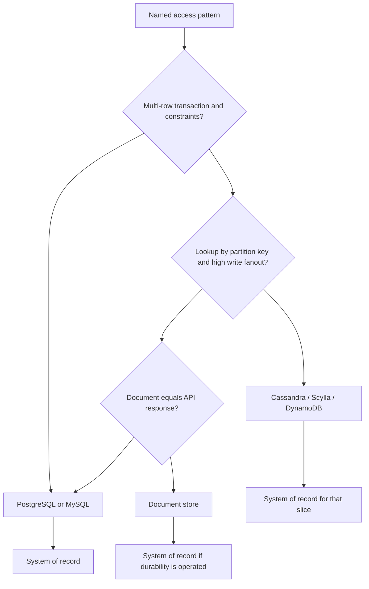

SQL versus NoSQL is a workload and consistency choice, not a fashion. Relational engines (PostgreSQL, MySQL, SQL Server) give you a schema, a query planner, joins, and transactions with isolation levels you can name. Non-relational engines give you a storage and distribution model aimed at a narrower access path: key-value (DynamoDB, Redis as database, Memcached is not a database), document (MongoDB), wide-column (Cassandra, Scylla, Bigtable), graph (Neo4j). The second group is not one thing. "NoSQL" is a marketing umbrella over different failure modes.

The question to ask is: what is the lookup, what is the write, and what happens when two writers conflict. If the product is a row you update with several related rows in one commit, and you need those rows to agree, a relational database with a real transaction is the default. If the product is a per-user append-only log of messages that must survive a datacenter loss and is always read by primary key or a well-known partition, a wide-column store is a default. If you pick Cassandra to store accounting ledgers because it is web-scale, you will rebuild transactions in the application and lose.

Schema-on-write versus schema-on-read is a secondary question. Document stores postpone the schema; they do not remove it. Someone will query `email` and discover three shapes. Relational migrations are painful and explicit. Implicit schema drift is also painful. Choose where the pain lives.

Scale is not a reason by itself. PostgreSQL and MySQL run very large systems (often with replicas, partitioning, or Vitess). Cassandra and DynamoDB run very large systems with a different consistency story. The engine that matches the access pattern and the consistency requirement will scale more honestly than the engine you picked because a talk said joins do not scale.

## Concept

### What SQL actually gives you

A relational database stores typed tables, enforces constraints you declare (primary keys, foreign keys, uniqueness, checks), and runs a planner over SQL. You can ask questions you did not denormalize for, at the cost of CPU and of indexes you must keep. Transactions group writes. Isolation levels decide which anomalies you accept; the default is often not serializable. Durability depends on WAL settings, not on the word ACID in a brochure.

Joins are the feature people cite and the cost people fear. A join that hits indexes on a bounded set of rows is ordinary OLTP. A join that explodes two large unindexed tables is a mistake in any engine. Moving to a document store so you can "avoid joins" usually means you embedded the child documents, which is denormalization: faster reads of that shape, worse updates when the embedded copy must change everywhere.

Use SQL when the data is relational in the business sense: orders and line items, users and roles, inventory and SKUs, anything with constraints that would be embarrassing to violate. Use it when ad-hoc query and reporting on the same database is required. Use it when multiple rows must commit or fail together and you do not want to implement that in Kafka plus a reconciliation job on day one.

### What the NoSQL families actually give you

Key-value: read and write by key, maybe with a sort key. DynamoDB, key-value mode of other stores. You win on operational predictability if you stay in the access patterns you provisioned. You lose when you need a query the key design did not anticipate. Secondary indexes exist in some products and become a second write path with their own consistency.

Document: JSON-like documents, indexes on fields, flexible shape. MongoDB is the usual example. You win when the document matches the API response and most updates touch one document. You lose when you need multi-document transactions as the common path (though MongoDB added them; they are not free) or when every document of a "collection" has a different shape and nobody can write a query.

Wide-column / partitioned log: Cassandra, Scylla, Bigtable. Data is partitioned by a key, sorted by clustering columns, replicated with tunable consistency (ONE, QUORUM, ALL). You win on multi-datacenter write availability and on time-series or messaging shapes that match the partition model. You lose on arbitrary queries, on multi-row transactions, and on a cluster that was not sized for compaction and repair. Cassandra will not save a team that needs SQL and thinks CQL is close enough.

Graph: nodes and edges as first-class, traversals as the query. You win on path queries. You lose when the working set of a traversal is the whole graph and you treated it like a local pointer chase.

Search engines (Elasticsearch) and caches (Redis, Memcached) get called NoSQL and then used as systems of record. Search is a derived index. A cache is a copy. If you need a system of record, pick a store that has a durability and backup story you operate, then derive search and cache from it.

### Consistency, transactions, and the application

Relational defaults: a transaction, a primary, replicas that are often read-only and lagging. You can read stale from a replica. You can still lose a write if you turned off durable commit. You can still see anomalies at read committed.

Dynamo-style defaults: a write can return when a subset of replicas has it. Concurrent writes to the same item may need a version, a condition, or last-writer-wins. Last-writer-wins on a shopping cart is a lost item. Conditional writes and idempotent writes are part of the data model, not an afterthought.

Cassandra tunable consistency lets a read at QUORUM overlap a write at QUORUM and usually see the latest value, with repair and hinted handoff as the rest of the story. Reading at ONE after writing at ONE is a cache with extra steps. If the product needs "this counter never goes backward," you have more design work than a SQL `UPDATE`.

### Workload first, engine second

Draw the access patterns before the logo. "Read user by id, update user by id" is key-value or a SQL primary key. "Read user, their orders, and line items, commit a paid flag on all of them" is SQL or a carefully designed document that embeds the order. "Append messages in a channel, read latest N, retain forever, survive a zone" is Cassandra/Scylla or a partitioned log, which is why Discord stores messages that way and not as a giant PostgreSQL table of all chat history.

Polyglot is normal. One company, several engines, each with a job. Polyglot without a source of truth is a mess: two stores both "own" the user, both drift. Name origin. Derive the rest.

## Trade-offs

| Approach | When it wins | Cost / risk |
| -------- | ------------ | ----------- |
| Relational SQL | Constraints, multi-row transactions, ad-hoc query, mature operators | Horizontal scale needs partitioning; isolation is not automatically serializable; schema migrations |
| Document / key-value | Single-item access matches the API; flexible fields; operational simplicity at modest scale | Hidden schema; multi-item transactions are awkward; surprise queries need new indexes or a new store |
| Wide-column (Cassandra-style) | Partitioned high write volume, multi-DC availability, time-series/chat shapes | Data model is the query; compaction/repair; weak multi-row transactional story |

Start in PostgreSQL or MySQL if the business rules are relational and the scale is unknown. Move a partition of the workload when you have a measured access pattern that the relational engine is bad at, not when a blog post is bad at joins. If you start in DynamoDB or MongoDB, design the keys and the documents as if they were permanent, because they mostly are.

## Diagram

## Failure modes

### Wrong engine for the transaction

**Detection.** Lost updates, half-applied orders, or application code implementing two-phase commit across documents or partitions. Support tickets that a paid order has no line items, or a friend edge exists in one direction. Metrics look fine; the invariant does not.

**Mitigation.** Put the invariant in a store that can commit it atomically, or redesign the data so one item is the invariant. Do not spread one business transaction across Cassandra partitions and hope. If you already did, add a reconciliation job and a source of truth, then stop writing the second store first.

### Query the data model does not support

**Detection.** Full table scans in MongoDB, `ALLOW FILTERING` in Cassandra, DynamoDB scans in production, or a PostgreSQL query that joins unindexed JSON. Latency is load-dependent and unpredictable. New product questions require a new cluster.

**Mitigation.** Access patterns first. Add a table, a GSI, or a derived store built for that query. Do not scan a wide-column cluster to answer an analytics question; export to a warehouse. In SQL, add the index or the column you need rather than hiding a JSON blob you cannot constrain.

### Dual writes without an origin

**Detection.** SQL user row and MongoDB profile disagree. Search shows a document the database deleted. Engineers "fix" by writing to both stores in the request path without a transaction or an outbox. Incidents after a partial failure: one store committed.

**Mitigation.** One origin. The other stores are consumers of a log, CDC, or an outbox. Idempotent consumers. If you must dual-write on the request path, treat it as a bug and measure disagreement until you remove it.

### Operational model you did not staff

**Detection.** Cassandra repair lag, MongoDB oplog too small, DynamoDB throttling on a hot partition, PostgreSQL bloat and WAL disk full. The engine is "theoretically" right and the pager is always this cluster.

**Mitigation.** Pick the engine your team can operate at 3 a.m., or buy a managed version and still learn the failure modes. Hot partitions, compaction, vacuum, and failover drills are part of the choice. A managed NoSQL table with a hot key is still your incident.

## Real-world example

Discord's storage split is a public, workload-driven SQL versus NoSQL story. Guilds, users, and metadata live in PostgreSQL: relational, constrained, transactional, a size that a primary-plus-replicas shape can hold. Messages live in Cassandra, later with Scylla in the story, because the access pattern is append and read-recent by channel, the volume is huge, and the team optimized for that partition key rather than for SQL joins across all chat history.

That split is the essay in production form. They did not put messages in PostgreSQL as one infinite table because a talk said SQL is dead. They did not put guild permissions in Cassandra because a talk said joins do not scale. Each engine owns the pattern it is good at. The consistency requirements differ: permission checks and guild structure want relational integrity; a message channel wants durable append and read of a slice.

Amazon's retail and AWS history teaches the same lesson from the other direction. The Dynamo paper and DynamoDB exist because some shopping-cart and always-writable workloads wanted availability under partition. Amazon still runs large relational systems (including Aurora and the rest of RDS) for workloads that need SQL. The existence of DynamoDB did not delete SQL at Amazon. It named a class of applications whose access pattern and consistency needs matched a keyed, replicated store.

If you are choosing for a new service, copy the method, not Discord's Cassandra. Write down reads, writes, transactions, and the failure you will not tolerate. If the paper still says "rows that must agree," start with PostgreSQL. If it says "append by partition key, survive a zone, never `SELECT WHERE` across partitions," look at DynamoDB or Cassandra and budget for the data model work. Fashion is picking the second one so you can say NoSQL on a résumé.

## What to remember

- SQL versus NoSQL is access pattern plus consistency, not a generation of tools.
- Relational engines win on constraints and multi-row transactions; isolation is still a setting, not a spell.
- Key-value, document, and wide-column stores win on specific lookup and write shapes; they are different products.
- One origin, derived copies; polyglot is a split of workloads, not two sources of truth for the same row.
