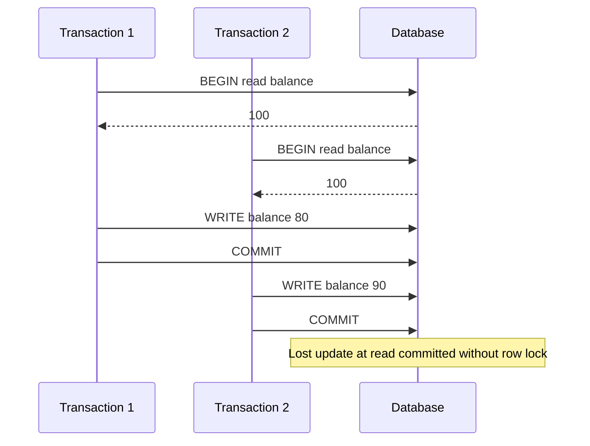

ACID is four promises a transactional store can make about a unit of work: atomicity, consistency, isolation, durability. Engineers quote the acronym as if every SQL database shipped serializable, crash-proof, constraint-checked transactions by default. That is not how the products are configured. Isolation is a slider. Durability is an fsync policy. Consistency in ACID is not the C in CAP. If you skip those distinctions, you will ship a money movement at read committed and call it "we use Postgres, so we are fine."

Atomicity means the transaction's writes all appear or none do. Consistency (the ACID one) means the transaction takes the database from one state that satisfies declared constraints to another: foreign keys, uniqueness, checks. Isolation means concurrent transactions do not surprise you — except they do, at every isolation level below serializable, in ways the SQL standard named. Durability means a committed transaction survives a crash, to the extent the WAL actually hit stable storage.

Isolation levels are where anomalies live. Read uncommitted can dirty-read. Read committed, the PostgreSQL default, avoids dirty reads and still allows non-repeatable reads, phantoms, and lost updates unless you lock or use `SELECT FOR UPDATE`. Repeatable read, the InnoDB default, still allows write skew under snapshot isolation. Serializable is supposed to make concurrent execution equivalent to some serial order; PostgreSQL implements that with serializable snapshot isolation (SSI) and can abort transactions that would violate it. MySQL's `SERIALIZABLE` is closer to locking. Do not pretend all SQL is serializable.

The practical skill is to name the invariant, pick the isolation and the locks that protect it, and test concurrent sessions. "We wrap it in a transaction" is not a design. A transaction at read committed that reads a balance, computes, and writes a new balance is a lost-update factory.

## Concept

### Atomicity: all or nothing

A transaction is a list of changes. Atomicity says a crash or an error in the middle does not leave a prefix applied. The implementation is undo (rollback logs, MVCC old versions) plus, on crash recovery, not applying incomplete transactions from the WAL. `COMMIT` is the point at which atomicity flips from "nothing" to "all." `ROLLBACK` is the explicit nothing.

Atomicity does not span two databases. A PostgreSQL transaction and a Redis `SET` are two systems. If you need both, you need an outbox, a two-phase protocol, or a decision that Redis may lag. Nested "transactions" in application code that catch an exception after the SQL commit and then try to undo in another statement are not atomicity. They are an apology.

Savepoints give partial rollback inside one transaction. They do not commit. Distributed sagas give a sequence of local transactions with compensating actions. Compensations are not atomicity; they are a business-level undo that can itself fail.

### Consistency: constraints, not CAP

ACID consistency is: declared rules still hold after commit. A foreign key still points at a row. A unique email stays unique. A check constraint still passes. The application is responsible for rules the database does not declare. If "account balance is the sum of ledger lines" is not a constraint or a single-row invariant you update atomically, the database will not enforce it.

This is not CAP consistency (linearizability of a single object across replicas). Mixing the two Cs in a design review produces sentences that mean nothing. You can have ACID constraints on a primary and still read a stale replica (replication lag). You can have linearizable writes in a consensus store with almost no relational constraints.

Triggers and application code that "keep things consistent" run inside the transaction or they do not. If they run after commit, they are another system. If they run inside and fail, atomicity should roll back the whole transaction. Check that they actually abort.

### Isolation: the slider and the anomalies

The SQL standard's levels are defined by which phenomena they forbid:

Dirty read: seeing another transaction's uncommitted write. Read committed forbids this.

Non-repeatable read: reading a row twice in one transaction and seeing a committed change in between. Repeatable read forbids this (in the standard's intent).

Phantom: a range query returning extra (or fewer) rows because another transaction inserted or deleted in the range. Serializable forbids this.

Lost update: two transactions read the same value, both write, the second clobbers the first. The standard's levels do not all prevent this; you need row locks, `UPDATE ... WHERE version =`, or serializable.

Write skew: each transaction reads a disjoint set, writes a disjoint set, both commits, the combined state violates an invariant neither saw as broken (two doctors going off call when at least one must remain). Snapshot isolation, including PostgreSQL repeatable read, allows write skew. SSI serializable in PostgreSQL is designed to detect it and abort.

PostgreSQL default: read committed. Each statement sees rows committed before that statement started. Two statements in one transaction can see different snapshots. InnoDB default: repeatable read, implemented with consistent snapshots plus next-key locks for some range operations. Both defaults are reasonable OLTP choices. Neither is "no anomalies."

`SELECT FOR UPDATE`, unique constraints, and `SERIALIZABLE` plus retry-on-serialization-failure are the tools. ORM defaults that open a transaction and never retry serialization errors will fail in production the first time SSI does its job.

### Durability: commit means fsync, except when it does not

Durability is the WAL (or equivalent) on stable storage before commit returns. PostgreSQL `fsync` and `synchronous_commit` control this. `synchronous_commit = off` is a latency win and a loss window on crash. MySQL `innodb_flush_log_at_trx_commit` of 2 or 0 similarly delays fsync. Replicas add another axis: synchronous replication can make commit wait for a replica; asynchronous replication means a failover can lose committed-from-the-client's-point-of-view transactions that had not shipped.

Batteries, cloud disks, and "the hypervisor said write-through" are part of durability. If the disk lies about fsync, ACID durability is a story. You rarely control that, but you control the database flags and the replica policy. Write them in the runbook next to RPO.

## Trade-offs

| Approach | When it wins | Cost / risk |
| -------- | ------------ | ----------- |
| Read committed (PostgreSQL default) | High concurrency OLTP; short statements; invariants protected by `UPDATE` or unique keys | Lost updates on read-modify-write; phantoms; two statements see different worlds |
| Repeatable read / snapshot | Stable snapshot for a report or a multi-statement read; InnoDB default | Write skew; long transactions hold bloat or locks; not serializable |
| Serializable (SSI or locking) plus retries | Invariants across rows (write skew); "as if serial" is actually required | Abort rate under contention; developers must retry; locking SERIALIZABLE can deadlock |

Pick the weakest isolation that still protects the invariant, then add locks or optimistic versions on the hot path. Raising the whole database to serializable is a valid policy for a low-contention ledger and a painful policy for a social feed. Durability similarly: money and passwords wait for fsync; telemetry counters may not. State the RPO. Do not leave `synchronous_commit` at a lab setting in production because it made a benchmark look good.

## Diagram

## Failure modes

### Lost update on read-modify-write

**Detection.** Two concurrent sessions read the same row, both write, the first commit's change disappears. Inventory oversell, double spend of a coupon, a counter that goes backward relative to events. Application logs show both transactions committed. Isolation is read committed. There is no version column and no `FOR UPDATE`.

**Mitigation.** `UPDATE ... SET n = n - 1 WHERE n > 0` so the write is atomic in one statement. Or `SELECT FOR UPDATE` the row before compute. Or a version column with `WHERE version = old` and retry. Or serializable with a retry loop. Tests must run concurrent sessions; a single-threaded test will never see this.

### Write skew under snapshot isolation

**Detection.** An invariant over two rows is violated, yet each transaction looked correct. Classic: on-call count must stay ≥ 1; two transactions each take a different person off call. Repeatable read / snapshot showed each "the other is still on." Both committed. No row-level unique constraint could fire because they wrote different rows.

**Mitigation.** PostgreSQL `SERIALIZABLE` and retry on serialization failure. Or lock a sentinel row that represents the invariant. Or put the invariant in one row (`on_call_count`) and update it atomically. Do not assume repeatable read is serializable because the names sound adjacent.

### Commit returned, data gone after crash or failover

**Detection.** Users received success, then a crash, power loss, or failover to a replica, and the row is missing. `synchronous_commit` was off, InnoDB flush setting was not 1, or the primary shipped asynchronously and the replica was promoted. RPO was never stated, so the incident has no threshold.

**Mitigation.** Set durable commit for the cluster that holds money, identity, and orders. Use synchronous replication if RPO is zero on failover, and accept the latency. For stores that can lose a second, say so. Practice failover and look for missing rows. Disks that ignore fsync are an infrastructure problem; database flags are yours.

### Long transaction destroys isolation's neighbors

**Detection.** Table bloat, replication lag, lock waits, or SSI abort storms. A transaction stayed open (idle in transaction, a report, a forgotten BEGIN in a request). In MVCC, old versions cannot die. In locking isolation, rows stay locked. Other sessions time out.

**Mitigation.** Keep transactions short. Do not hold a transaction open while calling a payment network. `idle_in_transaction_session_timeout`. Paginate reports outside a single snapshot if they run for minutes, or use a replica snapshot on purpose. Watch oldest transaction age as a pageable metric.

## Real-world example

PostgreSQL is the ACID engine many teams actually run, and its defaults are the lesson. The default isolation level is read committed, documented as such in the PostgreSQL manuals. Snapshot isolation appears when you ask for repeatable read. Serializable uses SSI: the system tracks dependencies among transactions and aborts those that could not have occurred in a serial order, including write-skew patterns snapshot isolation would commit. That abort is the feature. Application code that does not retry `40001` serialization failures will surface them as user-facing errors the first time contention hits the invariant.

Durability in the same product is `fsync` and `synchronous_commit`. Cloud providers' PostgreSQL offerings (Amazon RDS PostgreSQL, Cloud SQL, and others) expose these as parameters because operators turn them for latency. A commit that returns with `synchronous_commit = off` is atomic and isolated relative to other transactions that can see it, and it may still vanish on a crash. That is a documented trade-off, not an urban legend.

MySQL InnoDB is the other default you will inherit. Repeatable read is the default isolation. Next-key locking tries to close phantom gaps for some queries. Write skew and lost updates remain possible depending on the statement shape. `innodb_flush_log_at_trx_commit` is the durability slider. GitHub, Shopify, and many other large MySQL shops run InnoDB as the system of record; they still design statements and locks for the invariant, because the engine's default is not serializable magic.

SQLite, by contrast, often serializes writers with a database-level lock in its default journaling modes. Small applications feel "perfectly ACID" because concurrency is low. That feeling does not transfer to PostgreSQL under web traffic. When you move from SQLite to Postgres, you inherit concurrent writers and read committed. Re-test the money path with two clients before you celebrate the migration.

## What to remember

- Atomicity is all-or-nothing in one database; consistency is constraints; durability is fsync and replica policy; isolation is a slider.
- Isolation levels are where anomalies live: lost updates, phantoms, and write skew happen on real SQL defaults.
- PostgreSQL defaults to read committed; InnoDB defaults to repeatable read; neither is serializable without asking and retrying.
- Protect invariants with one-statement updates, row locks, versions, or SERIALIZABLE plus retries — not with the acronym on a slide.
